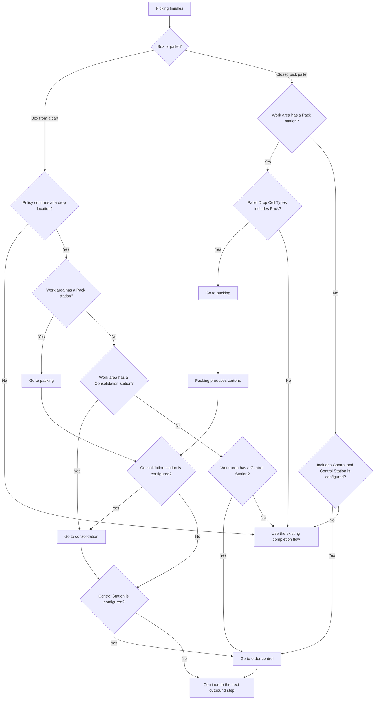

# Which settings send picked goods to a post-pick station

**What this shows.** How a work area and picking policy decide whether picked boxes and pallets go to packing, consolidation or order control.

## Settings in the diagram

| Setting | Where | Effect |
|---|---|---|
| **Completion** | Picking policy | A cart is routed to a post-pick station only when completion requires confirmation at the drop location. |
| **Pack station** | Work Area card | The location where this area's containers are packed. It must be a `Pack` location. |
| **Control Station** | Work Area card | The location where complete orders are checked. It must be a `Control` location. Empty means no order control for the area. |
| **Pallet Drop Cell Types** | Picking policy | A closed pallet can go to packing only when `Pack` is included, and to order control only when `Control` is included. |

## Rules to remember

- Every work area in one warehouse uses the same control station.
- If no work area names a control station, nothing is added to the current outbound flow.
- A box may go to control after packing or consolidation, or directly after picking when those steps are not used.
- A closed pick pallet can go directly from picking to control only when **Pallet Drop Cell Types** includes **Control station**. If the pallet goes to packing first, the cartons produced there follow the area's downstream station settings instead.
- The destination is chosen before the container moves. Changing the work area later does not redirect containers already sent to the old station.

## Related pages

- [Order control after picking](../../operator/11-order-control-after-picking.md)
- [Picking policy settings](../../admin/policies/21-picking-policy-settings.md)
- [Work areas, equipment and permissions](../../admin/policies/22-work-areas-equipment-and-permissions.md)
- [Location settings](../../admin/policies/03-location-settings.md)
- [Overview of this area](00-overview.md)
