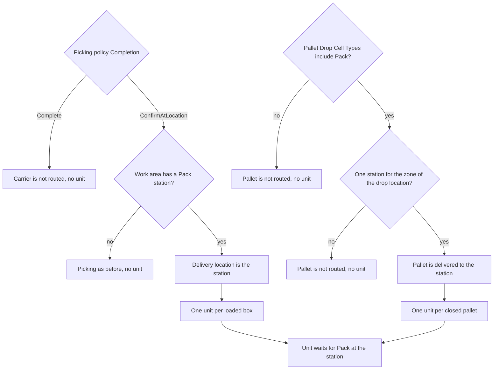

# Which settings send a unit to a pack station

**What this shows.** The settings that decide whether picked goods are delivered to a pack station and wait for packing.

There are two paths: a carrier (cart) with boxes, and a closed discrete pallet.

## How to read it

| Setting | Where | Effect |
|---|---|---|
| **Completion** | Picking policy | `Complete`: the cart is unloaded where it stands, never routed. `Confirm at the drop location`: the router is asked at start. |
| **Pack station** | Work area card (`pack_station_location`) | Must be a location of type `Pack`. Empty means no routing for that area. |
| **Pallet Drop Cell Types** | Picking policy for discrete pallets | Asked at the first deposit only if the list holds `Pack`. The list is read from the revision frozen on the pallet. |
| Zone of the drop location | Location's putaway zone and the work areas that list that zone | Exactly one distinct station must answer. Two different stations or none gives no routing. |

What you see: the station's queue (`packing_queue_list`, asked on RF screen `PACK00` and shown on `PACK01`) lists the unit with its box label and order number. A box or pallet that was not routed does not appear in any queue.

## Not built

Consolidation, staging and shipping are not routed. A unit that finishes `Pack` is `Completed`. See [00](00-overview.md).

## Where it comes from

| Claim | Source |
|---|---|
| Carrier path: ask only for `ConfirmAtLocation` | `crates/libs/wms-outbound/src/picking/commands/start.rs:205` |
| Station is read from the work area | `crates/libs/wms-lib-core/src/model/work_area.rs:253` |
| Pallet path: station via zone and areas, exactly one | `crates/libs/wms-lib-core/src/model/work_area.rs:298` |
| Only one distinct station counts | `crates/libs/wms-lib-core/src/model/work_area.rs:319` |
| Pallet asks the router only if `Pack` is in the list | `crates/libs/wms-outbound/src/picking/deposit/onto_pallet.rs:103` |
| Pallet destination is replaced by the station | `crates/libs/wms-outbound/src/picking/deposit/onto_pallet.rs:151` |
| Router uses the station if there is one | `crates/libs/wms-outbound/src/flow/resolve.rs:124` |
| Every unit of such an area is routed today | `crates/libs/wms-outbound/src/flow/route.rs:44` |
| Station must be a `Pack` location (trigger) | `crates/libs/wms-lib-sql/sql/wms-app/migrations/079_a_work_area_names_its_pack_station.sql:19` |
| `PickingCompletion` values | `crates/libs/wms-lib-core/src/model/outbound/picking_policy.rs:52` |

## Related pages

- [Picking policy settings](../../admin/policies/21-picking-policy-settings.md)
- [Work areas, equipment and permissions](../../admin/policies/22-work-areas-equipment-and-permissions.md)
- [Location settings](../../admin/policies/03-location-settings.md)
- [From picking to the pack station](20-flow-handoff-to-pack-station.md)
- [Overview of this area](00-overview.md)
