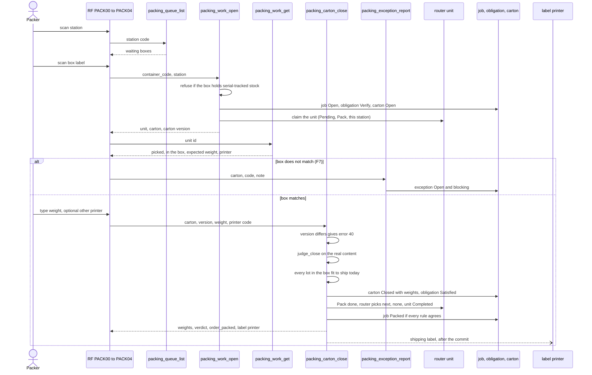

# Packing: verify a picked box

**What this shows.** The steps at a pack station for a box that came off a carrier: open, check, weigh, close, and report a mismatch. This is action `Verify`.

Verify moves no stock. The operator checks that the box holds what was picked into it, weighs it and closes it. A shipping label prints after the close.

## What `judge_close` checks on a package under verification

In this order. The first failure stops the close and nothing is written.

| Check | Error code |
|---|---|
| The carton is `Open` | `PACK_CARTON_NOT_OPEN` |
| No serial-tracked stock inside | `SERIAL_PACKING_NOT_SUPPORTED` |
| No stock of another order | `MULTI_ORDER_CARTON_NOT_SUPPORTED` |
| No stock that belongs to no order | `PACK_UNEXPECTED_ITEM` |
| The box is not empty | `PACK_CARTON_EMPTY` |
| Every picked item is there | `PACK_SOURCE_SHORT` |
| Nothing more than picked | `PACK_UNEXPECTED_ITEM` |
| A weight was typed | `PACK_WEIGHT_REQUIRED` |
| The weight is a number above 0 | `PACK_WEIGHT_INVALID` |
| Every lot in the box is fit to ship on the warehouse day | `LOT_NOT_FIT_TO_SHIP` |

The lot check runs last, only on a box all the checks above accepted. A lot is fit to ship when its expiration is later than today plus the SKU's shelf life (the minimum days left at shipping). A lot that expires today, is already expired, or expires on or before that date is not fit. A lot with no expiration date has nothing to judge and passes. The first unfit lot by lot code is named.

There is no weight tolerance. A box heavier or lighter than expected still closes. The verdict is `Recorded` when an expected weight exists, otherwise `NotComparable`.

## When the close is refused `LOT_NOT_FIT_TO_SHIP`

The refusal reads on the terminal as the phrase plus three values: the lot, its expiration date and the date it had to expire after. The answer's `context` carries the same values and the SKU and owner. Nothing is written: the box stays `Open`, the order stays unpacked, no label prints.

What the packer can do today, with the packing commands that exist:

1. Put the box aside and call a supervisor. The close will be refused again as long as that lot is in the box, whatever the weight.
2. The supervisor decides what happens to the lot with the stock tools (a hold, an adjustment, a move out of the pick flow). Packing never corrects stock.
3. `packing_exception_report` does not fit this case. It knows two codes, `PACK_SOURCE_SHORT` and `PACK_UNEXPECTED_ITEM`, and reporting one would block the order for a reason that is not true.
4. `packing_carton_void` does not help a box under verification either: it leaves the goods in the box, and the next `packing_work_open` makes a fresh package over the same box, refused again at the close.
5. `packing_remove` takes goods out of an **output carton** of a repack only: back onto the pallet while the pallet's obligation is open, or into another open carton of the order. That moves the unfit lot out of this carton, but the same lot is refused in any carton of the order, so the way back onto the pallet is the one that makes sense. A box under verification has no such command.

There is no command that settles this refusal. A supervisor-resolved exception for it is an owner decision and does not exist yet. Until it does, the route is manual.

## Rules in the diagram

- `packing_work_open` is a stateless command. Opening a box that is already open answers `already_open` and writes nothing.
- `packing_carton_close` is a stateful command on the carton version. A carton changed since the screen read it answers 40 with its current state.
- `packing_exception_report` records `PACK_SOURCE_SHORT` or `PACK_UNEXPECTED_ITEM`. No stock is corrected. The open exception keeps the order from being packed.
- A printer that fails never undoes the close. A replay of the close prints nothing.
- Void and reopen exist as commands, but no RF screen. See [32](32-packing-void-and-reopen.md).

## Where it comes from

| Claim | Source |
|---|---|
| Roles and the nine packing commands | `crates/services/app-server/src/web/rpcs/packing_rpc.rs:30` |
| Open is stateless, close is stateful on the carton | `crates/services/app-server/src/web/rpcs/packing_rpc.rs:147` |
| RF screens and their RPCs | `crates/libs/wms-lib-sql/sql/rf-screens/103_uc_pack_verify.sql:71` |
| Open refuses serial-tracked stock | `crates/libs/wms-outbound/src/packing/commands/work_open.rs:139` |
| Open finds or creates the job | `crates/libs/wms-outbound/src/packing/commands/work_open.rs:147` |
| Action follows the unit kind | `crates/libs/wms-outbound/src/packing/commands/work_open.rs:178` |
| Carton gets the plan weight | `crates/libs/wms-outbound/src/packing/commands/work_open.rs:192` |
| Open claims the unit | `crates/libs/wms-outbound/src/packing/commands/work_open.rs:219` |
| Version conflict on close | `crates/libs/wms-outbound/src/packing/commands/carton_close.rs:183` |
| The close judges the real content | `crates/libs/wms-outbound/src/packing/commands/carton_close.rs:217` |
| Close completes the `Pack` step | `crates/libs/wms-outbound/src/packing/commands/carton_close.rs:254` |
| Check list and codes | `crates/libs/wms-outbound/src/domain/packing_carton/aggregate.rs:208` |
| Weight verdict | `crates/libs/wms-outbound/src/domain/packing_carton/aggregate.rs:276` |
| The lot check runs after `judge_close` accepts the box | `crates/libs/wms-outbound/src/packing/commands/carton_close.rs:228` |
| A lot is fit to ship, the first unfit one is named | `crates/libs/wms-outbound/src/domain/packing_carton/aggregate.rs:157` |
| The refusal's words and context | `crates/libs/wms-outbound/src/packing/error.rs:544` |
| After a package closes the unit is `Completed` | `crates/libs/wms-lib-core/src/model/outbound/outbound_flow_unit.rs:273` |
| Label printed after the commit, detached | `crates/libs/wms-outbound/src/packing/commands/carton_close.rs:312` |
| The report is stateless and blocks packing | `crates/libs/wms-outbound/src/packing/commands/exception_report.rs:108` |

## Related pages

- [Packing, verify and repack (operator)](../../operator/10-packing-verify.md)
- [Packing: repack a pallet](31-packing-repack-journey.md)
- [When is an order packed](33-packing-influence-when-packed.md)
- [Weights, printer and station](34-packing-influence-weights-printer-station.md)
- [Overview of this area](00-overview.md)
