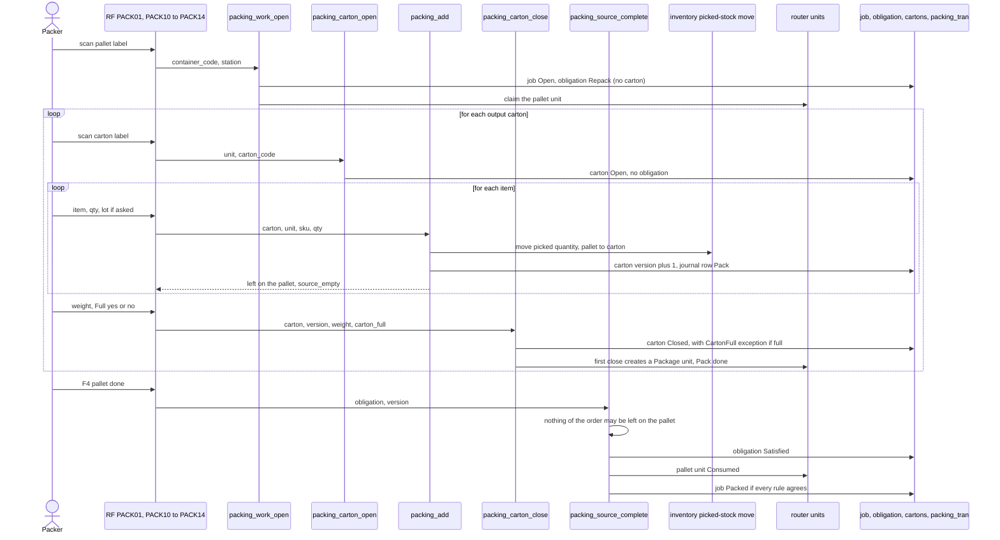

# Packing: repack a pallet into cartons

**What this shows.** The steps at a pack station for a discrete pick pallet: open output cartons, move picked goods in, close each carton, then complete the pallet. This is action `Repack`.

The action is not chosen by the operator. It follows what the unit is: a box off a carrier is `Verify`, a discrete pallet is `Repack`. It is frozen in the obligation when the work opens.

## Rules in the diagram

- Goods stay picked for their order. The move goes through inventory's door for picked stock, so no stock is created or lost.
- A carton is a planned carton of the order, or an empty registered container, standing at the station. It belongs to the job, not to one pallet.
- `packing_add` and `packing_remove` change the carton's version. A close that was decided on older content answers 40.
- `packing_remove` (RF `PACK13`) takes goods out of a carton, back onto the pallet while the source is open, or into another open carton of the job at any time.
- The pallet is completed only on the operator's command (`packing_source_complete`), never on the last unit moved. This is the point of no return: after it, nothing goes back onto the pallet (`PACK_SOURCE_CONSUMED`).
- A close judges only what is inside the output carton: not empty, one order, a weight above 0. There is no expected content to compare with.
- A first close of an output carton creates a router unit of its own (`Package`, `Pack` done). A reopen of the carton makes that unit wait for `Pack` again. A void of an empty carton that was closed and reopened marks that unit `Consumed`.
- `packing_source_complete` is a stateful command on the obligation version. The others in this diagram are stateless, except the close (stateful on the carton).

## Where it comes from

| Claim | Source |
|---|---|
| Action follows the unit kind | `crates/libs/wms-outbound/src/domain/packing_obligation/aggregate.rs:57` |
| Repack open makes an obligation and no carton | `crates/libs/wms-outbound/src/packing/commands/work_open.rs:178` |
| Next carton: rules of the carton to open | `crates/libs/wms-outbound/src/domain/packing_carton/aggregate.rs:344` |
| Carton open is stateless and needs a `Repack` obligation | `crates/libs/wms-outbound/src/packing/commands/carton_open.rs:1` |
| Add moves picked stock through inventory | `crates/libs/wms-outbound/src/packing/commands/add.rs:176` |
| Add needs an open source and an open output carton | `crates/libs/wms-outbound/src/packing/commands/add.rs:167` |
| Remove moves goods back or to another carton | `crates/libs/wms-outbound/src/packing/commands/remove.rs:238` |
| Remove is journalled `Unpack` | `crates/libs/wms-outbound/src/packing/commands/remove.rs:271` |
| First close of an output carton makes a `Package` unit | `crates/libs/wms-outbound/src/packing/commands/carton_close.rs:259` |
| `carton_full` records a non-blocking exception | `crates/libs/wms-outbound/src/packing/commands/carton_close.rs:282` |
| Complete source: nothing of the order may be left | `crates/libs/wms-outbound/src/packing/commands/source_complete.rs:14` |
| Complete source consumes the unit | `crates/libs/wms-outbound/src/domain/packing_obligation/aggregate.rs:121` |
| Complete source may pack the order | `crates/libs/wms-outbound/src/packing/commands/source_complete.rs:154` |
| Void of an output carton only when empty | `crates/libs/wms-outbound/src/domain/packing_carton/aggregate.rs:385` |
| RF screens `PACK10` to `PACK14` | `crates/libs/wms-lib-sql/sql/rf-screens/108_uc_pack_repack.sql:11` |
| Roles and classes of the commands | `crates/services/app-server/src/web/rpcs/packing_rpc.rs:30` |

## Related pages

- [Packing, verify and repack (operator)](../../operator/10-packing-verify.md)
- [Packing: verify a box](30-packing-verify-journey.md)
- [When is an order packed](33-packing-influence-when-packed.md)
- [Overview of this area](00-overview.md)
