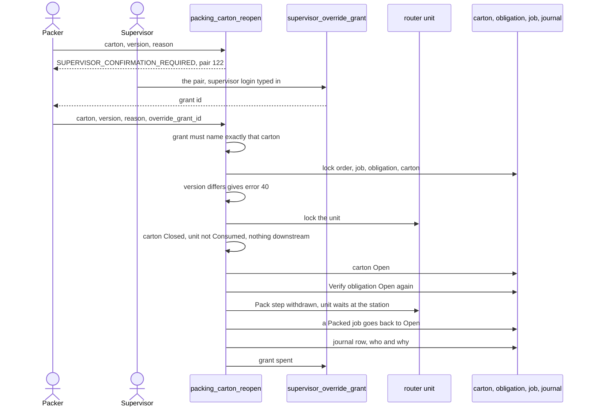
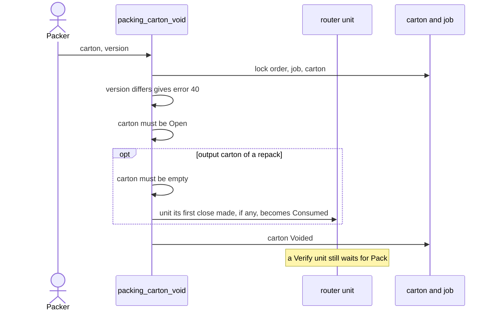

# Packing: void a package, reopen a closed one

**What this shows.** The two ways to undo packing work: void an open package, or reopen a closed one with a supervisor's grant.

Both commands exist in the API. There is no RF screen for either.

## Reopen a closed package

Rules:

- A reopen without a grant is refused. The answer names the one pair the grant must carry: code 122, subject `packing_carton:<id>`.
- A carton that is not `Closed` answers `PACK_CARTON_NOT_CLOSED` before any grant is asked for.
- A unit that is `Consumed` (its goods went into other packages) answers `PACKAGE_DOWNSTREAM_COMMITTED`. No later step exists yet, so the downstream guard always answers "not committed".
- An output carton of a repack has no obligation. Its source's obligation stays as it is. The unit its first close made waits for `Pack` again.
- A grant opens one carton once.

## Void an open package

Rules:

- A void moves no stock. The obligation stays `Open`.
- For a package under verification, the next `packing_work_open` makes a fresh package over the same box.
- An output carton with picked goods inside cannot be voided: `packing_remove` takes the goods out first (`PACK_CARTON_CONTAINER_NOT_EMPTY`).

## Where it comes from

| Claim | Source |
|---|---|
| Both are stateful commands on the carton version | `crates/services/app-server/src/web/rpcs/packing_rpc.rs:165` |
| Reopen without a grant is refused with the pair | `crates/libs/wms-outbound/src/packing/commands/carton_reopen.rs:10` |
| Grant must name that one pair | `crates/libs/wms-outbound/src/packing/commands/carton_reopen.rs:172` |
| Reopen steps and locks | `crates/libs/wms-outbound/src/packing/commands/carton_reopen.rs:32` |
| What a reopen decides | `crates/libs/wms-outbound/src/domain/packing_carton/aggregate.rs:439` |
| Verify obligation goes back to `Open` | `crates/libs/wms-outbound/src/domain/packing_obligation/aggregate.rs:108` |
| Router step withdrawn | `crates/libs/wms-outbound/src/packing/commands/carton_reopen.rs:234` |
| No step exists after packing yet | `crates/libs/wms-outbound/src/flow/ports.rs:87` |
| Pair code 122 | `crates/libs/wms-shared/src/validation_codes.rs:683` |
| Mint a grant | `crates/services/app-server/src/web/rpcs/override_grant_rpc.rs:103` |
| Void steps and locks | `crates/libs/wms-outbound/src/packing/commands/carton_void.rs:118` |
| Output carton voided only empty | `crates/libs/wms-outbound/src/domain/packing_carton/aggregate.rs:385` |
| Void and reopen have no RF screen | `crates/libs/wms-lib-sql/sql/rf-screens/103_uc_pack_verify.sql:32` |

## Related pages

- [Packing: verify a box](30-packing-verify-journey.md)
- [Packing: repack a pallet](31-packing-repack-journey.md)
- [Packing (operator)](../../operator/10-packing-verify.md)
- [Overview of this area](00-overview.md)
