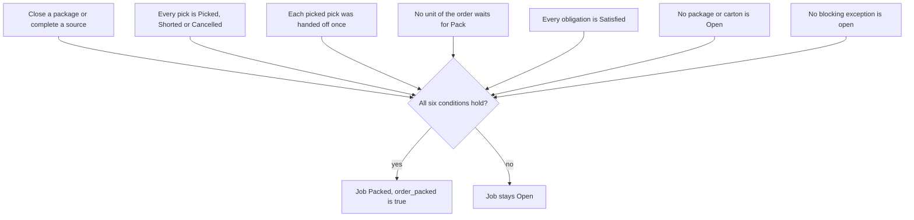

# Packing: when the order's packing job is `Packed`

**What this shows.** The six conditions that must all hold before the packing job of an order becomes `Packed`, and what removes each one.

The rule is asked after every step that can finish the job: a package closes (`packing_carton_close`) and a repack source is completed (`packing_source_complete`). If any condition fails, nothing is written. The job stays `Open`.

## What removes each condition

| Condition | What clears it |
|---|---|
| Every pick is terminal | Picking ends: the pick is picked, shorted or cancelled. |
| Each picked pick handed off once | The carrier is delivered or the pallet is closed at a routed location. See [20](20-flow-handoff-to-pack-station.md). |
| No unit waits for `Pack` | The unit is closed (Verify) or consumed (Repack source complete). |
| Every obligation `Satisfied` | `Verify`: the package is closed. `Repack`: `packing_source_complete`. |
| No `Open` carton | Close or void it. |
| No blocking exception | Not built: no command sets a packing exception to `Resolved`. |

## What you see

- The close and complete answers carry `order_packed` and the job status.
- The RF screen adds "Order packed" to its message.
- The order's own status does not change. The order statuses have no "packed" value, so `Picked` stays `Picked`.
- A packed job refuses new work: `PACK_JOB_PACKED`. A reopen with a supervisor's grant takes it back to `Open`.

## Not confirmed by code

- Which user role or screen resolves a reported packing discrepancy. The exception has status `Open` or `Resolved`, but nothing in `crates/` writes `Resolved`. To verify: ask the owner how a reported discrepancy is cleared today.
- There is no packing policy. A job is created with `policy_id` empty, an empty policy snapshot and release mode `PerUnit`, always.

## Where it comes from

| Claim | Source |
|---|---|
| Six conditions | `crates/libs/wms-outbound/src/domain/packing_job/aggregate.rs:84` |
| Facts gathered and job marked `Packed` | `crates/libs/wms-outbound/src/packing/commands/readiness.rs:24` |
| Packed on a yes | `crates/libs/wms-outbound/src/packing/commands/readiness.rs:61` |
| Asked after a close | `crates/libs/wms-outbound/src/packing/commands/carton_close.rs:40` |
| Asked after a source is completed | `crates/libs/wms-outbound/src/packing/commands/source_complete.rs:154` |
| Only open and blocking exceptions count | `crates/libs/wms-outbound/src/domain/packing_job/postgres_repository.rs:58` |
| Exception statuses (`Open`, `Resolved`) | `crates/libs/wms-lib-core/src/model/outbound/packing_exception.rs:35` |
| Picks and their hand-off count | `crates/libs/wms-lib-core/src/model/outbound/packing_job.rs:216` |
| No policy and `PerUnit` on a new job | `crates/libs/wms-outbound/src/packing/commands/work_open.rs:159` |
| Order statuses have no "packed" | `crates/libs/wms-lib-core/src/model/outbound/shipment_order.rs:46` |
| Packed job refuses new work | `crates/libs/wms-outbound/src/packing/commands/work_open.rs:147` |

## Related pages

- [Packing: verify a box](30-packing-verify-journey.md)
- [Packing: repack a pallet](31-packing-repack-journey.md)
- [Order statuses and transitions](../../reference/outbound/90-order-statuses-and-transitions.md)
- [Overview of this area](00-overview.md)
