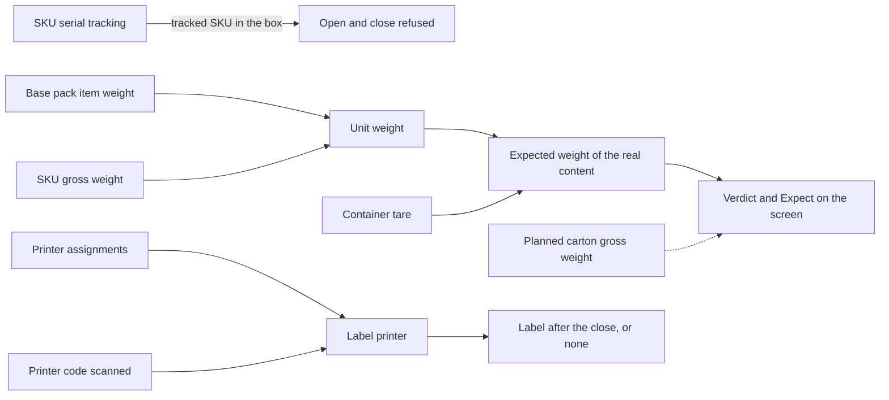

# Packing: which settings change what the packer sees

**What this shows.** The master data and settings that packing reads, the decision each one changes, and what shows on the pack station screens.

Packing has no policy of its own. These are the only inputs the code reads.

## How to read it

| Input | Where you set it | Decision it changes | What you see |
|---|---|---|---|
| Serial tracking on | SKU, Serial Tracking tab (`Continuous serial tracking`) | A box or carton that holds such a SKU cannot be opened or closed for packing. | Error `SERIAL_PACKING_NOT_SUPPORTED`. |
| Pack item weight, SKU **Gross Weight** | Pack card (base item), SKU Weight tab | The weight of one unit is the base pack item weight if above 0, else the SKU gross weight, else unknown. | With any unknown unit weight the verdict is `NotComparable` and `Expect` may be empty. |
| Container tare | Copied from the policy carton when the plan made the container | Expected weight = sum of unit weight times quantity, plus tare. | `Expect` on `PACK03`. Containers that exist keep their old tare. |
| Planned carton gross | Cartonization plan | Shown as `Expect` only when no expected weight of the real content exists. Nothing compares it with the measured weight. | `Expect` on `PACK03`. |
| Printer assignments | System settings, printer assignments | The label printer is the first active assignment in this order: zone of the station, user, owner, warehouse. | `Printer` line on `PACK02` and `PACK03`. |
| Printer code scanned | Operator, field "Other printer" | Replaces the station printer. A code with no active printer is refused before anything is written (`PACK_PRINTER_UNKNOWN`). | `label_printer` in the close answer. |

Fixed rules, not settings:

- The measured weight must be above 0. A missing weight is `PACK_WEIGHT_REQUIRED`, a bad one is `PACK_WEIGHT_INVALID`.
- There is no weight tolerance. The weight is recorded, never enforced. The verdict is only `Recorded` or `NotComparable`.
- A live Catch Weight flag on any level of the SKU's active pack makes the
  execution weight `NotComparable`; packing then relies on the measured box
  weight instead of a nominal quantity × unit-weight calculation.

## Stored only. It has no effect today.

- `packing_job.policy_id` and `policy_snapshot`: always empty. There is no packing policy.
- `packing_job.release_mode`: always `PerUnit`.
- `packing_carton.plan_expected_weight`: shown, never compared.
## Related pages

- [Printing and labels](../../admin/07-printing-and-labels.md)
- [Serial configuration](../../admin/policies/33-serial-configuration.md)
- [SKU-level settings](../../admin/policies/34-sku-level-settings.md)
- [Cartonization: how it works](../../admin/policies/30-cartonization-overview.md)
- [Packing: verify a box](30-packing-verify-journey.md)
- [Overview of this area](00-overview.md)
