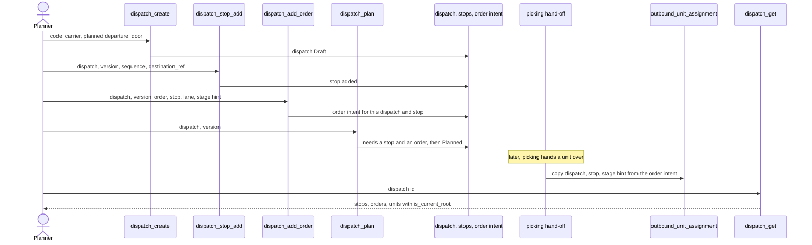
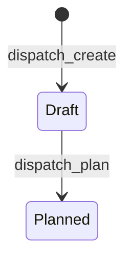

# Dispatch: plan a trip with stops and orders

**What this shows.** How a planner builds a dispatch (a planned trip), and how a unit picked later picks up that plan.

A dispatch is a plan only. It loads nothing, stages nothing and ships nothing. All of it is API only: there is no screen and no RF flow for dispatch.

## Status of a dispatch

`Cancelled` is a value of the status type, but no command sets it. Stops and orders can be added, changed and removed only while the dispatch is `Draft`.

## Rules in the diagrams

- `dispatch_create` is stateless. The other commands are stateful on the dispatch version (`expected_dispatch_version`). Roles: Admin, Manager, Supervisor.
- The carrier must be an owner of type transporter. The door must be a location of type `Door`. The stage hint must be a location of type `Stage`.
- An order that is cancelled or closed cannot be added. An order can be in one active dispatch only. The stop must belong to the dispatch.
- The copy to a unit happens once, when picking hands the unit over, and only for a unit whose container has no parent. A change of the order intent later does not rewrite a unit's assignment.
- A unit made by a repack close (`Package`) gets no assignment, because the copy runs only in the hand-off.
- Assign the order to a dispatch before picking completes. A unit handed over earlier has no dispatch.

## Stored only. It has no effect today.

- `door_location_id`, `lane_ref`, `preferred_stage_location_id`, `external_ref`, `planned_departure_at`. The code checks their type or length when you save and `dispatch_get` returns them. Nothing in `crates/` reads them to decide anything.
- `Planned`: no later step (staging, load plan, loading) reads a planned dispatch.

## Where it comes from

| Claim | Source |
|---|---|
| Methods, roles, classes | `crates/services/app-server/src/web/rpcs/dispatch_rpc.rs:18` |
| Versioned on the dispatch | `crates/services/app-server/src/web/rpcs/dispatch_rpc.rs:91` |
| Create checks carrier and door type | `crates/libs/wms-outbound/src/service/dispatch/create.rs:73` |
| Assign checks stage type and writes the intent | `crates/libs/wms-outbound/src/service/dispatch/assign_order.rs:58` |
| Stage hint must be `Stage` | `crates/libs/wms-outbound/src/service/dispatch/assign_order.rs:67` |
| Rules for assign: draft, order, stop, one active dispatch | `crates/libs/wms-outbound/src/domain/dispatch/aggregate.rs:165` |
| Draft only | `crates/libs/wms-outbound/src/domain/dispatch/aggregate.rs:213` |
| Plan needs a stop and an order | `crates/libs/wms-outbound/src/domain/dispatch/aggregate.rs:126` |
| Plan sets `Planned` | `crates/libs/wms-lib-core/src/model/outbound/dispatch.rs:221` |
| Status values | `crates/libs/wms-lib-core/src/model/outbound/dispatch.rs:18` |
| The copy runs in the hand-off | `crates/libs/wms-outbound/src/flow/hand_off.rs:63` |
| What the copy selects | `crates/libs/wms-lib-core/src/model/outbound/outbound_unit_assignment.rs:60` |
| Current root rule | `crates/libs/wms-outbound/src/domain/outbound_unit_assignment/aggregate.rs:13` |
| What `dispatch_get` returns | `crates/libs/wms-outbound/src/service/dispatch/get.rs:15` |
| Door and stage are stored by create and assign | `crates/libs/wms-outbound/src/domain/dispatch/postgres_repository.rs:34` |

## Related pages

- [From picking to the pack station](20-flow-handoff-to-pack-station.md)
- [Location settings](../../admin/policies/03-location-settings.md)
- [Overview of this area](00-overview.md)
