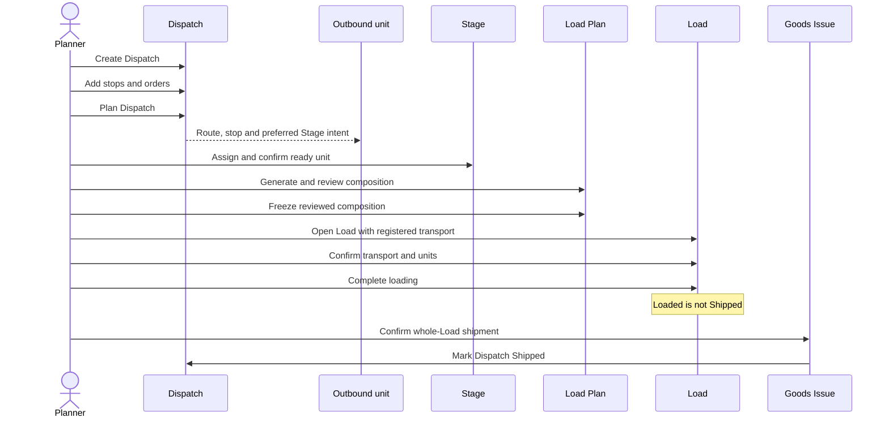
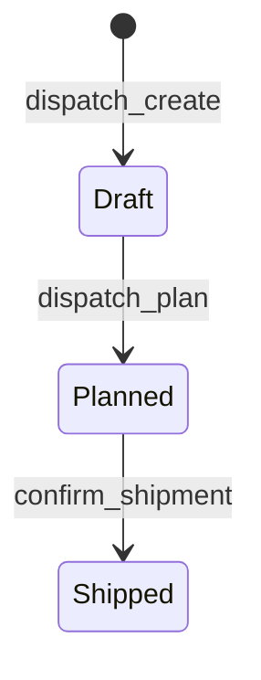

# Dispatch: plan stops, units and departure

**What this shows.** How a planner creates a Dispatch, how its order intent reaches physical units, and how the Dispatch becomes `Shipped` only through whole-Load Goods Issue.

A Dispatch is available in `Sidebar > Outbound > Dispatches` and through the `dispatch_*` API methods. Planning itself moves no stock. The planned stops and orders become input to staging and a reviewed Load Plan.

## Status of a Dispatch

`Cancelled` remains a value of the status type, but there is no ordinary Dispatch-cancel command in the current API. Stops and orders can be changed only while the Dispatch is `Draft`.

## Web workflow

1. Open `Sidebar > Outbound > Dispatches` and click `New Dispatch`.
2. Enter the Dispatch reference and optional external reference, carrier and `Door`; click `Create`.
3. Open the Dispatch. Add each delivery stop before assigning an order to it.
4. Add unreleased or released active orders. An order can belong to only one active Dispatch.
5. Review the `Stops` and `Orders` lists, then click `Plan Dispatch`.
6. Continue in `Outbound > Load Plans`: create a plan for the planned Dispatch, generate its stop order, review its complete unit set and freeze it.

The API sequence is `dispatch_create` -> `dispatch_stop_add` -> `dispatch_add_order` -> `dispatch_plan`. Every mutation after create uses the current `expected_dispatch_version`.

## What the plan controls later

- A stop supplies delivery grouping and ordering to the Load Plan.
- The order's Dispatch and stop intent is copied to a physical outbound unit at hand-off. Existing ready units can be explicitly aligned through the outbound-unit assignment commands after review.
- `Preferred stage` is carried with the order/unit intent and is used by controlled staging and transfer decisions.
- A frozen Load Plan records the exact reviewed units and their versions. It is not permission to load or ship.
- `confirm_shipment` marks the Dispatch `Shipped` only after every required unit is loaded and the complete Load passes Goods Issue checks.

## What the plan does not prove

- `Planned` does not mean staged, loaded or shipped.
- A Dispatch order row is intent; the actual unit membership is reviewed in the Load Plan.
- A unit scan is not a physical-loading confirmation.
- `Loaded` does not deduct warehouse stock.
- `external_ref`, lane and planned times are useful planning/integration metadata; they are not shipment receipts.

## Rules

- Roles: `ADMIN`, `MANAGER`, `SUPERVISOR` for planning; `OPERATOR` can execute loading and shipment after the Load exists.
- The carrier, when present, must be a transporter. `Door` must name a `Door` location; `Preferred stage` must name a `Stage` location.
- A cancelled or closed order cannot be added. The chosen stop must belong to the same Dispatch.
- Review current versions after every mutation. A version conflict means another user changed the plan; refresh and decide again.

## Where it comes from

| Claim | Source |
|---|---|
| Dispatch create, stop, order and plan commands | `crates/libs/wms-outbound/src/service/dispatch/` |
| Dispatch lifecycle rules | `crates/libs/wms-outbound/src/domain/dispatch/aggregate.rs` |
| Unit intent and controlled reassignment | `crates/libs/wms-outbound/src/service/outbound_unit_assignment/` |
| Staging assignment and confirmation | `crates/libs/wms-outbound/src/service/staging/` |
| Load Plan generation and freeze | `crates/libs/wms-outbound/src/service/load_plan/` |
| Whole-Load Goods Issue | `crates/libs/wms-outbound/src/service/load/ship.rs` |
| Web Dispatch screens | `crates/libs/wms-lib-sql/sql/wms-meta-ui/migrations/20261015141436_dispatch_planning_screens.sql` |

## Related pages

- [Outbound Setup](../../admin/06-outbound-setup.md#10-dispatch-loading-and-goods-issue)
- [After picking overview](00-overview.md)
- [Order closure](50-order-closure.md)
