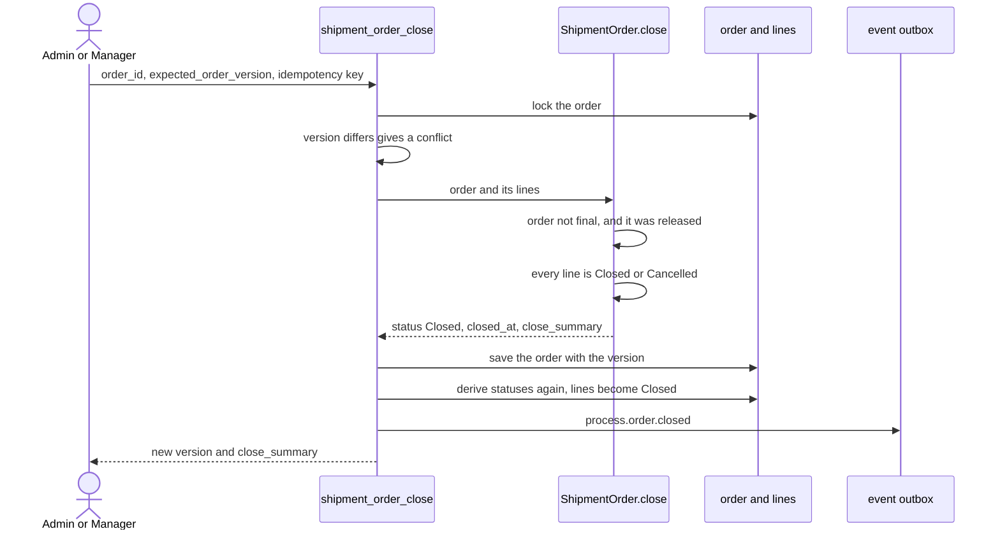

# Order closure

**What this shows.** What `shipment_order_close` checks and writes, and why today it closes only an order whose lines were all cancelled.

There is no Close button. Closing is an API method for Admin and Manager.

## Why only cancelled orders close today

A line is `Cancelled` when ordered minus cancelled minus shipped is zero. In practice that comes from cancelling quantity with `Cancel Qty`. Nothing in the code writes `qty_shipped`: the shipping area is a placeholder. So the way to a closed order is to cancel every line, not to ship it. After the close, every line reads `Closed`.

`close_summary` holds the number of lines, the ordered, cancelled and shipped quantities, and the user who closed.

Packing does not change this. A packed job does not change the order status, and `Picked` stays `Picked` after packing.

## Where it comes from

| Claim | Source |
|---|---|
| Close is a stateful command for Admin and Manager | `crates/services/app-server/src/web/rpcs/shipment_order_commands_rpc.rs:52` |
| Versioned on the order | `crates/services/app-server/src/web/rpcs/shipment_order_commands_rpc.rs:158` |
| The command locks, closes and saves | `crates/libs/wms-outbound/src/service/order/close.rs:81` |
| Rule: not final, released, every line terminal | `crates/libs/wms-outbound/src/domain/shipment_order/aggregate.rs:246` |
| Lines still open refuse the close | `crates/libs/wms-outbound/src/domain/shipment_order/aggregate.rs:256` |
| Every line reads `Closed` after the close | `crates/libs/wms-outbound/src/domain/shipment_order/status_derive.rs:51` |
| `Cancelled` when nothing is left to ship | `crates/libs/wms-outbound/src/domain/shipment_order/status_derive.rs:54` |
| Nothing writes `qty_shipped` | `crates/libs/wms-lib-core/src/model/outbound/shipment_order_line.rs:154` |
| Event name | `crates/libs/wms-lib-core/src/model/integration/event_payloads/order.rs:107` |
| Shipping area is a placeholder | `crates/libs/wms-outbound/src/shipping/README.md:3` |

## Related pages

- [Order statuses and transitions](../../reference/outbound/90-order-statuses-and-transitions.md)
- [Who can do what](../../reference/outbound/91-who-can-do-what.md)
- [Overview of this area](00-overview.md)
