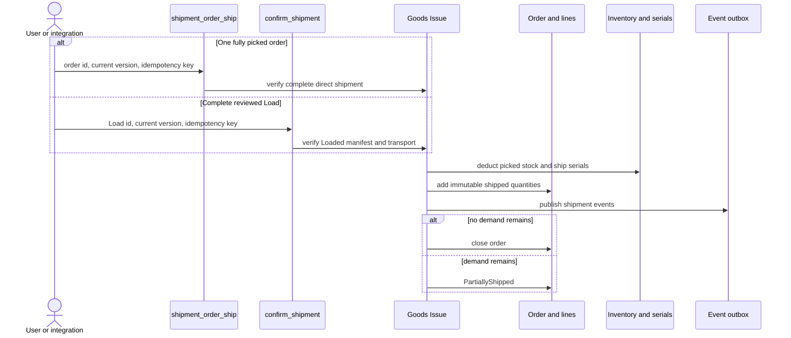

# Goods Issue and order closure

**What this shows.** How shipped quantities reach an order and when the order closes.

There are two Goods Issue paths. `shipment_order_ship` ships one fully picked order. `confirm_shipment` ships every order represented by a complete reviewed Load. Both are irreversible, idempotent business commands that update stock, serials, shipment history and order counters atomically.

## Direct order shipment

Use `Ship order` in the order card, or call `shipment_order_ship`, only when no line has already been partly shipped and every line's effective demand (ordered minus cancelled) is fully allocated and picked. Every pick pallet must first be placed at its destination. An open pallet still in transit has not been handed off and its stock is excluded from direct shipment. The physical content must belong only to that order. The command is refused when the order belongs to an active Load, shares a physical root with another order, has incomplete work or follows an earlier partial Goods Issue; use the Load path for that follow-up shipment.

The result includes `goods_issue_id`, shipped quantities, journal ids, serial ids, the new order version and whether the order closed.

## Whole-Load shipment

Use `confirm_shipment` only after the Load is `Loaded`, its transport is confirmed, every required unit is loaded and the immutable content checks still match. One transaction:

- records a Goods Issue for each represented order;
- deducts picked inventory and advances serials;
- updates order and line shipped quantities;
- marks the Load and Dispatch `Shipped`;
- writes the shipment outbox events.

A Load can contain only part of an order. That Goods Issue is valid: the line or order becomes `PartiallyShipped` while remaining demand stays open for a later departure.

## The separate close command

`shipment_order_close` remains an administrative lifecycle command for `ADMIN` and `MANAGER`. It has no ordinary `Close` button. It requires a released order whose every line is terminal: fully shipped, fully cancelled, or a permitted mixture of shipped and cancelled quantity.

Normal complete-order Goods Issue closes automatically, so integrations do not call `shipment_order_close` after `shipment_order_ship`. Use the separate command only when the lifecycle genuinely needs closing after all line quantities are already accounted for.

`close_summary` records line count, ordered, cancelled and shipped quantities, and the user who closed the order.
## Related pages

- [Outbound Setup](../../admin/06-outbound-setup.md#10-dispatch-loading-and-goods-issue)
- [Order statuses and transitions](../../reference/outbound/90-order-statuses-and-transitions.md)
- [Who can do what](../../reference/outbound/91-who-can-do-what.md)
- [After picking overview](00-overview.md)
