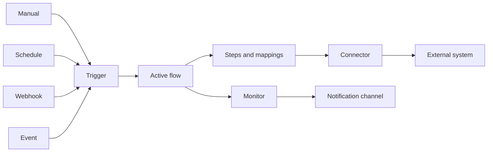
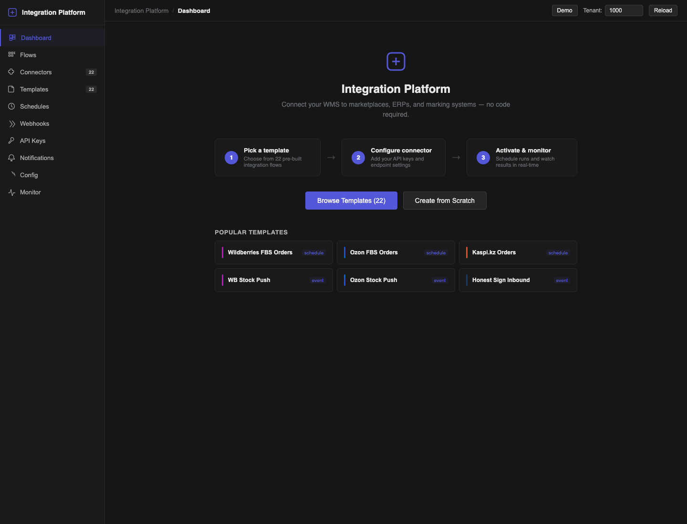

# Integration Platform

Quark Integration Platform connects Quark WMS to marketplaces, ERP systems, product-marking services and other HTTP-based systems. You assemble a **flow** from reusable steps, connect it to external systems, choose how it starts and watch every run from one place.

Use this guide if you configure or support integrations. You do not need to change WMS code to create a flow.

## Choose a task

| Task | Guide |
| --- | --- |
| Start a working integration from a template | [Quickstart](01-quickstart.md) |
| Connect an external system and store its credentials | [Connectors and API keys](02-connectors-and-api-keys.md) |
| Create, edit, validate and activate a flow | [Templates and Flow Builder](03-templates-and-flow-builder.md) |
| Start a flow manually, on a schedule, from a webhook or from an event | [Triggers, schedules and webhooks](04-triggers-schedules-and-webhooks.md) |
| Investigate a failure, retry a run and configure alerts | [Monitoring and notifications](05-monitoring-and-notifications.md) |
| Set shared values and prepare access to the platform | [Configuration, access and API](06-configuration-access-and-api.md) |

## How the parts fit together

- A **template** is a starting design. Using it creates your own editable draft flow.
- A **connector** holds the address, transport and authentication method for one external system.
- An **API key** holds sensitive connector or notification credentials.
- A **flow** defines the steps, mappings, conditions and error behaviour.
- A **trigger** decides when the flow starts.
- A **run** is one execution of an active flow. Its step-by-step result is available in **Monitor**.

## Main menu

| Page | Use it for |
| --- | --- |
| **Dashboard** | Current run totals, failures, schedules and connector health. |
| **Flows** | Create, import, activate, pause, run or delete flows. |
| **Connectors** | Create connections, enter credentials and test access. |
| **Templates** | Start from a supported integration pattern. |
| **Schedules** | Run a flow from a cron expression and timezone. |
| **Webhooks** | Give an external system a URL that starts a flow. |
| **API Keys** | Store and revoke encrypted credentials. |
| **Notifications** | Send flow and schedule alerts to a team channel. |
| **Config** | Maintain system defaults and tenant overrides used by flows. |
| **Monitor** | Inspect run and step results, then retry failed runs. |

*Caption: the Integration Platform welcome page. Focus: Browse Templates starts the recommended setup path; Create from Scratch opens an empty flow.*

## Safe working pattern

1. Build and test in a non-production tenant.
2. Prefer **Templates** when a suitable template exists.
3. Store secrets in **API Keys** and never paste them into a flow mapping or log message.
4. Keep the flow in **draft** or **paused** status while you edit it.
5. Use **Validate flow**, then **Save snapshot** before activation.
6. Run a controlled test and inspect **Monitor** before connecting a production trigger.
7. Configure a failure notification for every production flow.

An active flow is protected from editing. Pause it first, make the change, validate it and activate it again. This prevents a run from seeing a half-finished design.
