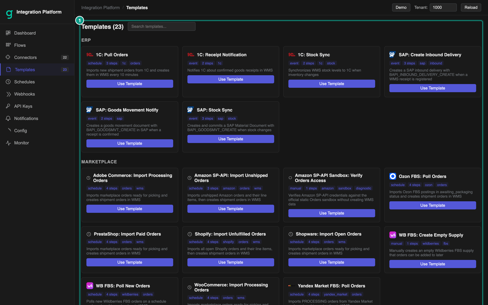
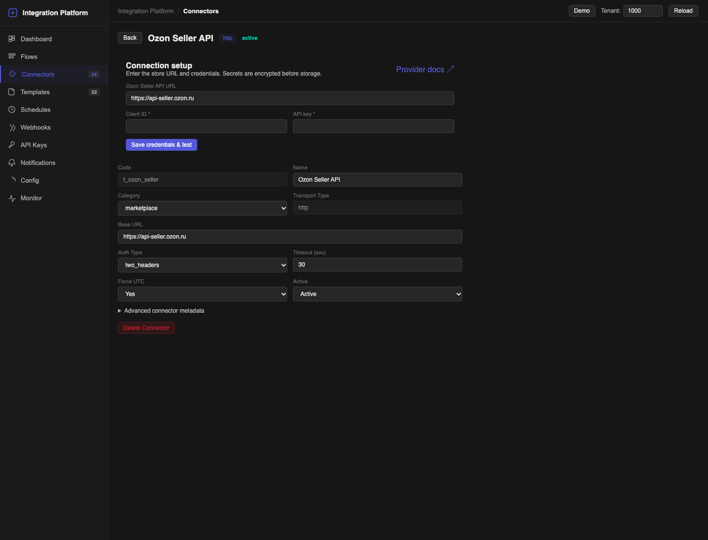
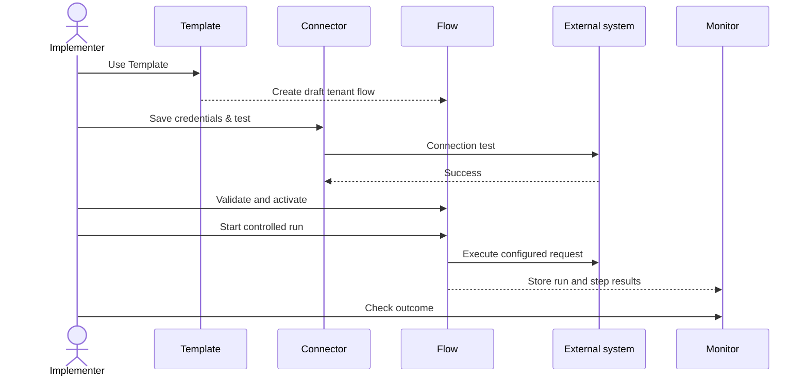

# Quickstart

The fastest safe route is to fork a flow template, create the recommended connector, enter credentials, activate the flow and watch its first run.

## Before you start

Have these items ready:

- access to the correct Integration Platform tenant;
- the external system's base URL and credentials;
- the Quark WMS goods owner ID used by this integration, when the template asks for it;
- the marketplace ship-to ID for an order-import template, when requested;
- one harmless test record that you can identify in both systems.

Do not use production credentials in a shared test tenant.

## 1. Pick a template

1. Open **Templates**. If the tenant has no flows, you can also select **Browse Templates** on **Dashboard**.
2. Search by marketplace, ERP or task.
3. On the matching template card, select **Use Template**.
4. If **Fork & Map** opens, review the connector selection:
   - choose an existing connector only if it was created from the recommended connector template for the same environment;
   - otherwise select the option to create the recommended connector.
5. Complete any setup fields shown by **Fork & Map**, such as **WMS goods owner ID** or **Marketplace ship-to ID**.
6. Select **Fork & Map**. If the template needs no mapping or setup fields, **Use Template** forks it immediately.

*Caption: the Templates page. Focus: choose a template that matches the direction of data and the external system.*

### Expected result

The platform creates a tenant-owned flow in **draft** status. It copies the template name and generates a unique code. It also creates the recommended tenant connector when you chose that option. The draft is safe to review before activation.

### If the connector cannot be matched

Do not attach a similarly named connector just to continue. Cancel **Fork & Map**, open **Connectors**, create or clone the correct connector, test it, and then return to **Templates**.

## 2. Configure and test the connector

1. Open **Connectors** and select the connector created for the flow.
2. In **Connection setup**, enter the external system's base URL and required credentials.
3. Select **Save credentials & test**.
4. Wait for the result.

*Caption: connector setup. Focus: Save credentials & test verifies the address and credentials before the flow is activated.*

### Expected result

You see **Credentials saved and connection verified.** The credential is stored for the connector and the test confirms that the remote endpoint can be reached with it.

### If the test fails

Check the base URL, environment, credential value and any provider-specific account identifier. Confirm that the remote service allows requests from this environment. Keep the flow in **draft** or **paused** status until the connector test passes.

## 3. Review the flow

1. Open **Flows** and find the new flow.
2. Select **Builder**.
3. Check the trigger, connector and any owner, ship-to or other setup values.
4. For a schedule-triggered flow, keep the flow in **draft**, create an active schedule whose next occurrence is far enough in the future to finish validation and activation, then return to **Builder**. Schedule validation requires an active schedule, but the scheduler does not run it while the flow is inactive.
5. Select **Validate flow**.
6. Resolve every error. Review warnings before continuing.
7. Select **Save snapshot**.

Leave a scheduled, webhook or event flow in **draft** status until its trigger is configured and under your control.

## 4. Run a controlled test

The trigger determines the activation sequence:

- **Manual**: activate the flow, then select **Run**.
- **Schedule**: leave the schedule active, activate the validated flow before the planned occurrence, and watch that occurrence in **Monitor**. Pause the schedule after the controlled run if you are not ready for continuous execution.
- **Webhook**: while the flow is still inactive, create and review the webhook. Disable it until the provider is ready, activate the flow, enable the webhook and send one signed or authenticated test request.
- **Event**: connect the event route while the flow is inactive. Activate the flow only when you are ready to send or produce one matching event.

Activation validates the flow again and saves an activation snapshot. If validation fails, the flow stays **draft** or **paused**.

Open **Monitor**, select the new run and inspect every step.

### A successful first run

- The run status is **success**.
- Every required step completed.
- The expected test record appears in the destination system.
- Repeating or retrying the test does not create an unwanted duplicate.

Only after these checks should you enable the production schedule, webhook or event source.

## Start from scratch

Use **Create from Scratch** only when no template matches the workflow.

1. Create and test every connector first.
2. On **Flows**, select **+ New**.
3. Enter **Code**, **Name**, **Trigger** and an optional **Description**.
4. Open **Builder** and add the steps.
5. Follow the same validate, snapshot, activate and monitor sequence described above.

See [Templates and Flow Builder](03-templates-and-flow-builder.md) for step configuration and mappings.
