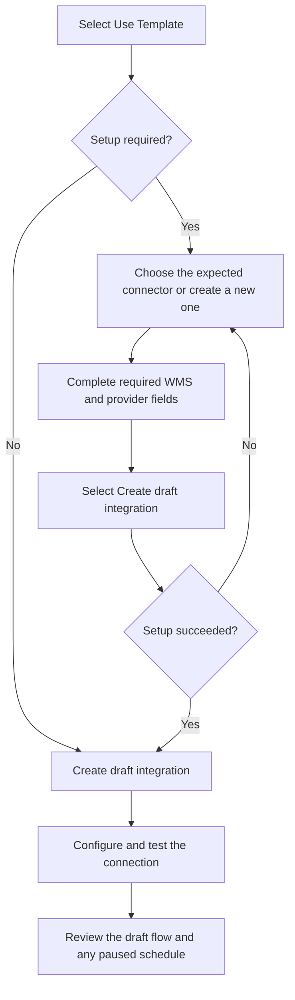
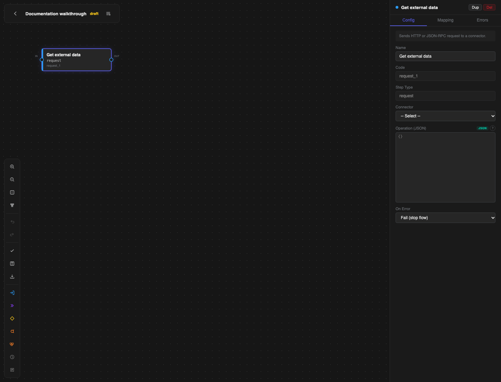
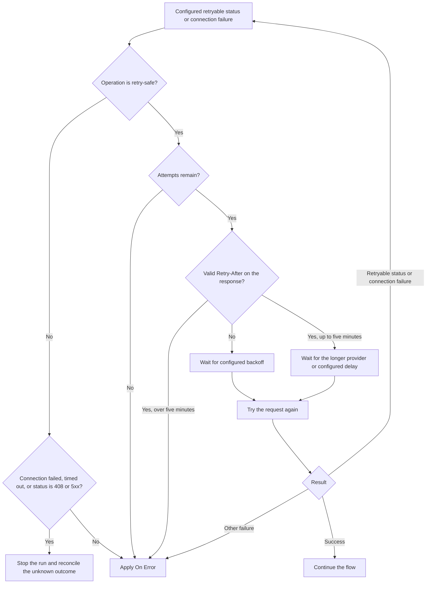
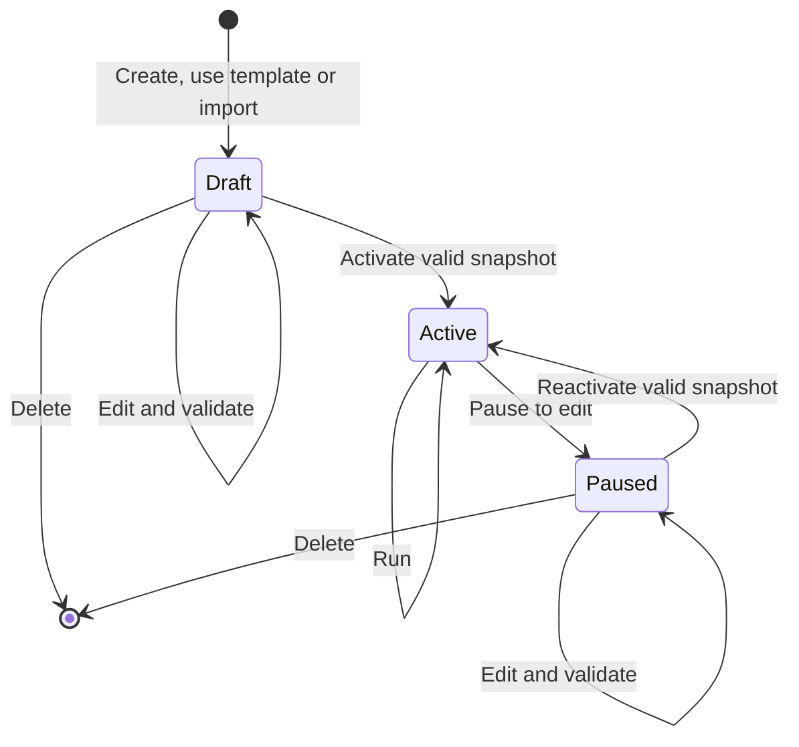
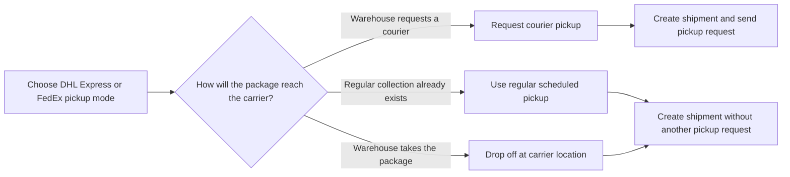
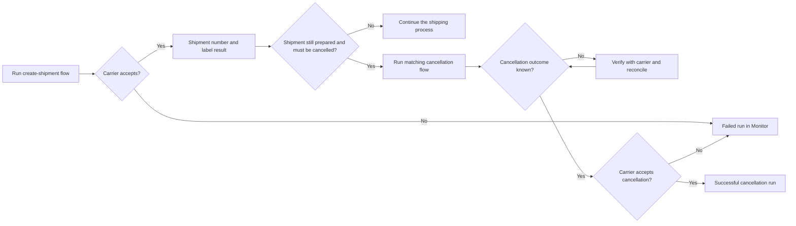

# Templates and Flow Builder

Use a template when it matches the system and direction of data. Use **Flow Builder** to review the result or to build a custom integration.

## Create a draft from a template

1. Open **Templates** and find the template card.
2. Select **Use Template** on that card.
3. If **Set up: _template name_** opens, choose an existing matching connector or keep **Create a new connector (recommended)** selected.
4. In that dialog, complete the required WMS and provider setup fields.
5. Select **Create draft integration**. If the dialog does not open, **Use Template** creates the draft immediately.

The platform copies the template name, generates a unique flow code and creates the flow in **draft** status. It offers an existing connector only when that connector was created from the expected connector template. A name match alone is not enough.

When a template asks for **WMS goods owner ID**, enter the owner whose stock or orders belong to this integration. For an order-import template, **Marketplace ship-to ID** identifies the WMS customer or destination used for imported orders. Verify both values in the target tenant before activation.

While dialog-based setup is running, the action reads **Creating draft...** and cannot be submitted again. On success, the platform confirms that the draft integration was created and opens the new flow. Configure and test its connections, then review the draft flow and, for a schedule template, its paused schedule. If dialog-based setup fails, the dialog stays open and shows **Setup failed: ...**; correct the values or connector selection before trying again. A direct-creation failure shows the same message while you remain on **Templates**.

## Create or import a flow

On **Flows**:

- select **+ New** to create an empty flow;
- select **Import** to upload a flow JSON file;
- use the search field to find a flow by name or code.

For a new flow, enter **Code**, **Name**, **Trigger** and an optional **Description**. Trigger choices are Manual, Schedule (cron), Webhook and Event.

Import the file into a test tenant first. Review its connectors, variables, mappings and trigger before activation; an exported flow design does not include a guarantee that the destination tenant has matching credentials or configuration.

### Restrict a flow to an owner or warehouse

A flow can have an optional **Owner** target, an optional **Warehouse** target, or both. A blank target is a wildcard: the flow can run for any value of that field inside its tenant. When a target is set, an event or parent flow must carry the same value.

Use the flow management API to set `owner_id` and `warehouse` when creating or updating a flow. The warehouse value is the WMS schema name, for example `wh1`: it is 1–50 characters long, starts with a lowercase letter and contains only lowercase letters, numbers and underscores. The reserved names `enterprise`, `public` and `information_schema`, and names beginning with `pg_`, are not accepted. Do not enter a warehouse display name. API requests that fork a template or import a bundle also accept these target fields, so choose the destination target explicitly instead of assuming that it is copied from another tenant.

Use a target for flows that read or write warehouse-specific records. Leave a field blank only when one reviewed flow is deliberately shared across all owners or warehouses in the tenant.

## Edit in Flow Builder

Select **Builder** for a flow. An active flow is read-only; use **Pause to edit** before changing it.

*Caption: Flow Builder. Focus: the palette adds steps, the graph shows execution order and the inspector configures the selected step.*

### Build the graph

1. Add a step from the palette.
2. Select the step and complete the **Config** tab.
3. Drag from an output port to the next step's input port.
4. For a condition, connect each branch to its destination.
5. Select **Auto-layout** when you want the platform to arrange the graph.

Common step types:

| Step | Use it for |
| --- | --- |
| **Request** | Call a connector operation or JSON-RPC method. |
| **Transform** | Reshape values between steps. |
| **Condition** | Choose a branch from a Jinja2 expression. |
| **Loop** | Run a group of later steps for each item in a list. |
| **Batch** | Split a list into bounded groups. |
| **Delay** | Wait for a configured number of milliseconds. |
| **Log** | Record a diagnostic message without exposing secrets. |

Useful keyboard controls are Delete or Backspace to remove a selected step or edge, Ctrl/Cmd+D to duplicate a selected step and Esc to clear the selection.

## Configure a request

On a **Request** step:

1. Choose **Connector**.
2. Choose an available RPC method when the connector publishes an OpenRPC catalogue, or enter the operation JSON required by the transport.
3. Configure the input and output on the **Mapping** tab.
4. Configure **On Error** on the **Config** tab.
5. Configure **Request Retry Override** and **Timeout (seconds)** on the **Errors** tab.

Do not enable retries for a mutating remote operation unless the provider supports safe repeats or an idempotency key. The platform does not automatically assume that a write can be repeated safely.

## Map data

- **Input Mapping** reads values with JSONPath and supplies them to the step.
- **Output Mapping** writes selected response values into named flow variables.
- **Inline Transform** can filter, map or rename values between the two sides.

Keep mappings explicit. If a value is required by a later step, give it a clear variable name and validate its presence before the remote call.

Configuration values can be referenced through `system` and `tenant` namespaces. See [Configuration, access and API](06-configuration-access-and-api.md).

## Handle errors

Choose one **On Error** action for the result after any request-level attempts are exhausted:

| Action | Result |
| --- | --- |
| **Fail (stop flow)** | Stop the run and mark it failed. Use this for required work. |
| **Skip (continue)** | Record the step outcome and continue. Use only when the step is optional. |
| **Fallback (jump to fallback step)** | Continue at a later fallback step. |

**Request Retry Override** can change maximum attempts, backoff and retryable status codes. It runs before **On Error**. `GET`, `HEAD` and `OPTIONS` operations are retry-safe unless **Operation** explicitly sets `"retry_safe": false`; another operation must explicitly set `"retry_safe": true`. An unsafe operation is attempted once. **Timeout (seconds)** limits the time spent on the step. A fallback must point forward to a later step so that the graph remains executable.

### When the provider asks you to wait

For a retry-safe request, a provider can return a retryable status together
with `Retry-After`. The platform accepts either a number of seconds or an HTTP
date. Before the next attempt, it waits for whichever is longer: the delay in
`Retry-After` or the backoff configured on the connector or step. A shorter
provider delay never shortens your configured backoff.

The platform waits inside the current run only when the provider delay is at
most five minutes. If the provider asks for more than five minutes, it does not
make another request in that run; the provider response continues to **On
Error**. A missing or invalid `Retry-After` uses the configured backoff. This
does not make an unsafe operation retryable and does not schedule a background
retry after the run has ended.

After an upgrade that removes the old step-level **Retry** action, existing steps that used it are changed to **Fail (stop flow)**. Revalidate those flows. Add **Request Retry Override** only when the remote operation is safe to repeat; otherwise keep the single attempt. A known provider refusal then follows **On Error**. If an unsafe request times out, loses its connection, or returns HTTP 408 or 5xx, the run stops with an unknown outcome instead: check the provider before deciding whether to submit the operation again.

## Validate, save and activate

1. Select **Validate flow**.
2. Fix every error. Review warnings for unintended branches, mappings or resilience settings.
3. Select **Save snapshot**.
4. Optionally select **Export JSON** to keep a reviewed, portable design.
5. Return to **Flows** and change the status to **active**.

Activation performs validation again and saves an activation snapshot as one operation. If validation fails, the flow remains in its current **draft** or **paused** state.

## Run, export or delete

- **Run** is available for an active flow and opens its result in **Monitor**.
- **Export JSON** exports the design for review or controlled import elsewhere.
- **Del** is available while the flow is **draft** or **paused**, but not while it is active.

Deleting a flow also removes its schedules, webhooks and run history. Export anything you need for audit or reuse before confirming deletion. The platform also refuses deletion while an execution is still running.

## Recover while editing

Use **Undo** and **Redo** while the builder is open. Before a larger change, select **Export JSON** and keep the reviewed file with the change record. If you need to return to that design later, import it as a separate draft flow, compare it with the current flow and test it before replacing any production trigger.

If a run fails because of a credential or remote outage, fix and test the connector instead of changing an unchanged flow.

## Carrier shipment labels and cancellation

The template catalogue contains ready-made manual flows for shipment labels and carrier cancellation:

| Template | Result |
| --- | --- |
| **Speedy: Create Shipment & Label** | Creates one Speedy shipment, then requests its PDF or ZPL label. |
| **Econt: Create Shipment & Label** | Creates one Econt shipment and returns its shipment number and waybill PDF URL. |
| **DHL Express: Create Shipment & Label** | Creates one DHL Express shipment and returns its tracking number and PDF or ZPL label. |
| **FedEx: Create Shipment & Label** | Creates one FedEx shipment and returns its tracking number and PDF or ZPL label. |
| **Speedy: Cancel Shipment** | Cancels a prepared Speedy shipment before pickup is ordered. A cancellation reason is required. |
| **Econt: Cancel Shipment** | Deletes a prepared Econt shipping label before courier acceptance. |
| **FedEx: Cancel Shipment** | Cancels a complete FedEx shipment by its master tracking number, including every package in a multi-piece shipment. |

### Create a shipment and label

1. Set up and test the matching carrier connector. For Speedy or Econt, see [Bulgarian shipment setup](02-connectors-and-api-keys.md#set-up-speedy-or-econt-for-bulgarian-shipments). For DHL Express or FedEx, see [DHL Express or FedEx setup](02-connectors-and-api-keys.md#set-up-dhl-express-or-fedex).
2. Open **Templates**, find the carrier's **Create Shipment & Label** template and select **Use Template**.
3. Select the tested carrier connector and create the draft.
4. Review the flow, validate it and activate it.
5. Select **Run**. Enter a unique **Shipment reference**, recipient details, contents and **Weight (kg)**.
6. For DHL Express or FedEx, also enter the recipient country and address, package dimensions and **Carrier service code**, then choose **Label format**. The connector's **Pickup mode** decides whether this shipment requests a courier, uses an existing scheduled pickup or will be dropped off.
7. For Speedy, choose **Label format** (`PDF` or `ZPL`) and **Paper size** (`A6`, `A4` or `A4 (4 × A6)`).
8. Open the run in **Monitor**. Confirm that the run succeeded, record the returned tracking or shipment number and label result, and verify the expected pickup arrangement with the carrier.

Speedy returns label data in the run result. The template calls Speedy's label operation; it does not send the result to a local warehouse printer. Econt returns a waybill PDF URL. DHL Express and FedEx return the carrier response that contains the tracking and label result. Download or print the returned label through the approved process for your site.

The shipment reference is the repeat-protection key. Reusing a reference after a successful run returns that existing run instead of creating another carrier shipment. A carrier rejection fails the run and remains visible in **Monitor**. Shipment creation is not retried automatically because repeating a remote write could create a duplicate.

Do not immediately repeat a failed create run. A timeout or lost response can leave the run failed even though the carrier accepted the shipment. First check the run steps and search the carrier account by **Shipment reference**. If the run is **outcome_unknown**, follow [the reconciliation procedure](05-monitoring-and-notifications.md#if-the-status-is-outcome_unknown) and do not retry until the external result is known.

### Cancel a prepared shipment

1. Use the matching **Cancel Shipment** template to create, validate and activate a separate cancellation flow.
2. Select **Run**. For Speedy or Econt, enter the shipment number returned by the creation flow.
3. For FedEx, enter the shipment's master tracking number in **Tracking number**. Cancelling it cancels the complete shipment, not one package.
4. For Speedy, also enter **Cancellation reason**.
5. Check the terminal run in **Monitor**. A provider refusal leaves the run failed with the carrier's explanation.

The shipment number is the cancellation repeat-protection key. Repeating a successful cancellation returns the existing successful run and does not call the carrier again. Cancellation itself is not automatically retried.

Before repeating a failed cancellation, check the carrier account to see whether the shipment was already cancelled. A lost or incomplete provider response can make the result uncertain even after the carrier received the request. Reconcile **outcome_unknown** runs instead of retrying them. A FedEx run is successful only when FedEx explicitly confirms that the shipment was cancelled.

