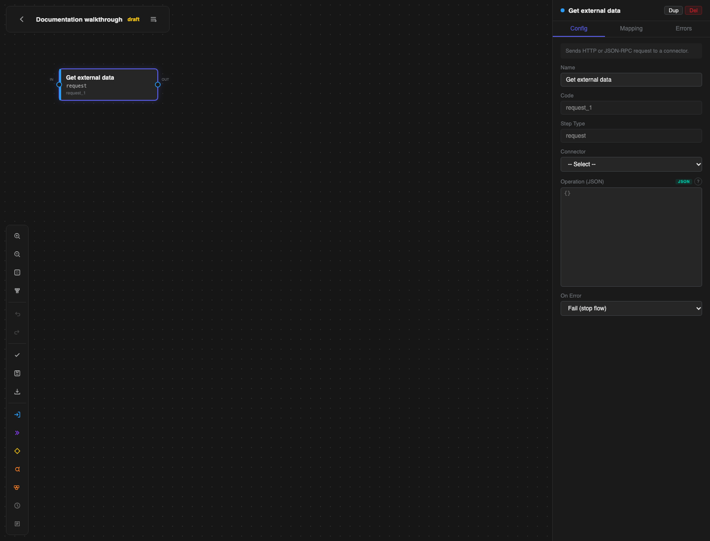
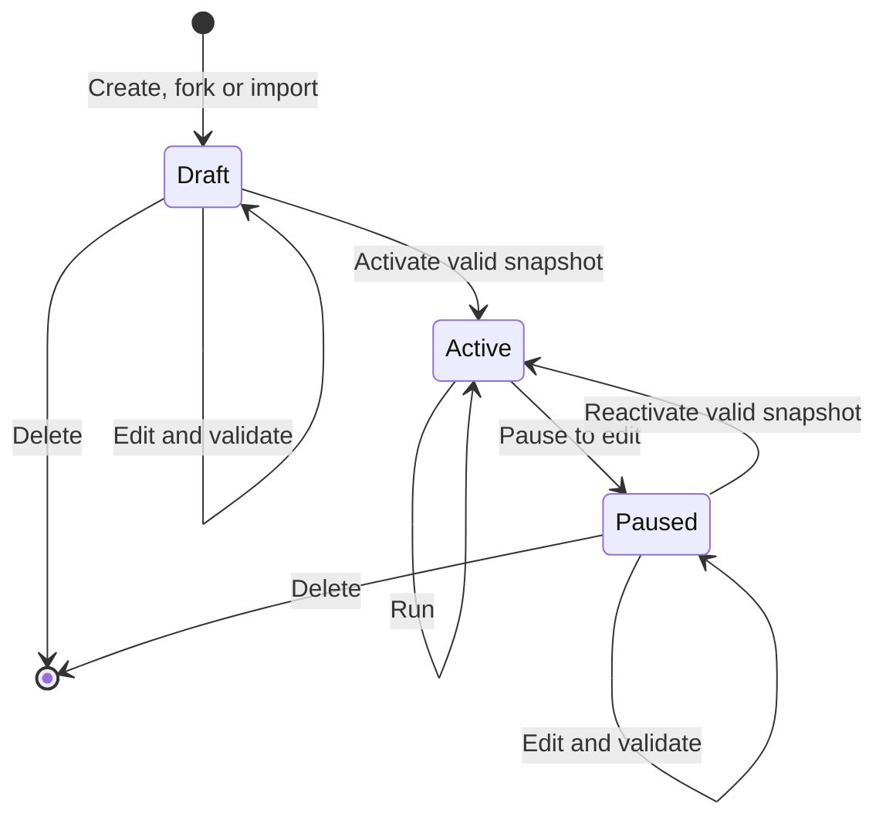

# Templates and Flow Builder

Use a template when it matches the system and direction of data. Use **Flow Builder** to review the result or to build a custom integration.

## Fork a template

1. Open **Templates** and find the template card.
2. Select **Use Template** on that card.
3. If **Fork & Map** opens, choose the connector that the flow will use and complete the setup fields shown by the template.
4. Select **Fork & Map**. If no mapping or setup is required, **Use Template** forks the template immediately.

The platform copies the template name, generates a unique flow code and creates the flow in **draft** status. It offers an existing connector only when that connector was created from the expected connector template. A name match alone is not enough.

When a template asks for **WMS goods owner ID**, enter the owner whose stock or orders belong to this integration. For an order-import template, **Marketplace ship-to ID** identifies the WMS customer or destination used for imported orders. Verify both values in the target tenant before activation.

## Create or import a flow

On **Flows**:

- select **+ New** to create an empty flow;
- select **Import** to upload a flow JSON file;
- use the search field to find a flow by name or code.

For a new flow, enter **Code**, **Name**, **Trigger** and an optional **Description**. Trigger choices are Manual, Schedule (cron), Webhook and Event.

Import the file into a test tenant first. Review its connectors, variables, mappings and trigger before activation; an exported flow design does not include a guarantee that the destination tenant has matching credentials or configuration.

## Edit in Flow Builder

Select **Builder** for a flow. An active flow is read-only; use **Pause to edit** before changing it.

*Caption: Flow Builder. Focus: the palette adds steps, the graph shows execution order and the inspector configures the selected step.*

### Build the graph

1. Add a step from the palette.
2. Select the step and complete the **Config** tab.
3. Drag from an output port to the next step's input port.
4. For a condition, connect each branch to its destination.
5. Select **Auto-layout** when you want the platform to arrange the graph.

Common step types:

| Step | Use it for |
| --- | --- |
| **Request** | Call a connector operation or JSON-RPC method. |
| **Transform** | Reshape values between steps. |
| **Condition** | Choose a branch from a Jinja2 expression. |
| **Loop** | Run a group of later steps for each item in a list. |
| **Batch** | Split a list into bounded groups. |
| **Delay** | Wait for a configured number of milliseconds. |
| **Log** | Record a diagnostic message without exposing secrets. |

Useful keyboard controls are Delete or Backspace to remove a selected step or edge, Ctrl/Cmd+D to duplicate a selected step and Esc to clear the selection.

## Configure a request

On a **Request** step:

1. Choose **Connector**.
2. Choose an available RPC method when the connector publishes an OpenRPC catalogue, or enter the operation JSON required by the transport.
3. Configure the input and output on the **Mapping** tab.
4. Configure **On Error** on the **Config** tab.
5. Configure **Request Retry Override** and **Timeout (seconds)** on the **Errors** tab.

Do not enable retries for a mutating remote operation unless the provider supports safe repeats or an idempotency key. The platform does not automatically assume that a write can be repeated safely.

## Map data

- **Input Mapping** reads values with JSONPath and supplies them to the step.
- **Output Mapping** writes selected response values into named flow variables.
- **Inline Transform** can filter, map or rename values between the two sides.

Keep mappings explicit. If a value is required by a later step, give it a clear variable name and validate its presence before the remote call.

Configuration values can be referenced through `system` and `tenant` namespaces. See [Configuration, access and API](06-configuration-access-and-api.md).

## Handle errors

Choose one **On Error** action for the result after any request-level attempts are exhausted:

| Action | Result |
| --- | --- |
| **Fail (stop flow)** | Stop the run and mark it failed. Use this for required work. |
| **Skip (continue)** | Record the step outcome and continue. Use only when the step is optional. |
| **Fallback (jump to fallback step)** | Continue at a later fallback step. |

**Request Retry Override** can change maximum attempts, backoff and retryable status codes. It runs before **On Error** and applies only when the step's **Operation** contains `"retry_safe": true`. An unsafe operation is attempted once. **Timeout (seconds)** limits the time spent on the step. A fallback must point forward to a later step so that the graph remains executable.

After an upgrade that removes the old step-level **Retry** action, existing steps that used it are changed to **Fail (stop flow)**. Revalidate those flows. Add **Request Retry Override** only when the remote operation is safe to repeat; otherwise keep the single attempt and handle the failure through **On Error**.

## Validate, save and activate

1. Select **Validate flow**.
2. Fix every error. Review warnings for unintended branches, mappings or resilience settings.
3. Select **Save snapshot**.
4. Optionally select **Export JSON** to keep a reviewed, portable design.
5. Return to **Flows** and change the status to **active**.

Activation performs validation again and saves an activation snapshot as one operation. If validation fails, the flow remains in its current **draft** or **paused** state.

## Run, export or delete

- **Run** is available for an active flow and opens its result in **Monitor**.
- **Export JSON** exports the design for review or controlled import elsewhere.
- **Del** is available while the flow is **draft** or **paused**, but not while it is active.

Deleting a flow also removes its schedules, webhooks and run history. Export anything you need for audit or reuse before confirming deletion. The platform also refuses deletion while an execution is still running.

## Recover while editing

Use **Undo** and **Redo** while the builder is open. Before a larger change, select **Export JSON** and keep the reviewed file with the change record. If you need to return to that design later, import it as a separate draft flow, compare it with the current flow and test it before replacing any production trigger.

If a run fails because of a credential or remote outage, fix and test the connector instead of changing an unchanged flow.
