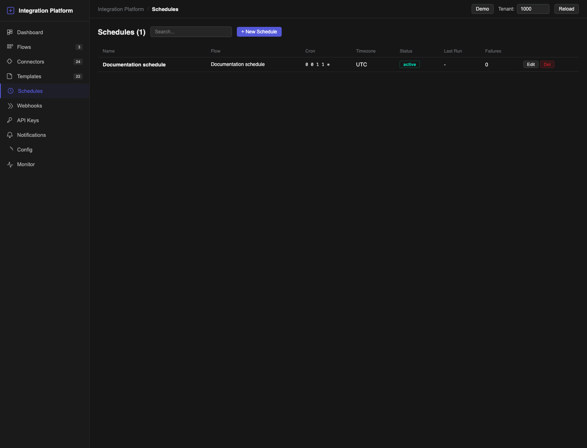
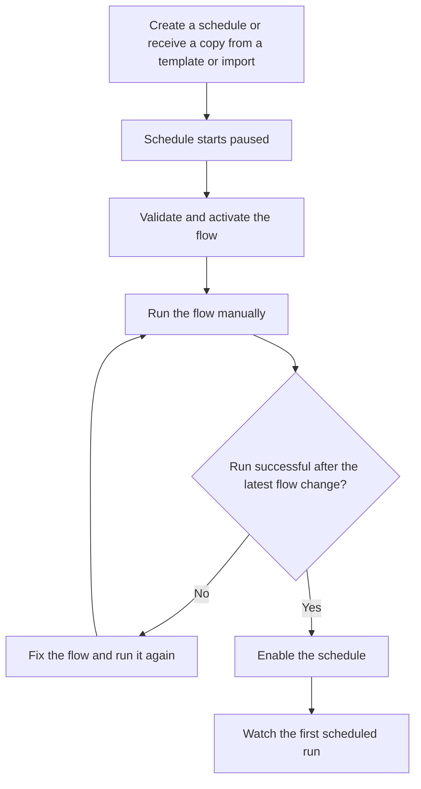
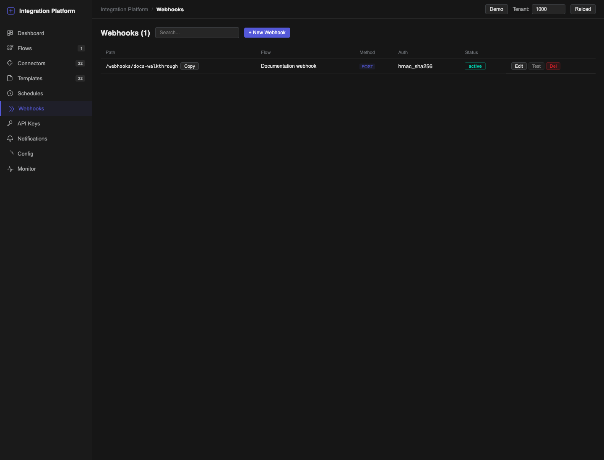
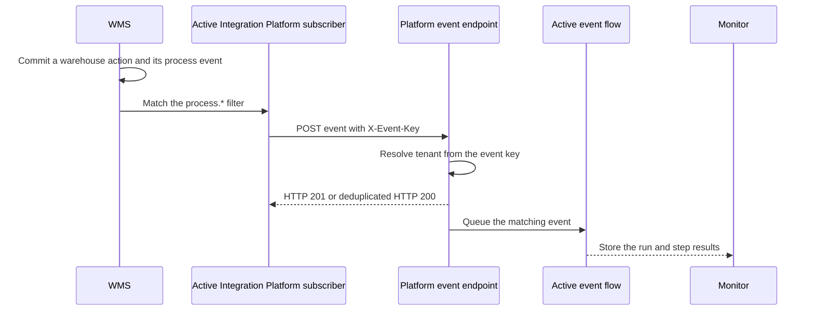
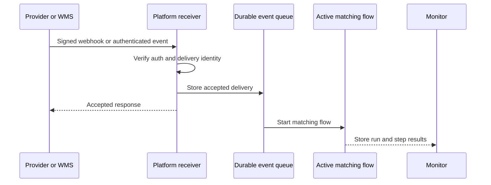

# Triggers, schedules and webhooks

A flow can start manually, from a schedule, from an incoming webhook or from an event. Choose one trigger when you create the flow, then configure the corresponding page before production use.

## Choose a trigger

| Trigger | Best for | Main safety control |
| --- | --- | --- |
| **Manual** | Testing and operator-controlled jobs | A user explicitly selects **Run**. |
| **Schedule (cron)** | Periodic polling or synchronization | Timezone and automatic pause after repeated failures. |
| **Webhook** | A provider pushes a change to the platform | HMAC or bearer authentication and a delivery ID. |
| **Event** | A trusted system publishes a named business event | A tenant-scoped event key and stable source event identity. |

The flow must be active before its configured trigger can execute it.

## Run manually

1. Open **Flows**.
2. Activate a validated flow.
3. Select **Run**.
4. The platform opens the run in **Monitor**.

Use the manual **Run** action for the first controlled run even when the flow's production trigger is a schedule, webhook or event.

## Create a schedule

1. Open **Schedules** and select **+ New Schedule**.
2. Choose a **Flow** created with **Trigger = Schedule (cron)**. A manual, webhook or event flow cannot be attached to a schedule.
3. Enter a descriptive **Name**.
4. Enter a five-field **Cron Expression**, for example `*/5 * * * *` for every five minutes.
5. Enter the intended **Timezone**. The default is `UTC`.
6. Save the schedule. A new schedule starts **paused** and cannot execute during setup.
7. Validate and activate the flow.
8. On **Flows**, select **Run**. Wait for the manual run to finish successfully and review it in **Monitor**.
9. Return to **Schedules**, edit the schedule and enable it.
10. Watch the first scheduled occurrence in **Monitor**.



*Caption: the Schedules page. Focus: Cron and Timezone determine when a run starts; Failures shows consecutive failed executions.*

### Expected result

The schedule row shows the flow, cron expression, timezone and status. After you enable it and it fires, **Last Run** and **Failures** update, and the run appears in **Monitor** with a schedule trigger.

The platform enables a schedule only when the flow is active and has completed a successful manual run after its latest change. If you edit the flow later, run it manually again before enabling a paused schedule.



### Repeated failures

The platform counts consecutive failures and automatically pauses a schedule when its configured failure limit is reached. Pending occurrences for that schedule are not allowed to keep running after the pause. Fix the connector or flow, run a controlled test, then enable the schedule again.

Edit a schedule to change its name, cron expression, timezone or active state. Delete it when the periodic trigger is no longer needed; deleting a schedule does not delete the flow.

## Create a webhook

1. Open **Webhooks** and select **+ New Webhook**.
2. Choose **Flow**.
3. Enter a unique **Path** such as `orders/created`. Do not start it with `/`, add the `/webhooks/` prefix, or include a query (`?`) or fragment (`#`). Use non-empty path segments only.
4. Choose **Auth Type**:
   - **HMAC SHA-256** when the provider signs the original request body;
   - **Bearer Token** when the provider can send an Authorization header;
   - **None** only for a deliberately unauthenticated test endpoint on a protected network.
5. Enter **Secret / Token** for HMAC or bearer authentication.
6. If the provider sends a stable unique delivery identifier, enter its header name in **Delivery ID Header**.
7. Save the webhook and select **Copy** to copy its full URL.



*Caption: the Webhooks page. Focus: Copy returns the public receiver URL; Auth and Status show whether the endpoint is protected and enabled.*

### Authentication details

- HMAC uses SHA-256 over the exact request body. Send the signature in `X-Signature-256` as hexadecimal or Base64; a `sha256=` prefix is accepted.
- Bearer authentication uses `Authorization: Bearer <token>`.
- The built-in **Test** action is available only when **Auth Type** is **None**. Test an authenticated webhook from the provider or another client that can calculate the correct signature or send the token.

### Safe duplicate handling

When **Delivery ID Header** is configured, that header is required on every request. The platform accepts a given delivery ID once for that webhook and does not start a duplicate execution for a repeated delivery. Use a provider-generated event or delivery ID, not a timestamp created by the receiver.

If the same delivery ID is reused with different content, treat it as an upstream error and investigate instead of changing the ID to force execution.

### Edit or disable a webhook

Select **Edit** to change authentication, the secret or token, delivery ID header and active state. The path stays fixed. If the public path must change, create and test a replacement webhook, update the provider and then delete the old definition.

## Trigger from an event

An event-triggered flow matches its configured event name. An authenticated producer sends the event to the Integration Platform event endpoint with at least:

```json
{
  "event_name": "orders.created",
  "payload": {
    "order_number": "TEST-1001"
  }
}
```

Use a stable `source_event_id` and `source_scope` when the producer can provide them. Together they let the platform recognize a repeated delivery without confusing events from different producers. The authentication key determines the tenant; a tenant number supplied in the JSON body does not change routing.

For Quark WMS, use a dedicated event key rather than a normal platform access key. The event key can submit events only; it cannot open the platform UI, read flows or call the normal tenant API.

## Connect Quark WMS business events

Complete the platform setup first, then activate delivery in WMS. This order prevents the WMS delivery worker from repeatedly calling an endpoint that is not ready.

### 1. Create the tenant event key

1. Open the Integration Platform for the tenant that should own the resulting flow runs.
2. Open **Config > WMS Events**.
3. Copy the displayed **Event endpoint**. Its path ends with `/api/v1/events/emit`.
4. Enter a name that identifies the WMS environment, for example `Production WMS event delivery`.
5. Select **Create event key**.
6. Select **Copy key** and put the secret in the approved secret handoff. The secret is shown only on this confirmation card. After you select **Done** or leave the page, the platform cannot display it again.

The key belongs to the current platform tenant. Creating it while the wrong tenant is selected routes accepted events to that wrong tenant even if the JSON body contains another tenant number.

### 2. Configure the WMS subscriber

1. In WMS, switch to **Enterprise** and open `Integrations > Subscribers`.
2. Open the built-in **Integration Platform** subscriber with code `ipaas`.
3. Keep **Active** off while you configure it.
4. Set **Delivery** to `webhook` and set **Webhook URL** to the copied event endpoint.
5. Store this subscriber header:

   ```json
   {"X-Event-Key": "<copied event key>"}
   ```

6. Keep the event filter restricted to WMS business events:

   ```json
   {"event_codes": ["process.*"]}
   ```

7. Save the subscriber configuration.

The WMS subscriber card shows the URL and active state but does not expose every routing field. If **Webhook headers** and **Event filter** are not available on your screen, set them with the supported `update_integration_subscriber` JSON-RPC method or ask the deployment administrator to apply them. Do not put the event key in the URL, description or event filter.

`process.*` matches event codes below `process.`, such as `process.order.created`. It does not match `processfoo`, `processfoo.created` or the bare word `process`.

### 3. Activate and verify delivery

1. Confirm that the target event flow is validated and active.
2. Turn on **Active** for the WMS Integration Platform subscriber and save it.
3. Perform one controlled WMS action that produces a matching `process.*` event.
4. In WMS, check **Integrations > Events** and **Deliveries**. The delivery should receive an HTTP 2xx response.
5. In the Integration Platform, open **Monitor** and confirm that the expected event flow ran in the same tenant in which the key was created.



### Rotate or revoke the key

Rotate without intentionally stopping delivery:

1. Create a new key in **Config > WMS Events** and copy its one-time secret.
2. Replace `X-Event-Key` in the WMS subscriber with the new secret.
3. Produce one controlled event and verify both the WMS delivery and the platform run.
4. Return to **Config > WMS Events** and select **Revoke** for the old key.

Revocation is immediate. A subscriber that still sends the revoked key receives an authentication error and its deliveries enter the WMS retry path. If a newly created secret was lost before it reached WMS, revoke that key and create another one; the list deliberately shows status and dates, never the secret or its hash.

Do not try to reuse an event key in `X-Api-Key`. An `events:write` key is rejected by normal platform endpoints even while it remains active for `/api/v1/events/emit`.

See [Webhooks and events](../api/07-webhooks-and-events.md) for the WMS event envelope, subscriber retries and delivery statuses.



## Troubleshooting

| Symptom | Recovery |
| --- | --- |
| **Schedules can only be attached to flows with trigger_type=schedule** | Return to **Flows** and create the flow with **Trigger = Schedule (cron)**, then select it in the schedule. |
| **Activate the flow before enabling its schedule** | Validate the flow, resolve every error and activate it. Then complete a controlled manual run before enabling the schedule. |
| **Run this flow manually and complete it successfully before enabling the schedule** | On **Flows**, select **Run**, fix any failure and wait for a successful result in **Monitor**. If the flow changed after an earlier success, run it again. |
| Schedule never runs | Confirm that both the schedule and flow are active; check cron expression and timezone. |
| Schedule is paused with failures | Fix the underlying run failure, complete a manual test, then enable the schedule. |
| Webhook path is rejected | Remove the leading slash, query and fragment. Enter only non-empty path segments, for example `orders/created`. |
| Webhook returns an authentication error | Recalculate the signature from the unmodified body or check the bearer token. |
| Webhook says the delivery ID header is missing | Send exactly one header using the configured name and a non-empty stable value. |
| Webhook is accepted but no flow runs | Confirm that the webhook and flow are active, then check **Monitor** and the flow trigger. |
| **Invalid event key** | The `X-Event-Key` value is unknown, expired or revoked. Replace the WMS subscriber header with an active key from the intended tenant. |
| The WMS delivery is accepted but no flow runs | Confirm that the flow is active and its event trigger matches the exact `event_name`; then check **Monitor** in the tenant that owns the key. |
| WMS keeps retrying after a key change | Confirm that the subscriber saved the new `X-Event-Key`, then verify one delivery before revoking the old key. |
| Event reaches the wrong tenant or flow | Check where the event key was created and the exact event name, owner and source identity. The tenant value in the JSON body cannot override the key. |
