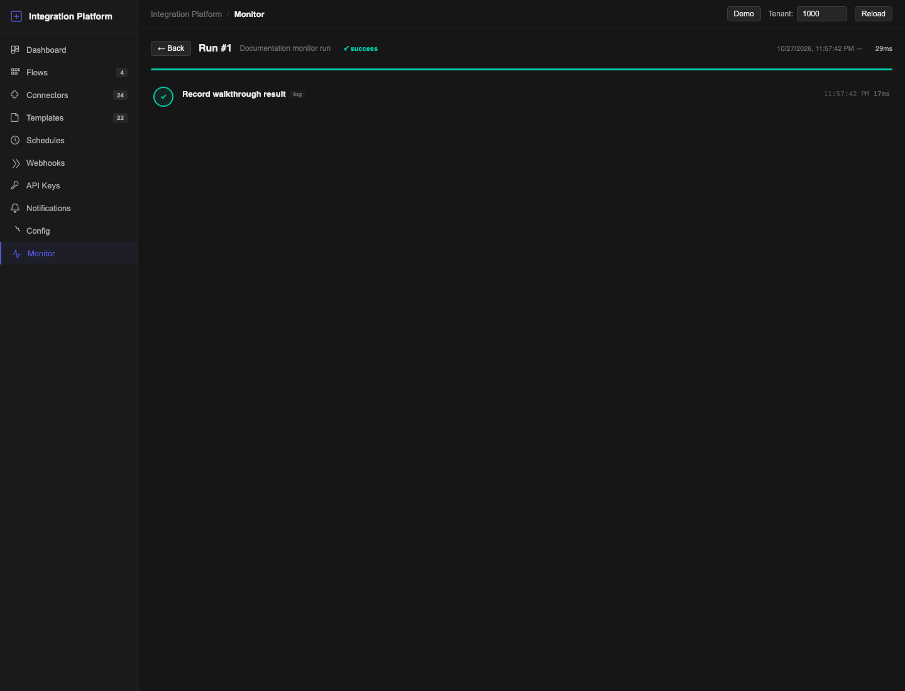

# Monitoring and notifications

Use **Dashboard** to see whether integrations are healthy and **Monitor** to understand one run. Add notification channels so a failure or automatic schedule pause reaches the people who can act on it.

## Read the Dashboard

Choose a period, then review:

- **Total Runs**, **Success Rate**, **Avg Duration** and **Failed**;
- running work and configured schedules and connectors;
- flows with the most activity or failures;
- recent errors;
- **Connector Health**, including requests, failures, success rate and average duration.

Connector Health refreshes automatically. A healthy connector does not guarantee that a later business step is valid, so use **Monitor** for failed runs.

## Find a run

1. Open **Monitor**.
2. Filter by flow, trigger or status.
3. Turn on **Auto-refresh** while watching live work, or select **Refresh**. Auto-refresh reloads the list every five seconds.
4. Select a run card.

The list includes successful, failed, running and pending runs. A run can also finish as **outcome_unknown** when the platform cannot prove whether an external write completed.

The filters search the saved run history, not only the cards already visible on the page. Select **Load more** to extend the list into older runs. If auto-refresh is on, new runs appear without removing the older cards you already loaded. Changing a filter starts a new list for that selection.

*Caption: Monitor run details for a controlled log-only test. Focus: the header and step timeline confirm which flow ran and whether every step completed.*

## Read run details

The header shows the run ID, flow, status, trigger, start and end time, and duration. While a run is live, the detail view updates automatically.

Read the step timeline from top to bottom. For each step, check:

- status and duration;
- request URL for connector calls;
- response status;
- error message;
- expandable **Response** and **Output** values.

Large response and output values are shortened in the interface. Use them to locate the failure, not as a permanent business archive. Sensitive values must never be written by a **Log** step.

## Decide what to fix

| First failed point | What to check |
| --- | --- |
| Connector request | Remote availability, URL, credentials, permissions, timeout and rate limit. |
| Mapping or transform | JSONPath, expected response shape, missing variables and type conversions. |
| Condition | Expression and values available at that point in the graph. |
| Loop or batch | Input list, item path, batch size and the failing item. |
| Downstream WMS call | Owner, warehouse context, entity status and the business error returned by WMS. |

Fix the cause in the connector, configuration or paused flow. Do not retry repeatedly while the remote side's result is unknown.

### If the status is outcome_unknown

Do not start another execution. The external system may already have accepted the write even though the platform did not receive a conclusive result. The platform intentionally blocks **Retry** for this status.

1. Use the run ID, request identity and business identifiers to inspect the destination system.
2. Confirm whether the intended change exists and whether it is complete.
3. Reconcile the two systems according to the business procedure for that integration.
4. Only then decide whether a new, separately controlled execution is required.

## Retry a failed run

**Retry** is available only for a run with status **failed**. It is not available for **outcome_unknown**.

1. Confirm whether the external system may already have completed the request.
2. Fix the cause of the failure.
3. Select **Retry**.
4. The platform creates a new run and opens it.
5. Confirm the new run's result and check the destination system.

A retry is a new execution linked to the earlier failure. For write operations, safe recovery depends on the remote API's idempotency behaviour and the flow design. If the outcome of a remote write is uncertain, reconcile the destination before retrying.

## Add a notification channel

1. Open **Notifications**.
2. Select **+ Add Channel**.
3. Enter **Name** and choose **Channel Type**.
4. Turn **Enabled** off while configuring the channel.
5. Complete the channel-specific address fields.
6. Under **Credentials**, prefer **API Key (encrypted)**:
   - select an existing active key for the provider; or
   - choose **Create new**, enter **New API Key Name** and the sensitive values.
7. Under **Event Filters**, choose one or more:
   - **Flow Failure**;
   - **Schedule Pause**;
   - **Flow Success**.
8. Select **Create**.
9. Select **Test** on the saved channel.
10. After the test passes, select **Edit**, turn **Enabled** on and select **Update**.

Supported channel types are Telegram, Slack, Microsoft Teams, Email SMTP and WhatsApp. The form shows the fields required by the selected type.

### Recommended production filters

- Enable **Flow Failure**.
- Enable **Schedule Pause** so repeated failures cannot silently stop synchronization.
- Enable **Flow Success** only when success messages are operationally useful; high-volume flows can create noise.

## Test and maintain a channel

The **Test** action sends a test through the current channel configuration even while the channel is disabled. If it fails, check the destination identifier, webhook URL or SMTP settings and the bound key. Do not enable the channel until the test passes.

Use **Edit** to change configuration and filters. Disable a channel during planned maintenance rather than deleting it. Built-in system channels cannot be edited or deleted.

## Incident checklist

1. Open **Dashboard** and identify the affected flow and period.
2. Open **Monitor** and select the first failed run, not only the latest retry.
3. Find the first failed step and capture its run ID and error without copying credentials or payloads containing customer data.
4. Check whether the external operation completed. If the status is **outcome_unknown**, reconcile it and do not use **Retry**.
5. Fix the connector, configuration or flow while the flow is paused when an edit is required.
6. Run one controlled test.
7. Restore the production trigger.
8. Watch the next scheduled or live run and confirm that notifications are working.
