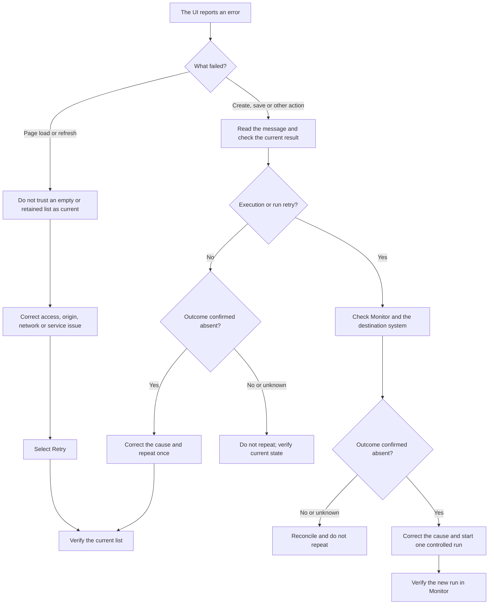

# Configuration, access and API

This page is for platform administrators and integration developers. It explains reusable flow configuration, the access boundary and the main API areas without exposing deployment secrets.

## Reusable flow configuration

Open **Config** and choose one of two tabs:

- **System Config** contains defaults available to all tenants.
- **Tenant Config** contains values for the current tenant and overrides a system value with the same key.

Each row has **Key**, **Value (JSON)** and **Description**. Values must be valid JSON, including quotes around a text value.

Examples:

| Intended value | Enter in **Value (JSON)** |
| --- | --- |
| Text | `"https://example.invalid"` |
| Number | `30` |
| On/off | `true` |
| List | `["WH1", "WH2"]` |
| Object | `{"mode": "test"}` |

Use these references in a flow:

- `{{ system.key_name }}` for an explicit system value;
- `{{ tenant.key_name }}` for an explicit tenant value;
- `{{ flow.key_name }}` for an explicit flow variable;
- `{{ key_name }}` for the effective flat value. The precedence is step output, then flow variable, tenant value and system default.

Prefer namespaced references when the same key can exist in more than one layer.

### Change a value safely

1. Search the affected flows and identify where the key is used.
2. Record the current JSON value in the change ticket without copying secrets.
3. Select **Edit**, change the value and select **Save**.
4. Run a controlled flow and inspect **Monitor**.
5. Restore the previous value if the test fails.

Do not store passwords or tokens in Config. Use **API Keys** and a connector binding.

## Two different kinds of key

Do not confuse these credentials:

| Key | Purpose | Managed where |
| --- | --- | --- |
| Platform access key | Authenticates a user, UI session or API client to one platform tenant. It may also carry the `admin` scope. | Provisioned by the deployment administrator. |
| Connector API key | Authenticates the platform to a marketplace, ERP, WMS or notification provider. | **API Keys** in the Integration Platform UI. |

The **API Keys** page does not create a platform login key.

## Access the platform

Protected API requests use the `X-Api-Key` header. A valid platform key determines the tenant. The `admin` scope is additionally required for **System Config** operations. Other tenant routes use the tenant boundary and do not currently enforce fine-grained scopes. A tenant number in a request body cannot move a request into another tenant.

The web interface can accept a bootstrap link supplied by the deployment administrator. It moves the key from the URL fragment into browser session storage and removes the fragment from the current address. The original link still contains a reusable key and remains valid until that key expires or is deactivated. Treat the entire link as a secret: do not bookmark, copy or share it. If access is refused, request a new tenant-scoped link or key; do not switch the deployment to anonymous access.

The service also enforces an origin allowlist for browser access. If the UI opens but API calls are blocked by the browser, the deployment administrator must add the exact HTTPS origin rather than using a wildcard.

## Recover from a UI request error

When the interface reports a failed load, refresh or action, use the message to recover. A visible error does not prove that a server-side action or external write did not start.

- A red load or refresh banner means the page could not confirm current server data. If earlier rows remain visible, treat them as the last successful view, not as a current snapshot.
- Select **Retry** only after correcting the access key, browser origin, network route or service outage named by the message.
- If a create, edit, delete, validation, import, export or template action shows a red message or toast, read it before repeating the action. Some legacy actions can still fail without a message; confirm the result in the relevant list.
- A button that shows **Saving...** or **Retrying...** is already working; do not select it again.
- For an execution or run retry, check **Monitor** and the destination system before repeating anything.



Do not use **Retry** in an error banner as permission to repeat an external write whose result is unknown. Follow the `outcome_unknown` recovery in [Monitoring and notifications](05-monitoring-and-notifications.md).

## API base and endpoints

Ask the deployment administrator for the platform base URL. Authenticated REST routes are under `/api/v1`.

Main endpoint groups:

| Area | Typical path | Purpose |
| --- | --- | --- |
| Connectors | `/api/v1/connectors` | Create, test and manage tenant connectors. |
| Flows | `/api/v1/flows` | Create, validate, activate, run and export flows. |
| Schedules | `/api/v1/schedules` | Manage cron triggers and their history. |
| Webhook definitions | `/api/v1/webhook-defs` | Manage incoming webhook routes. |
| Runs | `/api/v1/flow-runs` | List run details and retry a failed run. |
| Credential definitions | `/api/v1/keys` | Create, bind and revoke connector credentials. |
| Templates | `/api/v1/templates` | List and fork templates. |
| Events | `/api/v1/events/emit` | Submit a named event to the tenant queue. |
| Configuration | `/api/v1/system-config`, `/api/v1/tenant-config` | Manage flow variables. |
| Notifications | `/api/v1/notification-channels` | Manage and test alert destinations. |

Example read request:

```bash
curl -s "$PLATFORM_URL/api/v1/flows" \
  -H "X-Api-Key: $PLATFORM_API_KEY"
```

Keep the key in a secret manager or process environment. Do not put it in source code, shell history, screenshots or documentation.

## Webhook and event receivers

Incoming provider webhooks use `/webhooks/{path}` and authenticate according to the webhook definition. Event producers use `POST /api/v1/events/emit` with a platform access key. See [Triggers, schedules and webhooks](04-triggers-schedules-and-webhooks.md).

Operational endpoints such as health and metrics are separate from the tenant management routes. Monitor them from the deployment environment; they are not a substitute for checking a flow's run status.

## Production deployment checklist

The deployment administrator should verify all of these before users activate production flows:

- the Integration Platform database is dedicated to the intended environment;
- a strong encryption key is configured and backed up through the approved secret-management process;
- anonymous access is disabled;
- each user or integration has a separate platform key for the intended tenant and environment;
- only administrators who manage **System Config** receive a key with the `admin` scope;
- browser origins are restricted to the real HTTPS application origins;
- the public webhook address uses HTTPS and is reachable only as intended;
- database backups and key rotation procedures are tested;
- health and metrics are monitored;
- notification channels have passed their tests;
- the first production run is watched in **Monitor**.

## Access troubleshooting

| Symptom | Recovery |
| --- | --- |
| `Missing X-Api-Key header` | Supply the tenant platform key in the header or open the administrator-provided access link. |
| `Invalid API key` | Check that the key belongs to this environment and has not expired or been deactivated. Request a replacement; do not retry with a connector credential. |
| `Admin scope required` | The operation changes **System Config**. Use an administrator key or ask an administrator to perform it. |
| Browser reports a cross-origin error | Ask the deployment administrator to allow the exact UI origin. |
| Config value is rejected | Enter valid JSON; quote text values and check brackets and commas. |
| Flow reads an unexpected value | Check step output and flow variables first, then tenant and system values. Use `tenant.`, `flow.` or `system.` to avoid a flat-name collision. |
