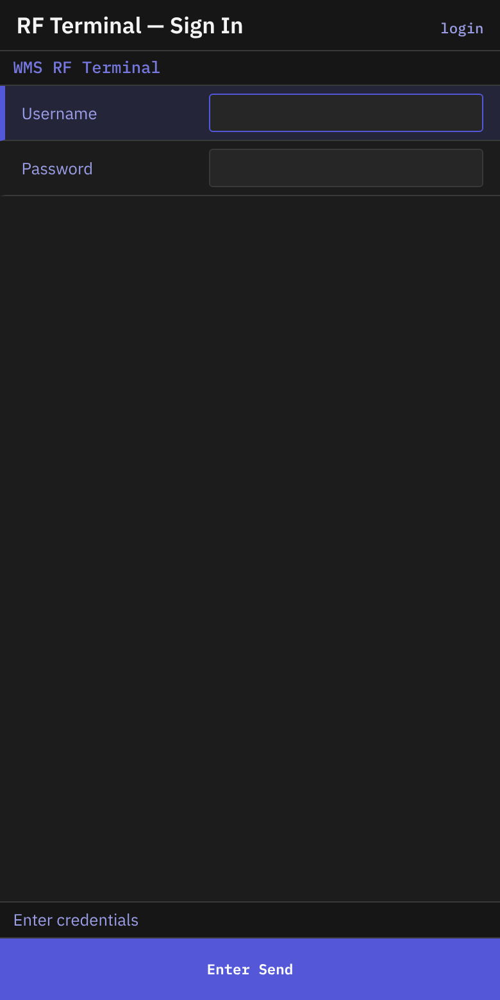
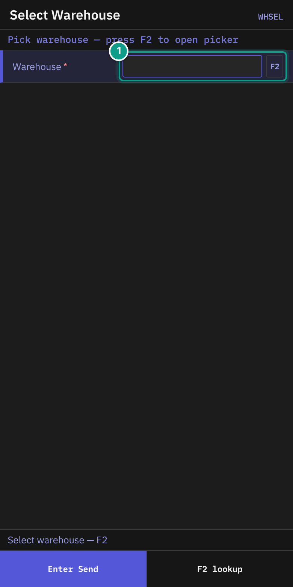
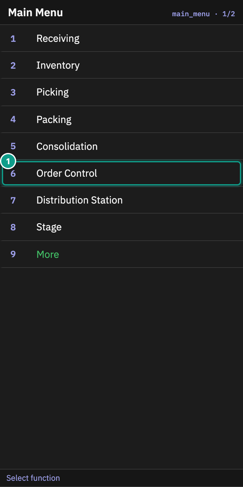

# 01 Login and warehouse

## What you will do

Sign in to the RF terminal. Choose the warehouse you work in. Reach **Main Menu**.

## Before you start

- You need a user name and a password from your administrator.
- You need access to at least one warehouse.
- The terminal must be connected to the server.

## Steps

### Sign in

*Screen login: the sign-in form with Username and Password. Focus: The cursor is in Username; Password is below it.*

1. Read the header **WMS RF Terminal**. The status line says **Enter credentials**.
2. In **Username**, type your user name. Press `Enter`.
3. In **Password**, type your password. The screen shows `*` for each letter.
4. Press `Enter`.

The screen title is **RF Terminal — Sign In**.
**Username** holds up to 64 characters. **Password** holds up to 128.

### Choose a warehouse

If you have more than one warehouse, the terminal opens **Select Warehouse**.
If you have one warehouse, it is chosen for you and the terminal opens **Main Menu**.

*Screen WHSEL: the warehouse picker. Focus: 1 Warehouse. The number matches the teal badge.*

1. Read the header **Pick warehouse — press F2 to open picker**. The status line says **Select warehouse — F2**.
2. In **Warehouse**, press `F2`. The terminal shows your warehouses.
3. Move to your warehouse with `Up` or `Down`. Press `Enter`.

You can also type the warehouse id in **Warehouse**. The hint says **Type warehouse_id or F2 to pick from your accessible warehouses.**

### Change the warehouse later

1. On **Main Menu**, press `Esc`. The terminal opens **Select Warehouse**.
2. Choose the warehouse as above.

*Screen main_menu. Focus: Order Control appears after Consolidation; press the number shown beside the function.*

## What you should see

- After a correct choice, **Main Menu** appears. It includes **Receiving**, **Inventory**, **Picking**, **Packing**, **Consolidation** and **Order Control** on the first page.
- You cannot go back to the sign-in screen with `Esc`. To sign in as another user, close the RF session and start it again.

## If something goes wrong

| Message | What it means | What to do |
|---------|---------------|------------|
| **Invalid username or password** (red status line, the screen stays on **RF Terminal — Sign In**) | The sign-in was not accepted. The screen stays so you can type again. The same message shows if your user is not allowed to sign in on RF terminals. | Check the user name and password. Type them again. If it keeps failing, ask your administrator. |
| **No permission: {screen}** or **No permission** | Your user may not use this function. | Tell your supervisor which screen you were using and what you tried to do. |
| The warehouse list is empty | Your user has no warehouse. | Ask your administrator to give you access. |

If your session ends while you work, the terminal shows **Session expired. Please sign in again.**

If the terminal cannot load your list of warehouses after sign-in, it does not stop. It opens **Main Menu** without a chosen warehouse. The server then uses your default warehouse, but only when exactly one warehouse is marked as your default. If none or more than one is marked, the server refuses your requests (code `warehouse_required`). In that case ask your administrator to set one default warehouse for you.

> Not confirmed by code: the exact words the terminal shows when the server refuses a request with `warehouse_required`. To verify: sign in with a user that has no warehouse assigned (the same case as an empty warehouse list), press `1` on **Main Menu**, and read the status line.

## Related guides

- [00 README](00-README.md) for the RF keys.
- [02 Receiving against an ASN](02-receiving-against-asn.md)
- [12 Troubleshooting and messages](11-troubleshooting-and-messages.md)
