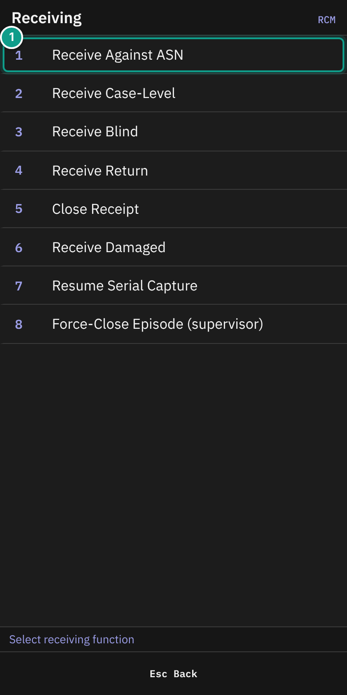
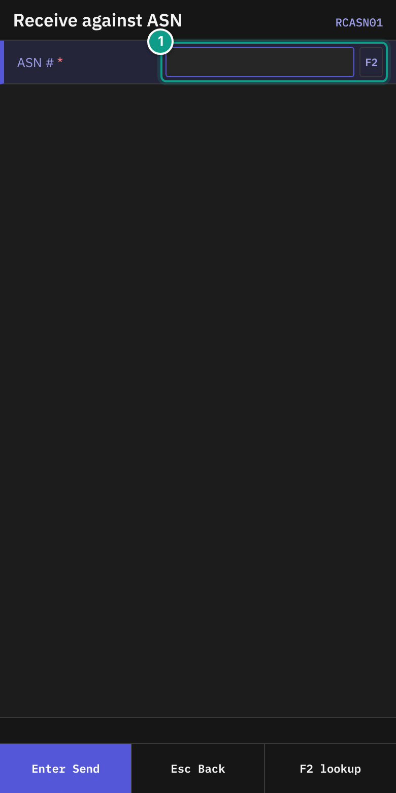
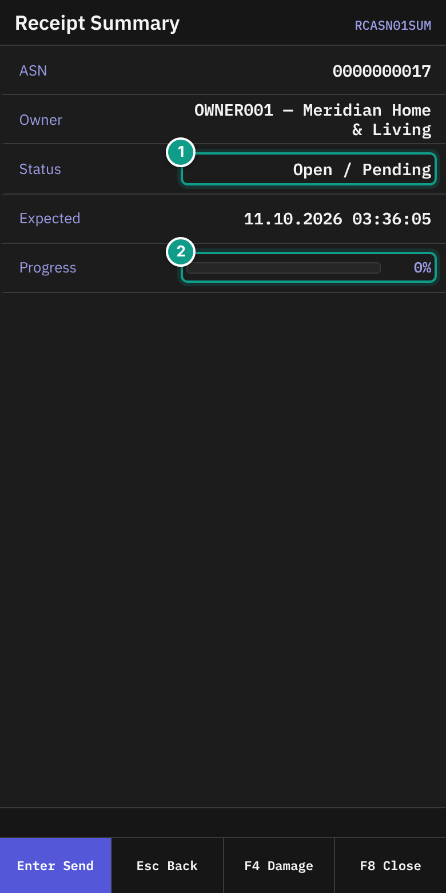
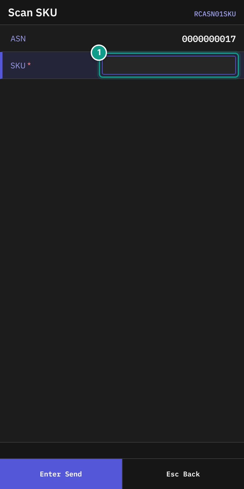
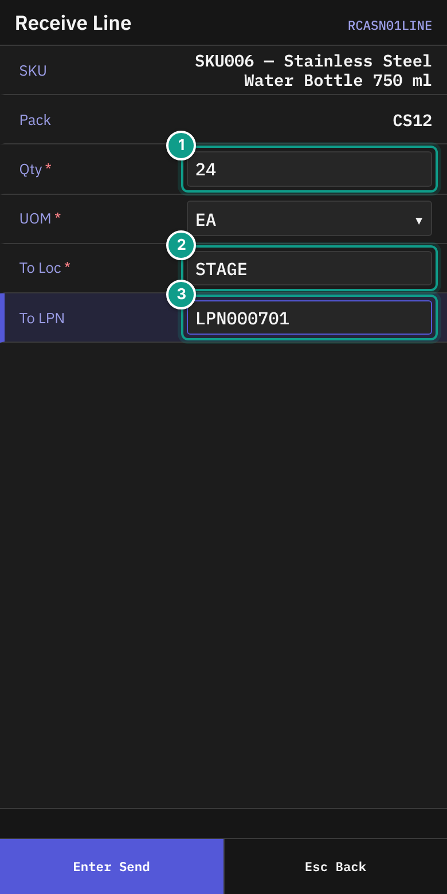
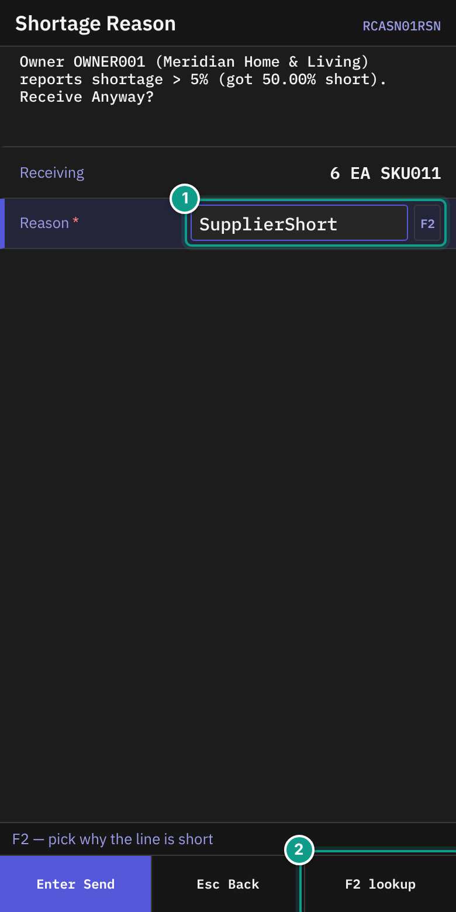
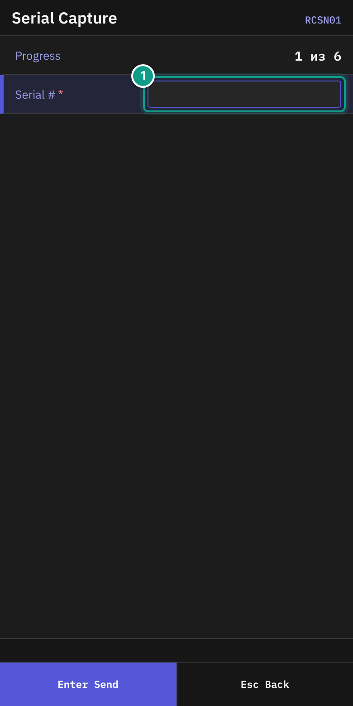
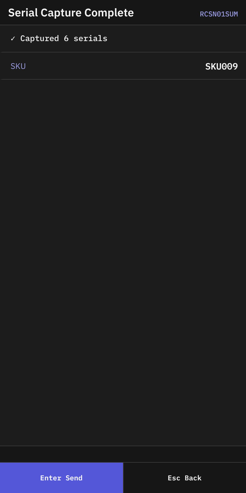
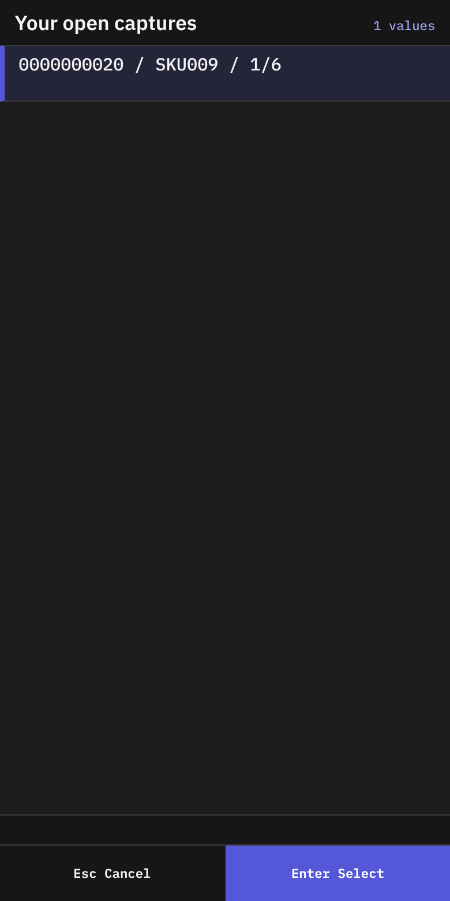
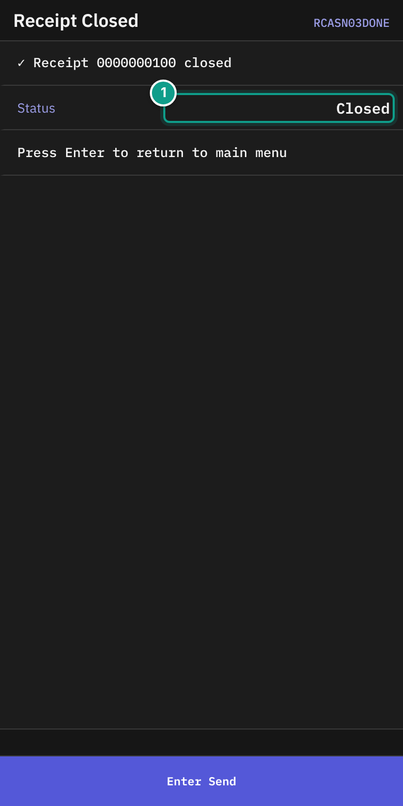

# 02 Receiving against an ASN

## What you will do

Receive goods against an ASN, line by line. Capture serial numbers when the SKU needs them.
When all goods are in, close the receipt from the summary screen.

## Before you start

- The ASN must exist and be open.
- You must know the ASN number.
- Have the goods and their labels in your hands.
- If the SKU has lot attributes (for example colour), read them from the goods.
- You need a location to put the goods in. The default is `STAGE`.
- To close a receipt that differs from the ASN, a supervisor must be near. See [04 Damage and receipt close](04-damage-and-receipt-close.md).

For case-level ASNs, use **Receive Case-Level**. See [03 Blind receiving and returns](03-blind-receiving-and-returns.md).

## Steps

### Open the ASN

*Screen RCM: the Receiving menu. Focus: The numbered list; 1 is Receive Against ASN. The teal number 1 marks that row.*

1. On **Main Menu**, press `1` (**Receiving**).
2. On **Receiving**, press `1` (**Receive Against ASN**).

*Screen RCASN01: the ASN number field. Focus: Scan or type the ASN number in the highlighted field (teal number 1).*

3. On **Receive against ASN**, in **ASN #**, scan or type the ASN number. The field holds up to 30 characters and changes letters to upper case. It sends itself when you press `Enter`.
4. To find an ASN, press `F2` in **ASN #**. The terminal shows a list of ASNs. Choose one with `Enter`.

If an earlier serial capture on this ASN is still open, the terminal opens **Serial Capture** instead. Go to "Capture serial numbers" below.

### Read the summary

*Screen RCASN01SUM: ASN, Owner, Status, Expected, Progress, Serials. Focus: ASN 0000000001, owner OWNER001, status Open / Pending and progress 0%. The teal numbers mark: 1 Status, 2 Progress.*

5. On **Receipt Summary**, check these lines:

| Line | What it shows |
|------|---------------|
| **ASN** | The ASN number |
| **Owner** | Owner code and company |
| **Status** | Status and completion, for example `Open / Pending`. Green when the completion is `Full`, yellow when it is `Over`. |
| **Expected** | The expected date. Shown only if the ASN has one. |
| **Progress** | Received quantity over expected quantity, with a percent bar. Shown only if a quantity is expected. |
| **Serials** | Serials collected over serials required. Shows `— missing {n}` when some are missing. Shown only if serials are required. Yellow while some are missing, green when all are collected. |

6. Press `Enter`. The terminal opens **Scan SKU**.

The footer shows `F8` **Close** and `F4` **Damage**.
`F8` is greyed out while serials are missing.

### Scan the SKU

*Screen RCASN01SKU: the SKU scan field under the ASN number. Focus: 1 SKU. The number matches the teal badge.*

7. On **Scan SKU**, check **ASN**.
8. In **SKU**, scan the item barcode, or type the SKU code. The field holds up to 50 characters. It sends itself.

If the SKU is not found, you see **SKU not found: {code}**. Check the code and scan again.

### Enter the quantity

*Screen RCASN01LINE: SKU, Pack, Qty, UOM, To Loc, lot attributes, To LPN. Focus: 1 Qty, 2 To Loc, 3 To LPN. The numbers match the teal badges.*

9. On **Receive Line**, check **SKU** and **Pack**. They are read-only.
10. Fill in the fields:

| Field | What to enter |
|-------|---------------|
| **Qty** | The quantity you hold in your hands. It must be more than 0. Up to 8 characters. |
| **UOM** | The unit of the quantity. Press `Left` or `Right` to choose `EA`, `IP`, `CS` or `PL`. |
| **To Loc** | The location to put the goods in. Default `STAGE`. After the first line, it starts with the location you sent last. Required. Up to 10 characters. |
| Lot attribute fields | Some SKUs ask for lot attributes, such as colour or dates. Fill in each field. A field can be prefilled and locked. Its name comes from the SKU lot policy. |
| **To LPN** | Scan the pallet label. It can be prefilled with the expected LPN. You may leave it empty only if the owner policy allows it. |

11. On the last field, press `Enter`. The goods are received.

### What happens next

- Normal case: the terminal returns to **Scan SKU**. Scan the next SKU, or press `Esc` to go back to the summary.
- Serial-tracked SKU: the terminal opens **Serial Capture**.
- Shortage: if you receive less than expected and the system needs a reason, the terminal opens **Shortage Reason**.

### Give a shortage reason

*Screen RCASN01RSN: the shortage reason field with the quantity you are receiving. Focus: 1 Reason (F2 lists the reasons). The number matches the teal badge.*

12. On **Shortage Reason**, read the top line, for example **Receiving less than expected**. The status line says **F2 — pick why the line is short**.
13. Check **Receiving**. It shows your quantity, unit and SKU.
14. In **Reason**, press `F2`. Choose a reason from the list. Press `Enter`.
15. Press `Enter` to send. The terminal returns to **Scan SKU**.

You can also type a reason code in **Reason** (up to 32 characters).

### Capture serial numbers

*Screen RCSN01: the progress line and the Serial # field. Focus: 1 Serial #. The number matches the teal badge.*

16. On **Serial Capture**, read **Progress**. It looks like `1 из 5`.
17. In **Serial #**, scan one serial. The field holds up to 64 characters and sends itself.
18. Repeat step 17 for each unit.
19. If you scan the same serial twice, a line shows **⚠ Already scanned: {serial}**. Scan a different unit.

> Label missing in English: `из` (in the **Progress** line, `1 из 5`). It means "of". The terminal shows the Russian word.

When the last serial is accepted, the terminal shows **Serial Capture Complete** with **✓ Captured {n} serials** and the **SKU**.

*Screen RCSN01SUM: the serial capture summary.*

It goes straight back to **Scan SKU**.

#### Stop in the middle of a capture

1. On **Serial Capture**, press `Esc`.
2. The terminal asks: **Captured {n} of {m} serials. Capture not finished — the receipt cannot be closed until all serials are entered. Exit and resume later?**
3. Press `Y` (**Exit**) to leave. Press `N` (**Keep scanning**) to stay.

### Resume a capture later

*Screen RCSN_RECOVERY: the list titled Your open captures.*

1. On **Receiving**, press `7` (**Resume Serial Capture**).
2. The list **Your open captures** shows one row for each open capture. A row reads `{receipt} / {sku} / {captured}/{expected}`.
3. Choose a row with `Enter`. The terminal opens **Serial Capture**.
4. If the list is empty, the status line says **No outstanding captures**. Press `Esc`.

### Close the receipt

1. When all lines are received, go back to **Receipt Summary** with `Esc`.
2. Press `F8` (**Close**).
3. If the receipt closes, the terminal shows **Receipt Closed**.

*Screen RCASN03DONE: the closed receipt with Status and Received. Focus: 1 Status.*

It shows **✓ Receipt {number} closed**, **Status** and **Received** (quantity over expected). The last line says **Press Enter to return to the Receiving menu**. Press `Enter`: the terminal opens the **Receiving** menu. Press `Esc` there to reach **Main Menu**.

If the receipt differs from the ASN, a supervisor must approve. See [04 Damage and receipt close](04-damage-and-receipt-close.md).

To report damaged goods during receiving, press `F4` (**Damage**) on **Receipt Summary**. See [04 Damage and receipt close](04-damage-and-receipt-close.md).

## What you should see

- After each line, **Progress** on **Receipt Summary** goes up.
- After the last serial, **Serials** shows equal numbers.
- After close, **Receipt Closed** appears.

## If something goes wrong

| Message | What it means | What to do |
|---------|---------------|------------|
| **asn {number} not found** | No ASN has this number. | Check the number. Use `F2` to find the ASN. |
| **SKU not found: {code}** | The scanned SKU or barcode is unknown. | Scan again. If it keeps failing, tell your supervisor. |
| **Owner not found: {code}** | The owner code is unknown. | Check the code. |
| **Receiving less than expected — say why (shortage reason)** | You receive less than the ASN line says. | Choose a reason on **Shortage Reason**. |
| **'{reason}' is not a shortage reason — pick one from the list** | The reason you typed is not in the list. | Press `F2` and choose from the list. |
| **This SKU is not on the receipt. Receive it anyway?  [Y/N]** | The SKU is not on this ASN. The owner policy lets you decide. | Check the SKU. Press `Y` to receive it anyway, or `N` (or `Esc`) to stop. If unsure, ask your supervisor first. |
| **This SKU is not on the receipt, and owner policy does not allow receiving what the document does not carry.** | The owner does not allow extra SKUs. | Do not receive it. Tell your supervisor. |
| **Receipt without LPN is not allowed by owner policy** | You left **To LPN** empty and the owner requires a pallet label. | Scan an LPN. |
| **This receive has no LPN  [Y/N]** | **To LPN** is empty and the owner policy asks for a confirmation. | Scan an LPN, or press `Y` to receive without one. |
| **qty {qty} is not a multiple of pack {pack_qty}** | The quantity does not fit the pack size. | Check the count and the unit. |
| **SKU {code} requires serial per unit** | This SKU needs serial numbers. | Capture a serial for each unit. |
| **receipt id={id} is OnHold — release the hold before receiving** | The receipt is on hold. | Tell your supervisor. |
| **receipt id={id} is in terminal state {status} — cannot receive** | The receipt is already closed or cancelled. | Tell your supervisor. |
| **receipt was modified concurrently, please retry** | Someone changed the receipt at the same time. | Send the form again. |
| **receipt is locked, please retry (timeout {ms}ms)** | Someone else is using the receipt. | Wait a moment. Send again. |
| **No permission: {screen} ({function})** | Your user may not do this. | Ask your supervisor. |

Any refusal that the server marks as "can be overridden" shows its message with **[Y/N]** on the status line. The screen files do not define this question. The terminal program raises it. Press `Y` to send the same entry again with your agreement. Press `N` or `Esc` to stop; the status line says **Cancelled**. For some questions (receiving more or less than expected) your user also needs a supervisor right. Without it the server refuses again after `Y`. Then ask your supervisor.

**To LPN** is prefilled only when the SKU leaves no choice. Every open line of this SKU on the receipt must announce the same expected LPN, and none of them may be received into another LPN already. If the lines announce different LPNs, or none, **To LPN** stays empty. Scan the pallet label yourself.

## What the supervisor sees

Each received line adds stock in the location you typed and updates **Progress**. A shortage reason is stored with the line. An open serial capture blocks the receipt close.

## Related guides

- [03 Blind receiving and returns](03-blind-receiving-and-returns.md)
- [04 Damage and receipt close](04-damage-and-receipt-close.md)
- [05 Putaway](05-putaway.md)
- [11 Troubleshooting and messages](11-troubleshooting-and-messages.md)
