# 03 Blind receiving, case-level receiving and returns

## What you will do

- Receive goods that have no ASN (**Receive Blind**).
- Receive goods case by case against a case-level ASN (**Receive Case-Level**).
- Receive a customer return with an RMA (**Receive Return**).

## Before you start

- For **Receive Blind** and **Receive Return**, know the owner code.
- For **Receive Return**, know the RMA number. An open customer return must exist.
- For **Receive Case-Level**, the ASN must be a case-level ASN. Each case has a label.
- Know the location for the goods. The defaults are `STAGE` (blind) and `RETURN` (return).
- The operator role may use blind and return receiving. Case-level cancel (**Cancel Planned Case**) needs a supervisor, a manager or an administrator.

The screen puts `RETURN` in **To Loc**, the location the standard warehouse set-up creates (it said `RETURNS` before F-26, which does not exist). If your warehouse uses another return location, change **To Loc** to the one your supervisor names. A location that does not exist is refused (see **Invalid location {code}** below).

## A. Receive Blind

### Steps

*Screen RCM: the Receiving menu. Focus: The numbered list; 1 is Receive Against ASN. The teal number 1 marks that row.*

1. On **Receiving**, press `3` (**Receive Blind**).

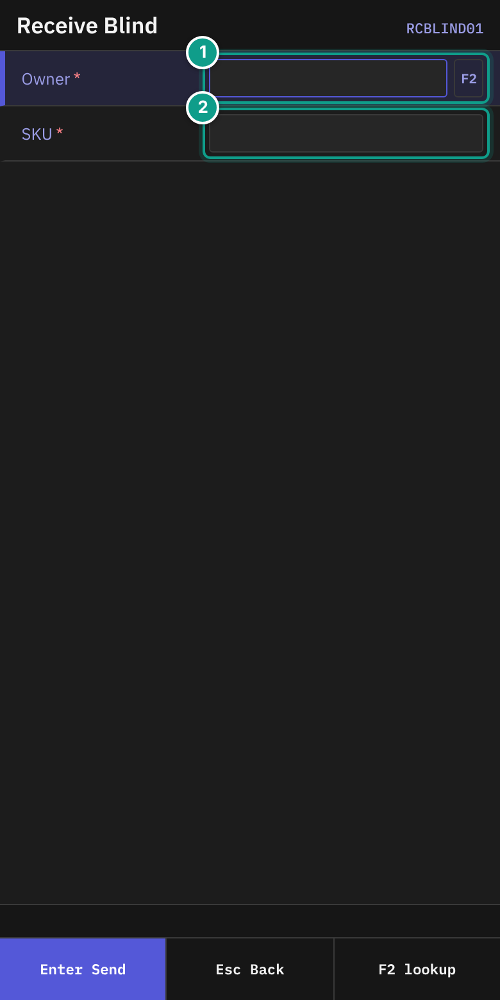
*Screen RCBLIND01: the Owner and SKU fields. Focus: Owner and SKU are required (red star). The teal numbers mark: 1 Owner, 2 SKU.*

2. On **Receive Blind**, in **Owner**, type the owner code (up to 20 characters). To pick from a list, press `F2`. The hint says **Type owner code or F2 to pick by code / company.**
3. In **SKU**, scan the barcode or type the SKU. The field sends itself.

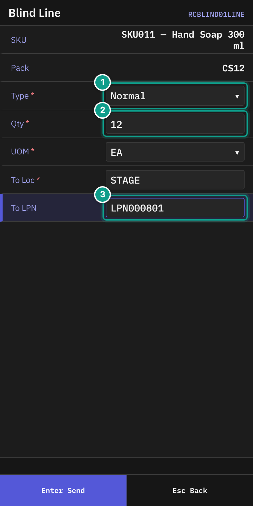
*Screen RCBLIND01LINE: Type, Qty, UOM, To Loc, lot attributes, To LPN. Focus: 1 Type, 2 Qty, 3 To LPN.*

4. On **Blind Line**, check **SKU** and **Pack**.
5. Fill in the fields:

| Field | What to enter |
|-------|---------------|
| **Type** | Leave `Normal`. It is the only choice. |
| **Qty** | The quantity. Must be more than 0. |
| **UOM** | `EA`, `IP`, `CS` or `PL`. |
| **To Loc** | The location. Default `STAGE`. After the first line, it starts with the location you sent last. |
| Lot attribute fields | Fill in each field the SKU asks for. |
| **To LPN** | Scan the pallet label. You may leave it empty only if the owner policy allows it. |

6. On the last field, press `Enter`.

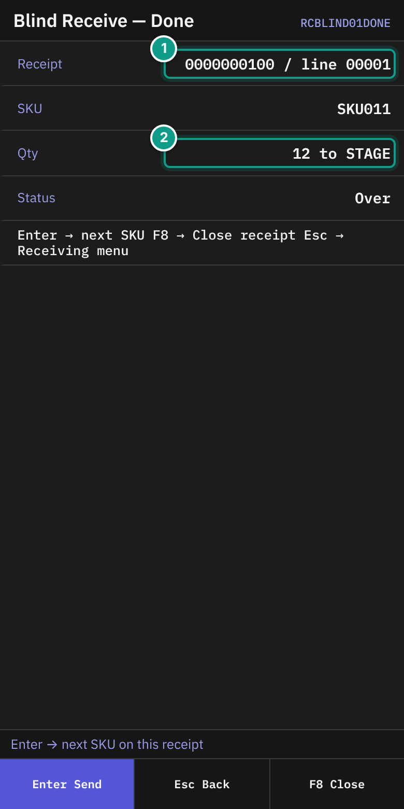
*Screen RCBLIND01DONE: the receipt, SKU, quantity and status. Focus: 1 Receipt number, 2 Qty.*

7. On **Blind Receive — Done**, check:
   - **Receipt**: `{receipt number} / line {n}`
   - **SKU**
   - **Qty**: `{qty} to {location}`
   - **Status**
8. Choose what to do next. The footer says **Enter → next SKU   F8 → Close receipt   Esc → Receiving menu**.
   - `Enter` receives the next SKU on the same receipt.
   - `F8` (**Close**) closes the receipt. See [04 Damage and receipt close](04-damage-and-receipt-close.md).
   - `Esc` returns to the **Receiving** menu.

### Next SKU on the same receipt

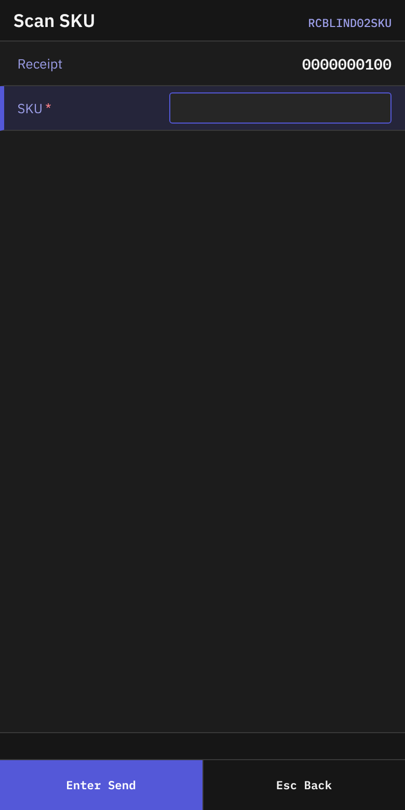
*Screen RCBLIND02SKU: Receipt and SKU.*

1. On **Scan SKU**, check **Receipt**.
2. In **SKU**, scan the next item.
3. On **Blind Line**, fill in the fields as above. This screen also shows **Receipt**. It has no **Type** field.

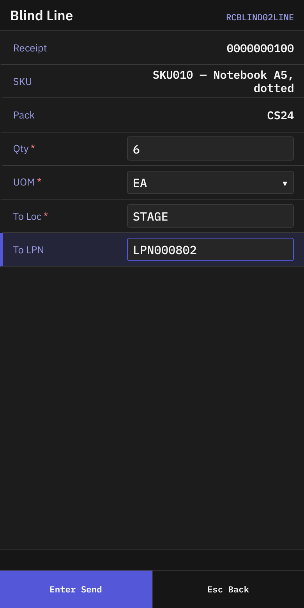
*Screen RCBLIND02LINE: the line form for the second and later SKUs.*

Press `Esc` on **Scan SKU** to go back to **Receiving**.

### Serial-tracked SKU

If the SKU needs serials, **Serial Capture** opens after the line. Scan each serial. See [02 Receiving against an ASN](02-receiving-against-asn.md).
When the last serial is accepted, **Serial Capture Complete** shows **✓ Captured {n} serials**, **Receipt** and **SKU**. The hint says **Enter → next SKU on this receipt   Esc → menu**.

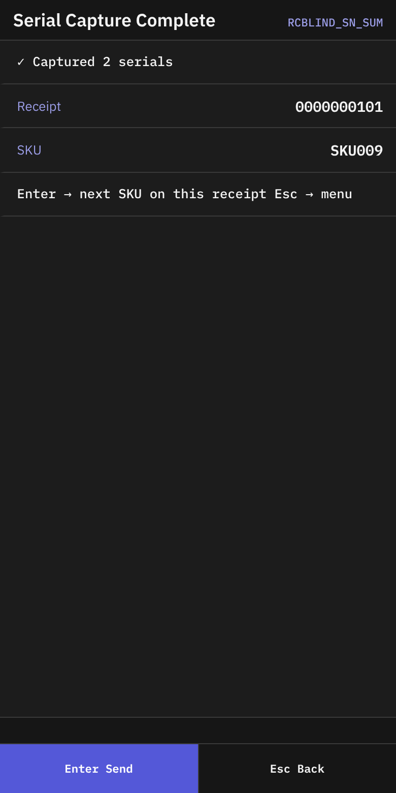
*Screen RCBLIND_SN_SUM: the serial capture summary for a blind receipt.*

## B. Receive Case-Level

### Steps

1. On **Receiving**, press `2` (**Receive Case-Level**).

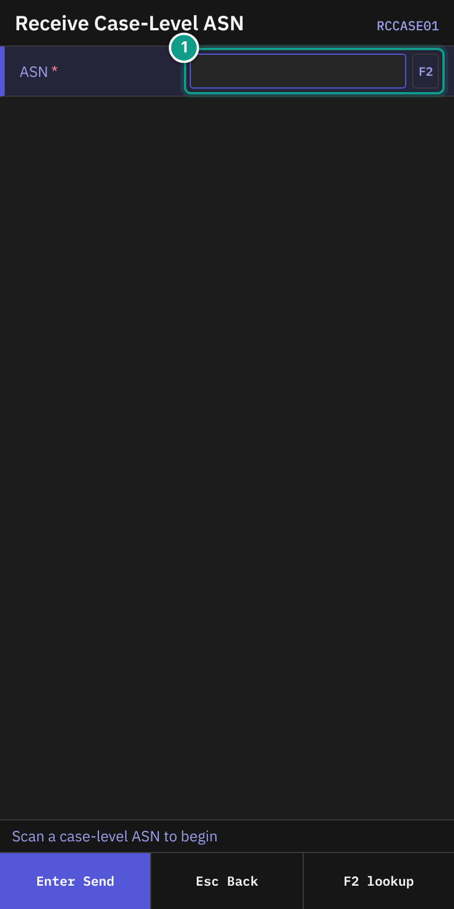
*Screen RCCASE01: the ASN field. Focus: 1 ASN.*

2. On **Receive Case-Level ASN**, in **ASN**, scan or type the ASN number. Press `F2` to find a case-level ASN. The status line says **Scan a case-level ASN to begin**.

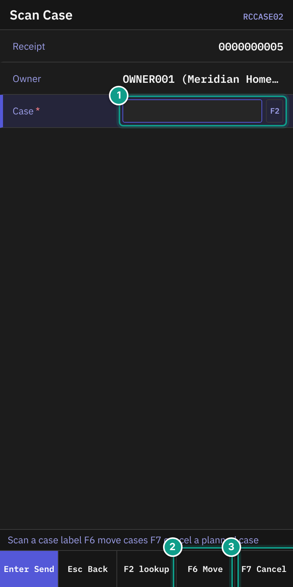
*Screen RCCASE02: Receipt, Owner, Last, Case. Focus: 1 Case, 2 F6 (move cases), 3 F7 (cancel a planned case).*

3. On **Scan Case**, check **Receipt** and **Owner**. The line **Last** shows the last case, for example `CASE-1 = 10 EA`.
4. In **Case**, scan the case label. Press `F2` to list cases not yet received. The status line says **Scan a case label   F6 move cases   F7 cancel a planned case**.

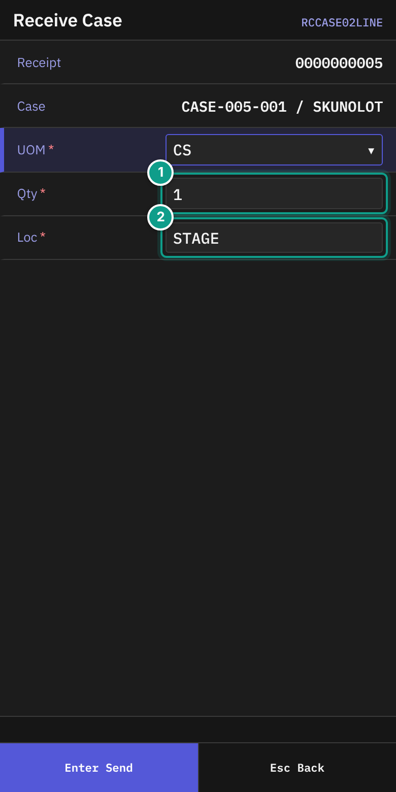
*Screen RCCASE02LINE: Case, UOM, Qty, lot attributes, Loc. Focus: 1 Qty, 2 Loc.*

5. On **Receive Case**, check **Case** (`{label} / {sku}`).
6. Fill in the fields:

| Field | What to enter |
|-------|---------------|
| **UOM** | `CS` (default) or `EA`. |
| **Qty** | The quantity. Default `1`. |
| Lot attribute fields | Fill in each field the SKU asks for. |
| **Loc** | The location. Default `STAGE`; after the first case, the location you sent last. The field sends itself. |

7. Press `Enter`.
8. If more cases wait on the line, the terminal returns to **Scan Case**. Scan the next case.
9. When the line is complete, **Receipt Line Complete** appears.

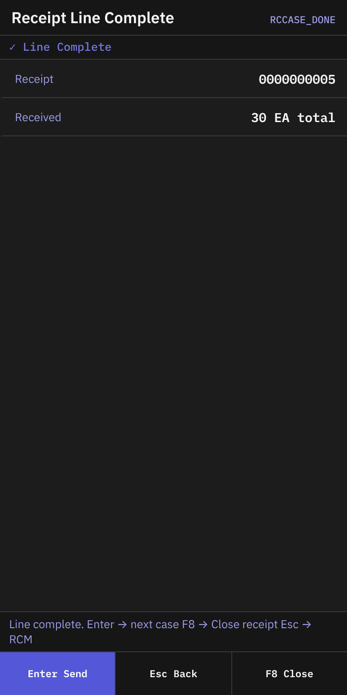
*Screen RCCASE_DONE: the line complete message.*

It shows **✓ Line Complete**, **Receipt** and **Received** (`{n} EA total`). The status line says **Line complete. Enter → next case   F8 → Close receipt   Esc → RCM**.
Press `Enter` for the next case. Press `F8` to close the receipt. Press `Esc` to go to **Receiving**.

### Cancel a case that will not arrive

On **Scan Case**, press `F7` (**Cancel**).

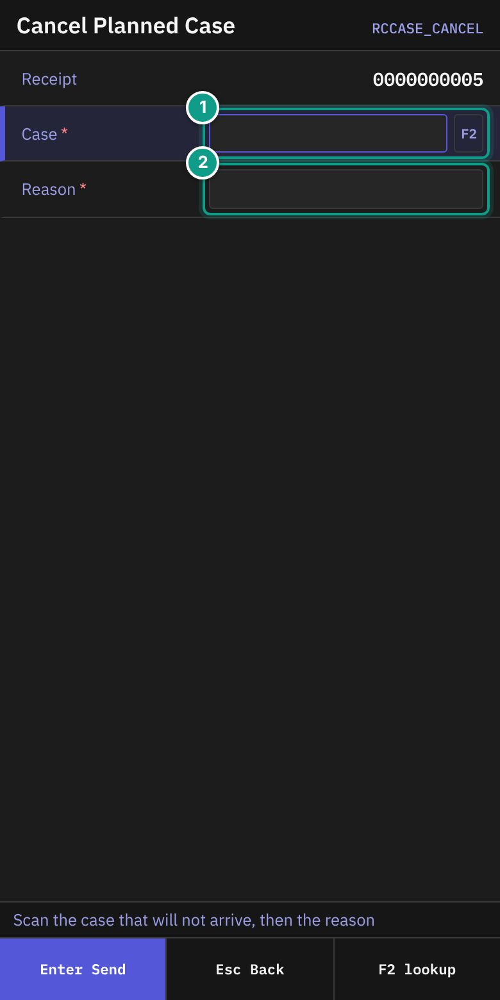
*Screen RCCASE_CANCEL: Receipt, Case, Reason. Focus: 1 Case, 2 Reason.*

1. On **Cancel Planned Case**, read the status line: **Scan the case that will not arrive, then the reason**.
2. In **Case**, scan or type the case label. `F2` lists cases not yet received.
3. In **Reason**, type why the case will not arrive (up to 200 characters).
4. Press `Enter`. The line **Case {label} cancelled** appears.
5. Press `Esc` to go back.

### Move cases to another pallet

On **Scan Case**, press `F6` (**Move**).

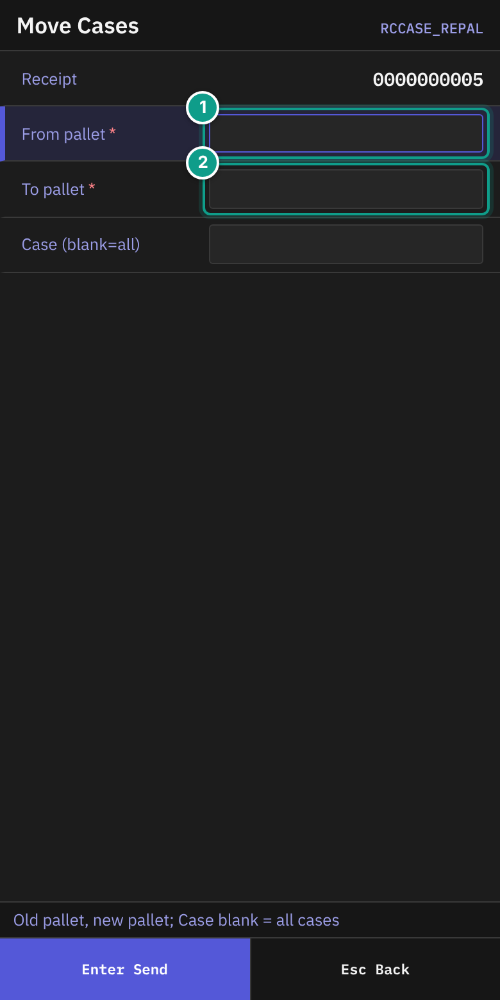
*Screen RCCASE_REPAL: From pallet, To pallet, Case. Focus: 1 From pallet, 2 To pallet.*

1. On **Move Cases**, read the status line: **Old pallet, new pallet; Case blank = all cases**.
2. In **From pallet**, scan the old pallet label.
3. In **To pallet**, scan the new pallet label.
4. In **Case (blank=all)**, scan one case, or leave it empty to move all cases.
5. Press `Enter`. The line shows **Moved {n} case(s) {old} → {new}**. If the new pallet was created, it adds **(new pallet)**.
6. Press `Esc` to go back.

## C. Receive Return

### Steps

1. On **Receiving**, press `4` (**Receive Return**).

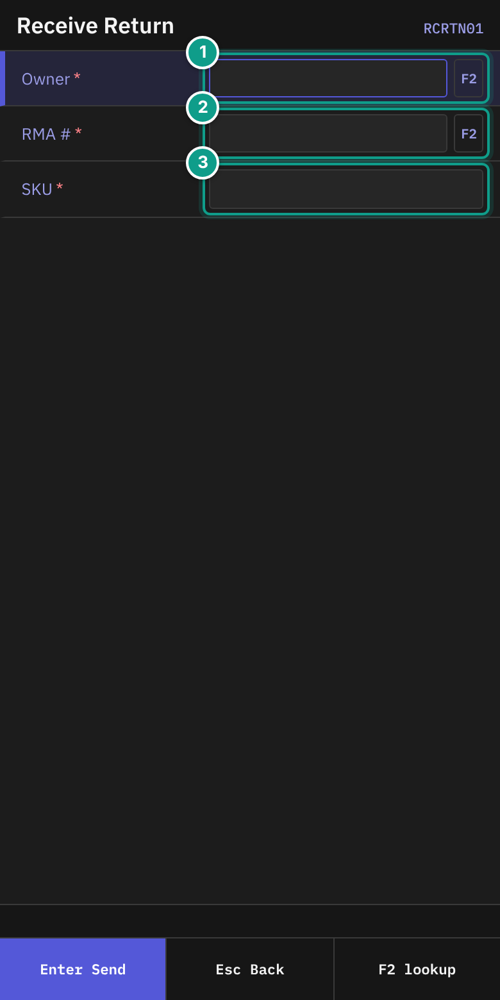
*Screen RCRTN01: Owner, RMA #, SKU. Focus: 1 Owner, 2 RMA #, 3 SKU.*

2. On **Receive Return**, in **Owner**, type the owner code. `F2` opens a list.
3. In **RMA #**, type the RMA number. `F2` lists open customer returns. The hint says **Type RMA reference or F2 to pick from open Customer Returns.**
4. In **SKU**, scan the returned item.

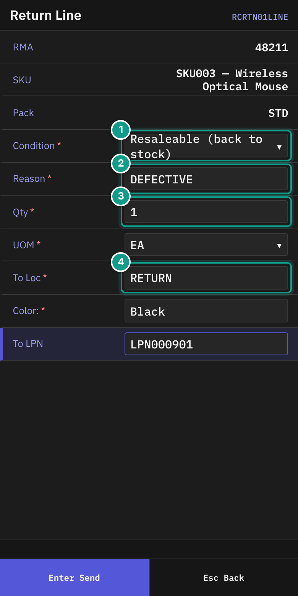
*Screen RCRTN01LINE: Condition, Reason, Qty, UOM, To Loc, damage fields. Focus: 1 Condition, 2 Reason, 3 Qty, 4 To Loc.*

5. On **Return Line**, check **RMA**, **SKU** and **Pack**.
6. Fill in the fields:

| Field | What to enter |
|-------|---------------|
| **Condition** | Your visual assessment. Press `Left` or `Right`. Choices: **Resaleable (back to stock)**, **Needs refurb (refurb staging)**, **Damaged (quarantine)**, **Discard (trash bin)**. Default **Resaleable**. |
| **Reason** | Why the customer returned the item. Type a code, for example `defective` or `wrong_item`. Required. Up to 30 characters. |
| **Qty** | The quantity. |
| **UOM** | `EA`, `IP`, `CS` or `PL`. |
| **To Loc** | Default `RETURN`; after the first line, the location you sent last. The hint says the system may send damaged or discarded goods to another place. |
| Lot attribute fields | Fill in each field the SKU asks for. |
| **To LPN** | Pallet label. May be empty only if the owner policy allows it. |

7. If **Condition** is **Damaged**, four more fields appear:

| Field | What to enter |
|-------|---------------|
| **Severity** | **Cosmetic (sell as-is)**, **Minor (discount)**, **Major (refurb / hold)** or **Total (write-off)**. Default **Minor**. |
| **Damage type** | **Crushed / Dented**, **Water damage**, **Torn / Punctured**, **Contamination**, **Temp breach**, **Transit damage** or **Other**. Default **Crushed / Dented**. |
| **Description** | Optional text, up to 200 characters. |
| **Vendor fault?** | `Space` switches yes/no. `Y` sets yes. `N` sets no. Default no. |

8. On the last field, press `Enter`.

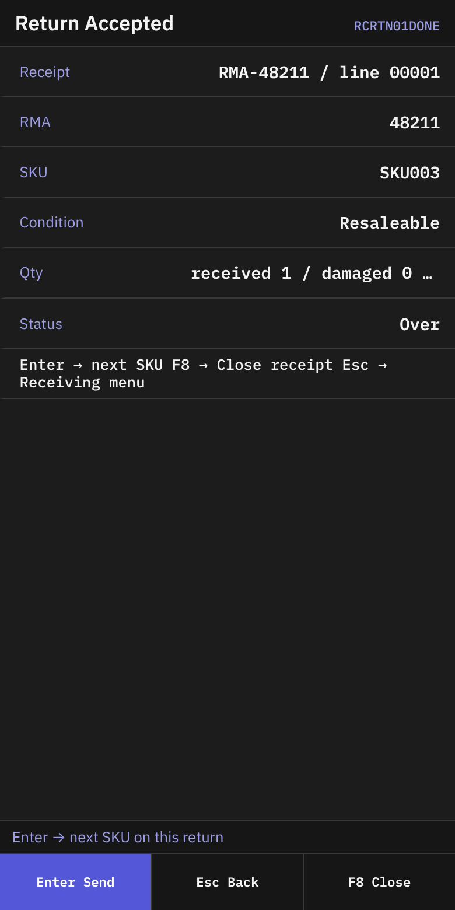
*Screen RCRTN01DONE: the return summary.*

9. On **Return Accepted**, check:
   - **Receipt**: `{receipt} / line {n}`
   - **RMA**, **SKU**, **Condition**
   - **Qty**: `received {a} / damaged {b} / rejected {c} to {location}`
   - **Status**
10. The status line says **Enter → next SKU on this return**. Press `Enter` for the next SKU. Press `F8` (**Close**) to close the receipt. Press `Esc` to go to **Receiving**.

For the next SKU, the terminal shows **Scan SKU** with **Receipt** and **RMA**.

*Screen RCRTN02SKU: Receipt, RMA, SKU.*

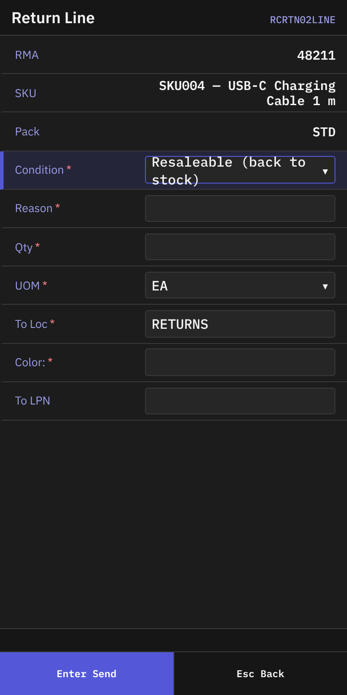
*Screen RCRTN02LINE: the return line form for the second and later SKUs.*

## What you should see

- A **Done** or **Accepted** screen after each line.
- The same receipt number for all SKUs in one session.

## If something goes wrong

| Message | What it means | What to do |
|---------|---------------|------------|
| **Owner not found: {code}** | The owner code is unknown. | Check the code. Press `F2` and choose from the list. |
| **SKU not found: {code}** | The SKU or barcode is unknown. | Scan again. Tell your supervisor if it keeps failing. |
| **receipt {number} is Aggregate-granularity — use 'Receive Against ASN' instead** | You scanned an ASN that is not case-level. | Press `Esc`. Use **Receive Against ASN**. |
| **asn {number} not found** | No ASN has this number. | Check the number. Press `F2`. |
| **case_label is blank** | You sent the cancel form without a case. | Scan the case label. |
| **ReceiveReturnLine: receipt {id} is type {type}, must be CustomerReturn** | The receipt is not a customer return. | Tell your supervisor. |
| **Receipt without LPN is not allowed by owner policy** | **To LPN** is empty, and the owner requires one. | Scan an LPN. |
| **qty {qty} is not a multiple of pack {pack_qty}** | The quantity does not fit the pack. | Check the quantity and unit. |
| **receipt id={id} is OnHold — release the hold before receiving** | The receipt is on hold. | Tell your supervisor. |
| **No permission: {screen}** or **No permission** | Your user may not do this. For example, **Cancel Planned Case** may be for supervisors. | Tell your supervisor which screen you were using and what you tried to do. |

Messages for a location and for case-level receiving:

| Message | What it means | What to do |
|---------|---------------|------------|
| **Invalid location {code}** | The location in **To Loc** does not exist in this warehouse. | Check the code. Ask your supervisor for the right location. |
| **location {code} holds only open pick pallets: nothing is received into it** | You cannot receive into this location. | Choose another location. |
| **case '{label}' is already {status} (only Planned cases can be received)** | This case was already received or cancelled. | Check the label. Tell your supervisor. |
| **case '{label}' not on receipt {id} and the receipt has no unplanned-case policy (granularity is Aggregate or column unset). Reject.** | The case is not on this ASN. | Do not receive it. Tell your supervisor. |
| **case '{label}' not on receipt {id} and unplanned_case_on_asn=HardError — scan rejected** | The owner does not allow cases that the ASN does not list. | Do not receive it. Tell your supervisor. |
| **old pallet '{lpn}' not found on receipt {id}** | **Replace Pallet**: the old pallet label is not on this receipt. | Check the label. |
| **Scan both the old and the new pallet LPN** | **Replace Pallet**: one of the two labels is empty. | Scan both. |
| **The old and the new pallet are the same ('{lpn}'): scan the new pallet** | **Replace Pallet**: both labels are equal. | Scan a different new pallet. |
| **new pallet lpn '{lpn}' already exists on receipt {id} — refusing to merge cross-receipt structural data; pick a different code or fix the source** | **Replace Pallet**: the new label is already used. | Scan a different new pallet. |
| **case '{label}' not found on receipt {id}** | **Cancel Planned Case**: the case is not on the receipt. | Check the label. |
| **case '{label}' is {status} — only Planned cases can be cancelled** | **Cancel Planned Case**: the case is already received or cancelled. | Nothing to do. |
| **reason is required for cancellation audit trail** | **Cancel Planned Case** needs a reason. | Enter a reason. |
| **This case was just received at another terminal: scan the next one** (or **... concurrent operation; retry**) | Someone else received the same case at the same time. | Scan the next case. |

Other case messages exist for rare data problems. Their text is in the server code and contains the case label or the receipt number.

To pick a case without typing its label, press `F2` on the **Case** field of **Scan Case**: it lists the cases of the receipt that are not received yet.

## What the supervisor sees

Blind and return receipts are created when you receive the first line. The receipt shows the owner, lines and quantities. Damaged returns go to quarantine and carry the severity and damage type you entered.

## Related guides

- [02 Receiving against an ASN](02-receiving-against-asn.md)
- [04 Damage and receipt close](04-damage-and-receipt-close.md)
- [05 Putaway](05-putaway.md)
- [11 Troubleshooting and messages](11-troubleshooting-and-messages.md)
