# 04 Damage and receipt close

## What you will do

- Receive damaged goods into the damage area.
- Correct a received quantity that is wrong.
- Close a receipt.
- (Supervisor) Force-close a serial capture that cannot be finished.

## Before you start

- For damaged goods, know the owner code (**Receive Damaged**) or the ASN (**Damage** key).
- To close a receipt, know the receipt number.
- Finish all serial captures on the receipt first. An open capture blocks the close.
- Every damage record must have a final decision. A receipt with undecided damage cannot be closed.
- A receipt that differs from its plan needs a supervisor. Have the supervisor ready at the terminal.

## A. Receive damaged goods

There are two ways in.

### A1. From the Receiving menu

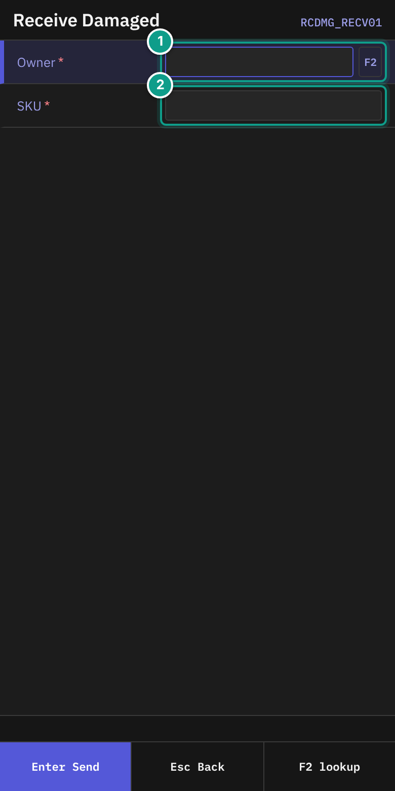
*Screen RCDMG_RECV01: Owner and SKU. Focus: 1 Owner, 2 SKU.*

1. On **Receiving**, press `6` (**Receive Damaged**).
2. On **Receive Damaged**, in **Owner**, type the owner code. `F2` opens a list. The hint says **Type owner code or F2 to pick.**
3. In **SKU**, scan or type the damaged item. The hint says **Scan or type SKU of the damaged item.**

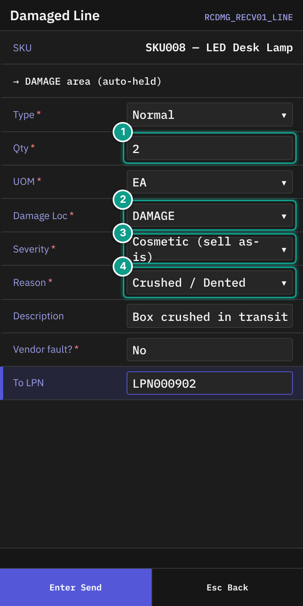
*Screen RCDMG_RECV01_LINE: damage fields. Focus: 1 Qty, 2 Damage Loc, 3 Severity, 4 Reason.*

4. On **Damaged Line**, read the line **→ DAMAGE area (auto-held)**. The goods go to the damage location and are held.
5. Fill in the fields:

| Field | What to enter |
|-------|---------------|
| **Type** | `Normal` (only choice). |
| **Qty** | The damaged quantity. |
| **UOM** | `EA`, `IP`, `CS` or `PL`. |
| **Damage Loc** | `DAMAGE` (only choice). The hint says **Dedicated damage location — permanent hold auto-blocks ATP.** |
| Lot attribute fields | Fill in each field the SKU asks for. |
| **Severity** | **Cosmetic (sell as-is)**, **Minor (discount)**, **Major (refurb / hold)** or **Total (write-off)**. Default **Minor**. |
| **Reason** | The damage type: **Crushed / Dented**, **Water damage**, **Torn / Punctured**, **Contamination**, **Temp breach**, **Transit damage** or **Other**. Default **Crushed / Dented**. |
| **Description** | Optional text, up to 200 characters. It is used for disputes and vendor claims. |
| **Vendor fault?** | `Space` switches. `Y` is yes. `N` is no. Yes means the vendor is responsible. |
| **To LPN** | Pallet label. May be empty only if the owner policy allows it. |

6. On the last field, press `Enter`. The footer shows `Esc` **Cancel**.

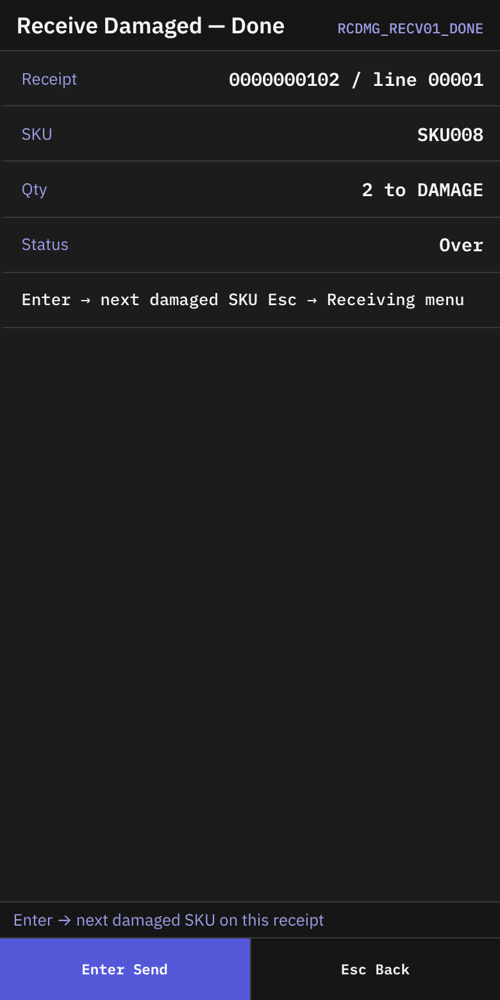
*Screen RCDMG_RECV01_DONE: the result of the damaged line.*

7. On **Receive Damaged — Done**, check **Receipt** (`{number} / line {n}`), **SKU**, **Qty** (`{qty} to {location}`) and **Status**.
8. The status line says **Enter → next damaged SKU on this receipt**. Press `Enter`, or press `Esc` for the **Receiving** menu.

For the next damaged SKU, the terminal shows **Scan Damaged SKU** (with **Receipt**) and then **Damaged Line** with the same fields.

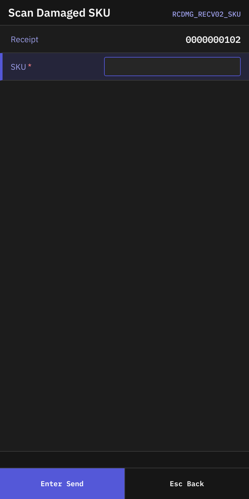
*Screen RCDMG_RECV02_SKU: Receipt and SKU.*

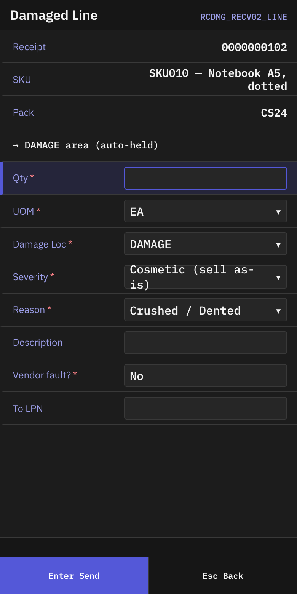
*Screen RCDMG_RECV02_LINE: the damaged line for the second and later SKUs.*

### A2. During ASN receiving (the Damage key)

1. On **Receipt Summary**, press `F4` (**Damage**).

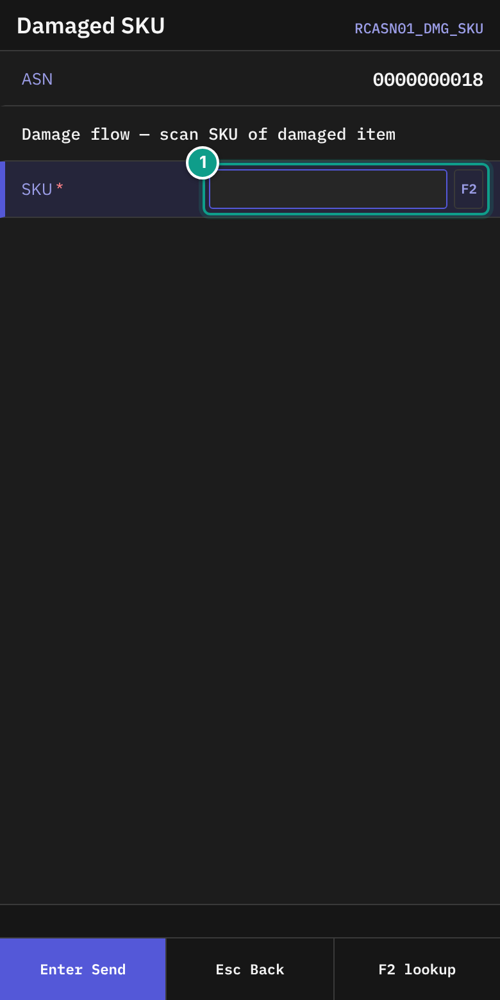
*Screen RCASN01_DMG_SKU: ASN and the damaged SKU field. Focus: 1 SKU.*

2. On **Damaged SKU**, read **Damage flow — scan SKU of damaged item**. Check **ASN**.
3. In **SKU**, scan the damaged item. `F2` lists the SKUs of the receipt.

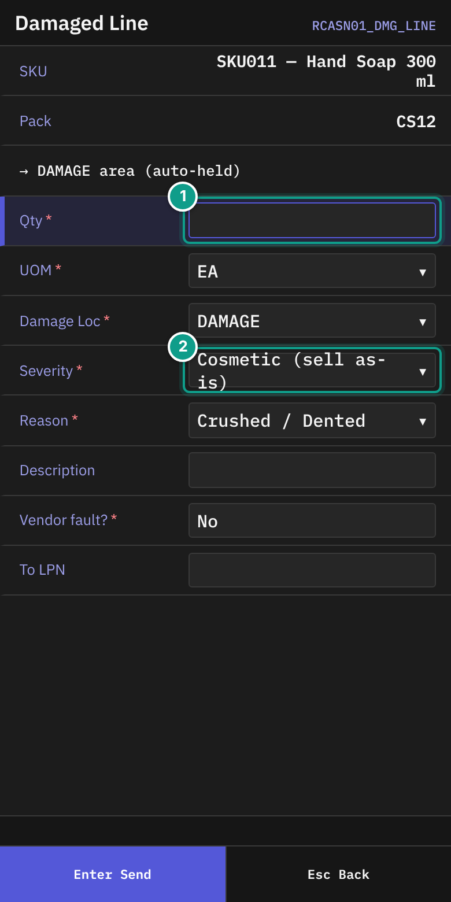
*Screen RCASN01_DMG_LINE: the damaged line for an ASN. Focus: 1 Qty, 2 Severity.*

4. On **Damaged Line**, fill in the same fields as in A1, without **Type**.
5. Press `Enter`. The terminal returns to **Damaged SKU**. Scan the next damaged SKU, or press `Esc` to go back to the summary.

## B. Close a receipt

You can reach **Close Receipt** in three ways:

- From **Receiving**, press `5` (**Close Receipt**).
- From a **Done** screen of blind, return or case-level receiving, press `F8` (**Close**).
- From **Receipt Summary** (ASN receiving), press `F8` (**Close**). This closes the receipt directly.

### B1. Open the receipt

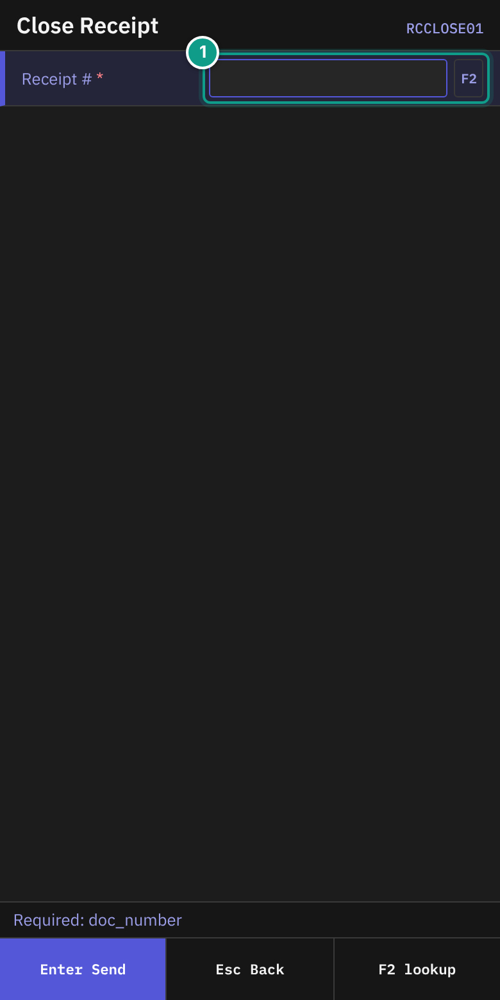
*Screen RCCLOSE01: the receipt number field. Focus: 1 Receipt #.*

1. On **Close Receipt**, read the status line: **Scan the receipt number**.
2. In **Receipt #**, scan or type the number. If you came from a Done screen, the number is already there. `F2` lists receipts.
3. Press `Enter`.

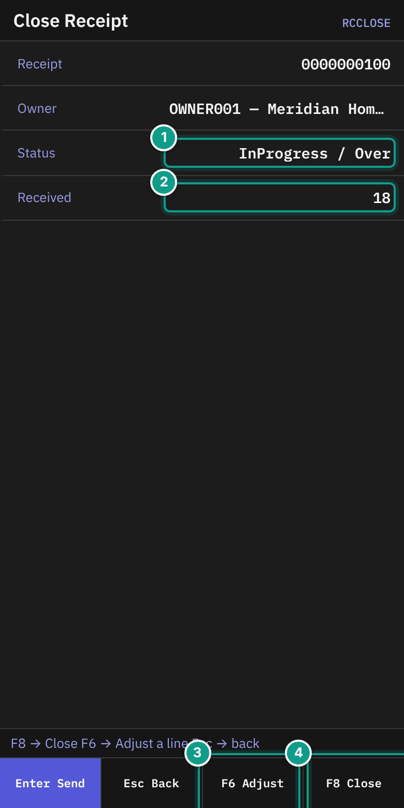
*Screen RCCLOSE: Receipt, Owner, Status, Received. Focus: 1 Status, 2 Received, 3 F6 (adjust a line), 4 F8 (close).*

4. Check the second **Close Receipt** screen:

| Line | What it shows |
|------|---------------|
| **Receipt** | The receipt number, and the external number if there is one |
| **Owner** | Owner code and company |
| **Status** | Status and completion |
| **Received** | Received over expected, with a percent bar. If no quantity is expected, it shows only the received quantity. |
| **Adjusted** | Only after a correction: `{line} {sku}: {old} → {new}` |
| (no label) | **Supervisor authorized — F8 to close**. Shown after a supervisor approved. |

The status line says **F8 → Close   F6 → Adjust a line   Esc → back**.

5. To close, press `F8` (**Close**).
6. If the receipt closes, **Receipt Closed** appears. Press `Enter`.

### B2. Correct a quantity before closing

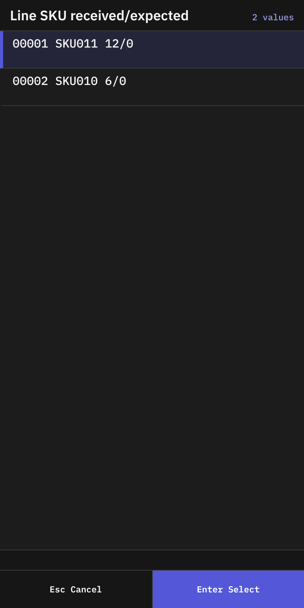
*Screen RCADJ01: the list of receipt lines.*

1. On **Close Receipt**, press `F6` (**Adjust**).
2. On **Adjust — Pick Line**, the list is titled **Line  SKU  received/expected**. Each row reads `{line} {sku} {received}/{expected}`.
3. Choose the line with `Enter`. If the receipt has no lines, you see **No lines on this receipt**. Press `Esc`.

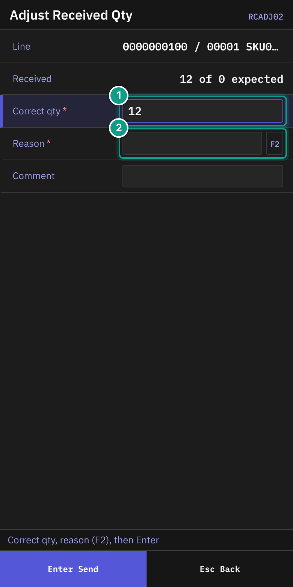
*Screen RCADJ02: Line, Received, Correct qty, Reason, Comment. Focus: 1 Correct qty, 2 Reason.*

4. On **Adjust Received Qty**, read the status line: **Correct qty, reason (F2), then Enter**.
5. Check **Line** and **Received** (`{received} of {expected} expected`).
6. In **Correct qty**, type the right quantity. The field starts with the current quantity.
7. In **Reason**, press `F2` and choose a reason. Required.
8. In **Comment**, type a note if needed (up to 200 characters).
9. Press `Enter`. If you left the quantity unchanged, nothing happens.
10. The terminal returns to **Close Receipt**. The line **Adjusted** shows your change.

### B3. A supervisor must approve the close

If the receipt differs from its plan, the close is refused and the terminal opens **Supervisor Override**.

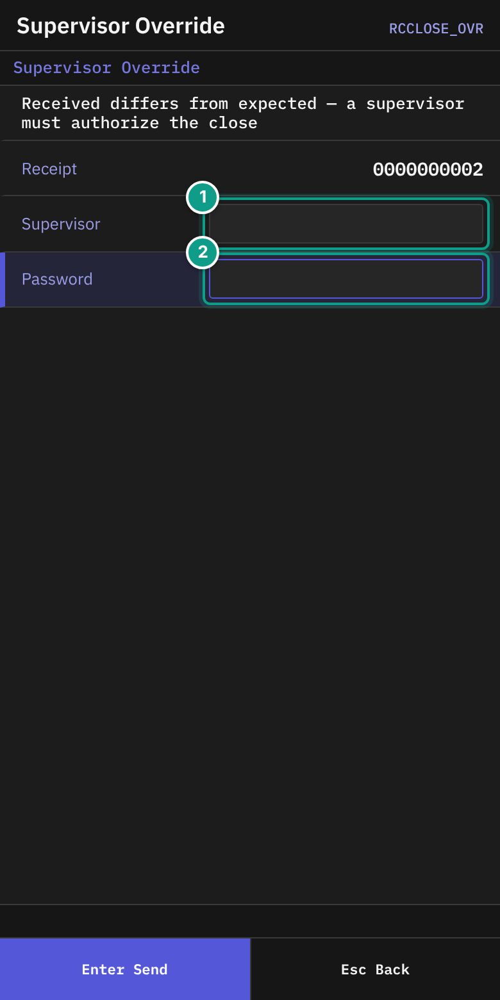
*Screen RCCLOSE_OVR: Receipt, Supervisor, Password. Focus: 1 Supervisor, 2 Password.*

1. Read the text: **Received differs from expected — a supervisor must authorize the close**. Check **Receipt**.
2. Give the terminal to the supervisor.
3. The supervisor types the user name in **Supervisor** and the password in **Password**, then presses `Enter`. The status line shows **Authorizing…**.
4. The terminal returns to **Close Receipt**. The line **Supervisor authorized — F8 to close** appears.
5. Press `F8` (**Close**) again.

You can press `Esc` to cancel and go back.

## C. Force-close a serial capture (supervisor)

Only a supervisor does this. Use it when an operator left a capture open and it cannot be finished.

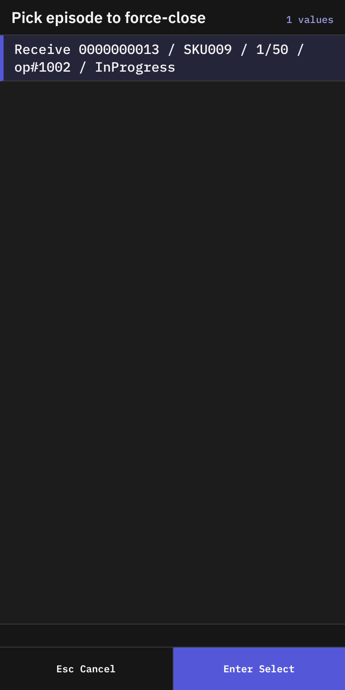
*Screen RCSN_FORCE: the list titled Pick episode to force-close.*

1. On **Receiving** (or **Picking**), press the key for **Force-Close Episode (supervisor)**.
2. On **Force-Close Episodes**, read the list **Pick episode to force-close**. Each row reads `{operation} {document} / {sku} / {captured}/{expected} / op#{operator} / {status}`.
3. Choose a row with `Enter`. If nothing waits, the status line says **No episodes need force-close**. Press `Esc`.

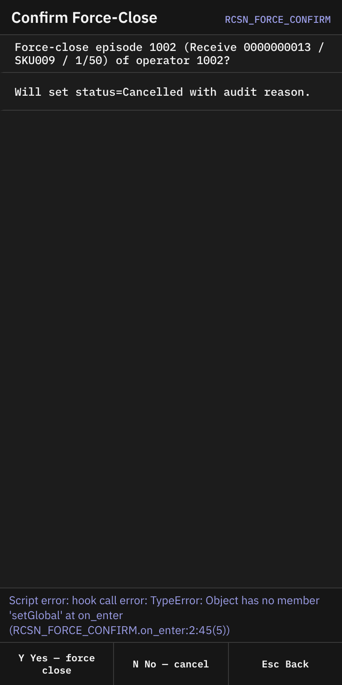
*Screen RCSN_FORCE_CONFIRM: the question and the two choices.*

4. On **Confirm Force-Close**, read the question **Force-close episode {id} ({operation} {document} / {sku} / {captured}/{expected}) of operator {id}?** and **Will set status=Cancelled with audit reason.** The status line says **Y = force-close, N = back**.
5. Press `Y` (**Yes — force close**) to force-close. Press `N` (**No — cancel**) to go back.
6. After `Y`, the list reloads.

The system stores the reason `supervisor force-close via RF menu` with the change.

## What you should see

- **Receipt Closed** after a successful close.
- A cleared **Serials** line and no open episodes before the close.
- After a supervisor approval, **Supervisor authorized — F8 to close**.

## If something goes wrong

| Message | What it means | What to do |
|---------|---------------|------------|
| **Receipt {number} has {n} unresolved serial-capture episode(s): {list}. Finish capturing serials or cancel the episode before close.** | A serial capture is still open. | Use **Resume Serial Capture** and scan the serials. |
| **... Abandoned episodes need supervisor force_close to resolve; operator-active episodes need capture finish or cancel.** | Some captures were left by an operator. | Ask a supervisor to force-close them (section C). |
| **Receipt {number} has {n} damage record(s) awaiting final disposition** | Damage records have no final decision. | Ask your supervisor to decide on the damaged goods first. |
| **Receipt {number} is {completion} — supervisor override required to close** | Received differs from expected. A supervisor can approve. | Follow section B3. |
| **You don't have permission to close receipt {number} with a discrepancy. Ask a supervisor.** | Your user may not approve this. | Ask a supervisor to approve on **Supervisor Override**. |
| **Cannot close receipt {number}: completion is {completion} and ALLOW_CLOSE_WITH_DISCREPANCY is off** | The warehouse does not allow closing with a difference. | Correct the quantities (B2) or ask your supervisor. |
| **receipt was modified concurrently, please retry** | Someone changed the receipt. | The terminal tries again up to three times. If it still fails, open the receipt again. |
| **receipt is locked, please retry (timeout {ms}ms)** | Someone else is using the receipt. | Wait. Try again. |
| **override grant is not usable: {reason}** | The supervisor approval cannot be used. See the reasons below. | Ask the supervisor to approve again. |
| **asn {number} not found** | No receipt has this number. | Check the number. |
| **No permission: {screen}** or **No permission** | Your user may not do this. | Tell your supervisor which screen you were using and what you tried to do. |

The `{reason}` in **override grant is not usable: {reason}** is one of these:

- `no such grant` — the approval does not exist.
- `it was granted to a different operator` — the approval was made for another person.
- `it has already been used` — the approval was used once already.
- `it has expired — ask the supervisor again` — the approval is too old.
- `it was issued for a different receipt` — the approval is for another receipt.
- `it was issued for a different line of this receipt` or `it names the receipt but not the line` — the approval does not fit this line.
- `it names a line, and a close is decided for the whole receipt` — a line approval cannot close a receipt.
- `it authorises closing the receipt (code {n}), and this command receives a line` or `it authorises a line's quantity (code {n}), and this command closes the receipt` — the approval is for the other action.
- `this receive opens a new line, which no grant can name in advance — a supervisor must acknowledge it at this terminal` — the supervisor must approve at your terminal.

Everyone sees **Force-Close Episode (supervisor)** in the menu. By default only Admin, Manager and Supervisor roles may open the list and force-close an episode. When an Operator chooses the menu item, the first list request is refused before the list opens. The status line says **No permission: Force-Close Episodes**.

## What the supervisor sees

A closed receipt has status **Closed**. A close with a difference is stored with the supervisor who approved it. A force-closed episode gets status Cancelled with an audit reason.

## Related guides

- [02 Receiving against an ASN](02-receiving-against-asn.md)
- [03 Blind receiving and returns](03-blind-receiving-and-returns.md)
- [12 Troubleshooting and messages](12-troubleshooting-and-messages.md)
