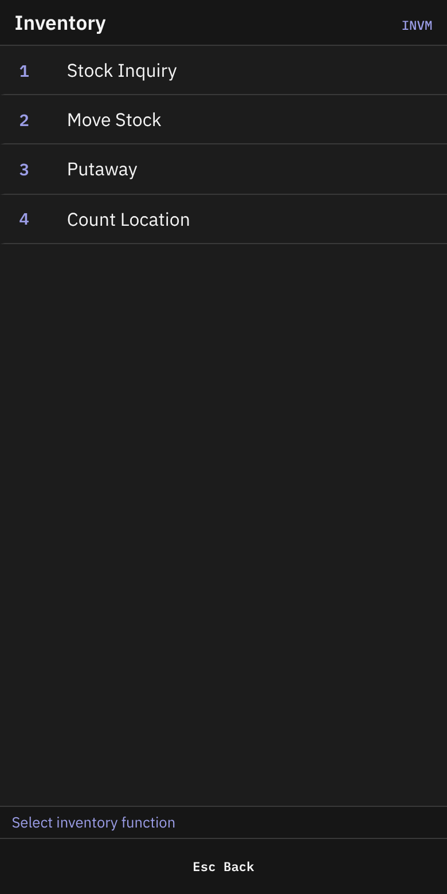
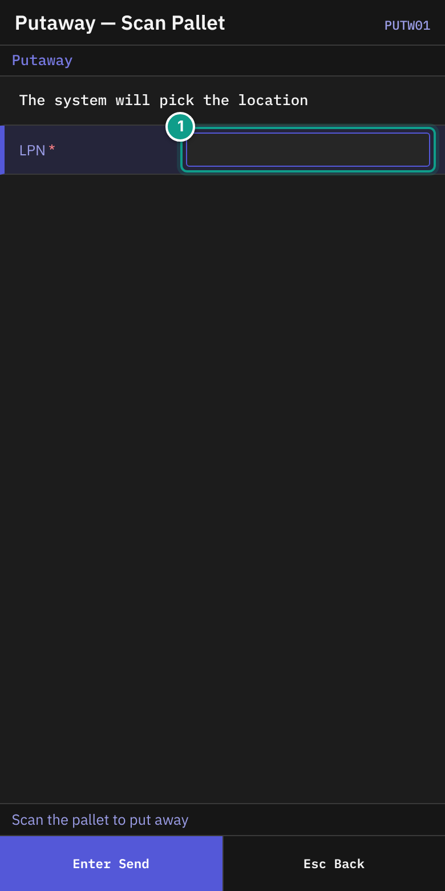
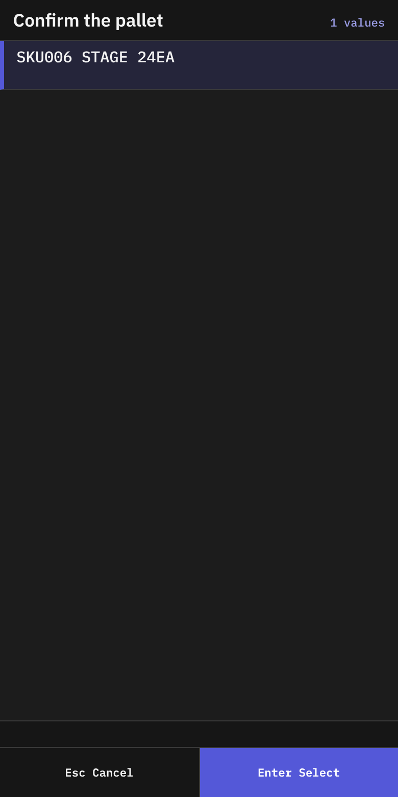
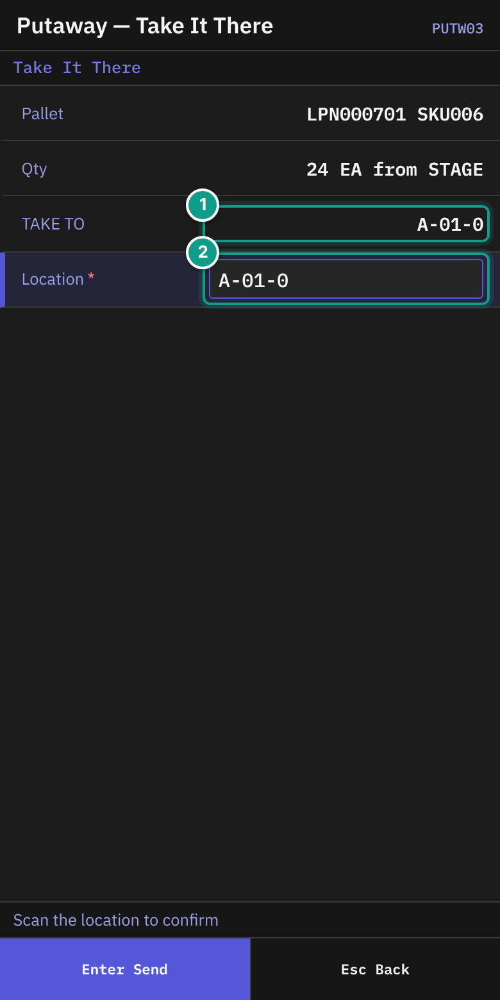
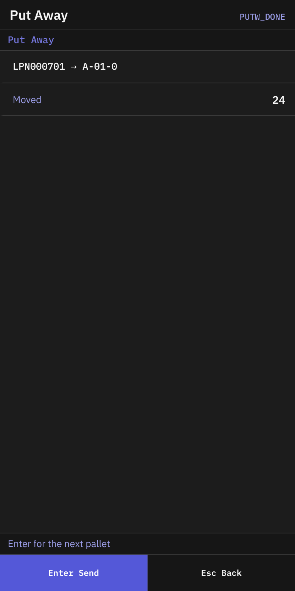
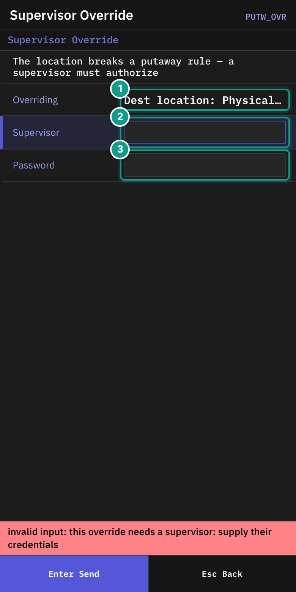

# 05 Putaway

## What you will do

Take a received pallet to the storage location that the system chooses. Scan the location to confirm.

## Before you start

- The pallet must have an LPN label and must hold stock.
- The pallet must stand at a known location (for example `STAGE`).
- You need to be able to walk to the location the system suggests.
- If the location breaks a putaway rule, a supervisor must approve.

The default roles Operator and Supervisor may run putaway. If you see **No permission: {screen}** or **No permission**, your administrator has changed the permission settings. Tell your supervisor which screen you were using and what you tried to do.

## Steps

*Screen INVM: the Inventory menu. Focus: Putaway is option 3.*

1. On **Main Menu**, press `2` (**Inventory**).
2. On **Inventory**, press `3` (**Putaway**).

*Screen PUTW01: the LPN field. Focus: The text says the system will pick the location; you only scan the pallet LPN. Focus: 1 LPN.*

3. On **Putaway — Scan Pallet**, read the line **The system will pick the location**. The status line says **Scan the pallet to put away**.
4. In **LPN**, scan the pallet label (up to 40 characters). If the field is empty, `Enter` does nothing.

*Screen PUTW02: the list titled Confirm the pallet.*

5. On **Putaway — Confirm Pallet** (header **Confirm Pallet**), the list **Confirm the pallet** shows what is on the pallet. A row reads `{sku} {location} {qty}{uom}` and adds `HOLD` if the stock is held.
6. Check that the row is your pallet. Press `Enter` on the row.
7. If the list is empty, the status line says **No pallet with that LPN — Esc to scan again**. Press `Esc` and scan again.

*Screen PUTW03: Pallet, Qty, TAKE TO, Location. Focus: 1 TAKE TO (where the system sends you), 2 Location (scan it).*

8. On **Putaway — Take It There** (header **Take It There**), check:
   - **Pallet**: the LPN and the SKU. **loose** means no LPN.
   - **Qty**: `{qty} {uom}  from {location}`.
   - **TAKE TO**: the location the system chose. The system holds this space for you.
9. Walk to the **TAKE TO** location with the pallet.
10. In **Location**, scan the location label. The field starts with the suggested location. The field sends itself.
11. The pallet moves. **Put Away** appears.

*Screen PUTW_DONE: the result of the putaway.*

12. On **Put Away**, check the line `{lpn} → {location}` and **Moved** (the quantity).
13. Press `Enter` for the next pallet. The LPN field is empty. Press `Esc` to go to the **Inventory** menu.

### If the system has no location

On **Putaway — Take It There**, the line shows **No location available: {reason} — Esc to give up**.

1. Press `Esc`.
2. The terminal asks: **Give up this putaway? The location held for you will be freed.** Press `Y` (**Give up**) or `N` (**Keep going**).
3. Tell your supervisor.

### If the system sends you to another location

If the system changes the location, a line on the screen tells you where to go. **TAKE TO** shows the new location. Scan the new location.

### If a supervisor must approve

If you scan a location that breaks a putaway rule, the terminal opens **Supervisor Override**.

*Screen PUTW_OVR: the rule and the supervisor sign-in. Focus: 1 Overriding (the broken rule), 2 Supervisor, 3 Password.*

1. Read **The location breaks a putaway rule — a supervisor must authorize**.
2. **Overriding** shows what is broken, for example `Putaway rule: {rule}`. Other parts can be **Source LPN**, **Source location**, **Dest location** and **Hold**.
3. The supervisor types the user name in **Supervisor** and the password in **Password**, then presses `Enter`.
4. The terminal returns to **Putaway — Take It There**. Scan the location again.

### Leave in the middle

1. Press `Esc` on **Putaway — Take It There**.
2. If a location is held for you, answer the question as above. The held location is freed if you press `Y`.

## What you should see

- **Put Away** with `{lpn} → {location}`.
- The stock is now at the new location.

## If something goes wrong

| Message | What it means | What to do |
|---------|---------------|------------|
| **container {id} not found** | The LPN is unknown. | Scan the label again. |
| **container {id} holds no stock to put away** | The pallet is empty. | Check the pallet. Tell your supervisor. |
| **container {id} has no current location to put away from** | The system does not know where the pallet is. | Tell your supervisor. |
| **No location available: {reason} — Esc to give up** | No location fits. | Press `Esc`. Tell your supervisor. |
| **destination not found: {code}** | The location code does not exist. | Scan the location label again. |
| **destination {code} is inactive** | The location is not in use. | Choose another location. Tell your supervisor. |
| **destination location blocked: {reason}** | The location is blocked. | Choose another. |
| **capacity exceeded ({kind}): limit={limit}, attempted={attempted}** | The location is full. | Ask for another location. |
| **directed move must be redirected away from {location}: {because}; put it in {location} instead** | The system moves you to another location. | Take the pallet to the named location. |
| **directed move must be redirected away from {location}: {because}; no replacement location could be named — ask for a fresh suggestion** | No new location was found. | Press `Esc` and start putaway again. |
| **directed move: reservation {id} is not usable ({reason})** | The space held for you has expired. | Start putaway again. |
| **hold #{id} ({code}) blocks this move (policy: not overridable)** | The stock is held. A supervisor cannot override it here. | Tell your supervisor. |
| **move requires an acknowledged override of: code {n} ({subject})** | A supervisor must approve. | Follow the **Supervisor Override** steps. |
| **No permission: {screen}** or **No permission** | Your user may not do this. | Tell your supervisor which screen you were using and what you tried to do. |

## What the supervisor sees

The system holds a space at the suggested location while you walk. If you give up, the space is freed. After the move, the stock appears at the new location.

## Related guides

- [06 Move](06-move.md)
- [07 Stock inquiry](07-inventory-inquiry.md)
- [12 Troubleshooting and messages](11-troubleshooting-and-messages.md)
