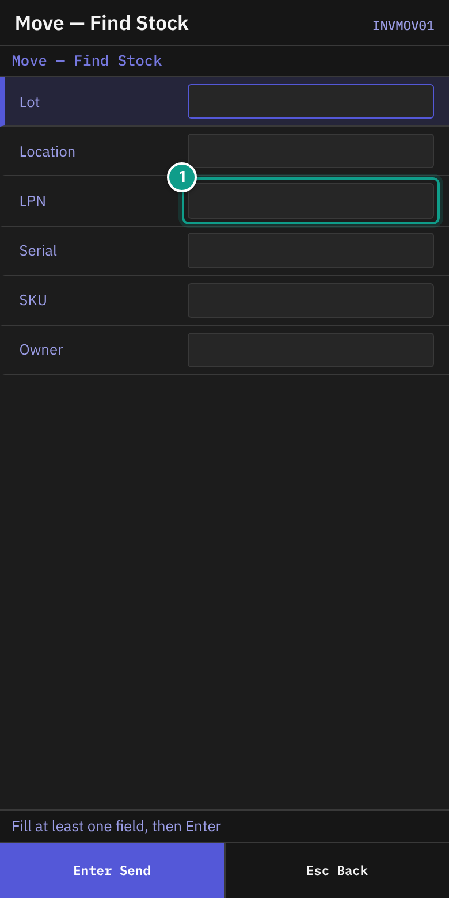
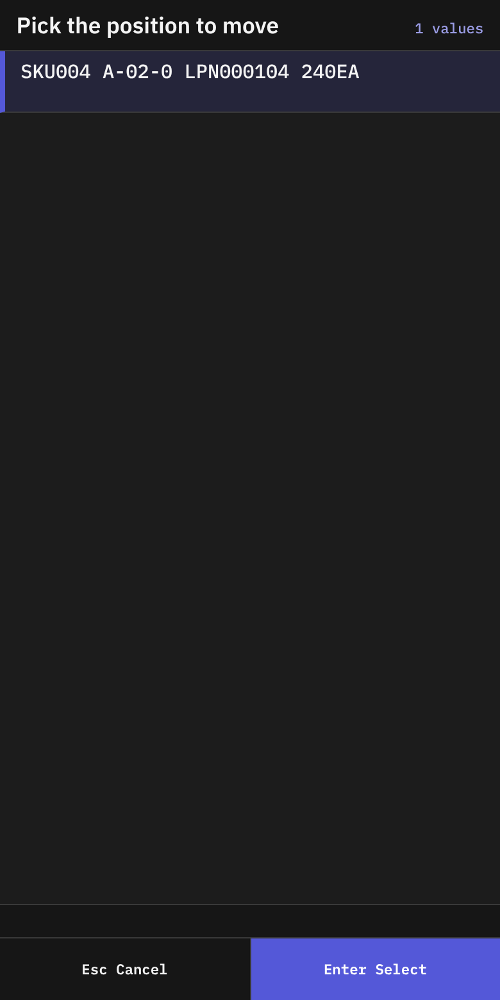
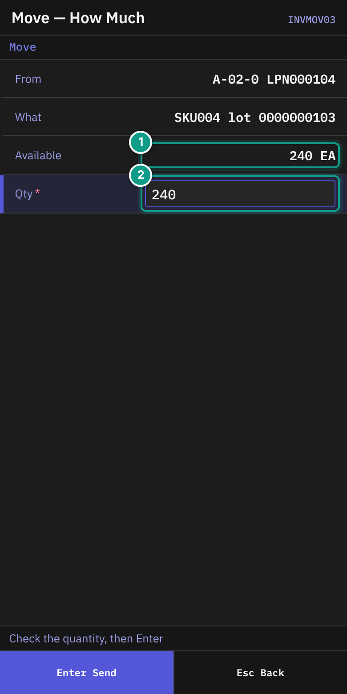
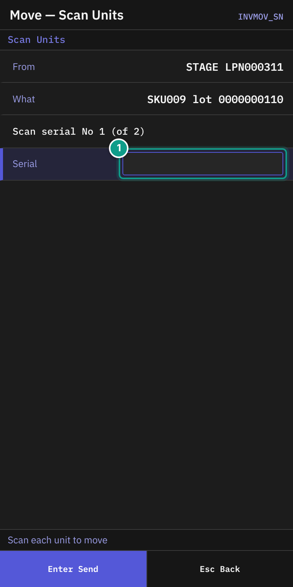
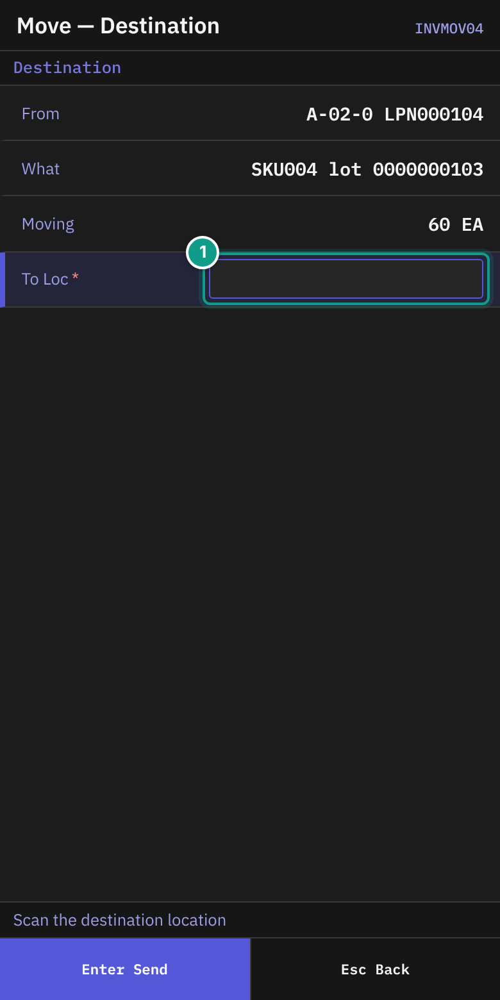
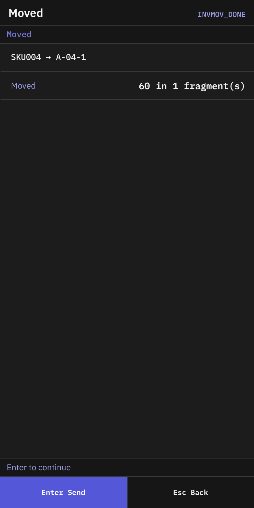
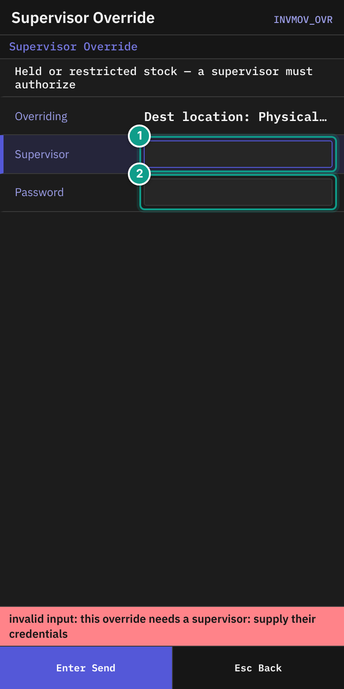

# 06 Move

## What you will do

Move stock from one location (or pallet) to another location.

## Before you start

- Know what you move: location, LPN, SKU, lot, serial or owner. You need at least one.
- Know the destination location.
- For a serial-tracked SKU, have the units ready to scan if you move only part of the stock.
- Stock on hold, or a restricted location, needs a supervisor.

The default roles Operator and Supervisor may run **Move Stock**. If you see **No permission: {screen}** or **No permission**, your administrator has changed the permission settings. Tell your supervisor which screen you were using and what you tried to do.

## Steps

1. On **Main Menu**, press `2` (**Inventory**).
2. On **Inventory**, press `2` (**Move Stock**).

*Screen INVMOV01: the search fields. Focus: Fill at least one field (Lot, Location, LPN, Serial, SKU or Owner), then press Enter. The teal number 1 marks the LPN field.*

3. On **Move — Find Stock**, read the status line: **Fill at least one field, then Enter**.
4. Fill in at least one field:

| Field | What to enter |
|-------|---------------|
| **Lot** | A lot code (up to 40 characters) |
| **Location** | A location code (up to 30) |
| **LPN** | A pallet label (up to 40). A label with several data fields can be scanned here. |
| **Serial** | A serial number (up to 60) |
| **SKU** | A SKU or barcode (up to 50) |
| **Owner** | An owner (up to 50) |

5. Press `Enter`.

*Screen INVMOV02: the list titled Pick the position to move.*

6. On **Move — Pick Position**, the list **Pick the position to move** shows the stock found. A row reads `{sku} {location} {lpn or loose} {atp}{uom}` and adds `HOLD` if held. The number is the available quantity.
7. Choose the row with `Enter`. If nothing is found, the status line says **Nothing found — Esc to change the filter**. Press `Esc`.

*Screen INVMOV03: From, What, Available, Qty. Focus: 1 Available, 2 Qty.*

8. On **Move — How Much**, check:
   - **From**: the location and LPN (or **loose**).
   - **What**: the SKU and lot.
   - **Available**: the quantity you can move. A serial-tracked SKU shows **(serial-tracked)**.
9. In **Qty**, check the quantity. The field starts with the available quantity. Change it to move less.
10. Press `Enter`. The quantity must be more than 0 and not more than **Available**. Otherwise the screen stays.

### Serial-tracked SKU, partial quantity

If the SKU is serial-tracked and **Qty** is less than **Available**, you scan each unit.

*Screen INVMOV_SN: the serial scan. Focus: 1 Serial.*

1. On **Move — Scan Units**, read **Scan serial No {n} (of {m})**. The status line says **Scan each unit to move**.
2. In **Serial**, scan one unit. The field sends itself.
3. If you scan a unit twice, a line shows **{serial} already scanned — not counted twice**.
4. After the last unit, the terminal opens **Move — Destination**.
5. To leave, press `Esc`. The terminal asks: **You scanned {n} serial(s) out of {m}. Nothing has moved yet — leaving loses them. Leave?** Press `Y` (**Leave**) or `N` (**Keep scanning**).

### Scan the destination

*Screen INVMOV04: From, What, Moving, To Loc. Focus: 1 To Loc.*

1. On **Move — Destination** (header **Destination**), read the status line: **Scan the destination location**.
2. Check **From**, **What** and **Moving** (the quantity, and the serials if any).
3. In **To Loc**, scan the destination location (up to 30 characters). The field sends itself.

#### If the terminal asks whether the location is empty

If the move took everything out of the location you moved from, and the owner of the stock asks for it (owner card, **Policies**, **Confirm Empty After Move**), **Location Empty?** opens before **Moved** (screen INVMOVZ).

1. Read **Location** — the location you moved from — and **Is this location empty now?**
2. Look into the location. Press `1` (**Yes - nothing left**) or `2` (**No - stock is left**).
3. If your answer does not match the stock the system holds there, the location is counted. **Moved** then shows `{location} to be counted`.
4. `Esc` skips the question. Nothing is recorded.

Your answer never changes the stock. It is kept on the location card, tab **Checks**.

*Screen INVMOV_DONE: the result of the move.*

4. On **Moved**, check the line `{sku} → {destination}` and **Moved** (`{qty} in {n} fragment(s)`).
5. Press `Enter` (or `Esc`). The terminal returns to **Move — Pick Position**. Choose another position, or press `Esc` to leave.

### If a supervisor must approve

*Screen INVMOV_OVR: what is overridden and the supervisor sign-in. Focus: 1 Supervisor, 2 Password.*

1. If the stock is held or restricted, **Supervisor Override** opens. It says **Held or restricted stock — a supervisor must authorize**.
2. **Overriding** lists the reasons. Each reads `{where}: {what}`. The `{where}` is **Source LPN**, **Source location**, **Dest location**, **Putaway rule** or **Hold**.
3. The supervisor types the user name in **Supervisor** and the password in **Password**, then presses `Enter`.
4. The terminal returns to **Move — Destination**. Scan the destination again.

## What you should see

- **Moved** with the new location.
- The stock at the destination in **Stock Inquiry**.

## If something goes wrong

| Message | What it means | What to do |
|---------|---------------|------------|
| **Nothing found — Esc to change the filter** / **No stock matches the filter. Esc to change it.** | No stock matches your search. | Press `Esc`. Change the fields. |
| **source not found: {id}** | The stock to move no longer exists. | Search again. |
| **source {id} is inactive (status={status})** | The source is not active. | Tell your supervisor. |
| **source location blocked: {reason}** | The source location is blocked. | Tell your supervisor. |
| **destination not found: {code}** | The destination code does not exist. | Scan again. |
| **destination {code} is inactive** | The destination is not in use. | Choose another. |
| **destination location blocked: {reason}** | The destination is blocked. | Choose another. |
| **the stock at destination {location} changed while the move was being prepared; repeat the move** | The destination changed. | Scan the destination again. |
| **insufficient qty: requested {a}, available {b}** | You asked for more than is available. | Lower **Qty**. |
| **full move refused: only {a} of {b} is available — the rest is reserved (qty_allocated/qty_picked)** | Part of the stock is reserved for orders. | Move only the available quantity. |
| **container move refused: container {id} still holds reserved stock (sku {sku}): qty_allocated={a}, qty_picked={b}** | The pallet holds reserved stock. | Tell your supervisor. |
| **move refused by open serial capture episode(s) ...** | A serial capture is open on this stock. | Finish the capture. See [02](02-receiving-against-asn.md). |
| **mixing rule violation: {rule}** | The destination does not allow this mix of goods. | Choose another location. |
| **capacity exceeded ({kind}): limit={limit}, attempted={attempted}** | The destination is full. | Choose another. |
| **destination loc_type {type} not authorized for source_type {source}** | This kind of location may not receive this stock. | Choose another. |
| **hold #{id} ({code}) blocks this move (policy: not overridable)** | A hold forbids the move. A supervisor cannot override it here. | Tell your supervisor. |
| **move requires an acknowledged override of: code {n} ({subject})** | A supervisor must approve. | Follow the **Supervisor Override** steps. |
| **location {location} holds only open pick pallets: nothing moves {side} it** | The location is a transit area for pick pallets. | Choose another location. |
| **the location the move takes stock {side} changed from {a} to {b} while the move was ...** | The location changed during the move. | Search and start again. |
| **No permission: {screen}** or **No permission** | Your user may not do this. | Tell your supervisor which screen you were using and what you tried to do. |

## What the supervisor sees

A move is recorded with the user, the source, the destination and the quantity. An override is recorded with the supervisor who approved it.

## Related guides

- [05 Putaway](05-putaway.md)
- [07 Stock inquiry](07-inventory-inquiry.md)
- [11 Troubleshooting and messages](11-troubleshooting-and-messages.md)
