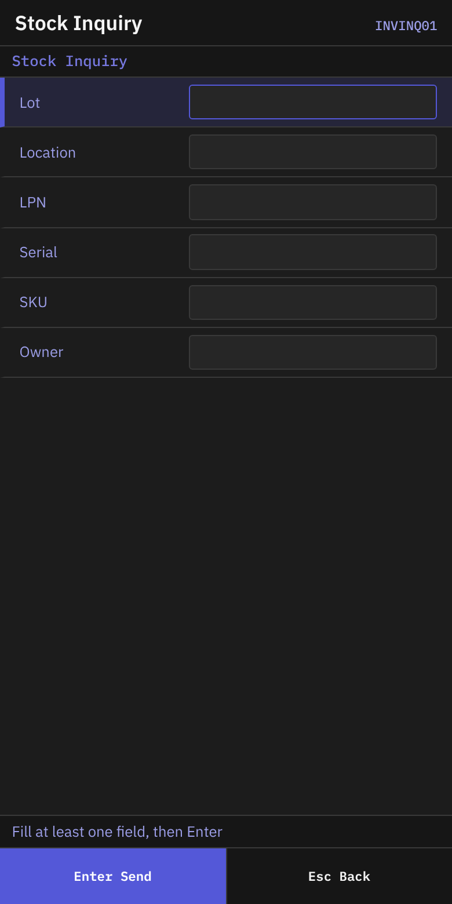
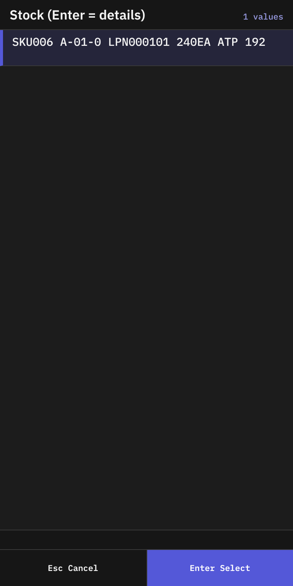
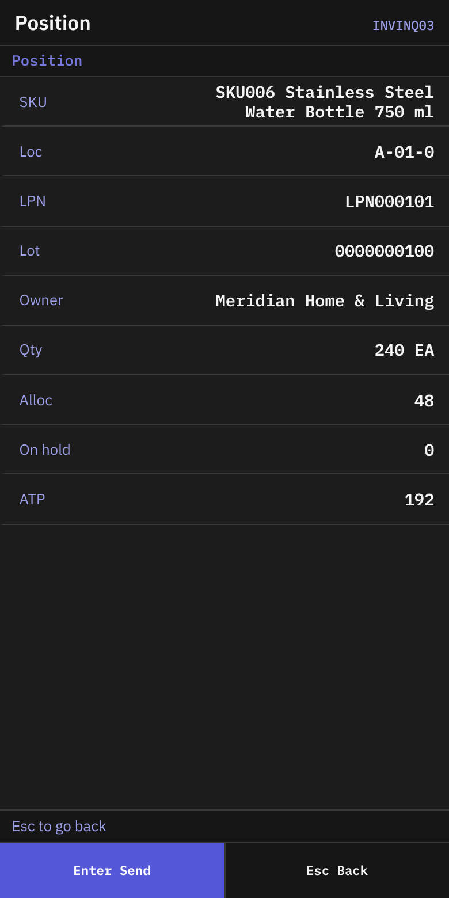
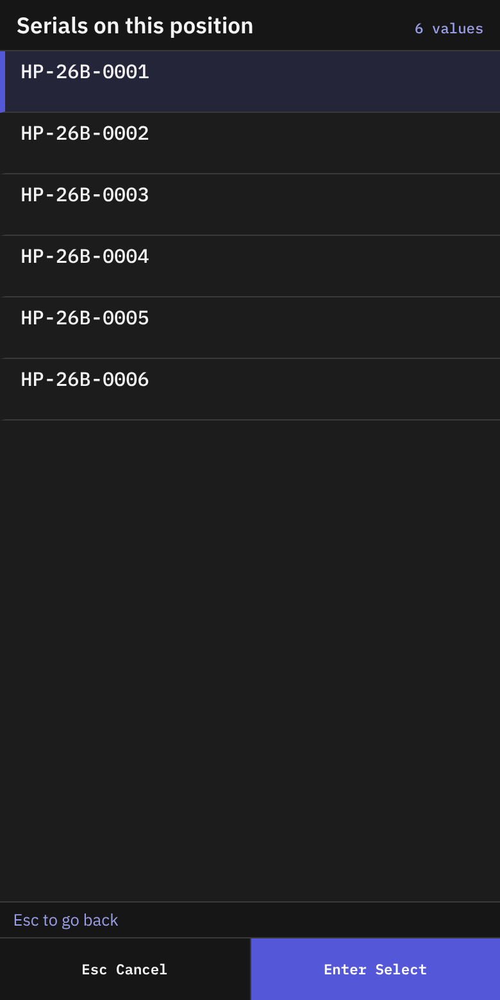

# 07 Stock inquiry

## What you will do

Look up stock by location, pallet, SKU, lot, serial or owner. See what is available and what is held.
The inquiry only reads. It changes nothing.

## Before you start

- Know at least one of: lot, location, LPN, serial, SKU, owner.

## Steps

1. On **Main Menu**, press `2` (**Inventory**).
2. On **Inventory**, press `1` (**Stock Inquiry**).

*Screen INVINQ01: the search fields. Focus: Fill at least one field, then press Enter.*

3. On **Stock Inquiry**, read the status line: **Fill at least one field, then Enter**.
4. Fill in at least one field. See the table.

| Field | What to enter |
|-------|---------------|
| **Lot** | A lot code (up to 40 characters) |
| **Location** | A location code (up to 30) |
| **LPN** | A pallet label (up to 40). A label with several data fields can be scanned here. |
| **Serial** | A serial number (up to 60) |
| **SKU** | A SKU or barcode (up to 50) |
| **Owner** | An owner (up to 50) |

5. Press `Enter`.

*Screen INVINQ02: the list titled Stock (Enter = details). Focus: Each row shows SKU, location, LPN, quantity and ATP (available quantity).*

6. On **Stock**, the list **Stock (Enter = details)** shows one row for each position. A row reads `{sku} {location} {lpn or loose} {qty}{uom}`. It adds `ATP {n}` when the available quantity differs, and `HOLD` when the stock is held.
7. Choose a row with `Enter`.
8. If nothing is found, the status line says **Nothing found — Esc to change the filter**. Press `Esc` and change the fields.
   If you searched a location and you **see stock there**, press `F6` (**Report stock**) — see [Report stock the system does not show](#report-stock-the-system-does-not-show).

*Screen INVINQ03: the details of one position.*

9. On **Position**, read the details:

| Line | What it shows |
|------|---------------|
| **SKU** | SKU code and description |
| **Loc** | The location |
| **LPN** | The pallet label, or **loose** |
| **Lot** | The lot, or `-` |
| **Owner** | The owner name |
| **Qty** | Quantity and unit |
| **Alloc** | Quantity reserved for orders |
| **On hold** | Quantity on hold |
| **ATP** | Quantity available now |
| **Hold** | Hold details. Shown only if the position is held. |

10. If you searched by serial, a line says **Serial {serial} — qty below is the whole position**. The quantity is for the whole position, not for one unit.
11. Press `Esc` to go back to the list.

### Look at the serial numbers

If the line **Serial-tracked — F2 lists the units** shows, press `F2` (**Check Serials**).

*Screen INVINQ04: the list of serials of a position.*

1. On **Serials Here**, check **Position** (`{location} {lpn or loose}`) and **What** (`{sku} lot {lot}`).
2. The list **Serials on this position** shows each serial.
3. If no serial is recorded, the status line says **No serial numbers recorded on this position**.
4. Press `Esc` to go back.

### Report stock the system does not show

Use it when you see stock in a location, and the system shows nothing there (or not this stock). Open it from the **Inventory** menu, **Report Unexpected Stock** (screen INVUX01), or with `F6` on an empty **Stock** list — then the location, LPN and SKU of your search are already filled in.

1. On **Report Unexpected Stock**, scan **Location**.
2. Scan **LPN** if the stock has a pallet label. Otherwise press `Enter`.
3. Scan **SKU** if you can read it. Otherwise press `Enter`. The report is sent.
4. **Reported** shows `{location} will be counted`. Press `Enter` to go back.

The report never changes the stock. The location is always counted, and the report is kept on the location card, tab **Checks** (`UnexpectedStock`, `Report: LPN … / SKU …`).

## What you should see

- A list that matches your filter.
- On **Position**, the quantity you can use now is in **ATP**.

**ATP** (available to promise) is the quantity minus what is already allocated to orders and what is already picked. If a hold that blocks outbound work covers the position (by lot, location or pallet), **ATP** is `0`. **ATP** is never below `0`. The list shows **ATP** next to the quantity only when the two numbers differ.

## If something goes wrong

| Message | What it means | What to do |
|---------|---------------|------------|
| **Nothing found — Esc to change the filter** | No stock matches. | Press `Esc`. Change the filter. |
| **No stock matches the filter. Esc to change it.** | Same. | Same. |
| **No serial numbers recorded on this position** | The position has no serials on record. | Nothing to do. |
| **location {code} does not exist** | The report names a location the warehouse does not have. | Scan the location label again. |
| **No permission: {screen} ({function})** | Your user may not look up stock. | Ask your supervisor. |

## Related guides

- [05 Putaway](05-putaway.md)
- [06 Move](06-move.md)
- [08 Inventory count](08-inventory-count.md)
