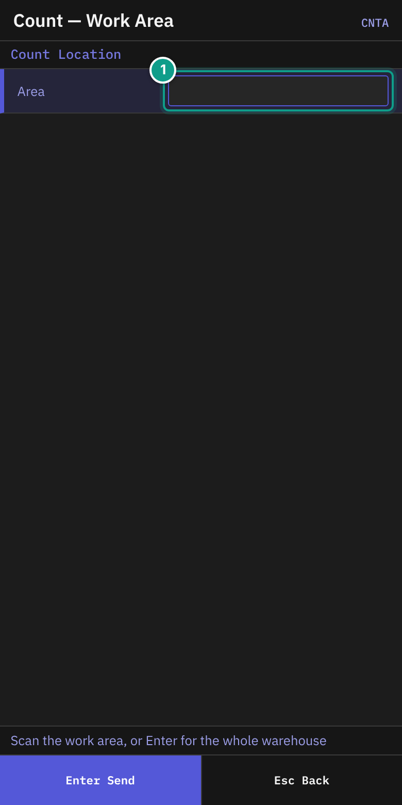
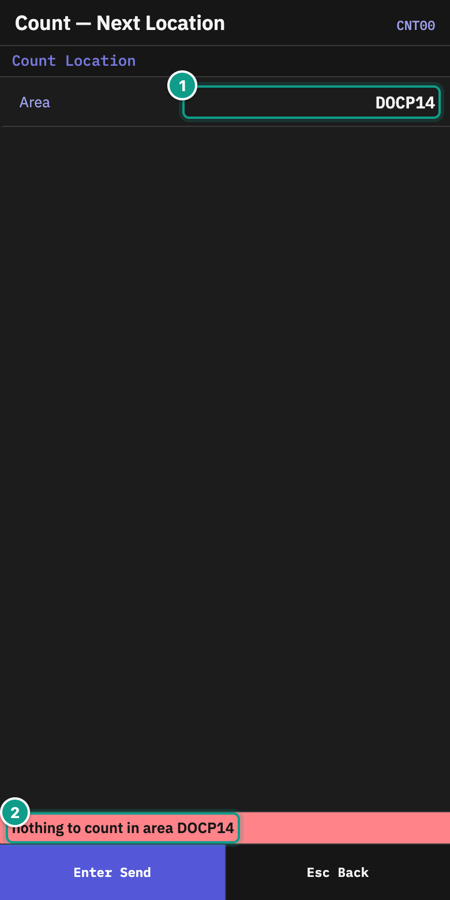
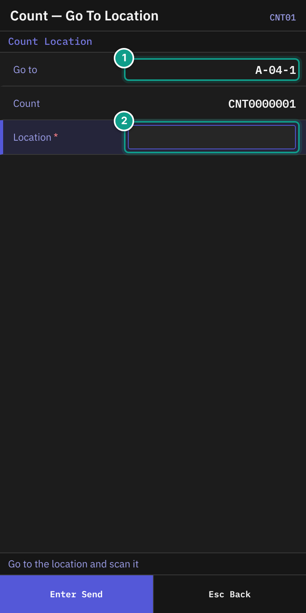
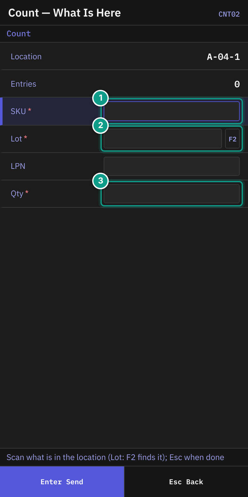
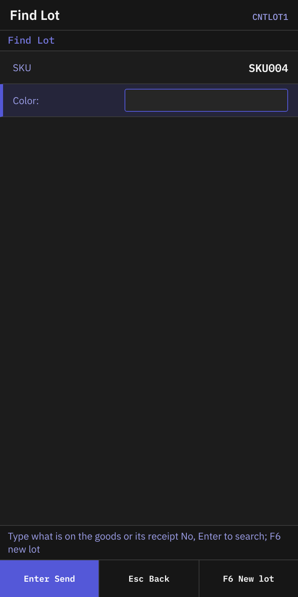
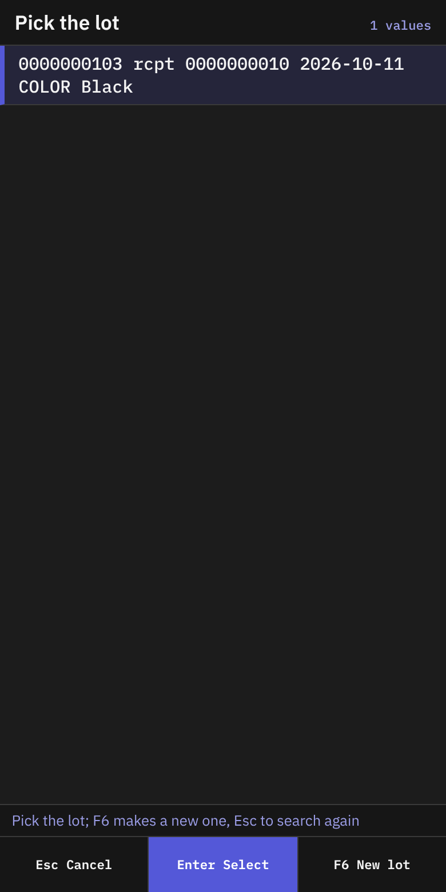
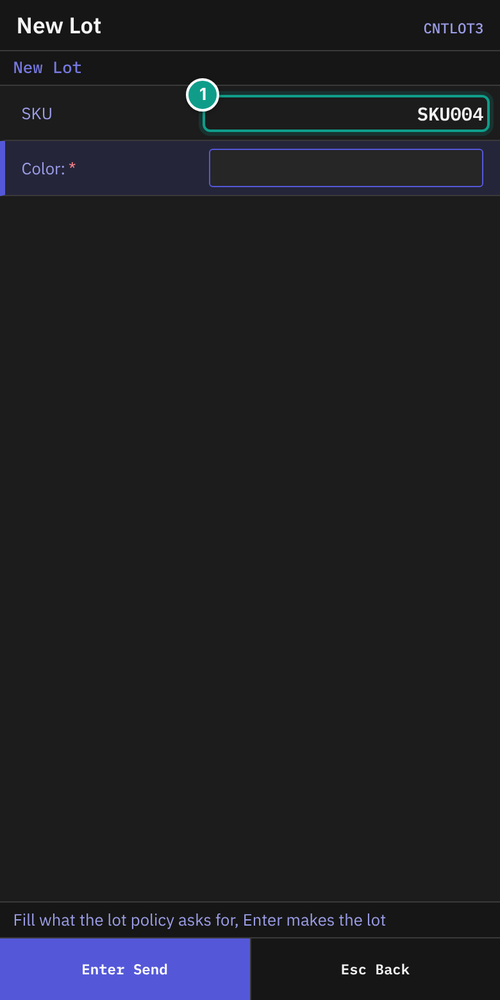
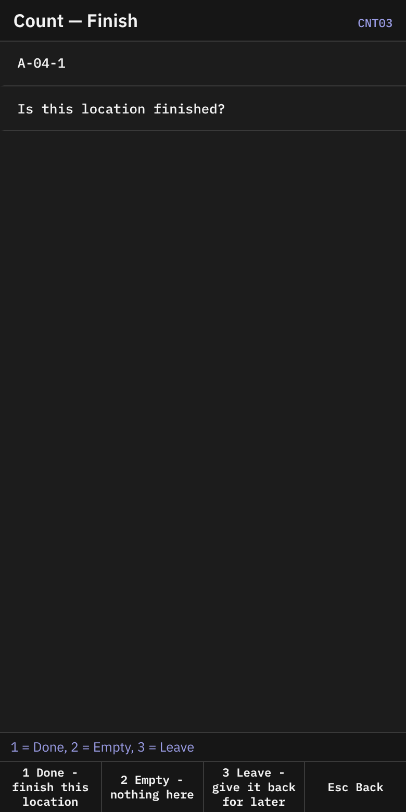
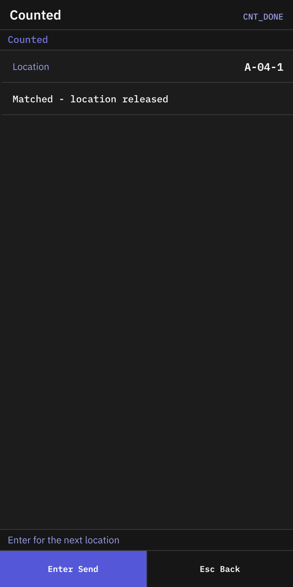

# 08 Inventory count

## What you will do

Count the stock in a location that the system gives you. Record what you find. Finish the location.

## Before you start

- A count must be open and have locations to count. A supervisor creates it, or a cycle-count policy makes it. A count can be of whole locations or only of an item (SKUs, lots or LPNs).
- A location must be free to count. A location that is blocked or already being counted is not given to you.
- Know your work area, or count in the whole warehouse.
- Decisions about differences (accept, recount, cancel) are made by a supervisor on another system, not on the RF terminal.

## Steps

### Get a location

1. On **Main Menu**, press `2` (**Inventory**).
2. On **Inventory**, press `4` (**Count Location**).

*Screen CNTA: the work area field. Focus: 1 Area.*

3. On **Count — Work Area** (header **Count Location**), read the status line: **Scan the work area, or Enter for the whole warehouse**.
4. In **Area**, scan the work area code (up to 30 characters). Or leave it empty. Press `Enter`.

*Screen CNT00 after a safe no-work response: Area and Nothing to count. Press Enter to ask again.*

5. On **Count — Next Location**, the terminal asks for your next location. The line **Area** shows the area, or **whole warehouse**. The status line says **Getting a location - Enter asks again**.
6. If you see an error, press `Enter` to ask again.

*Screen CNT01: Go to, Count, Location. Focus: 1 Go to (where to walk), 2 Location (scan it).*

7. On **Count — Go To Location**, read:
   - **Go to**: the location to count. A recount adds `(recount {n})`.
   - **Count**: the count number.
   - **Only**: shown only when the count is a count **by item**. It names what to count in this location, for example `SKU A; lot L1`. Count only that. Anything else you record is refused (`COUNT_OUTSIDE_ITEMS`). For a count of the whole location the line is not shown.
8. Walk to the location.
9. In **Location**, scan the location label (up to 20 characters). The field sends itself. The status line says **Go to the location and scan it**.

### Record what is there

*Screen CNT02: Location, Entries, Last, SKU, Lot, LPN, Qty. Focus: 1 SKU, 2 Lot (F2 finds it), 3 Qty.*

If the count is **Informed**, the screen also shows the line **System**. It shows what the system holds, so you can compare. Before you type a SKU it reads `{n} line(s), {units}` for the location (or `nothing`). After you type a SKU (and a lot or LPN) it reads `{sku}: {qty}`. A **Blind** count has no such line. A recount is always blind, even on an Informed count. The **Only** line is shown here too on a count by item.

10. On **Count — What Is Here** (header **Count**), read the status line: **Scan what is in the location (Lot: F2 finds it); Esc when done**.
11. Check **Location** and **Entries** (how many entries you made).
12. For each thing in the location, fill in the fields:

| Field | What to enter |
|-------|---------------|
| **SKU** | The SKU (up to 12 characters). Required. |
| **Lot** | The lot (up to 20). Required. Press `F2` to find the lot. |
| **LPN** | The pallet label, if the stock is on a pallet (up to 40). |
| **Qty** | The quantity you count (up to 10 characters). Required. |

13. Press `Enter`. The screen clears for the next entry. **Last** shows `{sku} {lot} x{qty}`, and adds `LPN` if you entered one.
14. When you have recorded everything, press `Esc`.

### Find or create a lot

If you do not know the lot code, press `F2` in **Lot**. Enter the **SKU** first. Otherwise you see **Enter the SKU first: F2 finds a lot among the SKU's lots**.

*Screen CNTLOT1: the lot attribute search.*

1. On **Find Lot**, read the status line: **Type what is on the goods or its receipt No, Enter to search; F6 new lot**. Check **SKU**.
2. Fill in the attribute fields the screen shows. Fill in **Receipt No** if it is shown.
3. Press `Enter`.

*Screen CNTLOT2: the list titled Pick the lot.*

4. On **Pick Lot**, choose the lot with `Enter`. You return to **Count — What Is Here** with the lot filled in.
5. If no lot fits, the screen says **No lot of {sku} has these attributes. F6: new lot.** Press `F6` (**New lot**), or press `Esc` to search again.

*Screen CNTLOT3: the fields the lot policy asks for. Focus: 1 SKU (here the lot policy asks for the colour).*

6. On **New Lot**, read the status line: **Fill what the lot policy asks for, Enter makes the lot**. Fill in the fields. Press `Enter`.
7. You return to **Count — What Is Here** with the new lot filled in.

### Finish the location

*Screen CNT03: three choices for the location.*

1. On **Count — Finish**, read **Is this location finished?** Check **Location**. The status line says **1 = Done, 2 = Empty, 3 = Leave**.
2. Press a key:

| Key | Choice | What it does |
|-----|--------|--------------|
| `1` | **Done - finish this location** | Completes the location. |
| `2` | **Empty - nothing here** | Says the location is empty. Use it only if you recorded nothing. You return to **Count — What Is Here**. The line **Entries** shows **EMPTY confirmed - Esc, 1 to finish**. Then press `Esc` and `1`. |
| `3` | **Leave - give it back for later** | Gives the location back. You return to the **Inventory** menu. |

*Screen CNT_DONE: the result of the location.*

3. After `1`, **Counted** shows **Location** and one of these lines:
   - **Matched - location released**: your count matches the system.
   - **Within tolerance - adjusted, released**: your count differs a little. The difference is within the tolerance your warehouse set, so the system adjusted the stock. No supervisor is needed.
   - **Difference found - a supervisor will review it**: your count differs.
4. Press `Enter` for the next location. Press `Esc` to go to the **Inventory** menu.

## What you should see

- **Counted** after each finished location.
- The next location when you press `Enter`.

## If something goes wrong

| Message | What it means | What to do |
|---------|---------------|------------|
| **nothing to count** / **nothing to count in area {area}** | No location is free to count. | Tell your supervisor. Try another area. |
| **{location} is not given to you: take your next location** | You scanned a location that is not yours. | Go to the location shown in **Go to**. |
| **{location} is being counted by {holder}** | Another user counts this location. | Wait. Ask for another location. |
| **nothing was counted in {location}: record what is there, or confirm that it is empty** | You pressed `1` with no entries. | Record the stock, or press `2` (**Empty**). |
| **{location} holds counted stock, so it cannot be confirmed empty** | You have entries, so the location is not empty. | Press `1` to finish. |
| **{location} was confirmed empty: nothing more can be recorded in it** | You marked it empty. | Press `Esc`, then `1`. |
| **SKU {sku_code} does not exist for this owner** | The SKU is unknown. | Check the SKU. |
| **SKU {sku_code} belongs to several owners: name the owner** | Several owners have this SKU. | Tell your supervisor. |
| **lot {lot} is not a lot of {sku_code}: F2 on Lot finds a lot by its attributes** | The lot belongs to another SKU. | Press `F2` on **Lot**. |
| **quantity {qty} is not a positive number** | **Qty** is zero or not a number. | Type a quantity above 0. |
| **a recount of {location} is counted by somebody other than the first counter** | A recount needs a different person. | Tell your supervisor. |
| **the count of {location} is {status}: it is not being counted** | The location is no longer open for counting. | Press `Esc`. Take the next location. |
| **No permission: {screen}** or **No permission** | Your user may not count. | Tell your supervisor which screen you were using and what you tried to do. |

## What the supervisor sees

Each location you finish is compared with the system stock. A small difference within the tolerance is adjusted at once. Any other difference goes to a supervisor, who accepts it, orders a recount or cancels. To accept, the supervisor records why the count differs, for example a pick error or a mix-up. While you count a location, it is frozen.

## Related guides

- [07 Stock inquiry](07-inventory-inquiry.md)
- [12 Troubleshooting and messages](12-troubleshooting-and-messages.md)
