# 09 Picking

## What you will do

Pick goods for orders. There are three ways to work:

- **Discrete Pick**: you get one pick at a time and put the goods on a pallet.
- **Pick by Area**: you work in a work area. You may take a carrier with boxes and walk a route.
- **Paper picking**: you record the result in the web task grid, keep the goods on a pick pallet in transit, and place the pallet when the trip is finished.

You also close pallets, deliver carriers, and report problems (short, reject, box full, box damaged).

## Before you start

- Have empty pallet labels that start with `DRP` (for discrete pick).
- For carrier work, have an empty carrier and empty boxes.
- Know your work area and what equipment you use.
- Some picks ask you to confirm the source: location, item, LPN, lot or a lot attribute. The screens ask in the order the system sets.
- Your user must have the right to take pick work in your work area.
- A supervisor is needed to dissolve an assignment that already has picked goods, and to close a pallet that belongs to another operator.
- For paper picking, have a pick pallet label that starts with `DRP`, unless the **Pick pallet (DRP…, optional)** field is optional in your warehouse.

Your supervisor gives each operator the right to take pick work per work area. The system checks this every time you ask for work, so a change applies at once. The zones your equipment cannot enter are left out. The terminal cannot show you the list of your areas. If a work area is not on your list, you see **you have no right to take pick tasks in work area {area} — ask a supervisor**.

## Menu

1. On **Main Menu**, press `3` (**Picking**).
2. On **Picking** (header **Picking Menu**), choose:

| Key | Item | Use it to |
|-----|------|-----------|
| `1` | **Discrete Pick** | Pick one task at a time |
| `2` | **Pick by Area** | Work in a work area, with or without a carrier |
| `3` | **Deliver Carrier** | Deliver a carrier you scan |
| `4` | **Force-Close Episode (supervisor)** | Supervisor only. See [04](04-damage-and-receipt-close.md). |

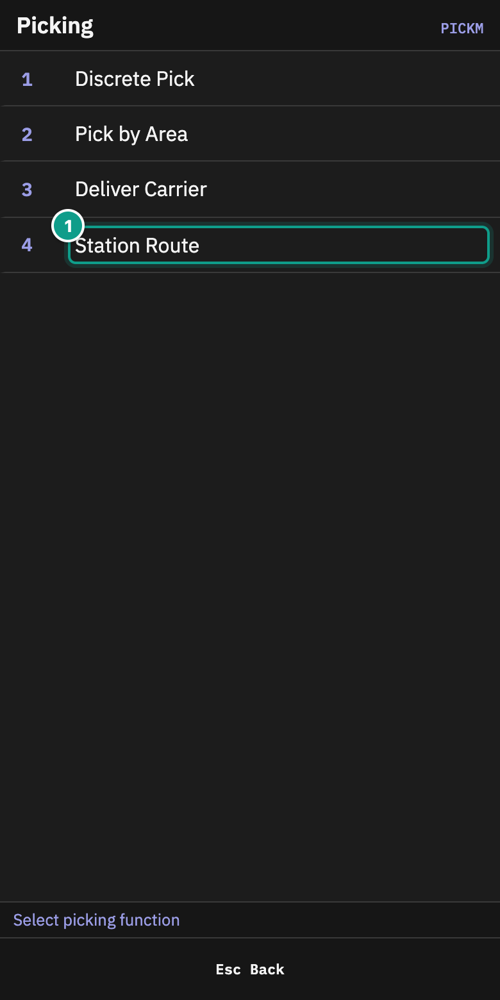
*Screen PICKM: the Picking menu. Focus: Discrete Pick is option 1.*

## A. Discrete Pick

### A1. Get work

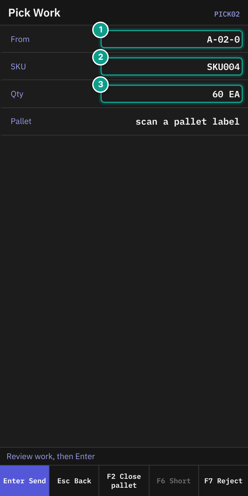
*Screen PICK01: the Current loc field. Focus: Press Enter to get work, with or without a location.*

1. On **Get Pick Work**, read the status line: **Enter current location or press Enter**.
2. In **Current loc**, scan your location, or leave it empty. Press `Enter`.
3. The system gives you work, or shows a message in a line above the field.

The footer shows `F2` **Close pallet**.

What happens next depends on the system:

- A pallet you must close first: **Close Pallet** opens.
- An open carrier assignment: the carrier screens in section B open.
- A new pick: **Pick Work** opens.
- Nothing: the screen stays and shows the message.

### A2. Review the pick

*Screen PICK02: From, Lot, SKU, Qty, Pallet, Serials, Blocked. Focus: 1 From, 2 SKU, 3 Qty.*

1. On **Pick Work**, read the status line: **Review work, then Enter**.
2. Check:

| Line | What it shows |
|------|---------------|
| **From** | The source location |
| **Lot** | The lot. Shown only if the pick has a lot. |
| **SKU** | The item |
| **Qty** | Quantity and unit |
| **Pallet** | Your pallet label, or **scan a pallet label** if you have none |
| **Serials** | Serials captured over expected. Shown only for serial-tracked items. |
| **Blocked** | Why you cannot go on. Shown only when the pick is blocked. |

3. Press `Enter`.

The footer shows `F2` **Close pallet**, `F6` **Short** and `F7` **Reject**. `F6` works only when the pick is blocked here. You can also use it on **Confirm Quantity**.

### A3. Read the pick instructions

If the pick has instructions, **Pick Instructions** opens first.

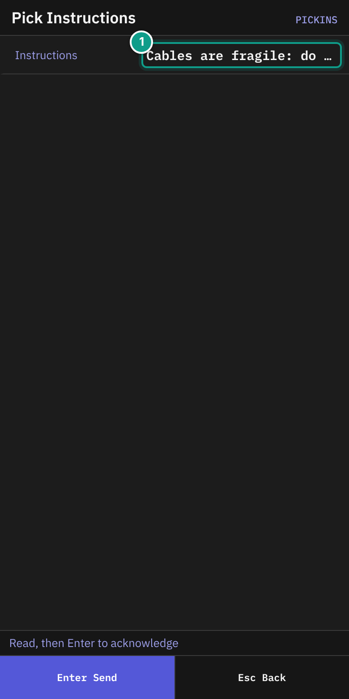
*Screen PICKINS: the instruction text. Focus: 1 Instructions.*

1. Read **Instructions**. The status line says **Read, then Enter to acknowledge**.
2. Press `Enter`.

### A4. Open a pallet

If you have no pallet, **Open Pallet** opens.

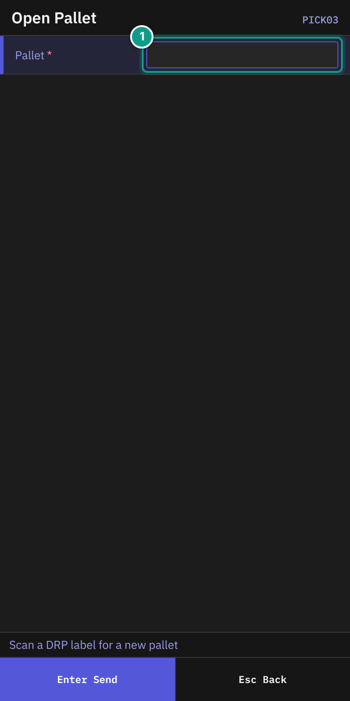
*Screen PICK03: the pallet label field. Focus: 1 Pallet.*

1. Read the status line: **Scan a DRP label for a new pallet**.
2. In **Pallet**, scan an empty pallet label. The label starts with `DRP` and has 4 to 50 letters, digits, `-` or `_`.

### A5. Confirm the source

The system asks for some of these confirmations, one after the other.

| Screen | You scan | Prompt |
|--------|----------|--------|
| **Confirm Source** (`PICK04`) | The source location in **Scan loc** | **Go to and scan the source location** |
| **Confirm Item** (`PICK05`) | The item in **Scan item** | (the line **SKU** shows the expected item) |
| **Confirm Source LPN** (`PICK06`) | The pallet label in **Scan LPN** | (the line **Source LPN** shows the expected one) |
| **Confirm Lot** (`PICK14`) | The lot label in **Scan lot** | **Scan the lot label of the source** |
| **Confirm Lot Attribute** (`PICK15`) | The value in **Value** | **Check the goods: scan or enter the value** |

On each screen the line above the field shows what is expected. The footer shows `F2` **Close pallet** and `F7` **Reject**.

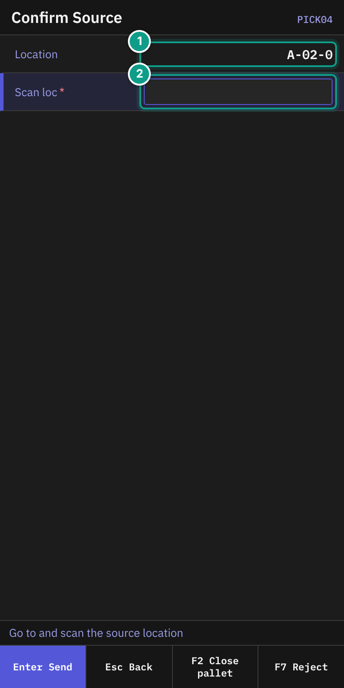
*Screen PICK04: expected location and Scan loc. Focus: 1 Location, 2 Scan loc.*

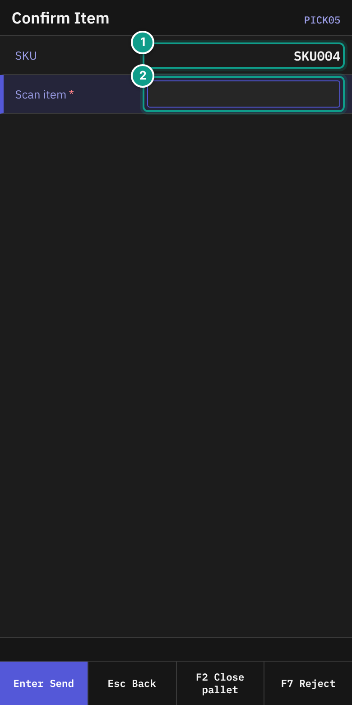
*Screen PICK05: expected SKU and Scan item. Focus: 1 SKU, 2 Scan item.*

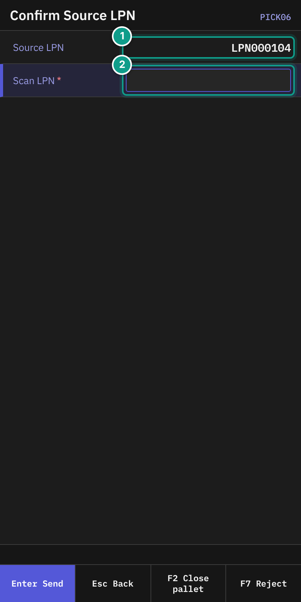
*Screen PICK06: expected LPN and Scan LPN. Focus: 1 Source LPN, 2 Scan LPN.*

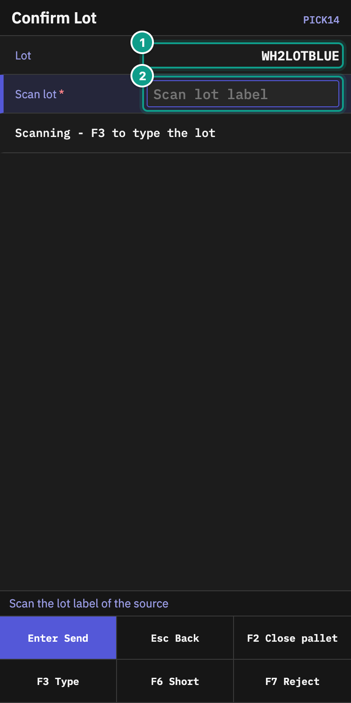
*Screen PICK14: expected lot and Scan lot.*

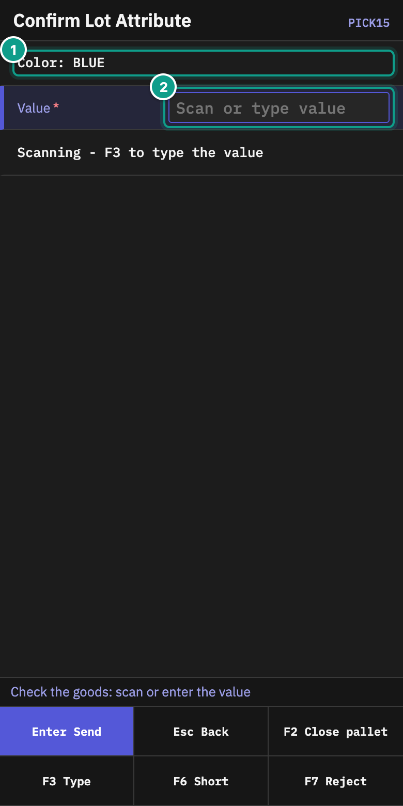
*Screen PICK15: attribute name, expected value, and Value.*

### A6. Confirm the quantity

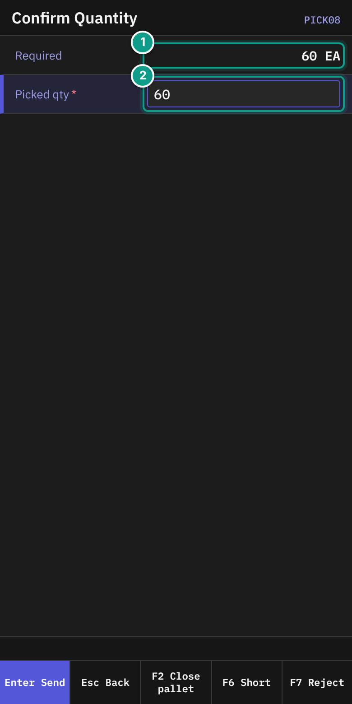
*Screen PICK08: Required and Picked qty. Focus: 1 Required, 2 Picked qty.*

1. On **Confirm Quantity**, check **Required**.
2. In **Picked qty**, check the number. It starts with the required quantity. Change it only if you took another quantity.
3. Press `Enter`.

For a serial-tracked item, **Pick Serials** opens next.

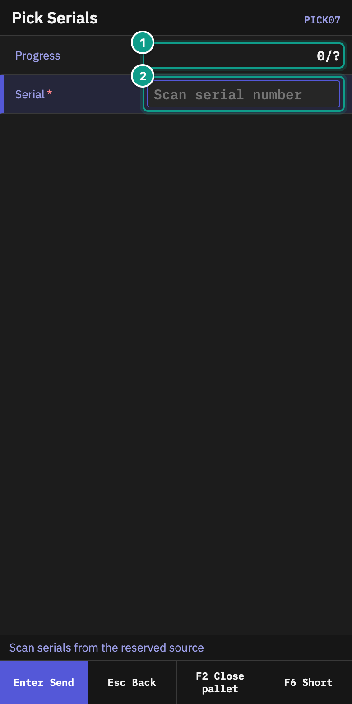
*Screen PICK07: Progress and Serial.*

1. On **Pick Serials**, read the status line: **Scan serials from the reserved source**. **Progress** shows `{captured}/{expected}`.
2. In **Serial**, scan one unit. Repeat until all are scanned.
3. To leave, press `Esc`. The terminal asks: **Captured {n}/{m}. Exit and resume later?** Press `Y` (**Exit**) or `N` (**Continue**).

### A7. Commit the pick

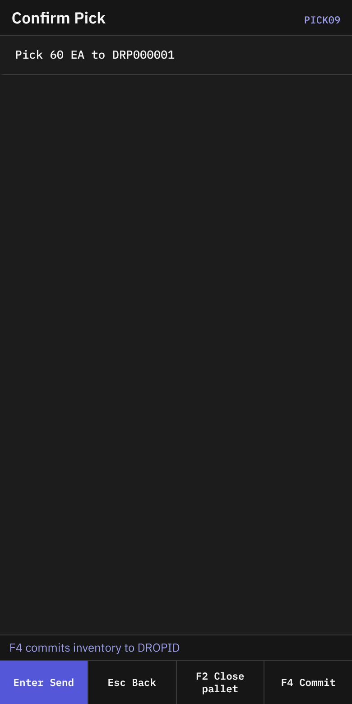
*Screen PICK09: the pick summary.*

1. On **Confirm Pick**, read the summary: `Pick {qty} {uom} to {pallet}`. The status line says **F4 commits inventory to DROPID**.
2. Press `F4` (**Commit**).

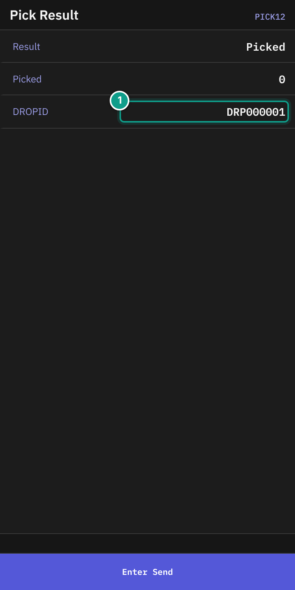
*Screen PICK12: Result, Picked, DROPID. Focus: 1 DROPID.*

3. On **Pick Result**, check **Result** (`Done` if there is no other text), **Picked** and **DROPID**.
4. The screen then returns to **Get Pick Work** (or to **Get Area Work** if you work by area).

### A8. Short pick

Use this when you found less than the required quantity.

1. On **Pick Work** or **Confirm Quantity**, press `F6` (**Short**).

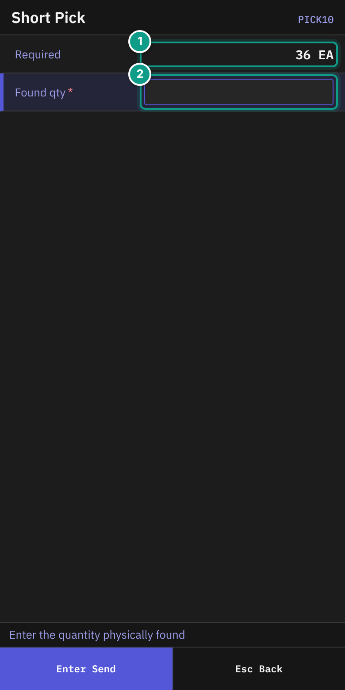
*Screen PICK10: Required and Found qty. Focus: 1 Required, 2 Found qty.*

2. On **Short Pick**, read the status line: **Enter the quantity physically found**. In **Found qty**, type the quantity. Press `Enter`.
3. For a serial-tracked item with a quantity above 0, scan the serials first (**Pick Serials**).

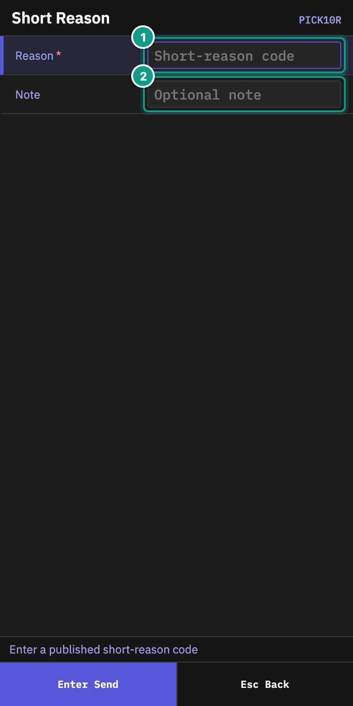
*Screen PICK10R: Reason and Note.*

4. On **Short Reason**, read the status line: **Enter a published short-reason code**. In **Reason**, type the code (up to 50 characters). In **Note**, type a note if needed (up to 200). Press `Enter`.

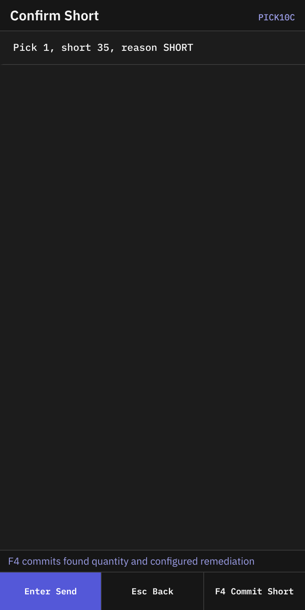
*Screen PICK10C: the short summary.*

5. On **Confirm Short**, read: `Pick {a}, short {b}, reason {code}`. Press `F4` (**Commit Short**).
6. **Pick Result** appears.

### A9. Reject a pick

*Screen PICK11: the reason field. Focus: 1 Reason.*

1. Press `F7` (**Reject**).
2. On **Reject Pick**, in **Reason**, type why (up to 80 characters). Press `Enter`.
3. **Pick Result** appears.

### A10. Close a pallet

Close a pallet when it is full or the order is done. `F2` (**Close pallet**) works on most pick screens.

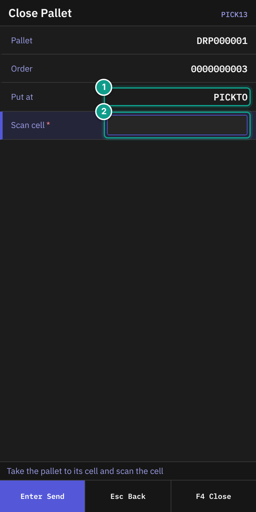
*Screen PICK13: Pallet, Order, Put at, Scan cell. Focus: 1 Put at, 2 Scan cell.*

1. Press `F2` (**Close pallet**). The status line on **Close Pallet** says **Take the pallet to its cell and scan the cell**.
2. Check:
   - **Pallet**: your pallet label, or **no open pallet**.
   - **Order**: the order.
   - **Put at**: where the pallet goes.
3. If you have no open pallet, type its label in **Pallet label**.
4. Take the pallet to the cell shown in **Put at**.
5. In **Scan cell**, scan the cell label. The field sends itself.
6. Press `F4` (**Close**) if it did not send.
7. The terminal returns to your work.

If the pallet belongs to another operator, **Supervisor Confirmation** opens.

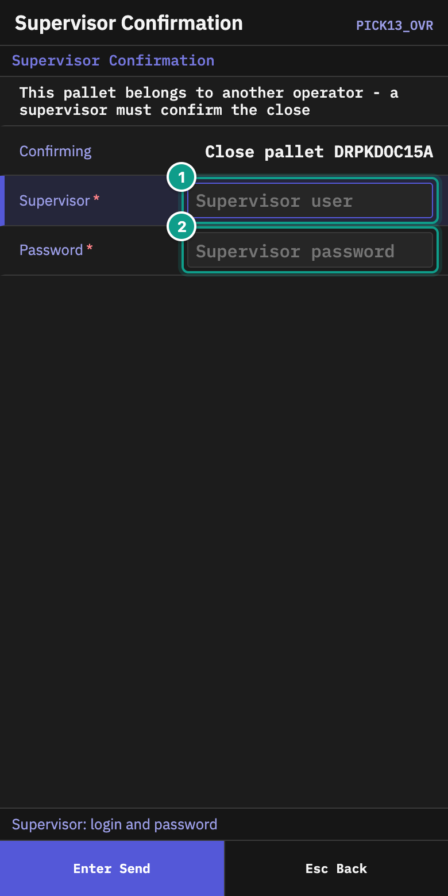
*Screen PICK13_OVR: the supervisor sign-in.*

1. Read **This pallet belongs to another operator - a supervisor must confirm the close**. **Confirming** shows `Close pallet {label}`. The status line says **Supervisor: login and password**.
2. The supervisor types the user name in **Supervisor** and the password in **Password**, then presses `Enter`.
3. On **Close Pallet**, the line **Supervisor confirmed - F4 closes** appears. Press `F4`.

## B. Pick by Area

### B1. Choose the area and equipment

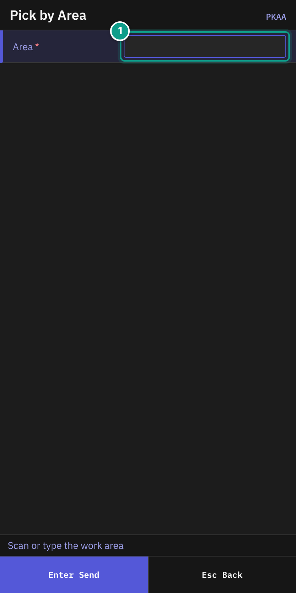
*Screen PKAA: the work area field. Focus: 1 Area.*

1. On **Pick by Area**, read the status line: **Scan or type the work area**.
2. In **Area**, scan or type the work area (up to 30 characters). Press `Enter`.

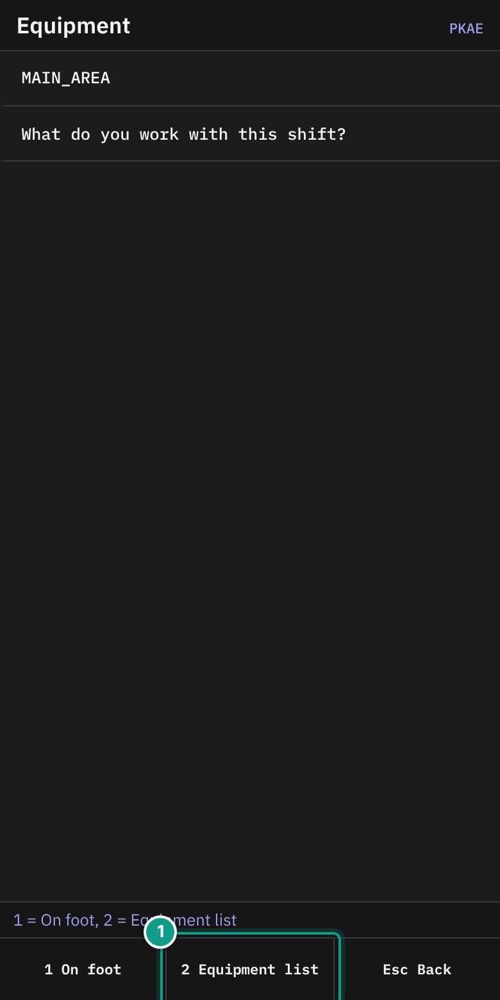
*Screen PKAE: On foot or Equipment list. Focus: 1 Equipment list.*

3. On **Equipment**, read **What do you work with this shift?** The status line says **1 = On foot, 2 = Equipment list**.
4. Press `1` (**On foot**) or `2` (**Equipment list**).

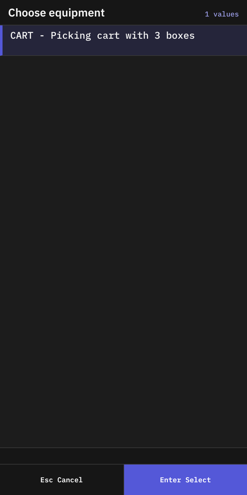
*Screen PKAEL: the list titled Choose equipment.*

5. If you pressed `2`, choose equipment from the list **Choose equipment**. A row reads `{code} - {description}`, and adds `(off)` if the equipment is not active. If the list is empty, the status line says **No equipment kinds - Esc, then 1 = On foot**.

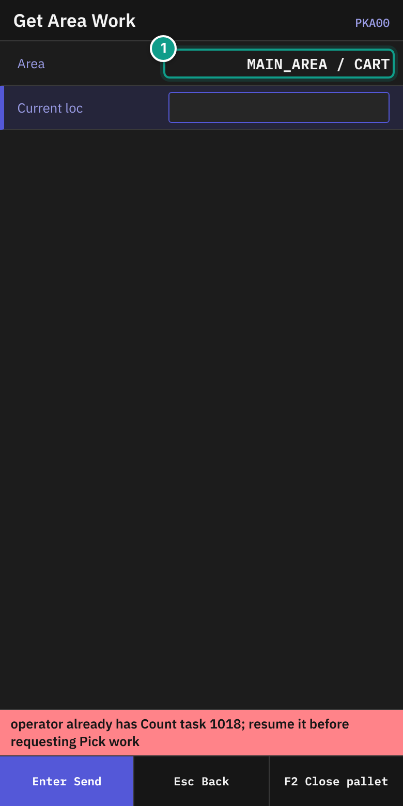
*Screen PKA00: Area and Current loc.*

6. **Get Area Work** asks for work. The line **Area** shows `{area} / on foot` or `{area} / {equipment}`. The status line says **Getting work in the area - Enter asks again**.
7. If nothing comes, press `Enter` to ask again. In **Current loc**, you can scan your location.

What happens next: a new pick opens **Pick Work** (see section A). A carrier job opens the carrier screens below.

If you open a pallet for a pick that you took through **Pick by Area**, and the pick stands in a zone of your area, the pallet follows the picking policy of the area (for your equipment). The area can, for example, send the closed pallet to its pack station. A pick outside the area, or a pick taken through **Discrete Pick**, uses the default policy `DISCRETE`. If the terminal says `UNKNOWN_WORK_AREA`, the area code is wrong.

### B2. Take and prepare a carrier

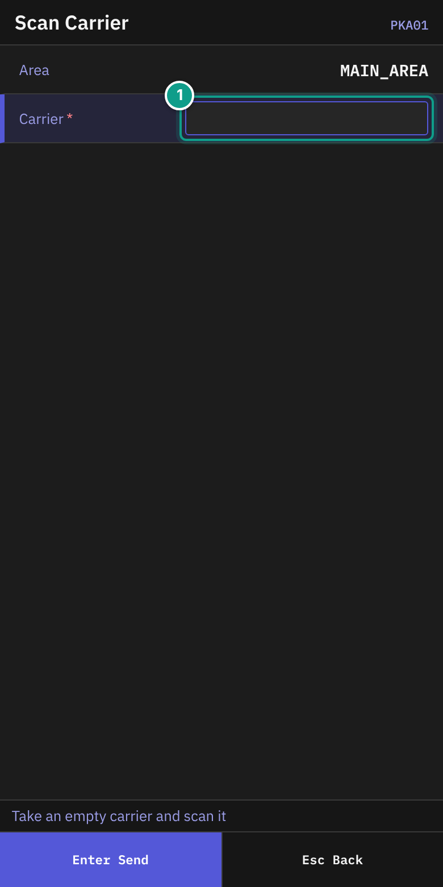
*Screen PKA01: Area and Carrier. Focus: 1 Carrier.*

1. On **Scan Carrier**, read the status line: **Take an empty carrier and scan it**.
2. In **Carrier**, scan the carrier label (up to 50 characters).

If you already hold an assignment, the terminal resumes it.

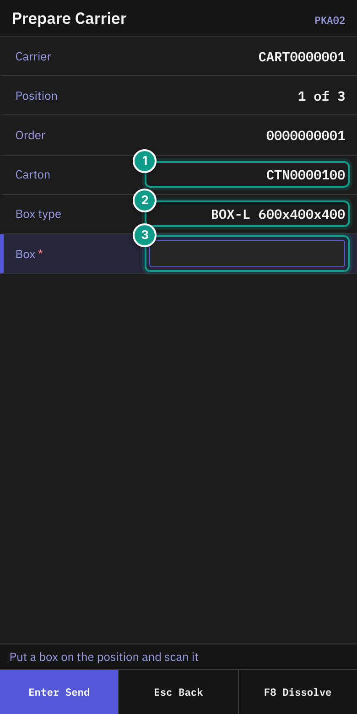
*Screen PKA02: Carrier, Position, Order, Carton, Box type, Box. Focus: 1 Carton, 2 Box type, 3 Box.*

3. On **Prepare Carrier**, read the status line: **Put a box on the position and scan it**. Check:

| Line | What it shows |
|------|---------------|
| **Carrier** | The carrier |
| **Position** | `{n} of {total}` |
| **Order** | The order for this position |
| **Carton** | The planned carton, or `none ({kind})` |
| **Box type** | The planned box and its size, `any box (no planned carton)`, or `not sized` |
| (no label) | `Bound {box} to {position}` after each box |

4. Put an empty box on the position. In **Box**, scan the box label (up to 50 characters).
5. Repeat for each position. When all positions have a box, **Carrier Ready** opens.

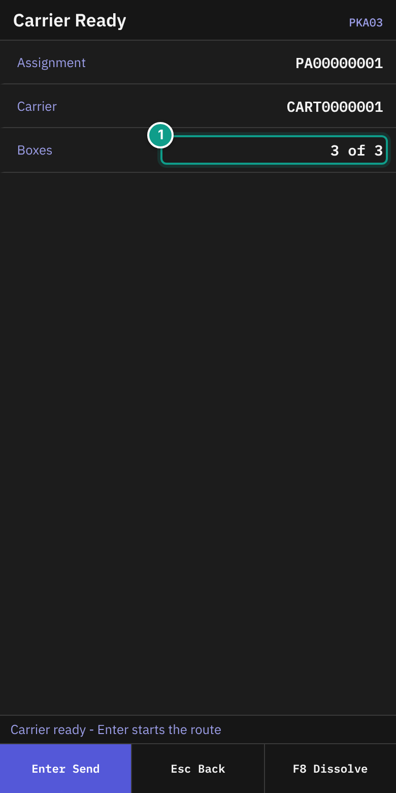
*Screen PKA03: Assignment, Carrier, Boxes. Focus: 1 Boxes.*

6. On **Carrier Ready**, read **Carrier ready - Enter starts the route**. Check **Assignment**, **Carrier** and **Boxes** (`{bound} of {total}`).
7. Press `Enter` to start the route.

### B3. Walk the route

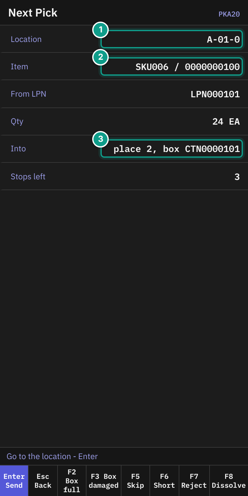
*Screen PKA20: Location, Item, From LPN, Qty, Into, Stops left. Focus: 1 Location, 2 Item, 3 Into.*

1. On **Next Pick**, read the status line: **Go to the location - Enter**. Check:

| Line | What it shows |
|------|---------------|
| **Location** | Where to go |
| **Lot** | The lot, if any |
| **Item** | SKU and lot |
| **From LPN** | The source pallet, if any |
| **Qty** | Quantity and unit |
| **Into** | `place {n}, box {code}` |
| **Stops left** | Stops left. Adds `(skipped before)` if you skipped one. |
| **Note** | Instructions, if any |
| **Blocked** | Why the pick is blocked (see below) |

2. Go to the location. Press `Enter`.
3. Confirm the source. The screens follow the same pattern as section A5:

| Screen | Field |
|--------|-------|
| **Confirm Location** (`PKA21`) | **Scan loc** |
| **Confirm Item** (`PKA22`) | **Scan item** |
| **Confirm Source LPN** (`PKA23`) | **Scan LPN** |
| **Confirm Lot** (`PKA21L`) | **Scan lot** |
| **Confirm Lot Attribute** (`PKA21A`) | **Value** |

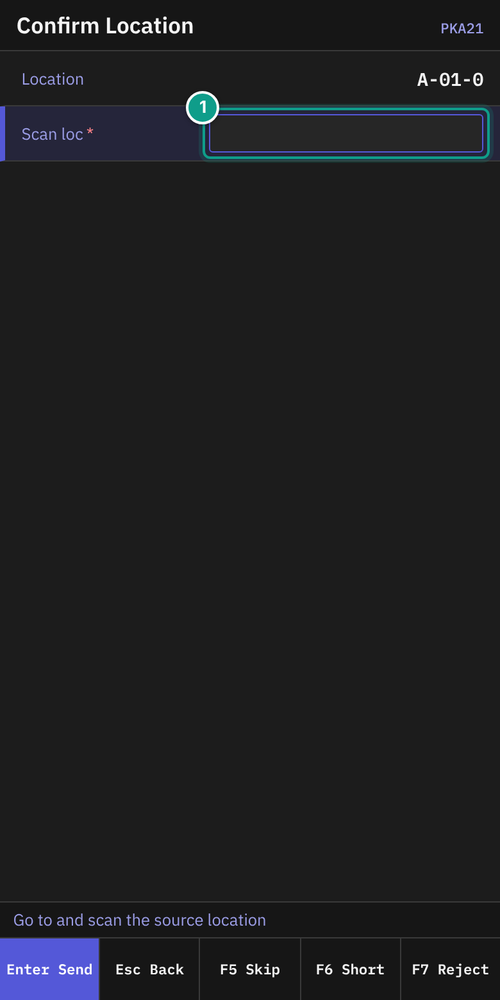
*Screen PKA21: expected location and Scan loc. Focus: 1 Scan loc.*

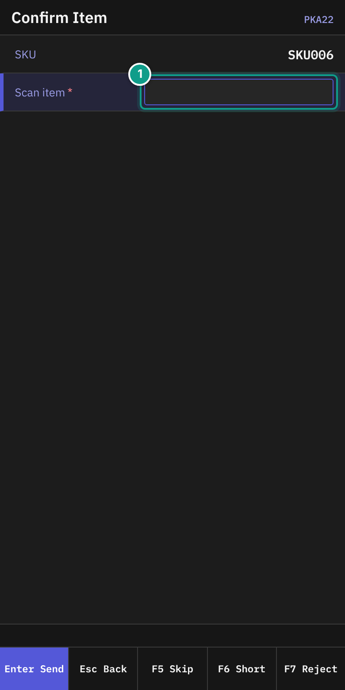
*Screen PKA22: expected SKU and Scan item. Focus: 1 Scan item.*

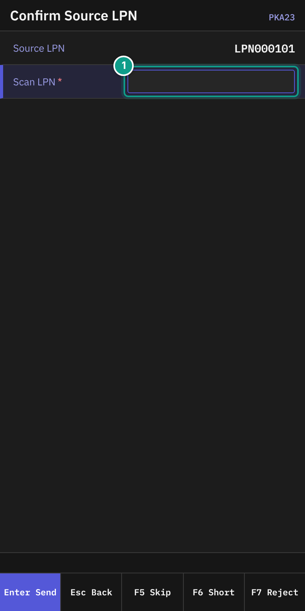
*Screen PKA23: expected LPN and Scan LPN. Focus: 1 Scan LPN.*

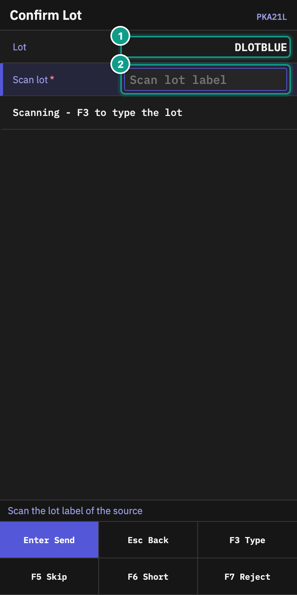
*Screen PKA21L: expected lot and Scan lot.*

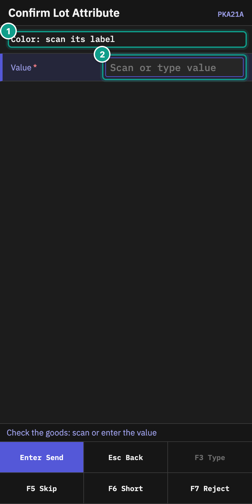
*Screen PKA21A: attribute and Value.*

4. On **Confirm Quantity** (`PKA24`), check **Required** and **Picked qty**. Press `Enter`.

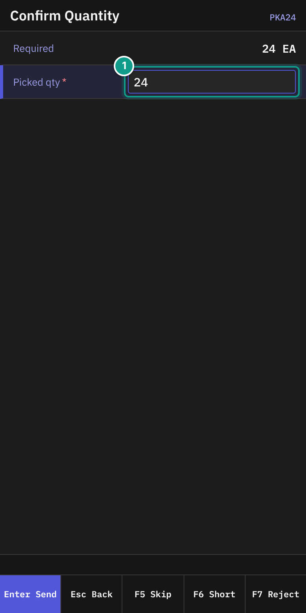
*Screen PKA24: Required and Picked qty. Focus: 1 Picked qty.*

5. For serial-tracked items, **Pick Serials** (`PKA24S`) opens. Scan each serial in **Serial**. `Esc` asks **Captured {n}/{m}. Exit and resume later?**

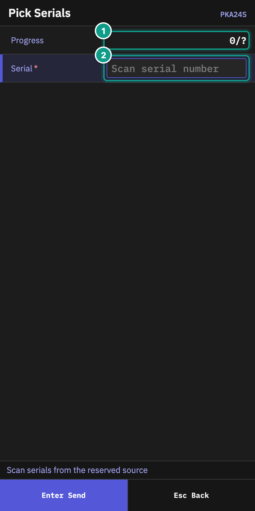
*Screen PKA24S: Progress and Serial.*

6. On **Into Box**, read the status line: **Scan the box of the place, F4 commits**. Check **Place / box** and **Qty**. In **Box**, scan the box label (up to 50 characters). Press `F4` (**Commit**).

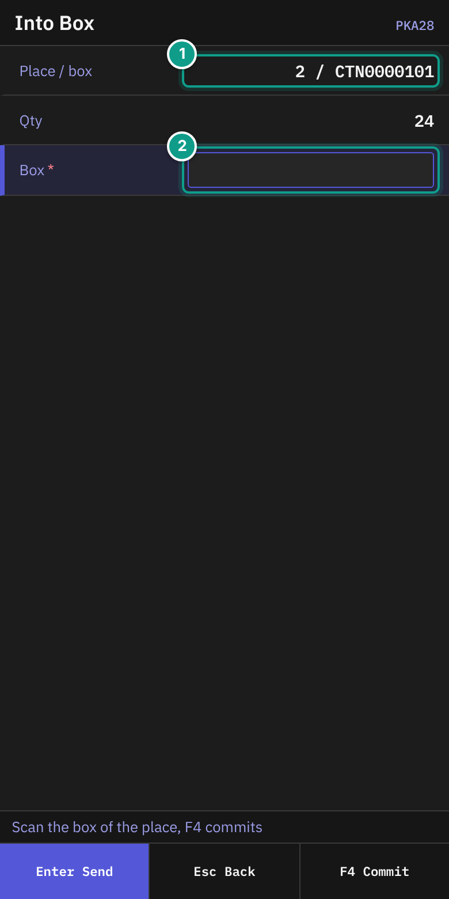
*Screen PKA28: Place / box, Qty, Box. Focus: 1 Place / box, 2 Box.*

7. The terminal goes to the next stop, **Next Pick**.
8. When the route is done, **Next Pick** shows **Route done - Enter to deliver**. Press `Enter`. **Deliver Carrier** opens.

Footer keys on **Next Pick** (active only on a pick stop): `F2` **Box full**, `F3` **Box damaged**, `F5` **Skip**, `F6` **Short**, `F7` **Reject**, `F8` **Dissolve**. On the confirm screens the footer shows `F5`, `F6` and `F7`.

Other lines on **Next Pick**:

| Line | What it means |
|------|---------------|
| **New box on place {n} - Enter** | Bind a new box. Press `Enter`. |
| **Place {n} waits for recovery: {code} - Enter** | A box needs recovery. Press `Enter`. See **Recovery**. |
| **No route to walk - Enter for the menu** | No route. Press `Enter`. |
| **Blocked: carton plan not ready - F5 skip, F7 reject** | The box plan is not ready. Skip or reject. |
| **Blocked: carton plan blocked - F5 skip, F7 reject** | The box plan is blocked. Skip or reject. |
| **Blocked: carton plan invalid - F5 skip, F7 reject** | The box plan is not valid. Skip or reject. |

### B3a. A summary step

If your area uses a policy with `Quantity` = `Aggregated`, two or more orders on your cart can take the same item from the same location. The route then shows them as **one step**. You go to the location once and prove the item once. Then you put each order's quantity into its own box.

On **Next Pick** (`PKA20`) a summary step shows the **Location**, the **Item** and the **From LPN** as usual, and two more lines:

| Line | What it shows |
|------|---------------|
| **Total** | The whole quantity of the step and the number of places, for example `Total 12 EA · 2 places`. |
| **Places** | The quantity for each place, for example `Place 1: 5 · Place 3: 7`. |

**Stops left** counts a summary step as one stop.

1. Go to the location. Press `Enter`.
2. Confirm the location, item, LPN and lot on the usual screens (`PKA21`, `PKA22`, `PKA23`, `PKA21L`, `PKA21A`). You do this **once** for the whole step.
3. On **Confirm Quantity** (`PKA24`), the line **Place** names the place: `Place {n}: put {qty} {unit} · box {code}`. **Picked qty** is filled with the quantity of the place. The screen refuses a bigger number and says: **This place takes only the quantity shown; if fewer are at the location press F6 Short**.
4. Press `Enter`. On **Into Box** (`PKA28`) scan the box of that place and press `F4` (**Commit**).
5. The terminal returns to **Next Pick**. It shows the places that are left. You do not confirm the source again. Press `Enter` for the next place.

If fewer items are at the location than the place needs, press `F6` (**Short**) on the place screen. It shorts that place only (section B5).

Keys on a summary step:

| Key | Where | What it does |
|-----|-------|--------------|
| `F5` **Skip** | On **Next Pick** | Skips every place that is left. The screen **Skip** asks the same question as for a plain stop. |
| `F7` **Reject** | On **Next Pick** | Rejects every place that is left. |
| `F7` **Reject** | On the place screen | Rejects this place only. |
| `F5` | On the place screen | Disabled. The screen says: **F5 skip: on the route card — Esc, then F5 skips the whole location**. |
| `F2`, `F3`, `F6`, `F8` | Place screen or card | Act on the current place, as on a plain stop. |

A serial-tracked item is never part of a summary step. It stays a stop of its own.

Source: `crates/libs/wms-lib-sql/sql/rf-screens/110_uc_pick_aggregated_cart.sql`, `112_uc_pick_aggregated_cart_followups.sql`; `crates/libs/wms-outbound/src/picking/README.md` (Summary step).

### B4. Skip a stop

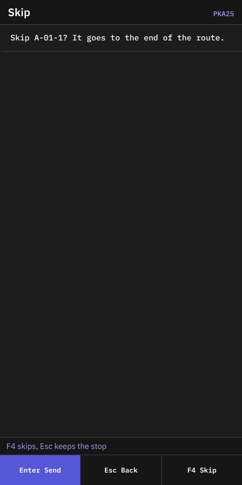
*Screen PKA25: the skip question.*

1. Press `F5` (**Skip**).
2. On **Skip**, read **Skip {location}? It goes to the end of the route.** The status line says **F4 skips, Esc keeps the stop**.
3. Press `F4` (**Skip**), or `Esc`.

### B5. Short, reject

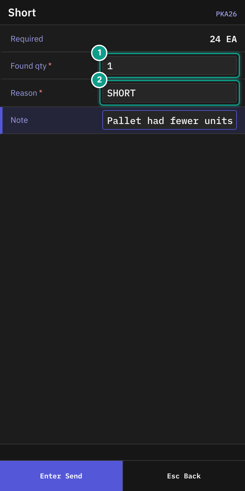
*Screen PKA26: Required, Found qty, Reason, Note. Focus: 1 Found qty, 2 Reason.*

1. Press `F6` (**Short**). On **Short**, read the status line: **Enter the quantity found and a short-reason code**.
2. Fill in **Found qty**, **Reason** (code, up to 50) and **Note** (optional). Press `Enter`.

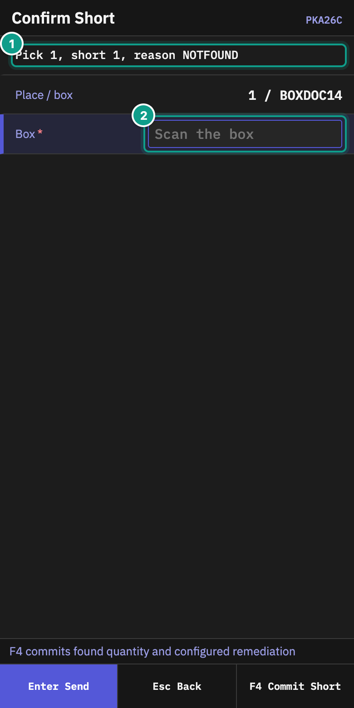
*Screen PKA26C: the short summary and the box.*

3. On **Confirm Short**, read `Pick {a}, short {b}, reason {code}`. If you picked something, check **Place / box** and scan the box in **Box**.
4. Press `F4` (**Commit Short**).

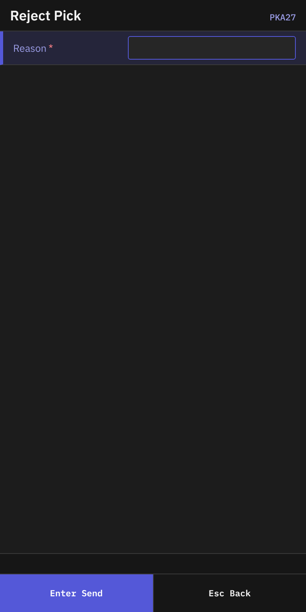
*Screen PKA27: the reason field.*

5. To reject, press `F7` (**Reject**). On **Reject Pick**, type a **Reason** (up to 80). Press `Enter`.

### B6. Box full

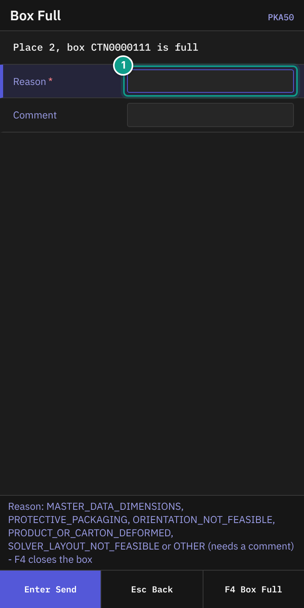
*Screen PKA50: Reason and Comment. Focus: 1 Reason.*

1. On **Next Pick**, press `F2` (**Box full**).
2. On **Box Full**, read `Place {n}, box {code} is full`. The status line lists the reason codes: `MASTER_DATA_DIMENSIONS`, `PROTECTIVE_PACKAGING`, `ORIENTATION_NOT_FEASIBLE`, `PRODUCT_OR_CARTON_DEFORMED`, `SOLVER_LAYOUT_NOT_FEASIBLE` or `OTHER` (needs a comment).
3. In **Reason**, type one code (up to 50). In **Comment**, type a note (up to 500). `OTHER` needs a comment.
4. Press `F4` (**Box Full**).
5. The terminal asks you to bind a new box (**Prepare Carrier**), or to hand over to recovery (**Recovery**), or goes on to **Next Pick**.

### B7. Box damaged

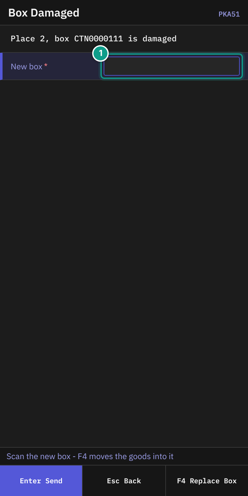
*Screen PKA51: the new box. Focus: 1 New box.*

1. On **Next Pick**, press `F3` (**Box damaged**).
2. On **Box Damaged**, read `Place {n}, box {code} is damaged`. The status line says **Scan the new box - F4 moves the goods into it**.
3. In **New box**, scan an empty box (up to 50 characters).
4. Move the goods into the new box. Press `F4` (**Replace Box**).

### B8. Recovery

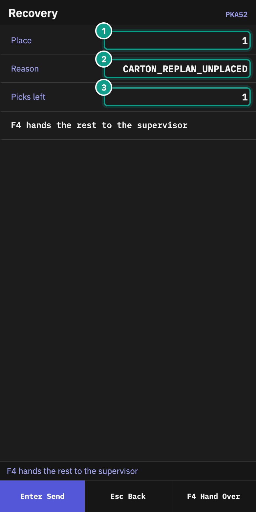
*Screen PKA52: Place, Reason, Picks left.*

1. On **Recovery**, check **Place**, **Reason** (the error code) and **Picks left**.
2. Press `F4` (**Hand Over**). The rest goes to the supervisor.

### B9. Dissolve an assignment

Use this only when you must give up the whole carrier.

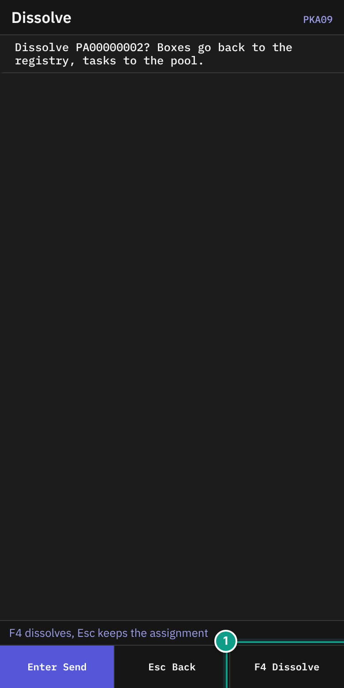
*Screen PKA09: the dissolve question. Focus: 1 F4 (dissolve).*

1. Press `F8` (**Dissolve**) on **Prepare Carrier**, **Carrier Ready** or **Next Pick**.
2. On **Dissolve**, read **Dissolve {code}? Boxes go back to the registry, tasks to the pool.** The status line says **F4 dissolves, Esc keeps the assignment**.
3. Press `F4` (**Dissolve**).
4. **Dissolved** shows **Dissolved**, **Tasks back** and **Boxes off**. Press `Enter`.

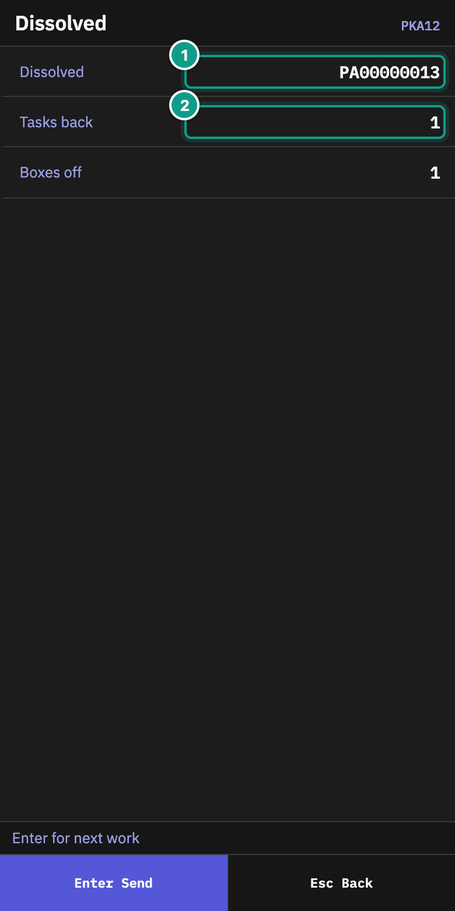
*Screen PKA12: the dissolve result.*

If goods are already on the carrier, **Supervisor Confirmation** opens.

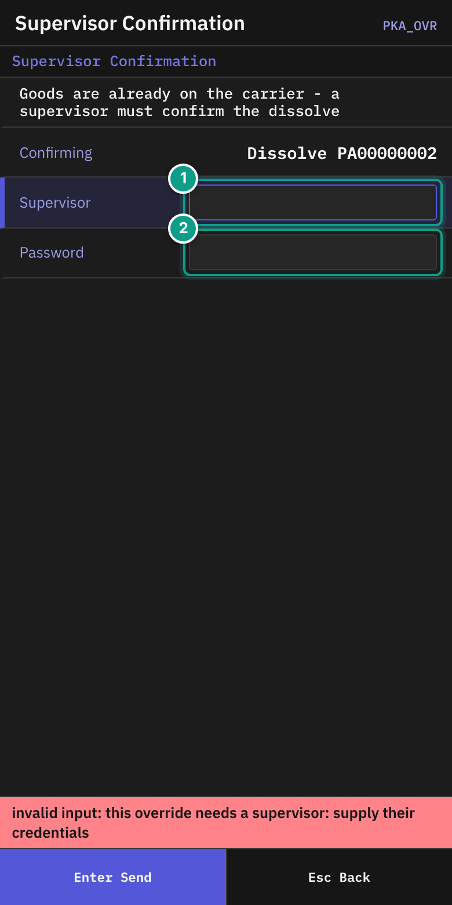
*Screen PKA_OVR: the supervisor sign-in for a dissolve. Focus: 1 Supervisor, 2 Password.*

1. Read **Goods are already on the carrier - a supervisor must confirm the dissolve**. **Confirming** shows `Dissolve {code}`.
2. The supervisor types the user name in **Supervisor** and the password in **Password**, then presses `Enter`.
3. On **Dissolve**, the line **Supervisor confirmed - F4 dissolves** appears. Press `F4`.

### B10. Deliver the carrier

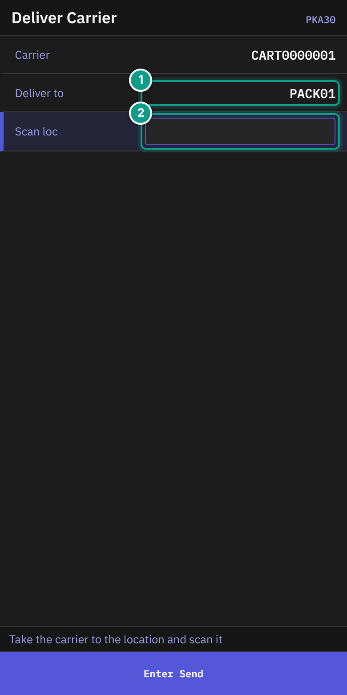
*Screen PKA30: Carrier, Deliver to, Scan loc. Focus: 1 Deliver to, 2 Scan loc.*

1. On **Deliver Carrier**, read the status line: **Take the carrier to the location and scan it**.
2. Check **Carrier** and **Deliver to**. **Deliver to** shows a location, `here (finish in place)`, `its delivery location`, or `ask the supervisor`.
3. Take the carrier there.
4. In **Scan loc**, scan the location (up to 30 characters). The field sends itself. If you finish in place, you may leave it empty.

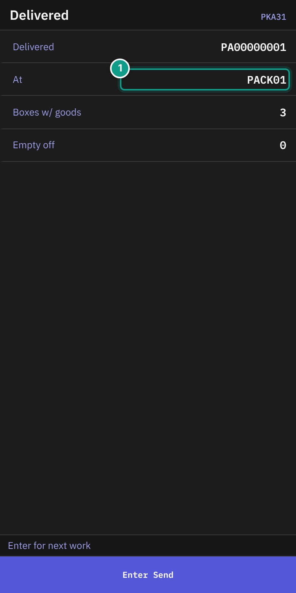
*Screen PKA31: Delivered, At, Boxes w/ goods, Empty off. Focus: 1 At.*

5. On **Delivered**, check **Delivered**, **At**, **Boxes w/ goods** and **Empty off**. Press `Enter` for the next work.

To deliver a carrier from the menu, use **Deliver Carrier** (`PKA40`).

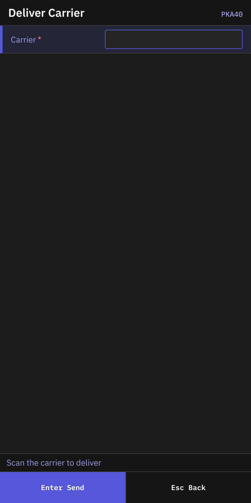
*Screen PKA40: the carrier field.*

1. On **Picking**, press `3` (**Deliver Carrier**).
2. On **Deliver Carrier**, read the status line: **Scan the carrier to deliver**.
3. In **Carrier**, scan the carrier. Then follow steps 2 to 5 above.

## C. Paper picking in the web app

Use this workflow when you pick from a printed list and record the result in **Task Manager > Task Board** or on an order's **Tasks** tab.

### C1. Record a completed pick

1. Find the Pick task in the grid.
2. Complete any confirmation fields that the row asks for, such as source location, item, source LPN, lot, lot attributes, serials or instructions.
3. In **Status**, choose **Picked / Completed**. Leave **Found qty** empty; completed means that you found the full quantity.
4. In **Pick pallet (DRP…, optional)**, enter the open pick pallet label if you already have one.
   - If the field is optional, you can leave it empty. The system reuses your open pallet for this order or opens a new `DRP` pallet.
   - If your warehouse requires a pallet label, enter a `DRP` label before saving.
5. Click **Save Picks**.
6. Read the result message. If the system opened a pallet, write the new `DRP` number on the physical pallet.

Saving puts the picked stock on the pallet in transit. It does not send the pallet to packing, sorting, loading or shipping. You can record more rows for the same order and destination and save again onto the same open pallet. An operator can have only one open pick pallet: place the current pallet before starting another order or a row with another destination.

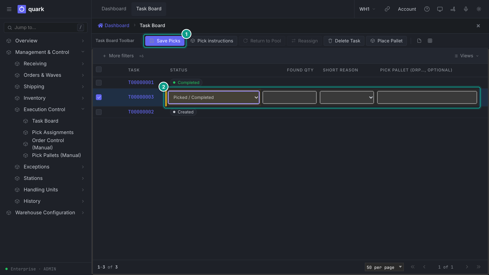

*Task Board with Status, Found qty, Short reason and Pick pallet fields. Focus: review the pallet label in the Save result before continuing the trip.*

### C2. Record a short pick

1. In **Status**, choose **Short**.
2. In **Found qty**, enter what you physically found. Enter `0` if you found nothing.
3. In **Short reason**, choose a published reason.
4. If **Found qty** is above `0`, use the same pallet rule as for a completed pick. If it is `0`, leave **Pick pallet** empty.
5. Click **Save Picks** and read the result for every changed row.

### C3. Place the pallet

Do this only when the picking trip is finished and the pallet is physically at the destination named by the pick card.

1. Click **Place Pallet**. You do not need to select a task row.
2. In **Pallet**, enter the `DRP` label.
3. In **Location**, enter the destination shown by the pick card.
4. Put the pallet in that location, then click **Place Pallet** in the window.
5. Check for **Pallet {label} placed in {location}**.

After this confirmation, the pallet goes to the next workflow step and accepts no more picks. If the location is wrong, the system refuses the action and names the pallet's destination. Move it to that destination and try again. **Ship order** does not ship stock that is still on an open pallet in transit.

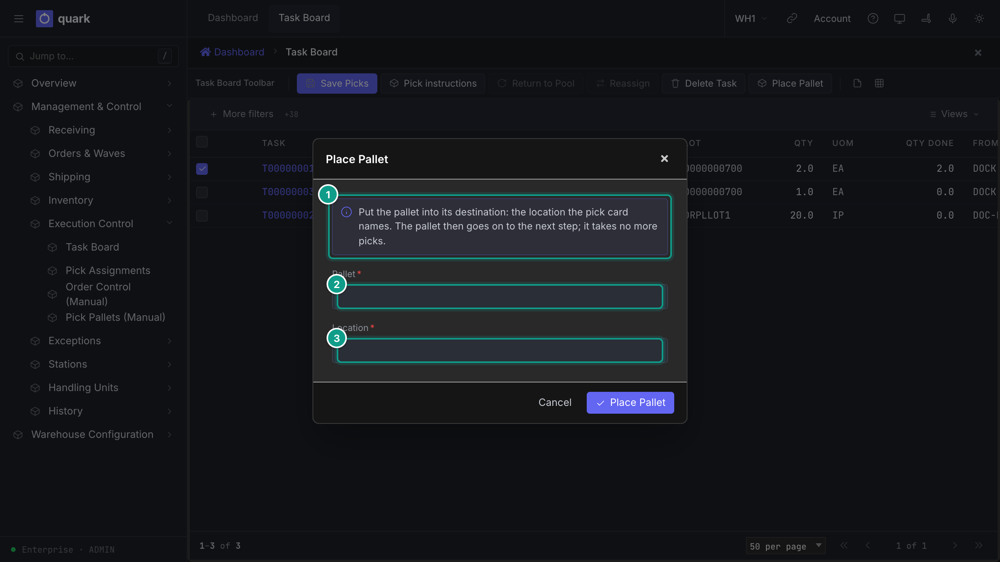

*Place Pallet window with Pallet and Location. Focus: use the destination from the pick card, not a convenient nearby location.*

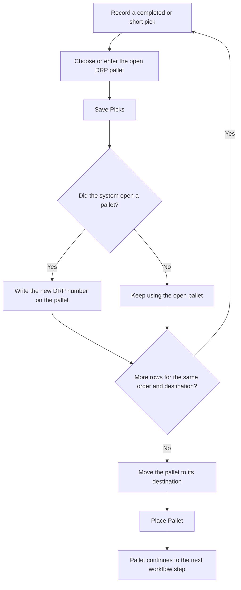

## What you should see

- **Pick Result** after each discrete pick, with **Picked** and **DROPID**.
- **Delivered** after a carrier route.
- A pallet that belongs to another operator closes only after a supervisor confirms.
- For paper picking, a Save result that names the pick pallet, followed by **Pallet {label} placed in {location}** when the trip is finished.

## If something goes wrong

| Message | What it means | What to do |
|---------|---------------|------------|
| **you have no right to take {type} tasks in work area {area} — ask a supervisor** | Your user may not take this work. | Ask your supervisor. |
| **you have no right to take {type} tasks in any work area — ask a supervisor** | Your user has no work area. | Ask your supervisor. |
| **there are {type} tasks in your work areas, but every one is heavier than your equipment lifts (up to {w} at ground level) — they wait for other equipment** | Your equipment cannot lift the work. | Ask your supervisor. |
| **operator already holds task {id}: finish it first** | You already have a pick. | Finish it, or return it. |
| **operator already has {type} task {id}; resume it before requesting Pick work** | Same. | Resume your task. |
| **task {id} lease has expired; claim the work again** | You took too long. | Ask for work again. |
| **task {id} is not assigned to you (currently: {user})** | Another user has the task. | Ask for work again. |
| **Pick task {id} has instructions the picker has not acknowledged** | You skipped the instructions. | Read and acknowledge them. |
| **pick {id} needs source confirmation first: {list}** | You must confirm the source first. | Scan the location, item, LPN or lot as asked. |
| **scanned LPN {scanned} is not the reserved source LPN** | You scanned the wrong pallet. | Scan the pallet shown in **Source LPN**. |
| **scanned lot {scanned} is not the reserved internal lot** | You scanned the wrong lot. | Scan the lot shown in **Lot**. |
| **lot attributes do not match the reserved lot: {codes}** | The goods in your hand have other lot attributes. | Check the goods. Use `F7` (**Reject**) or `F6` (**Short**) if needed. |
| **{n} lots in the source match the confirmed attributes** | The source has several matching lots. | Tell your supervisor. |
| **{what} must be scanned, manual entry is not allowed** | You typed a value that must be scanned. | Scan the label. |
| **{what} is not asked for by this pick's confirmation plan** | You scanned something the pick does not need. | Scan only what the screen asks. |
| **lot {lot} expires on {date}, too soon to pick** | The lot expires soon. | Reject the pick or tell your supervisor. |
| **lot {lot} at the source is on an outbound-blocking hold** | The lot is on hold. | Reject the pick. Tell your supervisor. |
| **barcode {raw} could not be read** | The scan is not readable. | Scan again. |
| **the source of pick {id} changed after it was confirmed** | The source changed after you confirmed. | Confirm the source again. |
| **a short pick requires a reason code** | You did not give a reason. | Type a reason code. |
| **Pick short reason '{code}' is not published** | The code is not valid. | Use a code your supervisor gives you. |
| **picked quantity {a} exceeds requested quantity {b}** | **Picked qty** is too high. | Lower it. |
| **there is no open pallet for this order: scan a pallet label** | You have no open pallet. | Scan a `DRP` label. |
| **a pallet label starts with DRP and has 4 to 50 letters, digits, '-' or '_'** | The label is not valid. | Use a `DRP` label. |
| **label {code} is on a container that is not an empty pallet** | The label is in use. | Use another label. |
| **pallet {code} belongs to another order** | The pallet is for another order. | Use your own pallet. |
| **pallet {open_code} of order {order} is still open: close it first (F2)** | You must close your open pallet before another order. | On RF, press `F2` and close it. In the web paper-pick grid, use **Place Pallet**. |
| **pallet {code} goes to {destination}, not to {location}: scan {destination}** | You scanned the wrong cell. | Scan the cell in **Put at**. |
| **pallet {code} is empty: there is nothing to close** | The pallet has no goods. | Do not close it. |
| **pallet {code} belongs to another operator** | Another operator opened the pallet. | A supervisor must confirm. |
| **a closed pallet cannot stand in location {location} of type {type}** | The cell is not allowed for a closed pallet. | Ask your supervisor. |
| **carrier {code} is on live pick assignment {assignment}** | The carrier is in use. | Use another carrier. |
| **carrier {code} is not empty** / **carrier {code} is on hold** | The carrier cannot be used. | Use another carrier. |
| **box {code} is not empty ({status})** / **box {code} is already on another carrier** / **box {code} is on hold** | The box cannot be used. | Use another box. |
| **box {code} is not registered: put it aside** | The box label is unknown. | Use another box. |
| **box {scanned} is not the box {expected} of position {n}** | You scanned the wrong box. | Scan the box shown in **Place / box**. |
| **box {code} is not the planned type {planned}: repack into the planned box** | The box type differs from the plan. | Use the planned box type. |
| **location {scanned} is not the delivery location {expected}** | You scanned the wrong place. | Scan the **Deliver to** location. |
| **pick assignment {code} has picked goods: a supervisor must dissolve it** | A supervisor must approve the dissolve. | Follow the **Supervisor Confirmation** steps. |
| **pick assignment {code} has {n} stops left on its route** | The route is not done. | Finish the route, or dissolve. |
| **the picks of position {n} wait for carton recovery: hand them over** | A position needs recovery. | Use **Recovery**. |
| **version conflict on task {id} (current version {n})** | Someone changed the task. | Ask for work again. |
| **No permission: {screen}** or **No permission** | Your user may not do this. | Tell your supervisor which screen you were using and what you tried to do. |

When there is no work, the line above **Current loc** says **No eligible Pick work**. On **Get Area Work** it says **No eligible Pick work in the area**. A refusal from the server shows in the same place.

A fresh system has three published short-reason codes: `SHORT` (the stock is below the system quantity), `WRONG_LOCATION` (the stock is not where the system says) and `LPN_NOT_FOUND` (the pallet is not in the location). `LPN_NOT_FOUND` takes no partial quantity: the pallet is there or it is not. Your administrator can add, change or retire codes, so ask your supervisor which codes your warehouse uses.

The server decides in this order. First, if you already hold a live carrier job, or a carrier that was dissolved with goods and not delivered, that job opens again. Next, if you did not name an area (**Discrete Pick**), you get a single pick. If you named an area, the picking policy for that area and your equipment decides. If the policy needs no carrier, you get a single pick. If it needs a carrier, you get a task you already hold, or else **Scan Carrier**.

## What the supervisor sees

Each committed pick moves stock to the pallet (DROPID) or box. A short pick releases the rest. A dissolved assignment returns boxes to the registry and tasks to the pool. A rejected pick is stored with your reason.

## Related guides

- [04 Damage and receipt close](04-damage-and-receipt-close.md) for **Force-Close Episode (supervisor)**
- [10 Packing and verify](10-packing-verify.md)
- [11 Troubleshooting and messages](11-troubleshooting-and-messages.md)
