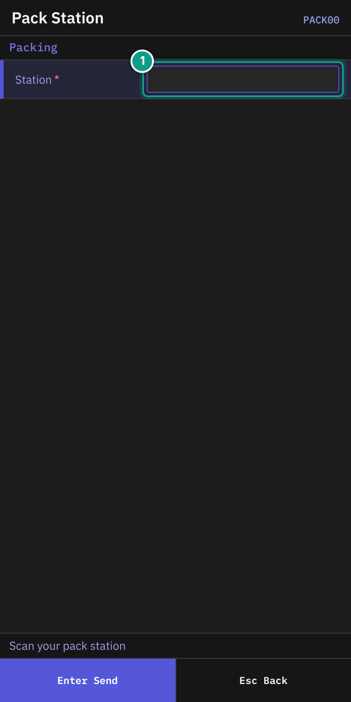
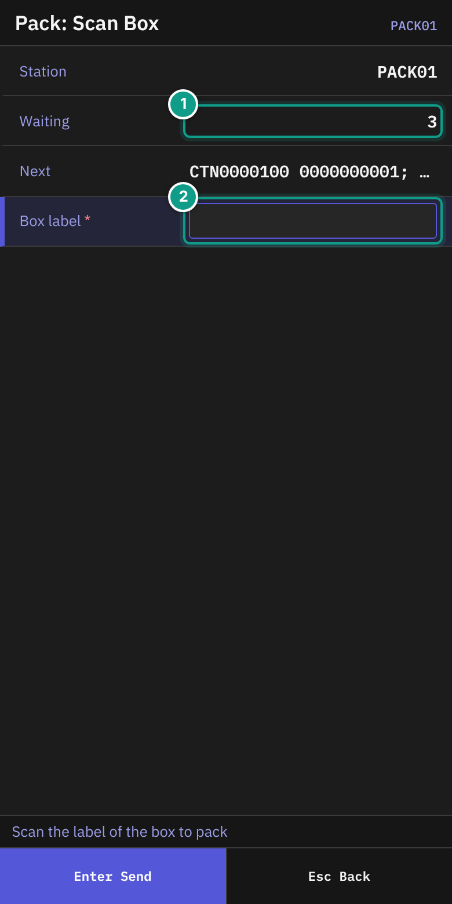
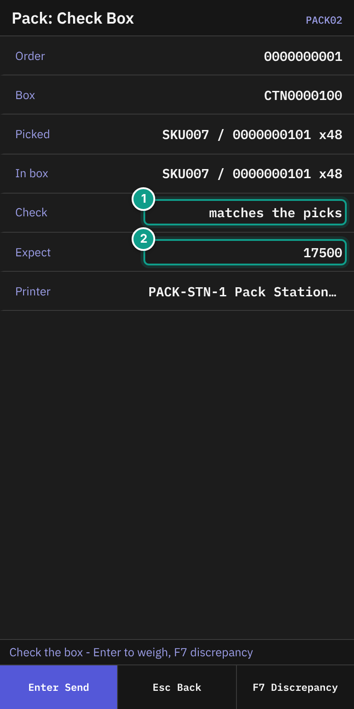
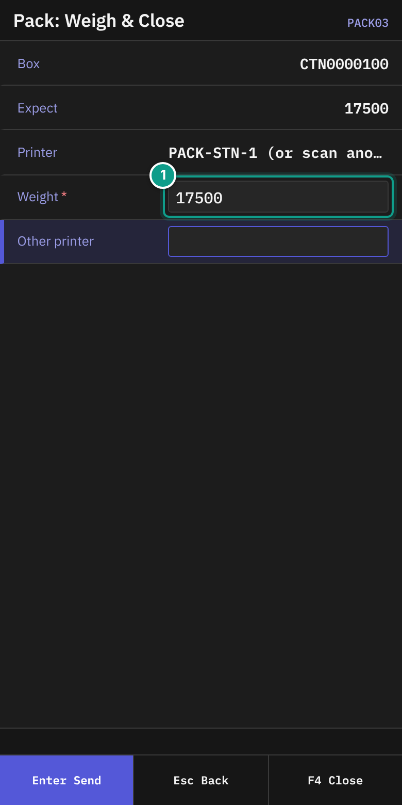
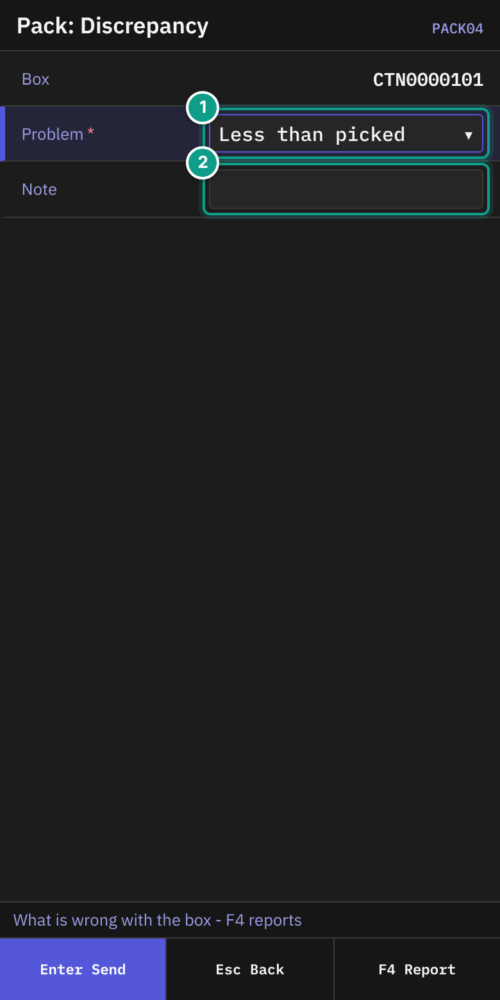

# 10 Packing, verify and repack

## What you will do

At a pack station, check that a picked box holds the right goods. Weigh the box and close it. Report a problem if the box does not match.

If you scan a **pallet** instead of a box, you repack it into cartons. See "Repack a pallet" below.

## Before you start

- Boxes must be picked and waiting at your pack station.
- Know the code of your pack station.
- A scale must be at the station. You type the weight.
- A printer may be assigned to the station. You can scan another printer.

## Steps

1. On **Main Menu**, press `4` (**Packing**).

*Screen PACK00: the Station field. Focus: Scan your pack station in the required Station field.*

2. On **Pack Station** (header **Packing**), read the status line: **Scan your pack station**.
3. In **Station**, scan the station code (up to 30 characters). The field may be filled in from your last session. It sends itself.

*Screen PACK01: Station, Waiting, Next, Label. Focus: 1 Waiting, 2 Label.*

4. On **Pack: Scan Unit**, read the status line: **Scan the label of the box or pallet to pack**. Check:
   - **Station**: your station.
   - **Waiting**: how many boxes wait.
   - **Next**: the next boxes, up to three. Each reads `{box} {order}`.
5. In **Label**, scan the label of the box you hold (up to 50 characters). The field sends itself. A box opens **Pack: Check Box**. A pallet opens **Repack: Next Carton** (see "Repack a pallet").

*Screen PACK02: Order, Box, Picked, In box, Check, Expect, Printer. Focus: 1 Check, 2 Expect.*

6. On **Pack: Check Box**, read the status line: **Check the box - Enter to weigh, F7 discrepancy**. Check:

| Line | What it shows |
|------|---------------|
| **Order** | The order number |
| **Box** | The box code |
| **Picked** | What was picked into the box: `{sku} / {lot} x{qty}` |
| **In box** | What the system sees in the box, or `empty` |
| **Check** | **matches the picks**, or `differs: {sku} {have} of {want}` |
| **Expect** | The expected weight. Shown only if known. |
| **Printer** | The station printer, or **none at this station** |

7. Open the box and count the goods. Compare them with **Picked**.
8. If the goods match, press `Enter`.
9. If the goods do not match, press `F7` (**Discrepancy**). See "Report a discrepancy".

*Screen PACK03: Box, Expect, Printer, Weight, Other printer. Focus: 1 Weight.*

10. On **Pack: Weigh & Close**, read the status line: **Weigh the box - Enter or F4 closes it**.
11. Put the box on the scale. In **Weight**, type the weight. It must be more than 0 (up to 10 characters).
12. Check **Printer**. It shows the station printer and **(or scan another)**, or **none here - scan one**.
13. If needed, scan a printer code in **Other printer** (up to 50 characters).
14. Press `Enter` or `F4` (**Close**).
15. The box closes. The terminal returns to **Pack: Scan Unit**.

### Report a discrepancy

*Screen PACK04: Box, Problem, Note. Focus: 1 Problem, 2 Note.*

1. On **Pack: Check Box**, press `F7` (**Discrepancy**).
2. On **Pack: Discrepancy**, read the status line: **What is wrong with the box - F4 reports**. Check **Box**.
3. In **Problem**, press `Left` or `Right` to choose:
   - **Less than picked**
   - **Item not of the order**
4. In **Note**, type a note if needed (up to 200 characters).
5. Press `F4` (**Report**).
6. The terminal returns to **Pack: Scan Unit**. Put the box aside for your supervisor.

### Repack a pallet

A discrete pick pallet that is routed to your pack station is a **source**. You open output cartons one by one, move the picked goods from the pallet into them, close each carton, and then complete the pallet. The goods stay picked for their order. A shipping label prints for each closed carton.

1. On **Pack: Scan Unit**, scan the label of the pallet. **Repack: Next Carton** (`PACK10`) opens. The status line says **Scan a carton to pack into - F4 pallet done**. Check:

| Line | What it shows |
|------|---------------|
| **Order** | The order number |
| **Pallet** | The pallet code. `(done)` is added once the pallet is completed. |
| **Left** | What of the order is still on the pallet: `{sku} x{qty}` |
| **Open** | The cartons that are open for this pallet, or `none` |

2. In **Carton**, scan the label of the next output carton (up to 50 characters). It is a planned carton of the order, or an empty registered container that stands at the station. **Repack: Pack Items** (`PACK11`) opens.
3. On **Repack: Pack Items**, read the status line: **Scan an item - F5 close carton, F7 take out, F4 pallet done**. Check **Carton**, **In carton** and **On pallet**. In **Item**, scan or type the SKU. In **Qty**, type how many go into the carton (the field starts at 1). In **Lot (if asked)**, type the lot when the SKU needs one. Press `Enter`.
4. The terminal stays on the same screen and shows `Packed {qty} {sku}, {n} left on the pallet`. Repeat step 3 for every item. If nothing of the order is left on the pallet, the terminal goes to **Repack: Pallet Done** and shows **Nothing of the order is left on the pallet**.
5. To close the carton press `F5` (**Close carton**). On **Repack: Close Carton** (`PACK12`), read **Weigh the carton - Enter or F4 closes it**. In **Weight**, type the weight (more than 0). In **Full?**, choose **No - packed as planned** or **Yes - carton is full**. Check **Printer**. Scan another printer in **Other printer** if needed. Press `Enter` or `F4` (**Close**).
6. The terminal returns to **Repack: Next Carton** and shows `Carton {code} packed, label on {printer}` (or `no printer - no label`). If this was the last carton of the order, the terminal returns to **Pack: Scan Unit** and adds `Order packed`.
7. When the pallet is empty, press `F4` (**Pallet done**) on **Repack: Next Carton** or on **Repack: Pack Items**. On **Repack: Pallet Done** (`PACK14`), read **F4 completes the pallet - nothing goes back onto it. F6 keeps packing**. Press `F4` (**Complete**) to finish the pallet. Press `F6` (**Keep packing**) to go back.

The pallet is completed only when you press `F4`. It is never completed by the last item you move, so you can still sort goods between the open cartons. After `F4` nothing can go back onto the pallet.

#### Take items out of a carton

1. On **Repack: Pack Items**, press `F7` (**Take out**).
2. On **Repack: Take Out** (`PACK13`), read **Scan the item, then the pallet or another carton**. Check **From**, **In carton** and **Pallet**.
3. In **Item** and **Qty** (and **Lot (if asked)**), name what you take out. In **Put into**, scan the label of the pallet (while it is open) or of another open carton of the same order. Press `Enter`.
4. The terminal goes back to **Repack: Pack Items**.

If you leave **Repack: Pack Items** with `Esc`, the carton stays open. The terminal says `Carton {code} stays open - scan it to go on`. If you leave **Repack: Next Carton** with `Esc`, the pallet stays open: scan it again to go on.

#### Repack messages

| Message | What it means | What to do |
|---------|---------------|------------|
| **the source still holds goods of the order: {sku}** | You tried to complete a pallet that still holds goods of the order. | Pack the rest, or take it out, then complete. |
| **the source was completed — goods go back into it only through recovery** | The pallet is already completed. Nothing goes back onto it. | Tell your supervisor. |
| **the source was already completed** | You completed the same pallet twice. | None. |
| **this carton was planned for another order** | The carton belongs to another order. | Scan another carton. |
| **a carton of another order is open on this container** | The container is in use. | Scan another carton. |
| **the container is not at this station** | The carton or pallet stands elsewhere. | Bring it to your station. |
| **the carton is not empty** | You opened a container that already holds goods. | Use an empty carton. |
| **there is no container with this label** | The label is unknown. | Scan the label again. |
| **there are no such picked goods in this container: {sku}** | The pallet or carton holds no picked stock of that item. | Check the item. |
| **several lots of this item are here — scan the lot: {sku}** | The item has more than one lot there. | Type the lot in **Lot (if asked)**. |
| **there is less picked here than you move: {sku}** | **Qty** is bigger than what is there. | Type a smaller quantity. |
| **the container is on hold: {container}** | A hold stands on the pallet or carton. | Tell your supervisor. |
| **say where the goods go: back into the source or into another carton** | **Put into** is empty or not an open carton or the pallet. | Scan the pallet or an open carton. |
| **the goods must go into another container** | **Put into** is the carton itself. | Scan another label. |
| **SERIAL_PACKING_NOT_SUPPORTED** | The carton holds serial-tracked stock. | Not supported today. |
| **version conflict on ...** | The carton changed after you looked (an item was added or taken out). | Look at the screen again and close the carton again. |

Voiding an empty output carton and reopening a closed carton have no screen yet.

Source: `crates/libs/wms-lib-sql/sql/rf-screens/108_uc_pack_repack.sql`, `crates/libs/wms-outbound/src/packing/README.md` (Repack).

### Leave

Press `Esc` on **Pack: Scan Unit** to go back to **Pack Station**. Press `Esc` on **Pack Station** to go to **Main Menu**. Press `Esc` on **Pack: Check Box** to return to **Pack: Scan Unit**.

## What you should see

- The box is gone from **Waiting** after you close it.
- On a report, the box stays in **Waiting**. A report does not move the box out of the queue. Put the box aside and do not scan it again until your supervisor says so.
- The screen shows `Discrepancy reported on box {box} - the order waits for recovery`.

**Report** stores the discrepancy as open. It blocks the order: the order cannot become packed while the discrepancy is open. The system changes no stock and no other record.

## If something goes wrong

| Message | What it means | What to do |
|---------|---------------|------------|
| **there is no such station location: {station}** | The station code is unknown. | Scan the station label again. |
| **no unit with container {box} waits for packing at {station}** | The box is not waiting at your station. | Check the box and station. |
| **unit {id} is assigned to {user}, not this station** | The box is for another station. | Take it to the right station. |
| **unit {id} is {status}, not waiting** | The box is not ready or is already packed. | Put it aside. Tell your supervisor. |
| **unit {id} waits for {step}, not this step** | The box is at another step. | Put it aside. Tell your supervisor. |
| **a measured weight is required to close** | **Weight** is empty. | Type the weight. |
| **there is no active printer {code}** | The printer code is wrong or inactive. | Scan another printer. |
| **a lot in the package is expired or too short-lived to ship: {lot}, {expiration}, {must expire after}** | A lot in the box expires on or before today plus the SKU's minimum days left at shipping (or is already expired). The box does not close. | Put the box aside. Tell your supervisor, who decides what happens to the lot. Weighing again does not help. |
| **carton {id} is not a package under verification** | The box is not in the check step. | Scan the box again. |
| **version conflict on ...** | Someone changed the box. | The terminal tries again. If it fails, scan the box again. |
| **No permission: {screen}** or **No permission** | Your user may not pack. | Tell your supervisor which screen you were using and what you tried to do. |

## What the supervisor sees

A closed box has the weight you typed. A reported box carries the problem you chose and your note.

## Related guides

- [09 Picking](09-picking.md)
- [11 Order control after picking](11-order-control-after-picking.md)
- [12 Troubleshooting and messages](12-troubleshooting-and-messages.md)
