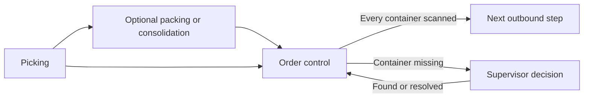
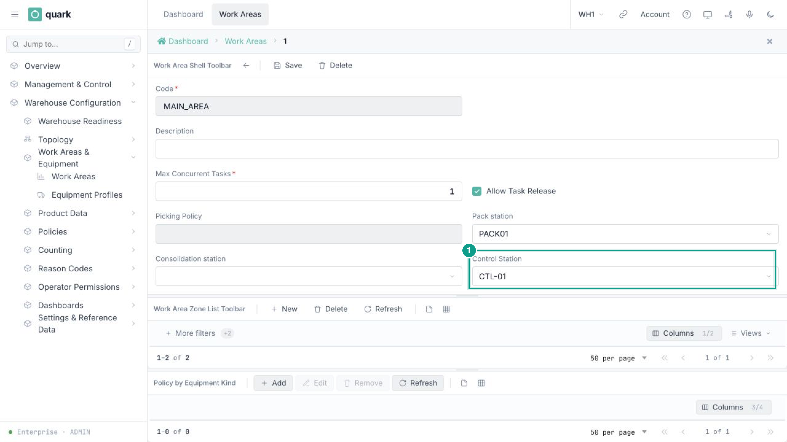
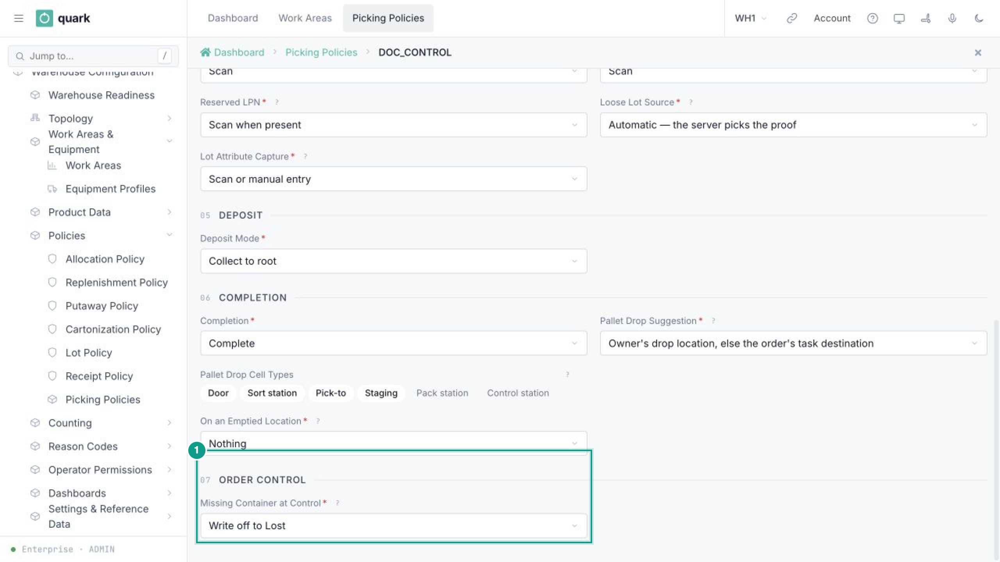
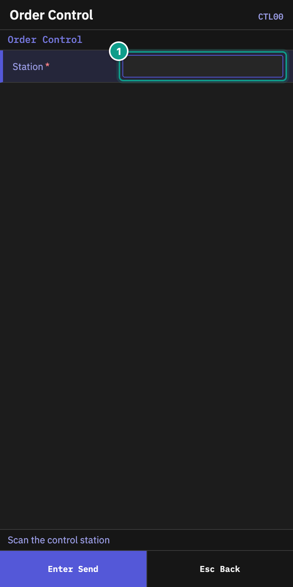
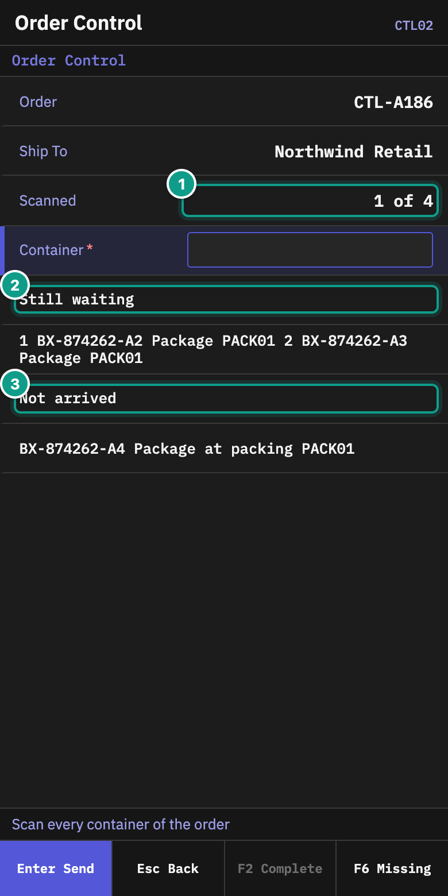
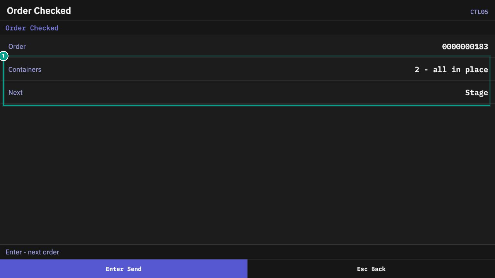
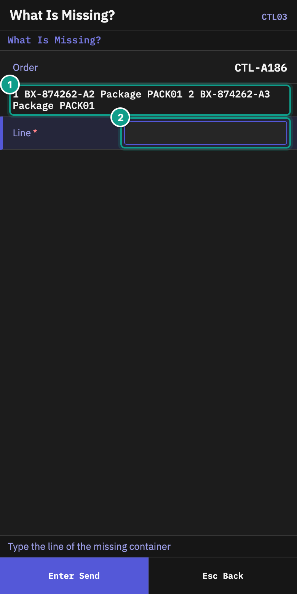
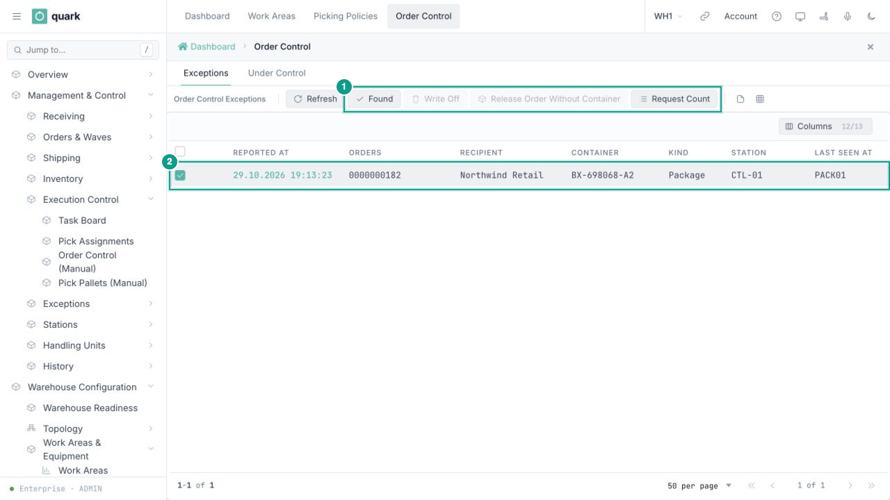
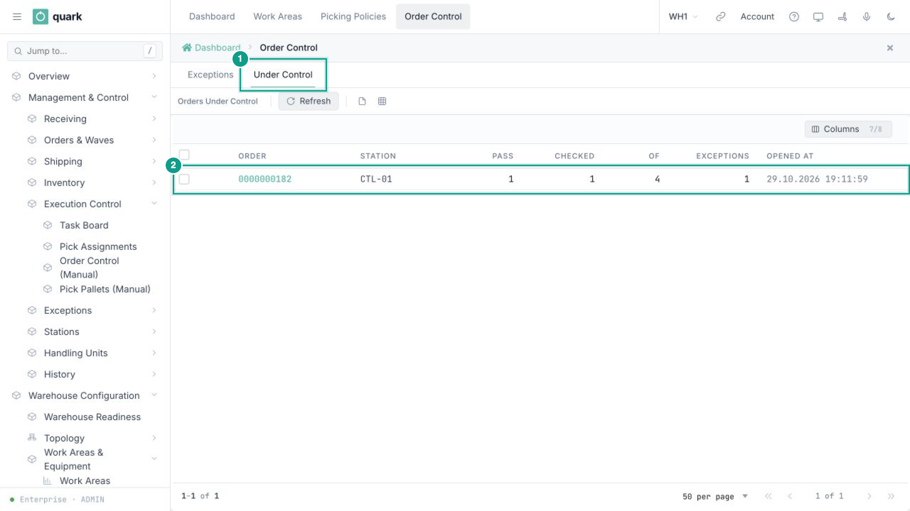

# 11 Order control after picking

## What you will do

Check that every container of an order has reached the control station before the order moves on. This check counts containers; it does not replace checking the goods inside a box during packing.

Order control is used only in a warehouse that has a control station. If no work area names one, picking and shipping continue as before.

## Administrator: set up order control

### Create and assign the station

1. Open `Sidebar > Warehouse Configuration > Topology > Locations` and click **New**.
2. Give the location a code, for example `CTL-01`.
3. In **Type**, choose **Control station** (`Control`). Fill the other required location fields and click **Save**.
4. Open `Sidebar > Warehouse Configuration > Work Areas & Equipment > Work Areas` and open the area whose picked goods must be checked.
5. In **Control Station**, choose `CTL-01` and save the area.
6. If more than one work area uses control, select the same control station in every area.

*Work Area card. Focus: Control Station names the location where this area's orders are checked.*

A warehouse can use only one control station. A second work area may name the same station, but it cannot name a different one. If it does, the message names the station already used by the warehouse.

Leaving **Control Station** empty keeps the area's current flow unchanged.

### Choose what happens when a container is missing

1. Open `Sidebar > Warehouse Configuration > Policies > Picking Policies`.
2. Open the policy used by the work area and create or open its draft revision.
3. In **Order Control**, set **Missing Container at Control**.
4. Save and publish the revision.

*Picking Policy card. Focus: choose the missing-container rule in the Order Control section.*

| Value | What happens |
|---|---|
| **Write off to Lost** | The goods in the missing container are written off to a `Lost` location. Picking closes short and the order continues without that container. |
| **Release the order without it** | The order continues without the container and may ship partially. The container remains on record, and its last known location is sent for a count. If the container is later found, it must be scanned at the control station and ships on a later trip. |
| **Only find it** | The order waits until the container is found. This is the default. |

The rule is recorded when the operator reports the container missing. Publishing a different rule later does not change an exception that is already open.

### Allow a closed pick pallet to go straight to control

On the same policy revision, add **Control station** (`Control`) to **Pallet Drop Cell Types** when a closed pick pallet may go directly from picking to order control. Without this type in the list, that direct pallet route is not available.

If the pick pallet goes to packing first, packing consumes it as the source and produces cartons. Those cartons follow the area's packing, consolidation and control-station settings; the original pallet's **Pallet Drop Cell Types** are not checked again.

### Move a control station safely

Change **Control Station** only when no order or container is waiting there. A container already sent to the old station keeps that destination; changing the work area does not redirect it. Moving the setting too early can leave existing work waiting at the old station.

## Operator: check an order

### Before you start

- Bring the order's containers to the control station.
- Know the station code.
- Use the container at the top level. If a box stands on a pallet, scan the pallet.

### Steps

1. On **Main Menu**, open **Order Control**.
2. On **Order Control**, scan the station in **Station**.

*Screen CTL00. Focus: scan the control station in Station.*

3. On **Control Station**, scan any container of the order in **Container/Order**. You can type the order number instead. Use the order number when none of its containers has reached the station yet. If this scan completes the order, the terminal opens **Order Checked** immediately; continue with step 6.
4. Otherwise, on **Order Control**, check **Order**, **Ship To** and **Scanned**. The card shows `k of N` and separates:
   - **Still waiting**: containers expected at this station but not yet scanned;
   - **Not arrived**: containers still at packing or consolidation;
   - **In picking**: work that has not yet produced a container.

*Screen CTL02. Focus: Scanned shows progress; Still waiting and Not arrived show what remains.*

5. Scan the remaining containers of the same order. A repeated scan is accepted and the terminal says that the container was already scanned.
6. After the last required container is scanned, **Order Checked** opens. Check **Containers** and **Next**, then press `Enter` for the next order.

*Screen CTL05. Focus: the order is checked and the Next line says where it goes.*

The scan history is kept on the server. A lost connection, `Esc`, or another operator taking over does not erase the containers already scanned.

### Report a missing container

Use this for a container under **Still waiting** that should be at the station but cannot be found, including one last seen at packing or consolidation but already directed to control. A row under **Not arrived** still has an earlier step to finish and cannot be reported missing yet.

1. On the order card, press `F6` (**Missing**).
2. On **What Is Missing?**, type the line number of the missing container and press `Enter`.

*Screen CTL03. Focus: choose the line of the missing container.*

3. On **Report Missing**, check **Missing** and **Last seen**. Press `Enter` to report it, or `Esc` to go back.
4. The order card returns. The container is marked as waiting for the supervisor. You may scan the other containers and then leave this order.

The order remains blocked until the missing-container rule allows the supervisor to resolve it, or the container is found and scanned.

### If the order changes while you complete it

`F2` (**Complete**) appears when the order became complete without a new scan, for example after a supervisor resolved a missing container. If the order changes while you press `F2`, the terminal reloads the card. Check the new card and press `F2` again.

### Refusals you may see

| What you see | What it means | What to do |
|---|---|---|
| The location is not a control station | The station code is wrong or the location is not configured for control. | Scan the configured control station. |
| Container or order not found | The code matches neither a container nor an order. | Check the label or order number and scan again. |
| The order has no container waiting for control here | The order is not ready at this station, has already passed control, or belongs elsewhere. | Check the order and station. |
| The container belongs to another order | It is not part of the open order. | Set it aside and finish the order shown on the card. |
| The container stands on a pallet — scan the pallet | The box is inside a larger shipping unit. | Scan the pallet label. |
| The container is routed to another control station | The container was assigned elsewhere. | Take it to the station named in the message. |
| The container is still at packing or consolidation | Its earlier step is not complete. | Finish that step and bring the container to control. |

## Supervisor: resolve missing containers

Open `Sidebar > Management & Control > Execution Control > Order Control (Manual)`. The screen has two tabs.

### Exceptions

Select one row. The toolbar shows the actions allowed for that row:

| Action | Result |
|---|---|
| **Found** | Records that the container was found. The operator still brings it to the control station and scans it. |
| **Write Off** | Opens **Write Off Container**. Read the warning, add an optional **Note**, then confirm **Write Off**. The goods go to `Lost`, picking closes short and the order continues. |
| **Release Order Without Container** | Opens a confirmation. The order continues without the container. The container remains on record, and its last known location is sent for a count. |
| **Request Count** | Sends the last known location for a count. The order continues to wait for another decision. The policy never blocks this action; after a count is already requested, a duplicate request is unavailable. |

*Order Control, Exceptions tab. Focus: select one row, then use an available action in the toolbar.*

An unavailable button is grey. Hover over it to see why. Availability depends on the rule recorded when the operator reported the container missing, the current exception status and the container's contents. For example, **Only find it** does not allow release or write-off, and a container with serial-tracked goods cannot be written off.

After **Release Order Without Container**, a count has already been requested, so **Found** and **Request Count** are unavailable. If the count does not find the container, **Write Off** becomes the remaining supervisor action even though the original rule was to release the order. The exception closes as found only when the container is physically scanned at the control station. If that container is found after the rest of the order shipped, it goes on a later trip.

### Under Control

This tab is read-only. It shows each open order, its station, the control pass, checked containers, expected containers, open exceptions and opening time.

*Order Control, Under Control tab. Focus: use this list to see progress; no action is available here.*

A container scanned at the station automatically closes its missing-container exception as found.

## What you should see

- A complete order ends on **Order Checked** and moves to its next outbound step.
- A reported container appears on **Exceptions** for the supervisor.
- The **Under Control** tab shows only open checks.
- A warehouse without a configured control station follows its previous flow.

## Related guides

- [09 Picking](09-picking.md)
- [10 Packing, verify and repack](10-packing-verify.md)
- [12 Troubleshooting and messages](12-troubleshooting-and-messages.md)
- [Warehouse structure](../admin/03-warehouse-structure.md)
- [Picking policy settings](../admin/policies/21-picking-policy-settings.md)
