# 14 Batch Picking and Distribution Station

## What you will do

Collect part of a wave route into a shared tote, deliver that tote to its distribution station, and sort the goods into the boxes for individual orders or stores.

This process has two workplaces:

- the picker uses **Picking > Station Route** and walks the warehouse with a shared tote;
- the station operator uses **Distribution Station** and divides the tote into boxes on numbered positions.

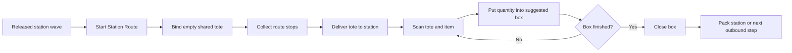

The shared tote is transport equipment, not an order box. Goods from several orders may travel in it. The separation into order or store boxes happens at the station.

## Before you start

- The wave must be released and assigned to a distribution station.
- The station must be a `Sort` location with numbered positions. See [Waves and wave policy](../admin/06-outbound-setup.md#4-waves-and-wave-policy).
- Have an empty registered shared tote.
- The station needs enough empty registered boxes for its positions.
- Know the wave code and your work area.
- Use **Station Route** only for a wave assigned to a station. Use [ordinary picking](09-picking.md) for discrete pallets and carts with order boxes.

## 1. Start a station route

1. On **Main Menu**, choose **Picking**.
2. On **Picking**, choose **Station Route**.
3. On **Start Station Route**, scan or type the wave in **Wave**.
4. Enter your **Area**.
5. In **Stops**, enter how many route stops you can take now. The allowed range is 1 to 100; the proposed value is 10.
6. Press `Enter`.

The terminal resumes your live station route instead of starting a second one. Finish every accepted stop, then deliver every tote that contains goods or release every tote that is still empty before taking another route.

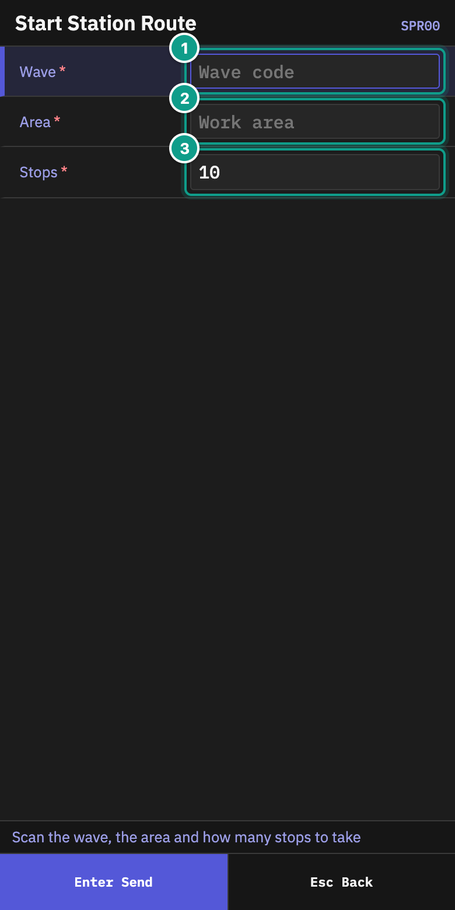

*Screen SPR00. Focus: identify the wave and area, then choose a practical number of stops.*

## 2. Bind a shared tote

1. On **Scan Shared Tote**, check the station shown in **Station**.
2. In **Tote**, scan an empty shared tote.

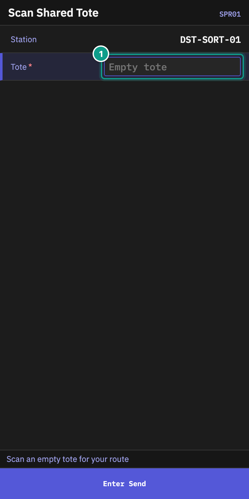

*Screen SPR01. Focus: bind an empty tote to this route portion.*

The tote stays attached to your route until you deliver it to the station or release it empty. Do not use an order box or a tote that still contains stock.

## 3. Collect the route stops

On **Station Stop**, the terminal shows:

| Field | Meaning |
|---|---|
| **From** | Source location to visit |
| **SKU** | Item to collect |
| **Lot** | Lot, when the task names one |
| **Left** | Quantity still needed at this stop |
| **Tote** | Shared tote receiving the goods |
| **Collect** | Quantity you are putting into the tote now |

1. Go to **From**.
2. Complete every source check the terminal asks for. Depending on the picking policy, this can include the location, item, source LPN, lot or a lot attribute.
3. If the goods are on a valid LPN other than the reserved one, follow the substitute-LPN prompt. Do not move goods from an unconfirmed source.
4. Put the goods into the shared tote.
5. Enter **Collect** and press `Enter`.
6. Continue with the next stop.

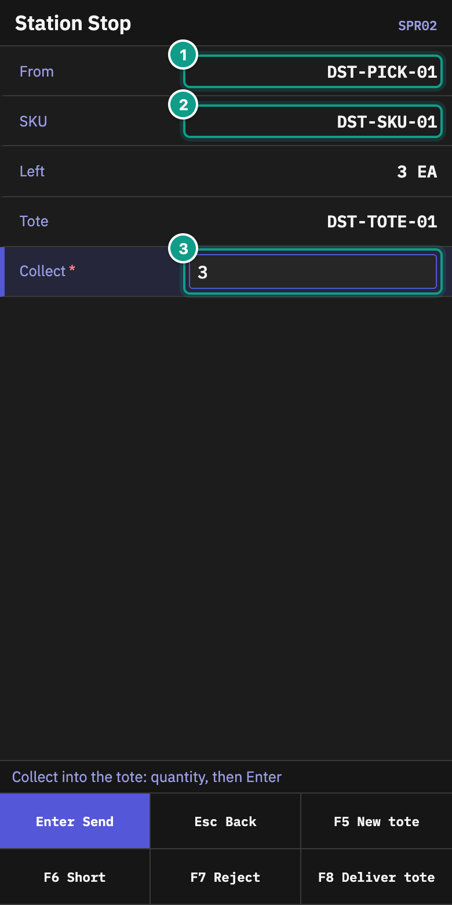

*Screen SPR02. Focus: collect the shown quantity from the shown source into the route's shared tote.*

The footer actions are:

| Key | Action | When to use it |
|---|---|---|
| `F5` | New tote | The current tote is full; keep it attached to the route and bind another empty tote for the next collection. |
| `F6` | Short | The full required quantity is not available. Use the reason that matches what you found. |
| `F7` | Reject | You cannot work this stop and need it returned for another decision. |
| `F8` | Deliver | Send the current tote to the station before the route portion is complete. |

A short follows the warehouse's configured short reason and actions. It may block the source, request a count, release other reservations or move missing stock according to policy. Do not choose a convenient reason; choose what happened at the source.

If the pick empties the source, the terminal may ask **Location {code} empty? 1 = Yes, 2 = No**. Answer from what is physically present.

## 4. Deliver or release the tote

1. On **Deliver Tote**, take the tote to **Deliver to**.
2. Confirm that **Tote** is the tote in your hands.
3. Scan the station location in **Scan loc**.

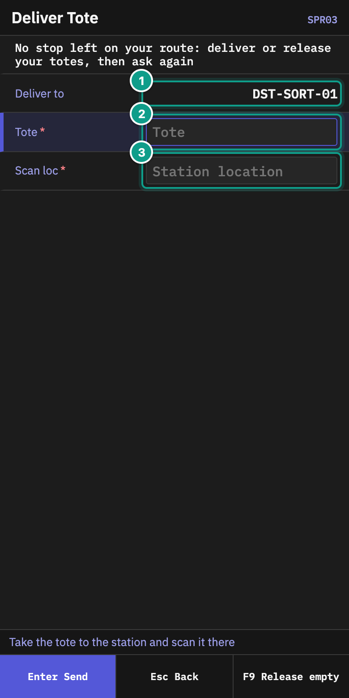

*Screen SPR03. Focus: physically take the tote to the shown station before scanning the location.*

If the tote is empty, use `F9` and scan it on **Release Empty Tote**. Releasing returns the empty tote for other work; it does not deliver stock.

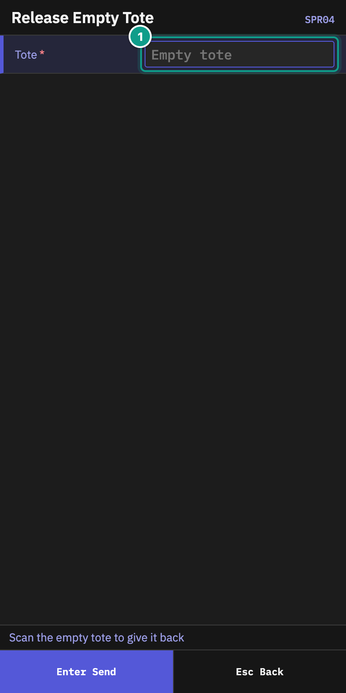

*Screen SPR04. Focus: release only the empty tote shown for your live route.*

After a full tote is delivered, the route may ask for another empty tote. Continue until all accepted stops are collected. The wave stays in progress while shared totes or station positions still contain unfinished work.

## 5. Put empty boxes on station positions

Before sorting, give each active position an empty box.

1. On **Main Menu**, choose **Distribution Station**.
2. Choose **Box on Position**.
3. On **Station**, scan the distribution station.
4. On **Box on Position**, scan the numbered **Position**, then scan an empty **Box**.
5. Repeat for the positions you need.

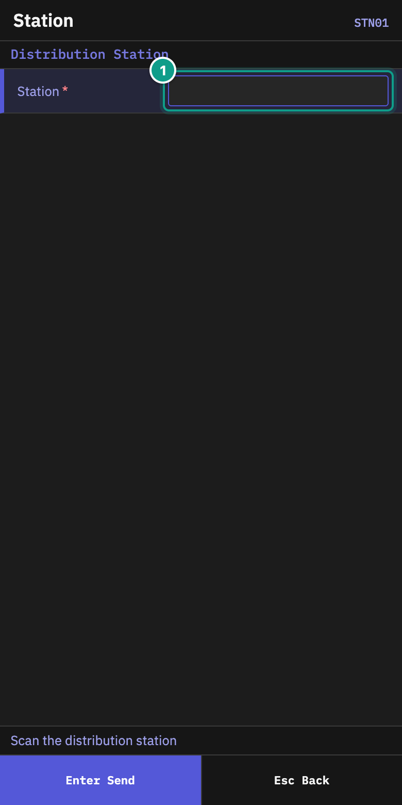

*Screen STN01. Focus: select the distribution station whose positions you are preparing.*

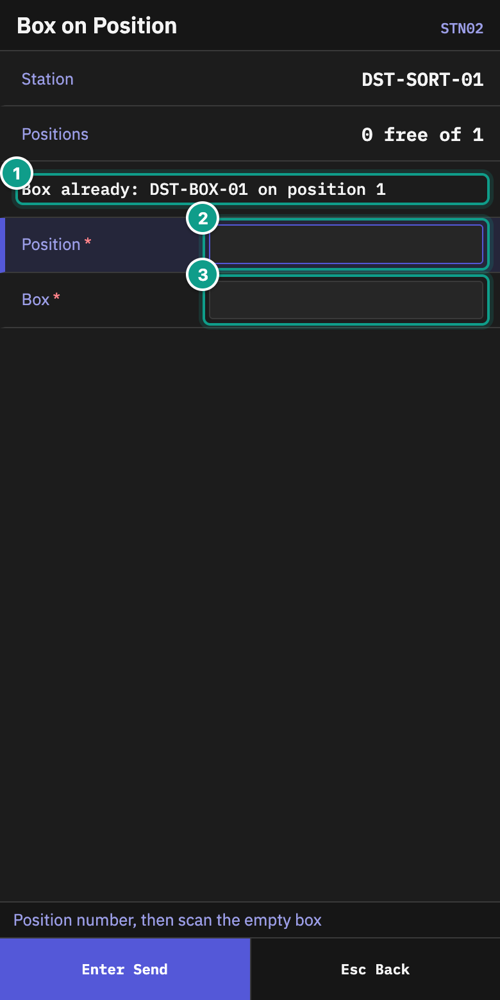

*Screen STN02. Focus: bind one empty box to the scanned position.*

The terminal shows how many positions are free and how many exist. A box already used elsewhere cannot be bound as an empty position box.

## 6. Sort goods into order or store boxes

1. On **Distribution Station**, choose **Place Items**.
2. On **Place: Scan Tote and Item**, scan the station, the delivered **Tote**, and an **Item** from that tote.
3. If the tote contains more than one lot of the item, scan the lot the terminal asks for.
4. Read the suggested position and box.
5. If that position has no box, **Place: Bind Empty Box** opens. Scan an empty box for the shown position.
6. On **Place: Confirm Box and Quantity**, scan the actual box and enter the quantity you are placing into it.
7. Put the quantity into that box and press `Enter`.
8. Continue until the tote has no goods left to place.

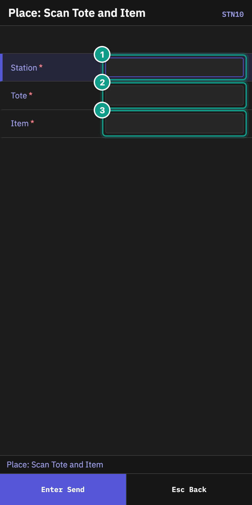

*Screen STN10. Focus: scan the delivered shared tote and the item you are holding.*

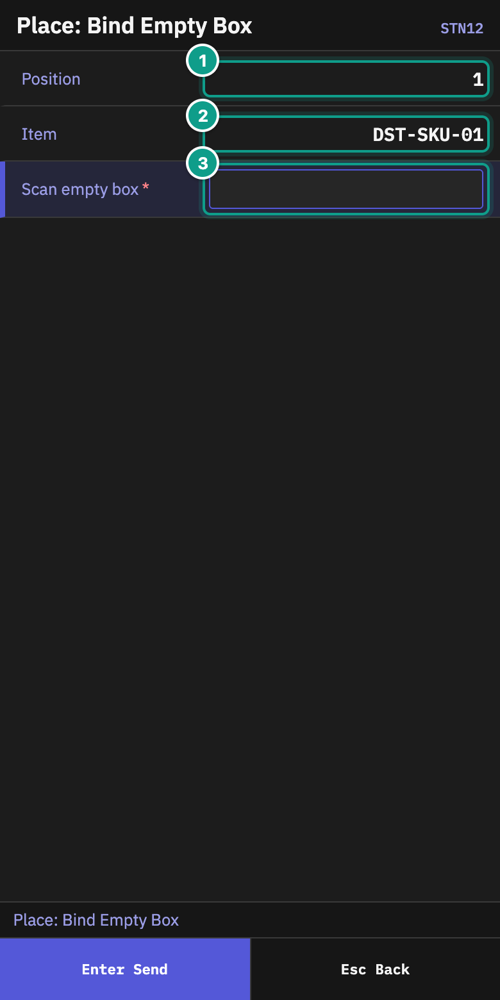

*Screen STN12. Focus: give the suggested position an empty box before placing goods.*

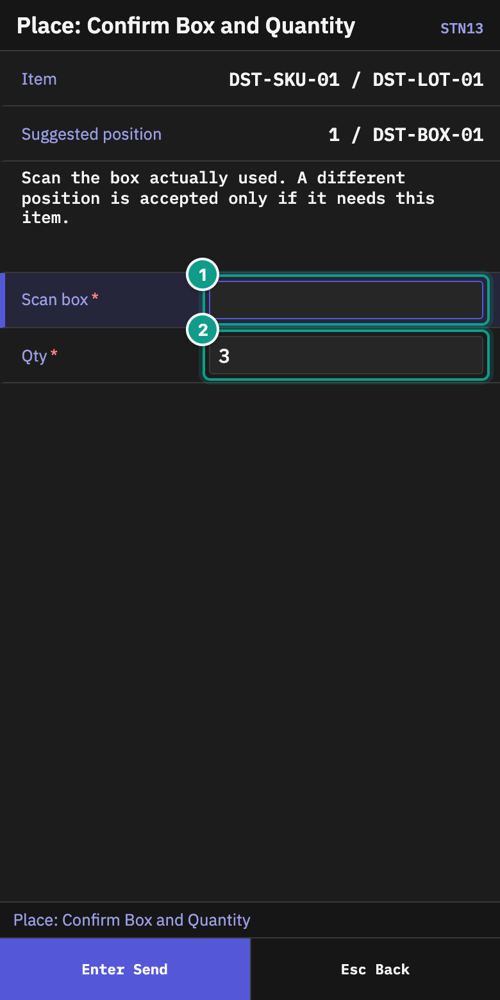

*Screen STN13. Focus: scan the actual box and place no more than the quantity needed there.*

You may use another position only when its box also needs the item. If the terminal says that no position needs it, stop and ask a supervisor before returning or moving the remainder.

## 7. Finish a station box

Use the action that matches the physical box:

### Close a completed box

1. Choose **Close Box**.
2. Scan the station and the completed box.

Closing frees the station position. A box that contains goods moves to its next destination; when no destination is ready, it waits at the station. If no goods were put into the box, closing frees the position but leaves the empty box at the station for the next wave.

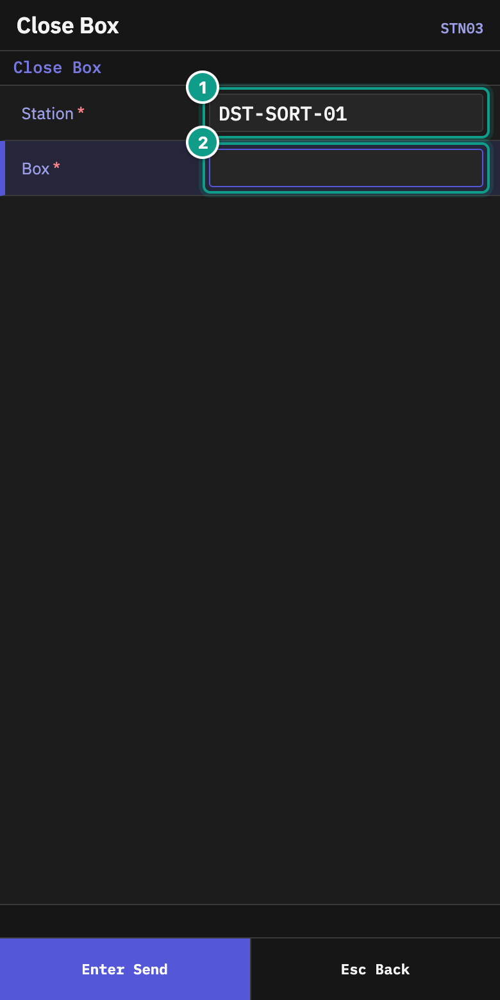

*Screen STN03. Focus: close only a box whose required station work is complete.*

### Replace a full box

1. Choose **Box Full**.
2. Scan the station and the full box.

The full box leaves the position. If the order still needs goods, the position waits for a replacement empty box. Otherwise the position is freed.

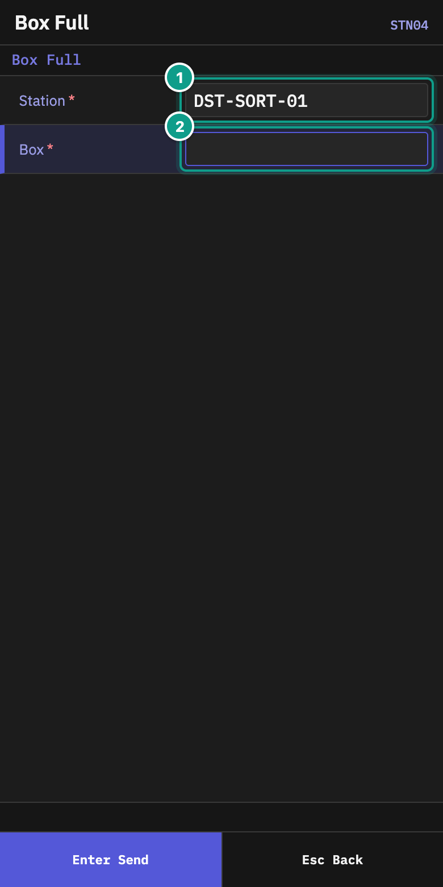

*Screen STN04. Focus: remove the full box and bind a replacement when more goods are due.*

### Take a closed box to packing

1. Choose **Box to Pack Station**.
2. Scan the closed box.
3. Take it to the pack station shown and scan that station.

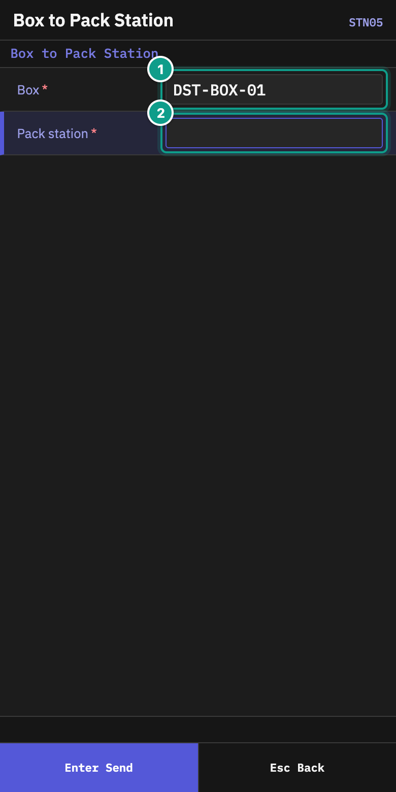

*Screen STN05. Focus: take the closed box to the exact pack station shown.*

## 8. Report a missing or damaged item at the station

Use **Item Missing** when the tote contains less of an item than the station expects. Use **Damaged Item** when the item is present but cannot be placed because it is damaged.

1. Choose **Item Missing** or **Damaged Item**.
2. Scan the station, tote and item.
3. Review the confirmation carefully and press `Enter`. Press `Esc` to cancel.

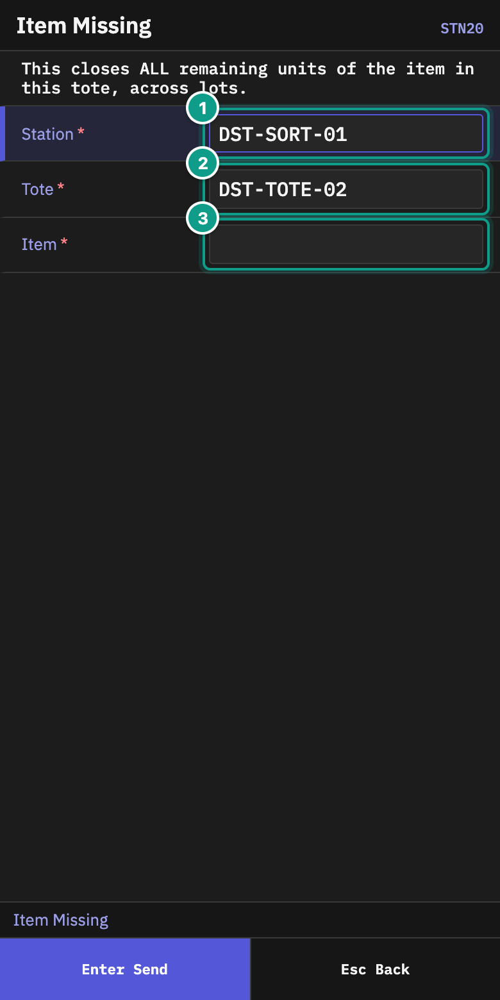

*Screen STN20. Focus: identify the station, tote and missing item before confirming.*

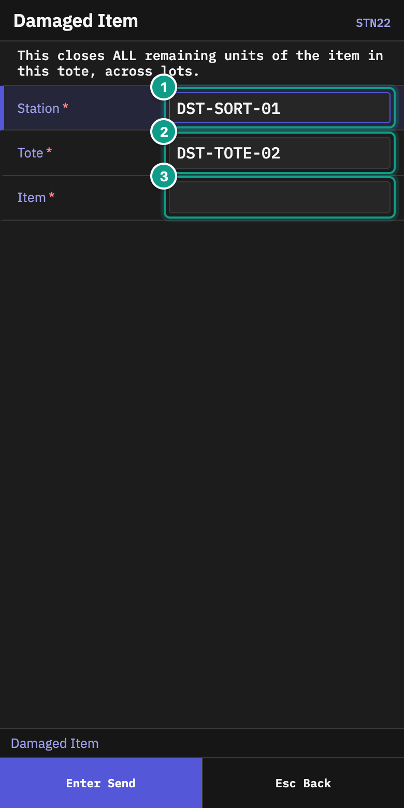

*Screen STN22. Focus: identify the station, tote and damaged item before confirming.*

The declaration closes all remaining units of that item in the tote across its lots. It is not a one-unit correction. If only one scanned quantity is wrong, stop and ask a supervisor instead of declaring the whole remainder missing or damaged.

## 9. Report excess goods

Use **Report Excess** when the tote physically contains more of an item than the station expects. Reporting the excess records what you found; it does not add stock or move the goods.

1. On **Distribution Station**, choose **Report Excess**.
2. On **Report Excess: Read Codes**, scan the station and tote.
3. Enter the owner code, wave code and item, then enter the **Excess qty**.
4. On **Confirm Excess Report**, compare the station, tote, owner, wave, item and quantity with the physical goods.
5. Press `Enter` to report the excess, or `Esc` to correct the details.
6. Keep the goods at the station until the count and recovery work is complete.

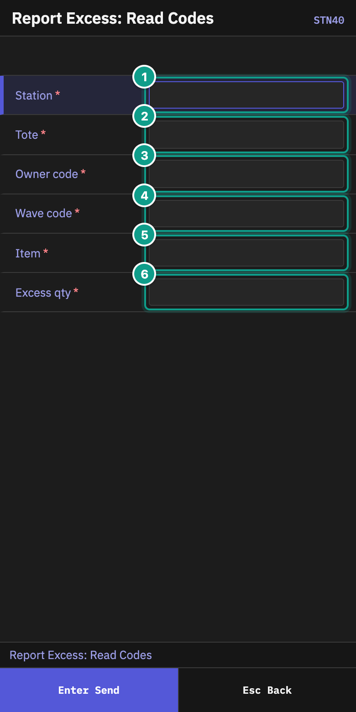

*Screen STN40. Focus: identify the exact tote, wave, owner and item before entering the excess quantity.*

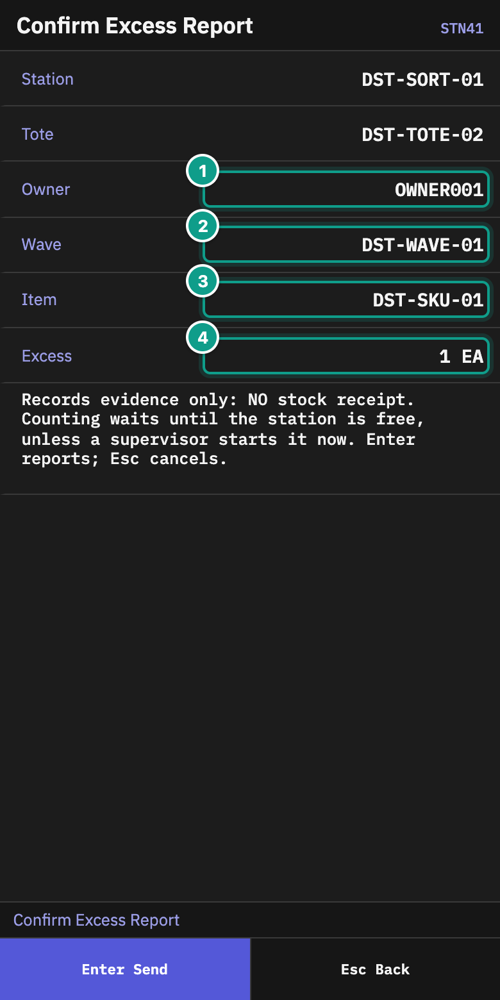

*Screen STN41. Focus: reporting records evidence only; it does not receive or move stock.*

The system normally waits for the station to become free before it requests a full count. A supervisor can request the count earlier, but returns from that station then stop until the count finishes.

## 10. Withdraw an order for return — supervisor

Use **Supervisor > Withdraw Order for Return** only when all picked goods still waiting for an order are together in one station tote. The action withdraws the whole order, cancels its remaining demand and makes those goods free in the tote. It does not physically move them.

1. Scan the station, tote and order number on **Withdraw: Read Order**.
2. Review the order, status, version and **Picked remainder**.
3. Enter a clear reason.
4. On **Confirm Whole Order Withdrawal**, check the same order and quantity again. Press `Enter` only if the whole order must be withdrawn.
5. On **Order Withdrawn**, note **Ready to return**.
6. Use the normal stock-movement process to return the freed goods from the tote.

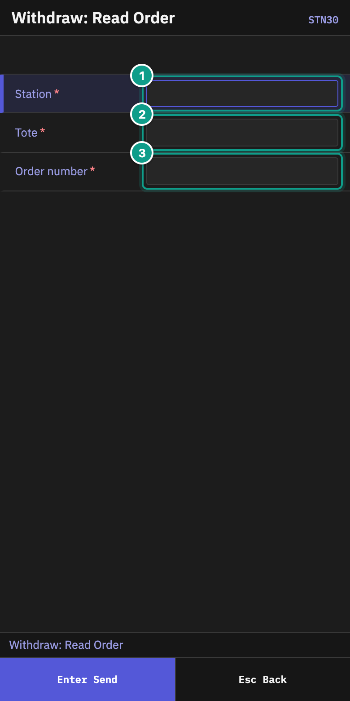

*Screen STN30. Focus: scan the exact order whose remaining picked goods are in this tote.*

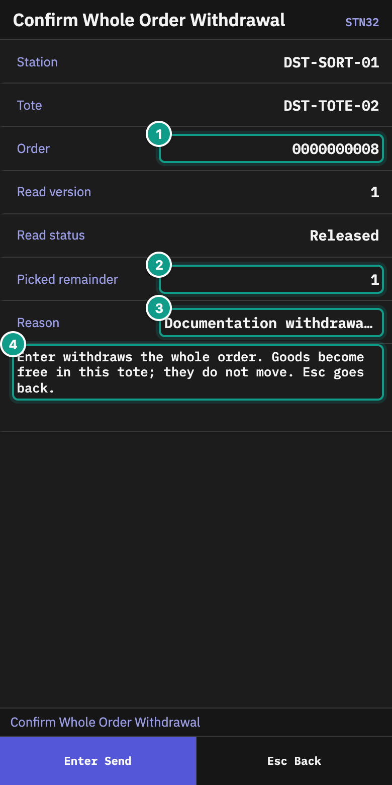

*Screen STN32. Focus: this decision applies to the whole order and cannot be narrowed to one item.*

The terminal refuses the withdrawal if source picking is still open, goods have already been placed into a station box, goods are outside the scanned tote, or part of the order has already shipped. If the order changes after you read it, scan and review it again.

## 11. Declare a tote lost — supervisor

Use **Supervisor > Tote Lost** only after the complete tote has been searched for and cannot be found. This includes a tote that disappeared on the way to the station.

1. Scan the station and tote on **Tote Lost: Scan**.
2. On **Confirm Whole Tote Lost**, check both codes and press `Enter`.
3. On **Tote Loss Recorded**, note the quantity written off and the destination used for the loss.

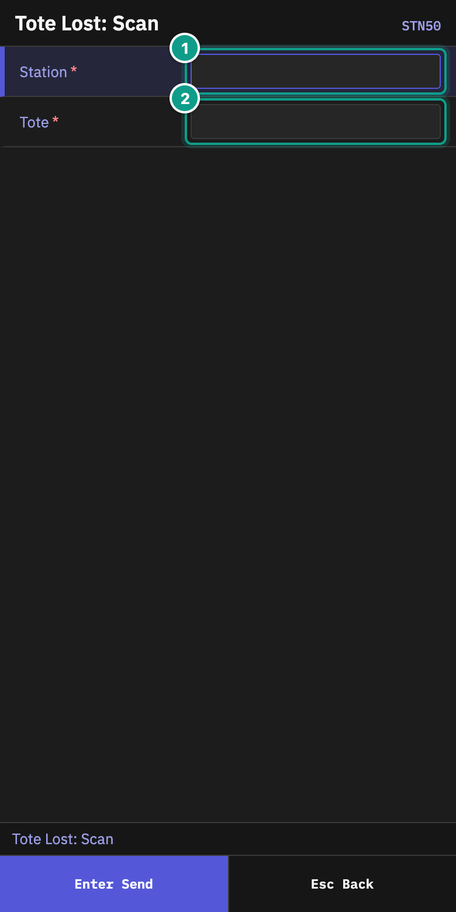

*Screen STN50. Focus: identify the exact missing tote and its intended station.*

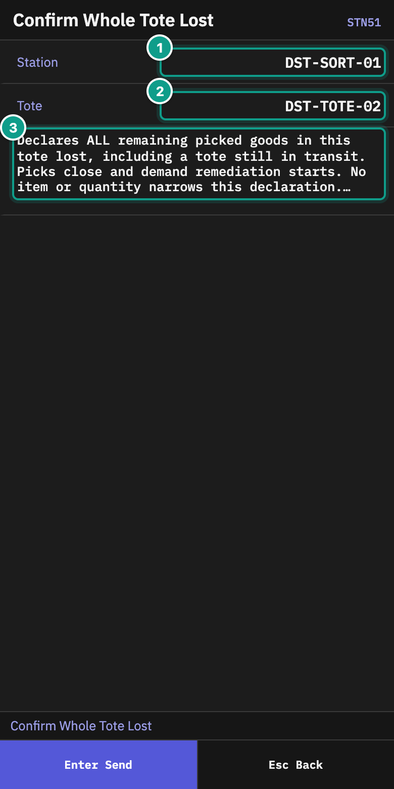

*Screen STN51. Focus: the declaration closes all remaining picked goods in the tote, not one item or quantity.*

The action writes off all remaining picked goods in the tote and starts the configured shortage follow-up. Do not use it for a single missing or damaged item; use **Item Missing** or **Damaged Item** instead.

## 12. Count reported excess now — supervisor

Use **Supervisor > Count Excess Now** when reported excess must be checked before the station becomes free.

1. Scan the station on **Count Excess: Read Station**.
2. On **Confirm Count Now**, review **Open positions**.
3. Press `Enter` to request the count, or `Esc` to leave the station unchanged.
4. Read **Count Request Result**:
   - **Count requested** means the count work was created;
   - **An existing partial count must finish first** means the excess remains pending;
   - **No pending excess reports** means no count was started.

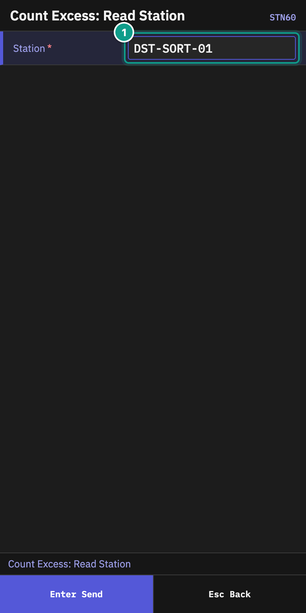

*Screen STN60. Focus: select the station whose reported excess needs an immediate count.*

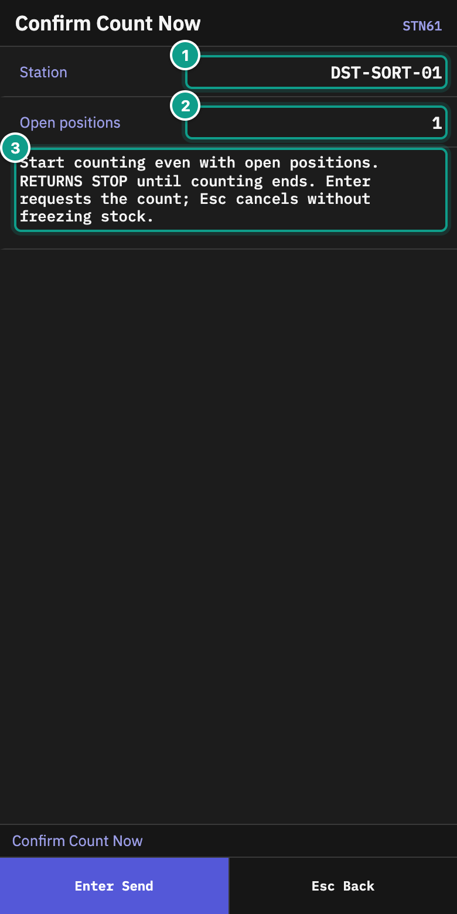

*Screen STN61. Focus: an immediate count can start while positions are open, but returns stop until counting finishes.*

## What you should see

- The station route visits each source once for the route portion you accepted.
- Every collected unit goes into the shared tote shown by the terminal.
- Delivery makes the tote available at the named distribution station.
- At the station, the terminal chooses the order or store position that needs each scanned item.
- A completed box that contains goods leaves its position for packing or the next outbound step. An empty completed box remains on the freed position.
- Reported excess creates count work; it does not silently increase stock.
- The wave completes only after its picking work is finished and all station positions are free.

## If something goes wrong

| What you see | Meaning | What to do |
|---|---|---|
| Your existing station route opens | You already hold live route work. | Finish every accepted stop and deliver or release every route tote; do not start a second route. |
| The tote is refused | It is not empty, is not registered, or belongs to other work. | Scan another empty registered shared tote. |
| The source scan is refused | The source does not match the work or the required proof is incomplete. | Read the prompt and confirm the location, item, LPN or lot it asks for. |
| The quantity is not available | The stop cannot be completed as planned. | Use `F6` **Short** and the correct reason. |
| The tote is full | It cannot safely carry the next quantity. | Use `F5` and bind another empty tote. The full tote remains on the route until delivery. |
| No position needs this item | The current station plan has no open box requirement for it. | Stop and ask a supervisor before moving the remainder. |
| The suggested position has no box | The order or store needs a box before placement. | Bind an empty box on **Place: Bind Empty Box**. |
| A box is full before its work is complete | More goods are still due for that position. | Use **Box Full**, remove it, then bind a replacement box. |
| Excess is reported while positions are open | The normal count waits until the station is free. | Keep the goods at the station, or ask a supervisor whether an immediate count is needed. |
| Return work stops after an immediate count | The station is protected while counting is active. | Finish the count before attempting another return or recovery action. |

## Related guides

- [Picking](09-picking.md): discrete pallets, carts, summary steps and paper picking.
- [Picking policy settings](../admin/policies/21-picking-policy-settings.md): how the warehouse chooses work shape, source proof, route grouping, pallet destinations and empty-location handling.
- [Pick short reasons](../admin/policies/23-pick-short-reasons.md): what each short reason does.
- [Waves and wave policy](../admin/06-outbound-setup.md#4-waves-and-wave-policy): create and release a wave assigned to a station.
- [Order control after picking](11-order-control-after-picking.md): check complete orders after picking when the area uses control.
- [Packing, verify and repack](10-packing-verify.md): check and close boxes at a pack station.
