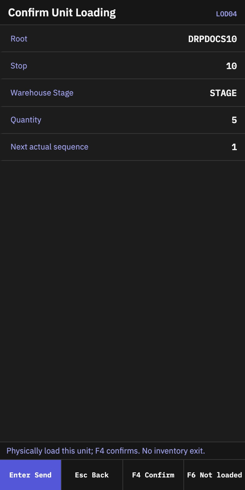
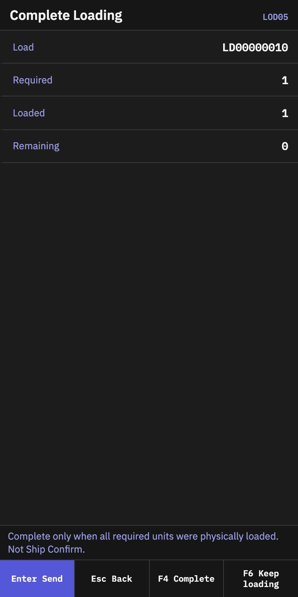
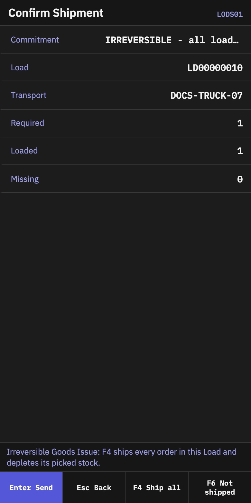

# Loading and shipment

## What you will do

Confirm the truck, load every planned root pallet or container in the required order, complete physical loading and then confirm warehouse departure. Completing a Load does not deduct stock. Shipment is the separate, irreversible step that does.

## Before you start

- A planner has frozen the Load Plan and opened the Load.
- The Load has an `LD########` number and a registered transport. A loading door may be assigned when the site uses one.
- Every planned unit is ready at its required Stage location and is not held.
- You have the physical truck and each root LPN in front of you.

## Load the truck

1. Open **Loading**.
2. Select **Load Units**.
3. On **Scan Load**, scan the `LD########` label or enter the complete number.
4. On **Confirm Transport**, scan the transport reference.
5. Check the transport, then press `F4` to start loading. Follow the assigned door when one is shown in the warehouse plan.
6. On **Scan Unit**, scan the root LPN shown by the loading sequence.
7. Review the unit, stop and Stage. Physically place the unit in the trailer.
8. On **Confirm Unit Loading**, press `F4` to confirm it is in the trailer.
9. Repeat until **Left to load** is `0`.

The loading history records the actual sequence. A successful scan does not ship the stock.

*Review the root LPN, stop, warehouse Stage, quantity and next sequence before the pallet enters the trailer.*

## Complete physical loading

1. From **Scan Unit**, press `F5`.
2. On **Complete Loading**, verify that all required units and stops are complete.
3. Press `F4` to complete the Load.

The Load becomes **Loaded**. Stock is still in the warehouse record until shipment is confirmed.

*Complete only when `Remaining` is `0`. This closes physical loading; it is not Goods Issue.*

## Confirm shipment

1. On **Load Status**, verify the Load number, transport and complete counts.
2. Press `F5` to open shipment confirmation.
3. Read the irreversible warning on **Confirm Shipment**.
4. Verify the order, unit and quantity totals.
5. Press `F4` to ship all.

Shipment writes off the loaded stock, records one shipment receipt per order, closes fully shipped orders, and makes the Load and Dispatch final.

*The shipment review is a separate screen. Check the transport and complete counts before the irreversible action.*

## If a unit must leave the trailer

Do this before shipment.

1. Open **Loading**.
2. Select **Unload / Cancel (Supervisor)**.
3. Scan the Load.
4. On **Supervisor Recovery**, select **Remove Loaded Unit**.
5. Scan the root unit that was physically removed.
6. Enter the reason and press `F4` to confirm it as unloaded.

Do not cancel a Load while it still contains physically loaded units. Remove and acknowledge every unit first.

## What you should see

- Load states progress through **Open**, **Loading**, **Loaded** and **Shipped**.
- **Loaded** means physical loading is complete; it does not mean stock has left the warehouse.
- **Shipped** is final and cannot be undone from the loading flow.
- The final shipment shows the shipped quantities and one receipt for each order.

## If something goes wrong

| Message or situation | What to do |
|---|---|
| **Load code not found** | Scan the complete `LD########` number. Historical Loads may use an older label format. |
| Transport confirmation is missing | Scan the registered transport before scanning units. |
| **Scanned transport does not match this load** | Stop. Check the physical truck and the transport shown on the screen. Do not begin loading until they match. |
| **Unit is not a member of this frozen manifest/Dispatch** | Leave it outside the trailer and ask the planner to review the frozen plan. |
| Unit is not staged | Return it to the required Stage location and confirm staging first. |
| Unit is held | Do not load it. Follow the site's hold-resolution process. |
| Unit is out of sequence | Load the stop or unit currently shown by the terminal first. |
| **Unit is already loaded** | Do not put it in the trailer twice and do not scan it again. Continue with the next planned unit. |
| **Load has required units still missing** | Press `F6` to keep loading. Complete the remaining planned units before trying again. |
| Anything changed after the Load was completed | Do not force shipment. Refresh the Load and ask the supervisor to reconcile the difference. |
| The web Dispatch card still shows the earlier state after RF work | Reopen or refresh the Dispatch, then verify the current Load status before taking another action. |
| Load status is **Shipped** | The shipment action is disabled. Do not try to repeat Goods Issue. Review the shipment receipt instead. |

## Related guides

- [Staging outbound units](15-staging.md)
- [Dispatch, loading and Goods Issue](../admin/06-outbound-setup.md#10-dispatch-loading-and-goods-issue)
