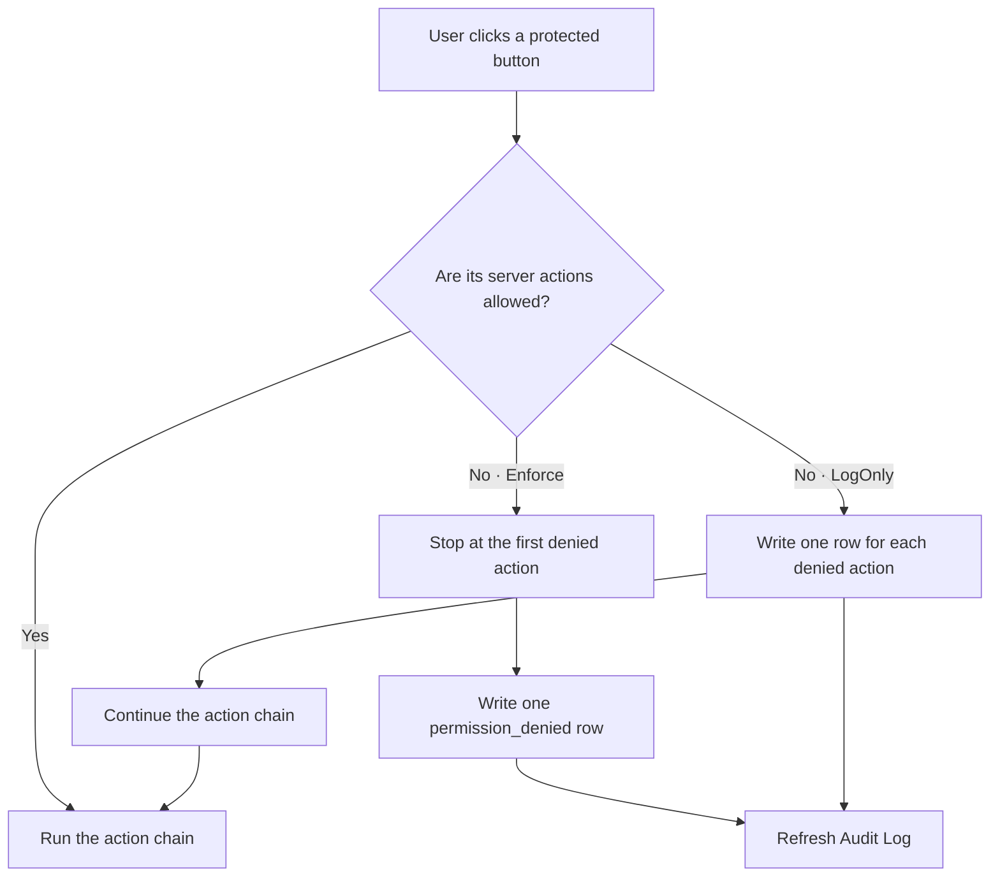

# Audit log

The `Audit Log` screen shows the security events of the company: who changed users, roles, permissions and API keys, and which API calls or web actions failed a permission check.
It is a read-only list.

## How to open it

1. Switch to **Enterprise**. See [Enterprise sidebar](00-administration-overview.md).
2. Open `Configuration > Users & Roles > Audit Log`.

The menu item is `ent_audit_log`. It opens the form `enterprise_audit_log`. The data comes from the view `enterprise.audit_log_view` (table `enterprise.audit_log`).

## Toolbar

| Button | What it does |
|---|---|
| `Refresh` | Reads the list again. |

There is no button to add, change or delete a row. The table is written only by the server.

## Columns

All columns are read only. The filter bar offers the filters named in the last column.

| Label | Column | Type | Visible | Filter | What it shows |
|---|---|---|---|---|---|
| `ID` | `id` | Whole number | No | | The row id. |
| `Time` | `event_time` | Date and time | Yes | Date | When the event was written. |
| `Event` | `event_kind` | Text | Yes | Set | The kind of event. See the next table. |
| `Resource Type` | `resource_type` | Text | Yes | Set | The protected resource: usually `api` or `server_action`. RBAC reseed events also use `api`. Empty for ordinary change events. |
| `Resource` | `resource_code` | Text | No | Text | The API method, server-action handler or administrative capability. |
| `Bit` | `required_bit` | Text | Yes | | The relevant permission bit: `can_execute` for invocations and RBAC reseed, or `no_role` when no role applies to the checked scope. |
| `User` | `username` | Text | Yes | | The login of the actor. Empty for events with no actor. |
| `Role` | `role_code` | Text | Yes | | The role used for a permission check. Empty for `no_role` and events without a role. |
| `Detail` | `detail` | JSON, shown as a summary | Yes | | The details of the event. See below. |
| `Warehouse` | `warehouse_code` | Text | Yes | Set | The warehouse of the event. Empty for enterprise-wide events. |
| `Target` | `target_label` | Text | Yes | Text | The row that was changed: a role code, a login, `login @ warehouse` for an assignment, `ROLE / type:code` for a permission, the key prefix for an API key. Empty (shown as a dash) when the target is unknown or has a composite key. |
| `Resource` | `resource_label` | Text | Yes | Text | A copy of `Resource`. There is no separate catalogue of labels yet. |

The view is defined in `crates/libs/wms-lib-sql/sql/wms-enterprise/migrations/001_baseline.sql:356`.
The `Event` filter reads its values from `list_audit_event_kinds`, so it lists the kinds that exist in your data.

## Event kinds

The database accepts only these kinds (check constraint `audit_log_event_kind_chk`, migration `010_mutation_audits_are_allowed_again.sql`).

| Event | Written when | Written by |
|---|---|---|
| `permission_denied` | An API call or web action fails a permission check. `Enforce` blocks it; `LogOnly` records the failed check but allows it to continue. | The API permission gate or the web action-chain gate |
| `user_mutation` | A user is created, changed or deleted, or a password is changed. | `UserBmc` |
| `role_mutation` | A role is created, changed or deleted. | `RoleBmc` |
| `user_warehouse_mutation` | A warehouse assignment is created, changed or deleted. | `UserWarehouseBmc` |
| `role_permission_mutation` | A permission cell is changed in the [Permission matrix](16-permission-matrix.md). | `batch_upsert_permission_matrix` |
| `api_key_mutation` | An API key is generated or revoked. | `user_api_key_rpc.rs` |
| `admin_rbac_reseed` | An administrator requests a permission-catalogue reseed, or the reseed fails or completes. The `Detail` phase is `requested`, `failed` or `completed`. | `app-server/src/web/admin_rbac.rs` |
| `task_mutation` | A task is changed. | `TaskBmc` |
| `rf_screen_mutation`, `rf_screen_revision_mutation` | An RF screen is published or reverted. | RF screen code |
| `studio_meta_create`, `api_key_created`, `api_key_revoked` | Allowed by the constraint. No code that writes them was found. | |

## What happens when a web action fails a permission check

A toolbar button can start a chain of server actions. The permission gate checks the chain before it runs.

For these rows, `Resource Type` is `server_action`, `Resource` is the denied handler name and `Bit` is `can_execute`. For a role-less non-superuser in an active warehouse, `Bit` is `no_role` and only the first action in the chain is recorded. A role-less superuser is allowed and produces no denial row. `Detail` identifies the `warehouse` or `enterprise` scope.

### What `Detail` holds

For a change event, `detail` has five keys (`crates/libs/wms-lib-auth/src/authorization/audit.rs:143`):

| Key | Meaning |
|---|---|
| `target_table` | The table that changed, for example `role`. |
| `target_pk` | The key of the row. A list for a composite key. |
| `action` | `insert`, `update` or `delete`. |
| `before` | The row before the change, or empty for an insert. |
| `after` | The row after the change, or empty for a delete. |

For a `permission_denied` event, `detail` holds `{"scope": "enterprise"}` or `{"scope": "warehouse"}`.

Secrets are not written. The keys `key_hash`, `password_hash`, `token_salt`, `plaintext_key`, `pwd` and `pwd_salt` are replaced by `[redacted]` (`audit.rs`, constant `REDACT_KEYS`).
For a user, only an allowed list of columns is written, so the password hash never appears (`UserBmc::mutation_audit_columns`, `user.rs:446`).
Whether a password changed is visible through `pwd_changed_at`.
Migration `018_user_mutation_audit_holds_no_credentials.sql` removed password hashes that older versions had written.

The `Detail` column shows the JSON as compact text in small grey type. A text longer than 60 characters is cut to its first 57 characters and `…`; the full text is in the tooltip (renderer `JsonSummaryRenderer`, `crates/services/web-ui-server/src/rendering/cell_renderer.rs`, function `json_summary`). The list loads when `detail` is a JSON object: the server turns an object in a text field into its compact JSON text (`BioValue::decode_from_server`, F-05, commit `49bbbf5f1`). Before the fix the whole list answered HTTP 503 as soon as one row had a JSON `detail`.

## Good to know

- **Most audit writes are best effort.** Permission-denial and ordinary change-event writes cannot change the permission result or undo the change. The exception is the initial `admin_rbac_reseed` `requested` event: if it cannot be written, the server returns an error and the reseed does not start. A later completion-audit failure does not roll back a completed reseed.
- **API and web permission failures are both logged.** Use `Resource Type` to distinguish `api` from `server_action`.
- **There is no clean-up.** No job that deletes old rows of `audit_log` was found.
- **Rows pin their user and role.** The foreign keys `audit_log_user_id_fkey` and `audit_log_role_id_fkey` have no `ON DELETE` rule. A user or a role that appears in the log cannot be deleted (see [Deleting a user](34-deleting-a-user.md)).
- **Checks in `log_only` mode.** Failed permission checks are written here, but the API call or web action continues. A web action chain records every denied action; a role-less non-superuser records only the first action. Role-less superusers bypass this denial path.

## Who can use it

The API methods `list_audit_log`, `get_audit_log`, `count_audit_log` and `list_audit_event_kinds` are open to the default roles `ADMIN`, `MANAGER`, `OPERATOR` and `VIEWER`
(`crates/services/app-server/src/web/rpcs/audit_log_rpc.rs:7`).
In Enterprise only `ADMIN` reaches the screen.

## Related pages

- [Permission matrix](16-permission-matrix.md)
- [Who can do what](91-who-can-do-what.md)
- API: `list_audit_log`, `get_audit_log`, `count_audit_log`, `list_audit_event_kinds`. RF terminal: none.
