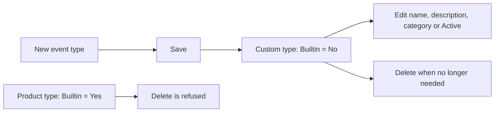

# Adding an event type

Use this page to add an entry to the event registry, to switch an event on or off, or to remove an entry.

Read first what the registry really does: only the `Active` switch has an effect, and only for the record-change events `bio.{table}.{operation}`. See [Event registry](20-event-registry.md).

## Before you start

- You hold the role `ADMIN` and can open Enterprise.
- You know the exact `Code`. A code you invent does not make the system write an event: the events are written by the program. The registry only lists them and, for `bio.*` codes, allows or stops them.
- For a record-change event, the code is `bio.{table}.{operation}`, for example `bio.receipt.after_insert`. The table name and the operation (`after_insert`, `after_update`, `after_delete`) must match what the system builds.

## Steps: switch a record-change event on

1. Switch to **Enterprise**.
2. Open `Integrations > Event Registry`.
3. Type the code in the filter of the column `Code`, for example `bio.receipt`.
4. Click the row of the event you want, for example `bio.receipt.after_insert`.
5. Tick `Active`.
6. Click `Save`. You go back to the list.

From then on, each time a receipt is created the system writes the event, and the [Event monitor](21-event-monitor.md) lists it.

## Steps: add a new entry

1. Open `Integrations > Event Registry` and click `New`.
2. Fill `Code`, `Name` and `Category`. `Description` is optional.
3. Keep `Active` ticked, unless you want the entry off.
4. Click `Save`.

The saved entry is custom: `Builtin` shows `No`. A value created on this screen cannot become a protected built-in event type.

## Steps: delete entries

1. In the list, tick only custom entries where `Builtin` is `No`.
2. Click `Delete`. The message is `{n} Event Registry record(s) deleted`.

The entries are deleted one by one. If a mixed selection reaches a built-in entry, deletion stops with `built-in event type '{code}' cannot be deleted`; custom entries processed earlier stay deleted. Select custom entries separately so the result is predictable.

If you delete a custom `bio.*` entry, that event is no longer written.

## What changes

| What | Change |
|---|---|
| Event registry | A custom row is added, changed or deleted. Built-in rows cannot be deleted. |
| Event writing | For a `bio.*` code, switching `Active` on or off starts or stops the writing of that event. Other codes: nothing changes. |
| Bindings | Deleting an entry deletes the rows of `enterprise.event_binding` that point to it. |

The registry is not audited: `EventRegistryBmc` has no audit event.

## What can go wrong

| Problem | Meaning | Fix |
|---|---|---|
| `Duplicate entry on event_registry (constraint ...)` | The code exists. | Open the existing entry. |
| `built-in event type '{code}' cannot be deleted` | The selected type came with the product. | Leave it in the registry. Clear **Active** only when the event semantics allow it. |
| No event appears after you ticked `Active` | The code does not match what the system builds, or nothing has been saved in that table since. | Check the code against the list of `bio.*` rows, and save a record of that table. |
| Switching a `process.*` entry off does not stop its events | The business code does not look at the registry. | None. This is how it works. |

## Related pages

- [Event registry](20-event-registry.md)
- [Event monitor](21-event-monitor.md)
- [Subscribers](22-subscribers.md)
- API: `create_event_registry`, `update_event_registry`, `delete_event_registry`. RF terminal: none.
