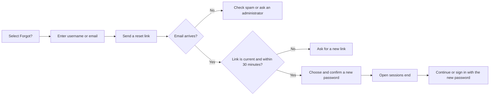

# Sign-in, Passwords and Sessions

Use this page to understand sign-in, password rules, session expiry and supervisor authorization.

## Sign in on the web

1. Open the WMS address supplied by your administrator.
2. Enter **Login** and **Password**.
3. Click **Sign in**.
4. If you have access to more than one warehouse, choose the warehouse you want to work in.

If you have forgotten the password, select **Forgot?** beside the password field. The recovery page accepts either the user name or the account email.

The first warehouse opened for a user is the one marked **Default** on [Warehouses & Roles](12-user-warehouses-and-roles-tab.md). When none is marked, the first available warehouse opens.

All failed sign-ins show **Invalid username or password**. The message deliberately does not say whether the login, password, account status or handheld access caused the refusal.

Repeated failed attempts cause a temporary delay. Wait before trying again, check the exact login, and ask an administrator to review the account when the problem continues.

## Password rules

| Rule | What to do |
|---|---|
| Minimum length | Use at least 8 characters. |
| Storage | Passwords are stored as one-way salted hashes. An administrator cannot read the current password. |
| New password on a user card | Leaving the field empty keeps the existing password. Entering a value replaces it. |
| Company policy | Use a unique password and follow your organisation's length, complexity and rotation rules. |
| Safe delivery | Send a new password through an approved secure channel, not in a shared ticket or screenshot. |

Changing a password ends the user's existing authenticated sessions. The user signs in again with the new password.

See [Resetting a password](31-resetting-a-password.md) for the administrator steps.

## Reset a forgotten password

Password recovery is available when the installation is connected to the email service and the account is active, already has a password and has a valid email address. An email lookup must identify exactly one account; when several accounts share an address, enter the exact user name instead.

1. On the sign-in page, select **Forgot?**.
2. Enter **Username or email**.
3. Select **Send a reset link**.
4. Open the email and follow the link within 30 minutes.
5. Enter **New password** and **Confirm password**, then select **Set the new password**.

The confirmation is deliberately the same whether or not the account exists. This prevents the recovery page from revealing user names or email addresses.

A reset link works once. When the system issues a new link for the same account, the previous link becomes unusable. After the password changes, every open session for that account ends. The page signs you in with the new password when it can; otherwise select **Sign in** and enter it there.

If the page says that the installation does not send password-reset emails, follow its instruction to contact your administrator. If it shows **Too many attempts. Try again in a few minutes.**, wait before trying again. Do not forward a reset email: the link grants access to the account until it is used or expires.

## Account status and handheld access

An **Active** or **Invited** account can sign in when its credentials are valid. A **Locked** or **Disabled** account is refused and its existing session stops working.

For the RF terminal, the user also needs **RF device login** turned on. The terminal uses the same login and password as the web application.

## Sessions

A session expires after the configured period of inactivity. When this happens, the next page action shows **Session expired. Please login again.** Sign in and reopen the task.

These actions end access before the idle period finishes:

- the user signs out;
- an administrator changes the password;
- the account becomes **Locked** or **Disabled**;
- the account is deleted.

Changing a role, permission or warehouse assignment takes effect without waiting for a new sign-in. Refresh the page if an open screen still shows the previous button state.

Production WMS addresses use HTTPS. Do not enter credentials on an address that your organisation has not approved.

## API keys

An integration can authenticate with an API key instead of an interactive session. The key is tied to its user, warehouse roles and **API access** switch. Locking or disabling the user also stops its keys.

See [API Keys](13-user-api-keys-tab.md) for generation and revocation.

## Supervisor authorization

Some RF actions open **Supervisor Authorization** and ask for **Supervisor username** and **Supervisor password**.

- The supervisor uses their own credentials.
- The action is allowed only when the supervisor has the required role and capability.
- A refusal uses one generic message: **those supervisor credentials were not accepted**.
- An approval is single-use. It authorizes the action in front of the operator, not later actions.

Never share a supervisor password with an operator. The supervisor should type it personally and confirm the action being approved.

## If sign-in still fails

| Check | What to do |
|---|---|
| Login or password | Retype both. Passwords are case-sensitive. |
| Password length | Use a password of at least 8 characters. |
| Account status | Ask an administrator to check that the user is **Active** or **Invited**. |
| Warehouse access | Ask an administrator to assign a warehouse and role. |
| RF terminal only | Ask an administrator to turn on **RF device login**. |
| Repeated attempts | Wait for the temporary delay to clear before retrying. |
| No recovery email | Check spam. Confirm that you used the expected user name or email. If several accounts share that email address, use the exact user name. Ask an administrator if the message still does not arrive; the page does not reveal whether the account is eligible. |
| Reset link expired or already used | Select **Ask for a new link**. Only the newest link works. |

## Related pages

- [User card: General tab](11-user-general-tab.md)
- [Resetting a password](31-resetting-a-password.md)
- [Locking or disabling an account](32-locking-or-disabling-an-account.md)
- [Warehouses & Roles](12-user-warehouses-and-roles-tab.md)
- [Messages catalogue](94-messages-catalogue.md)
