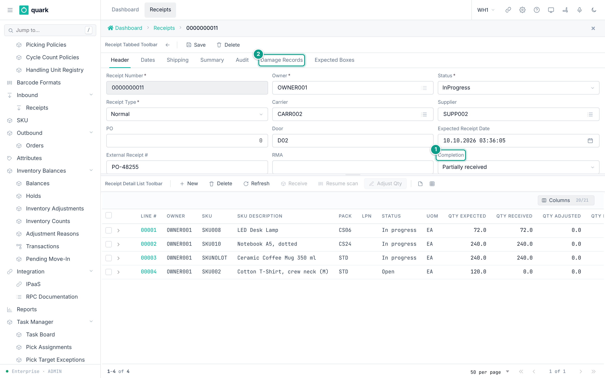

# Header tab

The `Header` tab is the first tab of the [receipt screen](01-receipt-screen-overview.md).
It holds the identity of the receipt and the main reference data.
The form is `receipt_header_form`. The data table is `receipt`.

*Caption: the Header tab. Focus: Receipt Number is grey (read only after the first save). Status and Completion are read only too.*

## Fields

The fields are laid out in three columns.

| Label | Column | Type | Required | Allowed values and default | What it does |
|---|---|---|---|---|---|
| `Receipt Number` | `receipt_number` | Text, up to 10 characters. Unique in the warehouse. | Yes | Any text up to 10 characters. A new receipt gets the next number of the counter `receipt_number`, 10 digits, for example `0000000012`. | The key of the document. Read only after the first save. |
| `Owner` | `owner_id` | Pick list of owners | Yes | An owner of type **Own**. A new receipt gets the default owner of the warehouse when one is set. | The owner of the goods. Read only after the first save. |
| `Status` | `status` | Drop-down | Yes | `Open`, `InProgress`, `OnHold`, `Closed`, `Cancelled`. A new receipt is `Open`. Always read only. | Where the receipt is in its life. |
| `Receipt Type` | `receipt_type` | Drop-down | Yes | `Normal` (default), `CustomerReturn`, `InterFacilityTransfer`, `Sscc`, `CaseLevel`. | The kind of receipt. |
| `Carrier` | `carrier_id` | Pick list of owners | No | An owner of type **Carrier**. | The company that delivers. |
| `Supplier` | `supplier_id` | Pick list of owners | No | An owner of type **Supplier**. | The company that sends the goods. |
| `PO` | `po_id` | Whole number | No | Any whole number. Empty by default. | A purchase order id. |
| `Door` | `door` | Text, up to 10 characters | No | Any text. | The dock door. |
| `Expected Receipt Date` | `expected_receipt_date` | Date and time | No | Empty by default. | The planned arrival. |
| `External Receipt #` | `external_receipt_number` | Text, up to 50 characters | No | Empty by default. | The number of the document in the other system (ERP). |
| `RMA` | `rma` | Text, up to 30 characters | No | Empty by default. | The return authorisation number. |
| `Completion` | `completion` | Drop-down | No | `Nothing received`, `Partially received`, `Fully received`, `Over receipt`. Always read only. A new receipt is `Nothing received` (`Pending`). | How much of the plan has arrived. The system sets it. |

The labels of `Completion` come from the code list `receipt_completion`.
The labels of `Status` and `Receipt Type` are the names of the database values.

## What each field affects

### Receipt Number

- Read only after the first save: `crates/services/web-ui-server/src/extensions/customization/receipt/header_render_action.rs:42`.
- Used to find the receipt. The ASN search of the RF terminal matches it.
- The number is made by the counter service `get_next_key`, 10 digits by default.
  A number you type yourself must not be longer than 10 characters.

### Owner

- Only an owner of type **Own** is accepted when a receipt is created. The pick list shows only such owners (form `owner_own_list_form`).
- The owner decides which SKUs the lines can use, and which owner settings and receipt policy are applied when goods are received.
- Every new line takes the owner of the receipt.

### Status and Completion

- Both are read only on the screen.
- They change only through the commands: receiving, hold, release, close, cancel. See [Receipt statuses and transitions](90-receipt-statuses-and-transitions.md).
- `Completion` decides if `Cancel Receipt` is available (only `Pending`) and whether closing needs a supervisor.

### Receipt Type

- A new receipt can have any type.
- After the first save the field is read only, with one exception: in status `Open` a receipt of type `Sscc` or `CaseLevel` can change its type. A receipt of type `InterFacilityTransfer` is never editable.
- Types `Sscc` and `CaseLevel` make the quantity, `To Loc` and `Hold Code` of the lines read only.
- Type `CustomerReturn` is required by the RF return flow. The web screens have no return flow.
- For the other types the value is a label.

### Carrier

Stored only. It has no effect today.
The value is shown in the list through a display lookup and nothing else reads it.
The receipt is refused when the id is not an owner of type Carrier.

### Supplier

- The pick list offers owners of type Supplier. A wrong type is refused.
- Read by the daily serial vendor-surge scan, which compares serials per supplier and SKU. It only logs a warning.
- Sent in the receipt events.

### PO

- No check is made that the number exists. The check in `ReceiptBmc::create` is a placeholder.
- Sent in the receipt events.
- A receipt with no `PO` and no `External Receipt #` counts as a *blind* receipt in the list method `list_open_blind_receipts`.

### Door

Stored only. It has no effect today.

### Expected Receipt Date

- Sorts the ASN search and the list of open receipts, newest first.
- Shown on the RF receipt summary.

### External Receipt #

- The ASN search finds receipts by this number too.
- Sent in the receipt events.

### RMA

- The method `find_receipt_by_rma` searches this column.

## Messages

| When | Message | What to do |
|---|---|---|
| `Receipt Number` is empty on `Save` | `Receipt number is required` | Type a number. |
| `Owner` is empty on `Save` | `Owner id is required` | Pick an owner. |
| The number already exists | `Duplicate entry on receipt (constraint ...)` | Use another number. The constraint is `receipt_receipt_number_key`. |
| The owner, carrier or supplier is of the wrong type | `owners {id} not found` | Pick an owner of the right type. |
| A text is longer than the limit | The database refuses it. | Shorten the text. |

The first two messages are made by the `Save` button.
The others come from the server.

## Saving

- `Save` on a new receipt calls `create_receipt`.
- `Save` on a saved receipt calls `update_receipt` with the fields you changed. It has no version check.
- `update_receipt` is refused when the receipt is `Closed` or `Cancelled`. The message is `receipt {id} is {status} - cannot edit receipt reference in its current lifecycle state`. A hold does not stop it.
- The call does not accept the fields `owner_id`, `receipt_number`, `status`, `completion`, `close_date`, `effective_date` and the two summaries.

## Related pages

- [Creating a receipt](30-creating-a-receipt.md)
- [Editing a receipt](31-editing-a-receipt.md)
- [Dates tab](11-dates-tab.md), [Shipping tab](12-shipping-tab.md), [Summary tab](13-summary-tab.md)
- [Receipt statuses and transitions](90-receipt-statuses-and-transitions.md)
- API: `create_receipt`, `update_receipt`, `get_receipt`
- RF terminal: `Receive Against ASN`, screen `RCASN01` (enter the ASN number).
