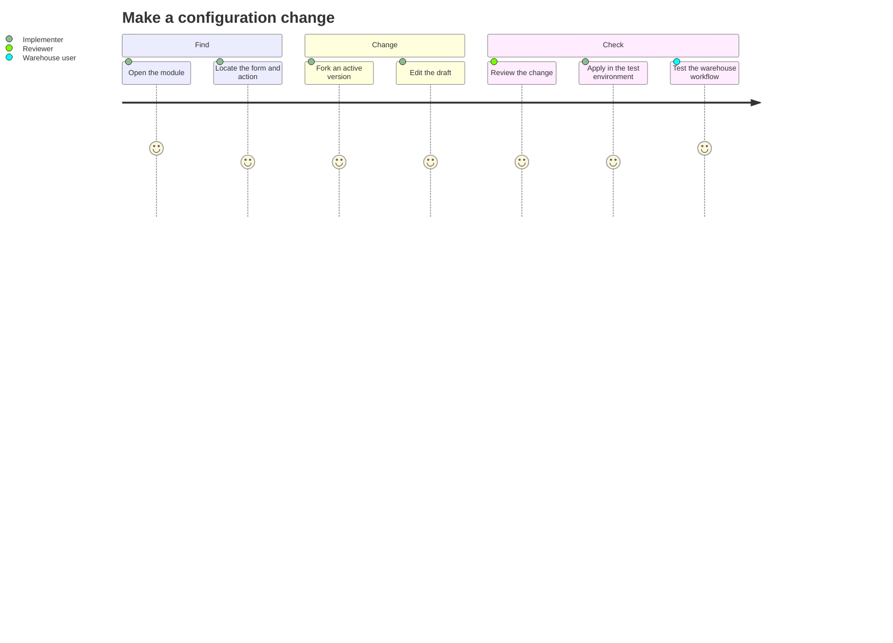

# Metadata Studio

Quark Metadata Studio lets implementation teams inspect and configure the screens and metadata used by Quark WMS. Start with the module and workflow you want to change, make a draft, and check the result in the warehouse interface.

## Choose a task

| Task | Guide |
| --- | --- |
| Find forms and their connections | [Graph Explorer](01-graph-explorer.md) |
| Change a module safely | [Module lifecycle](02-module-lifecycle.md) |
| Configure a detail form, list, tabs or shell | [Form designers](03-form-designers.md) |
| Connect an action to another screen | [Interactions and navigation](04-interactions-and-navigation.md) |
| Work with data entities and extensions | [BIOs and extensions](05-bios-and-extensions.md) |
| Generate a starting set of forms | [Entity Wizard](06-entity-wizard.md) |
| Translate labels | [Localization](07-localization.md) |
| Inspect what is registered and in use | [Architecture Catalog](08-architecture-catalog.md) |
| Inspect API implementation and overrides | [Runtime API Map](09-runtime-api-map.md) |
| Export configuration and investigate errors | [Export, import and troubleshooting](10-export-import-and-troubleshooting.md) |

## The three views

**Graph Explorer** is the configuration workspace. **Architecture Catalog** is a read-only inventory of forms, BIOs and runtime registries. **Runtime API Map** shows API implementations, active overrides and compatibility information.

Report and label designers belong to the reporting application. They are not tabs in the current Metadata Studio.

## Before changing configuration

Use the intended environment and warehouse context. Make sure you can identify the active module, the draft you will edit and the operational scenario you will test. Applying a draft changes the active configuration; saving a field in Studio is not the same as completing an operational test.

