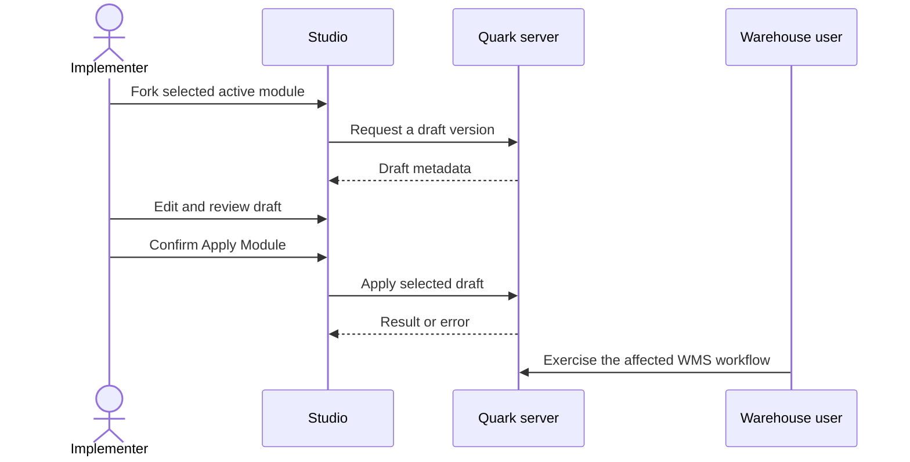

# Module lifecycle

Use a draft to prepare a new version without editing the active version directly.

## Fork an active module

1. Open the module selector and check the active module code and version.
2. Open the module status menu and choose **Fork → New Draft**.
3. Select the new draft and check that Studio shows **Draft** before editing.

To enter a version explicitly, open the module settings in the selector and use **Fork New Version**. Enter the version yourself; do not rely on a suggested number.

## Prepare and review the draft

Keep the change small enough to test. For a new SKU field, for example, check the data field, its form placement, label and any navigation or behaviour that uses it. Do not treat the graph preview alone as proof that the warehouse workflow works.

## Apply a draft

The current Graph Explorer provides **Apply & Publish** for the selected draft. Its confirmation is titled **Apply Module**.

1. Confirm the selected module and Draft version.
2. Review the change with the people responsible for the affected workflow.
3. Choose **Apply & Publish**, check the module name in **Apply Module**, then choose **Apply** in the intended environment.
4. Wait for the request to finish. If it fails, read the error before retrying.
5. Reopen the affected WMS screen and test the complete operation, including the return path and saved result.

## Discarding work

Discard is separate from applying. Before removing a draft, confirm that it is the intended version and that nobody needs its changes. A discarded draft should not be confused with a rollback of an already applied version. Agree recovery steps before changing a live environment.
