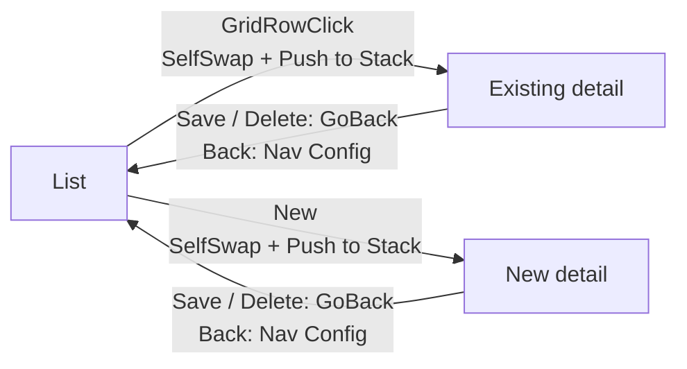
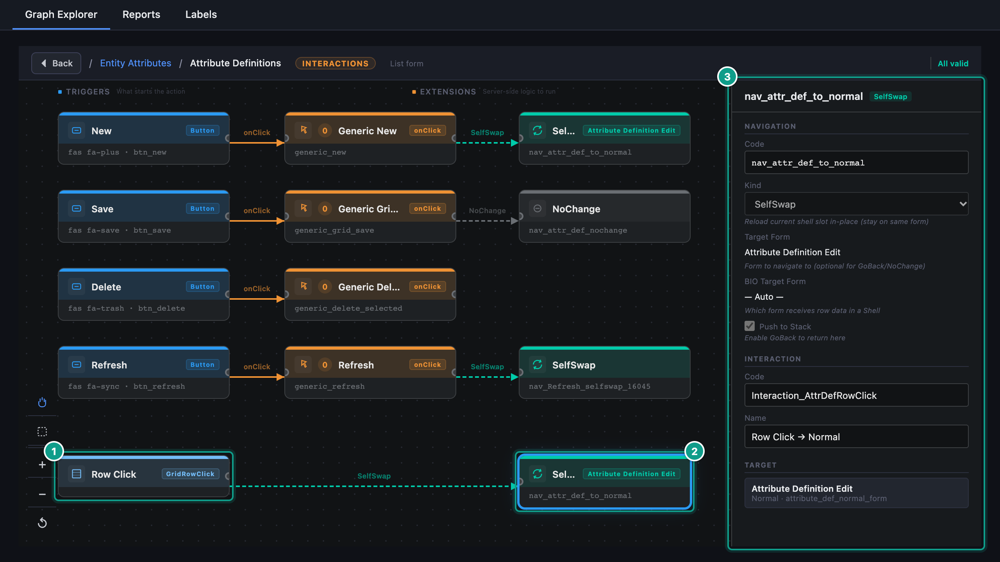

# Interactions and navigation

An interaction connects a user action to behaviour and, where needed, to navigation. A toolbar button, row click and field change are different triggers; check which one you are editing.

## Inspect before changing

Select the source form and open its navigation or interaction details. Identify the trigger, any linked extension or handler, the navigation kind and the destination. A target form alone does not describe the complete action.

## Common navigation intentions

| Intention | What to check |
| --- | --- |
| Replace the current screen | The destination and current record context |
| Return to the previous screen | The return path and any save action before it |
| Open a form in a shell slot | The parent shell, target slot and child form |
| Open a form in a tab | The intended tab and the record passed to it |
| Stay on the current screen | The action result and whether the displayed data refreshes |

The available navigation kinds and fields are shown by the editor. Do not copy a navigation code from another module without checking its destination and parameters.

## Connect mode

Use Connect mode in an editable draft to create a supported connection between nodes. Read the connection menu and confirm what kind of link you are adding. Afterwards, select the new connection and inspect its details in the sidebar.

## Build a list-to-detail journey

For a new entity, prefer the Entity Wizard template `List → Detail`. It creates the list, detail, toolbars and the complete return pattern. Use the Interaction Builder when you need to inspect or repair the chain.

1. Work in a draft module. In Graph Explorer, select the `Forms` layer and click the list form.
2. In the form sidebar, click `Open Interaction Builder`.
3. Check the row-click chain and the list toolbar chains against the table below.
4. Select a navigation node to open its inspector. Confirm `Kind`, `Target Form`, `BIO Target Form` when shown, and `Push to Stack`, then click `Save`.
5. Open the detail form's Interaction Builder and check its `Save` and `Delete` chains.
6. In the detail form sidebar, open `Nav Config` and confirm that `Go Back` is `Yes`; edit `Show Go Back` if needed. If `Nav Config` is absent, click `Enable Go Back Button`. This built-in Back button is not an Interaction Builder chain.

| Trigger | Navigation | Target | Push to Stack | Why |
| --- | --- | --- | --- | --- |
| `GridRowClick` on the list | `SelfSwap` | Detail form | on | Pushes the current list onto the stack so `GoBack` on the detail form returns to it. This is how seeded list-to-detail journeys and the Entity Wizard are configured. |
| `New` on the list | `SelfSwap` | Detail form | on | A toolbar click does not record the list automatically. The stack entry gives `GoBack` somewhere to return. |
| `Refresh` on the list | `SelfSwap` | none | off | Reloads the current form in place. |
| `Save` on the detail | `GoBack` | none | off | Save the record, then return to the list. The button also needs its save extension, plus validation when the form has required fields. |
| `Delete` on the detail | `GoBack` | none | off | Delete the record, then return to the list. The button also needs its delete extension. |
| Built-in `Back` on the detail | `GoBack` via `Nav Config` | none | off | Return without adding another navigation entry. Enable it in the form sidebar, not in the Interaction Builder. |

*Interaction Builder inspection. Focus: `GridRowClick → SelfSwap`, the Target Form and enabled Push to Stack.*

Use `TargetForm` only when the destination must be rendered into a Shell slot; it requires `Target Slot Name`. For a `SelfSwap` that opens a Shell or Tabbed container, set `BIO Target Form` to the leaf Normal form that must receive the selected row. A simple list-to-Normal-detail journey does not need that extra target.

`GoBack` follows the current layout context. From a top-level detail it returns to the previous list. From a non-first Shell slot it restores that slot's default list, or collapses the slot when it has no default form; it does not exit the whole Shell.

## Test a list-to-detail journey

1. Open the list with representative records.
2. Open one record using the intended row or toolbar action.
3. Confirm that the detail form shows that record.
4. Save a small test change.
5. Return to the list and check the displayed result.
6. Click `New`, then use `Back` without saving. Confirm that you return to the list once, not to another empty detail.
7. Open an existing row again after the New/Back test. Confirm that the selected record replaces the empty form state.
8. For a Shell layout, repeat from every slot that has a detail view and confirm that Back restores or collapses only that slot.
9. Repeat with an empty list or an unavailable record where your workflow permits it.

A field-change interaction can run while the user is still editing. Check its trigger and dependencies so that it does not overwrite another field unexpectedly.
